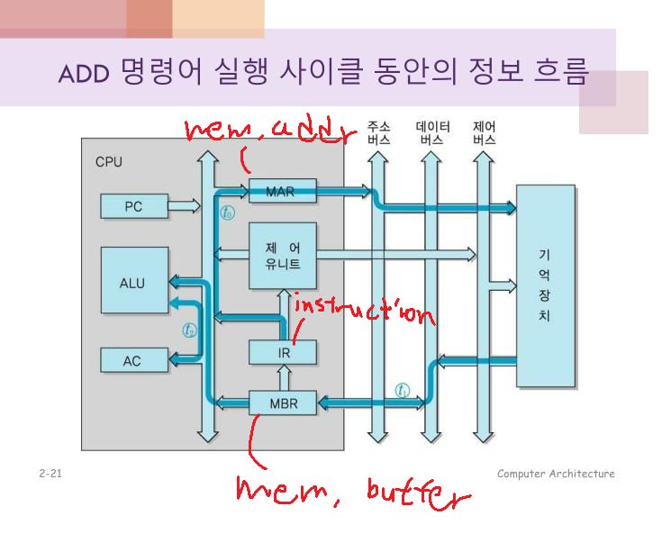
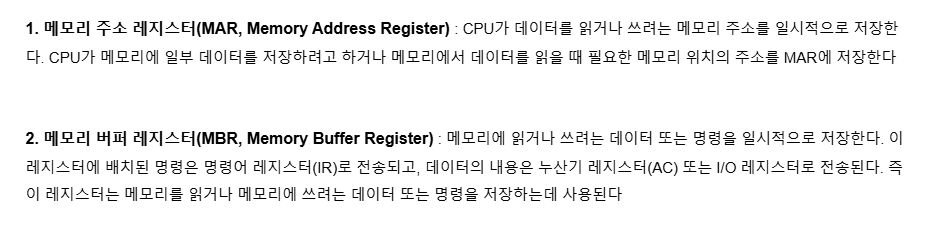
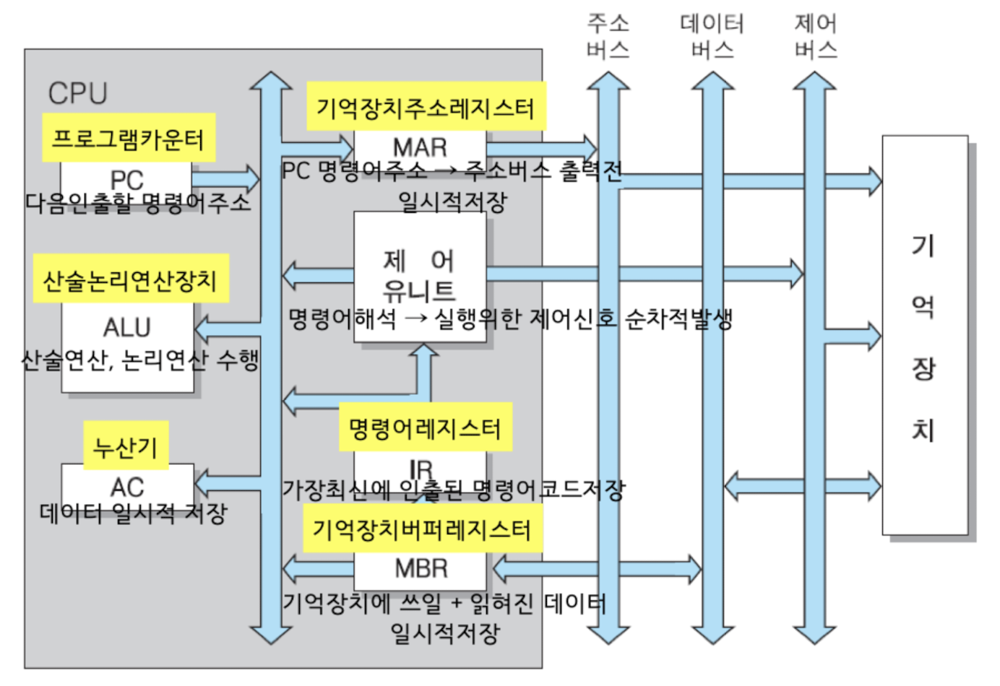
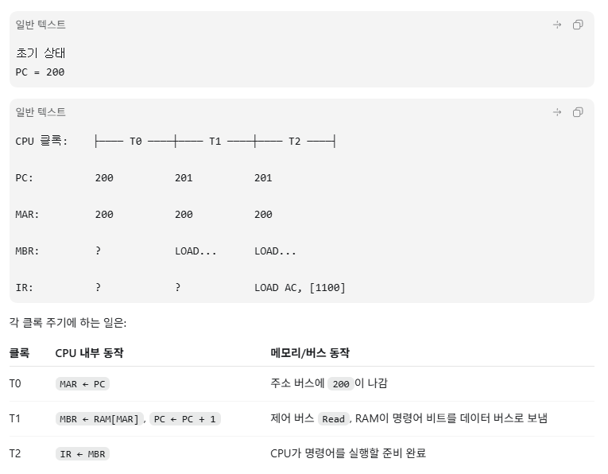
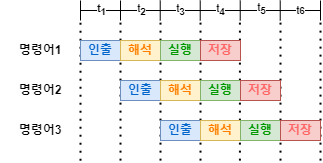
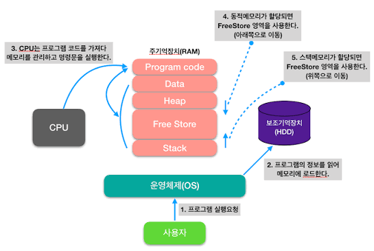
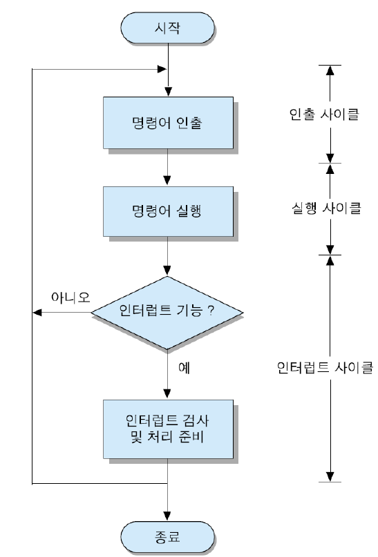
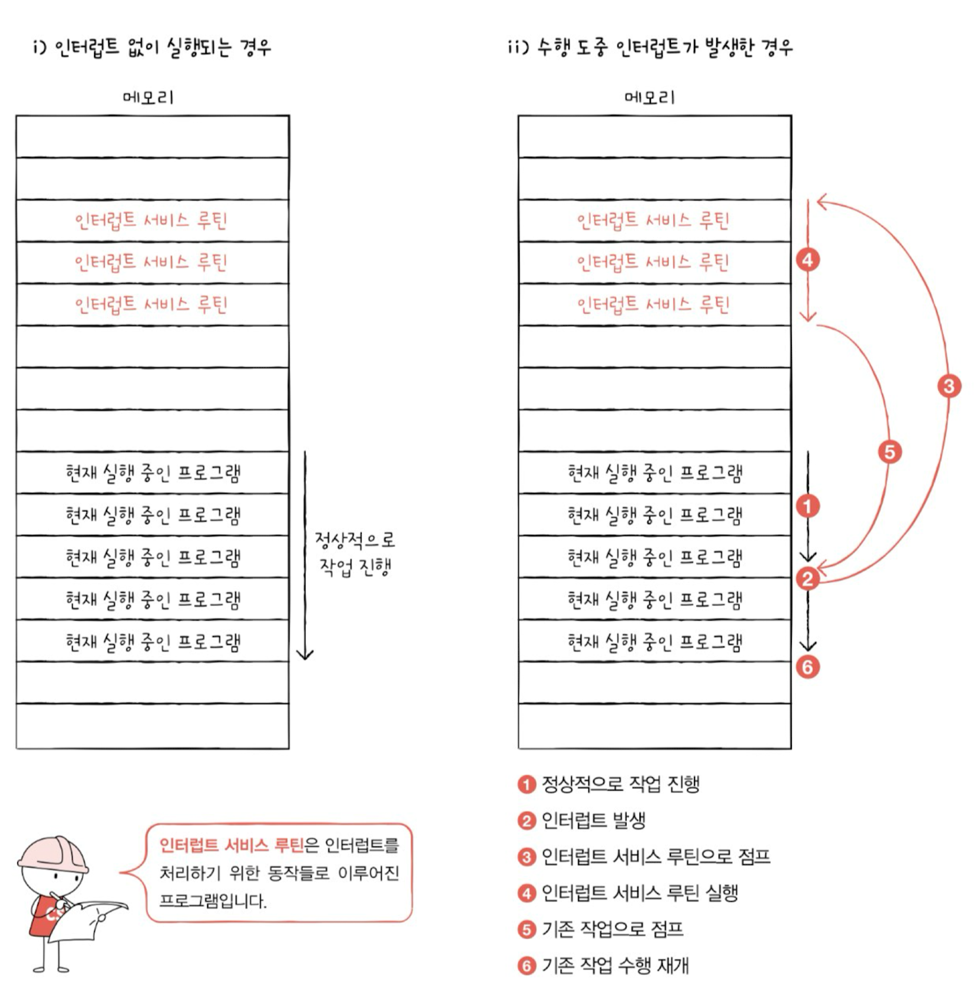
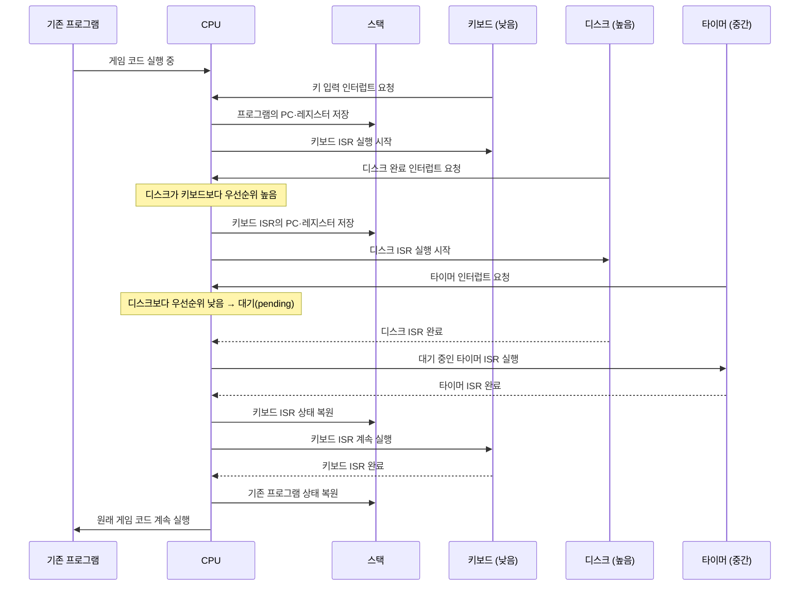
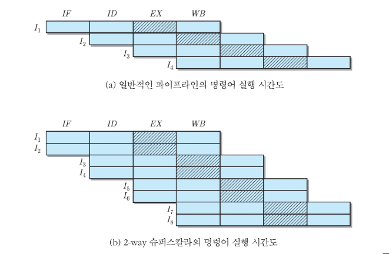

---

CPU는 기억장치에 저장되어 있는 프로그램 코드인 명령어들을 실행함으로써 프로그램 수행을 한다. 프로그램이 수행되는 과정은 다음과 같다.

1. 명령어 인출(fetch): 기억장치로부터 <b>명령어를 읽어온다</b>.
2. 명령어 해독(decode): 수행해야 할 동작을 결정하기 위하여 <b>명령어를 해독</b>한다.

---

1. 데이터 인출(fetch): 명령어 실행을 위하여 데이터가 필요한 경우에는 기억장치 혹은 I/O 장치로부터 그 <b>데이터를 읽어온다</b>.
2. 데이터 처리(process): 데이터에 대한 산술적, 논리전 <b>연산을 수행</b>한다.
3. 데이터 저장(store): 수행한 결과를 <b>저장</b>한다.

1<s>2 는 모든 명령어들에 대하여 공통적으로 수행되며 3</s>5 는 명령어에 따라 필요한 경우에만 수행된다. CPU의 내부 구성요소를 살펴본 다음, 명령어 실행 과정의 분석을 통해 CPU의 동작원리를 설명한다. 그리고 파이프라이닝의 원리와 명령어 형식에 대해 분석한다.

#### <b>2.1 CPU의 기본 구조 \_ 53 page.</b>



- 산술논리연산장치(ALU): 각종 산술/논리 연산을 수행하는 하드웨어 모듈.
- 레지스터: CPU 내부의 기억장치. 액세스 속도가 컴퓨터의 기억장치중 가장 빠르지만 용량은 구조상 작을수 밖에 없다.
- 제어 유닛: 명령어를 해석하고, 그것을 실행하기 위한 제어 신호들을 순차적으로 발생시키는 하드웨어 모듈. 명령어 실행에 필요한 각종 정보들의 전송통로와 방향을 지정하며 동작 시간을 결정해준다.
  - <b>시스템 내 모든 장치들의 동작을 지시하고 제어하는 장치, 명령 레지스터에서 읽어들인 명령어를 해독하여 해당하는 장치에게 제어신호를 전송</b>




참고: RISC(Reduced Instruction Set Computer) - 명령어의 수를 최소화하고 명령어 형식을 단순화한 설계 개념.

#### <b>2.2 명령어 실행 \_ 55 \~ 71 page.</b>

CPU는 기억장치에 저장되어 있는 명령어들을 인출하여 실행함으로써 실제적인 작업을 수행하게 된다.

- 명령어 사이클: 명령어를 실행하는데 필요한 전체 과정. 두 단계로 나누어져 있다.
  - 명령어 인출 단계: CPU가 기억장치로부터 명령어를 읽어오는 단계
  - 명령어 실행 단계: 인출된 명령어를 실행하는 단계

<b>명령어 사이클은 CPU가 프로그램을 실행한 순간부터 전원을 끄거나 회복 불가능한 오류가 발생되어 중단될 때까지 반복하여 수행된다.</b>

기본적으로 필요한 CPU 내부 레지스터들을 살펴보면 다음과 같다.

- 프로그램 카운터(PC): 다음에 인출될 명령어의 주소를 가지고 있는 레지스터. 각 명령어가 인출된 후에는 그 내용이 자동적으로 1(혹은 명령어 길이에 해당하는 주소 단위의 수)가 증가되며, 분기(branch) 명령어가 실행되는 경우에는 그 목적지 주소로 갱신된다.
- 누산기(AC): 데이터를 일시적으로 저장하는 레지스터. 이 레지스터는 Word 길이와 같다.
- 명령어 레지스터(IR): 가장 최근에 인출된 명령어가 저장되어 있는 레지스터.
- 기억장치 주소 레지스터(MAR): PC에 저장된 명령어 주소가 시스템 주소 버스로 출력되기 전에 일시적으로 저장되는 주소 레지스터. 즉, 주소 버스와 직접 접속됨.
- 기억장치 버퍼 레지스터(MBR): 기억장치에 저장될 데이터 혹은 기억장치로부터 읽혀진 데이터가 일시적으로 저장되는 버퍼 레지스터. 데이터 버스와 직접 접속됨.

<details>
<summary>명령어 흐름 예시</summary>

```c++
int a = 5;
int b = 10;
int c = a + b;
```

<p> </p>

실제 컴파일러는 더 짧게 만들 수 있지만, 여기서는 흐름을 보기 위한 가정입니다.

```txt
int a = 5;
int b = 10;
int c = a + b;
```

이를 다음처럼 둡니다.

```txt
주소 200: LOAD  AC, [1100]  ; 상수 5를 AC로
주소 201: STORE [1000], AC ; AC(5)를 a에 저장

주소 202: LOAD  AC, [1101]  ; 상수 10을 AC로
주소 203: STORE [1001], AC  ; AC(10)을 b에 저장

주소 204: LOAD  AC, [1000] ; a를 AC로
주소 205: ADD   AC, [1001] ; AC + b → AC
주소 206: STORE [1002], AC ; AC를 c에 저장
```

초기 RAM 상태입니다.

```txt
코드 영역
200: LOAD AC, [1100]
201: STORE [1000], AC
202: LOAD AC, [1101]
203: STORE [1001], AC
204: LOAD AC, [1000]
205: ADD AC, [1001]
206: STORE [1002], AC

데이터 영역
1100: 5       ; 상수
1101: 10      ; 상수
1000: ?       ; a
1001: ?       ; b
1002: ?       ; c

PC = 200
```

## <code>int a = 5</code>

### 1) <code>LOAD AC, [1100]</code> 명령어 인출

```txt
PC(200) → MAR
주소 버스: 200
제어 버스: Read
```

RAM이 200번지의 명령어를 보냅니다.

```txt
데이터 버스: LOAD AC, [1100]
MBR → IR
PC: 200 → 201
```

제어 유닛은 IR을 해석합니다. “1100번지의 값을 AC로 가져와라.”

```txt
MAR: 1100
주소 버스: 1100
제어 버스: Read
RAM[1100] = 5 → 데이터 버스 → MBR → AC
```

이제:

```txt
AC = 5
```

### 2) <code>STORE [1000], AC</code> 명령어 인출 후 실행

PC가 201이므로, 동일한 인출 과정으로 RAM\[201\]의 명령어가 IR에 들어갑니다.

```txt
IR = STORE [1000], AC
PC = 202
```

제어 유닛이 실행합니다.

```txt
MAR = 1000       ; a의 주소
MBR = AC = 5     ; 저장할 값

주소 버스: 1000
데이터 버스: 5
제어 버스: Write
```

RAM이 실제로 저장합니다.

```txt
RAM[1000] = 5    ; a = 5 완료
```

## <code>int b = 10</code>

같은 흐름입니다.

```txt
PC = 202
```

<code>LOAD AC, [1101]</code> 실행:

```txt
RAM[1101]의 10 → MBR → AC
AC = 10
```

<code>STORE [1001], AC</code> 실행:

```txt
MAR = 1001
MBR = 10
주소 버스: 1001
데이터 버스: 10
제어 버스: Write

RAM[1001] = 10   ; b = 10 완료
```

여기까지 RAM은 이렇게 됩니다.

```txt
1000 (a): 5
1001 (b): 10
1002 (c): ?
```

## <code>int c = a + b</code>

<code>LOAD AC, [1000]</code> 실행:

```txt
RAM[a] = 5 → MBR → AC
AC = 5
```

<code>ADD AC, [1001]</code> 실행:

```txt
RAM[b] = 10 → MBR

AC(5) ─┐
       ├─ ALU: 5 + 10 = 15 → AC
MBR(10)┘

AC = 15
```

<code>STORE [1002], AC</code> 실행:

```txt
MAR = 1002
MBR = AC = 15

주소 버스: 1002
데이터 버스: 15
제어 버스: Write

RAM[1002] = 15   ; c = 15 완료
```

최종 상태:

```txt
a = 5
b = 10
c = 15
AC = 15
PC = 207
```

<code>PC</code>는 매 명령어를 가져올 때 <code>200 → 201 → 202 ...</code> 식으로 다음 코드 주소를 가리키고, <code>MAR</code>은 그때그때 읽거나 쓸 RAM 주소를 가리킵니다.

</details>

<details>
<summary>더 간단한 흐름</summary>

<code>int a = 5;</code> 

<code>200: LOAD AC, [1100]</code> <br /><code>201: STORE [1000], AC</code>

1. PC의 값 200을 MAR에 복사<br />MAR = 200
2. MAR의 200을 주소 버스에 실음<br />주소 버스 = 200
3. 제어 유닛이 Read 신호를 보냄<br />제어 버스 = Read
4. RAM이 200번지의 명령어 비트들을 데이터 버스에 실음<br />데이터 버스 = <code>LOAD AC, [1100]</code>을 표현하는 비트들
5. CPU가 그 비트들을 MBR에 받아 둠<br />MBR = <code>LOAD AC, [1100]</code>
6. MBR의 내용을 IR에 복사함<br />IR = <code>LOAD AC, [1100]</code> (MBR은 1100번째의 데이터를 받아와야 하기 때문)
7. PC를 다음 명령어 주소로 변경<br />PC = 201
8. 제어 유닛이 IR을 해석<br />   opcode  = LOAD<br />   operand = 1100<br />   뜻: “RAM 1100번지의 값을 읽어 AC에 넣어라.”
9. 명령어의 operand 주소 1100을 MAR에 복사<br />   MAR = 1100
10. MAR의 1100을 주소 버스에 실음<br />    주소 버스 = 1100
11. 제어 유닛이 메모리 읽기 신호를 보냄<br />    제어 버스 = Read
12. RAM이 1100번지에 있는 데이터를 데이터 버스에 실음<br />    RAM\[1100\] = 5<br />    데이터 버스 = 5
13. CPU가 데이터 버스의 값을 MBR에 받음<br />    MBR = 5
14. MBR의 값을 AC에 복사<br />    AC = 5

</details>



<b>2.2.1 인출 사이클</b>

CPU는 각 명령어 사이클의 시작 단계에서 PC가 가리키는 기억장치의 위치로부터 명령어를 인출해온다. 그 후 CPU는 PC의 내용을 1 증가시킴으로써 명령어들을 기억장치에 저장되어 있는 순서대로 읽어올 수 있도록 해준다. 이를 마이크로 연산(CPU 클록의 각 주기동안 수행되는 기본적인 동작)으로 표현하면 다음과 같다.

| <b>t(주기)</b> | <b>동작</b> | <b>비고</b> |
| --- | --- | --- |
| t0 | MAR \<- PC | PC 내용을 내부 버스를 통해 MAR로 보냄 |
| t1 | MBR \<- M\[MAR\], PC \<- PC + 1 | Memory의 MAR번지의 명령어가 MBR로 적재, PC = PC + 1(ins\_size) |
| t2 | IR \<- MBR | MBR에 저장된 명령어가 레지스터인 IR로 이동 |

명령어 인출에는 세 개 의 CPU 클록 주기 만큼의 시간이 걸린다. 그림으로 표현하면 다음과 같다.





<b>2.2.2 실행 사이클</b>

실행 사이클에 대해 설명하기 이전에 명령어에 대해 간단하게 설명하겠다.

- 명령어: 연산 코드 + 오퍼랜드(addr)
  - 연산 코드: CPU가 수행할 연산
  - 오퍼랜드: 명령어가 사용할 데이터가 저장되어 있는 기억장치의 주소

실행 사이클에서는 CPU가 인출된 명령어 코드를 해독(decode)하고, 그 결과에 따라 필요한 연산을 수행한다. CPU가 수행하는 연산들은 매우 다양한다, 그들은 크게 다음과 같은 네 가지로 분류할 수 있다.

- 데이터 이동: CPU와 기억장치 간 혹은 CPU와 I/O 장치 간에 데이터를 이동한다.
  - ex) LOAD addr:
    | <b>t(주기)</b> | <b>동작</b> | <b>비고</b> |
    | --- | --- | --- |
    | t0 | MAR \<- IR(addr) | IR에 적재된 명령어의 오퍼랜드를 MAR을 통해 기억장치로 전달 |
    | t1 | MBR \<- M\[MAR\] | addr이 지정하는 기억 장소로부터 데이터를 인출, MBR에 저장 |
    | t2 | AC \<- MBR | MBR에 저장된 값을 AC에 적재 |
- 데이터 처리: 데이터에 대하여 산술/논리 연산을 수행한다.
  - ex) ADD addr:
    | <b>t(주기)</b> | <b>동작</b> | <b>비고</b> |
    | --- | --- | --- |
    | t0 | MAR \<- IR(addr) | IR에 적재된 명령어의 오퍼랜드를 MAR을 통해 기억장치로 전달 |
    | t1 | MBR \<- M\[MAR\] | addr이 지정하는 기억 장소로부터 데이터를 인출, MBR에 저장 |
    | t2 | AC \<- AC + MBR | MBR의 값과 AC 레지스터의 값을 더하고 그 결과를 AC에 저장 |
- 데이터 저장: 연산결과 데이터 혹은 입력장치로부터 읽어들인 데이터를 기억장치에 저장한다.
  - ex) STA addr:
    | <b>t(주기)</b> | <b>동작</b> | <b>비고</b> |
    | --- | --- | --- |
    | t0 | MAR \<- IR(addr) | 데이터를 저장할 기억 장소의 주소를 MAR로 보냄 |
    | t1 | MBR \<- AC | 저장할 데이터를 MBR로 이동 |
    | t2 | M\[MAR\] \<- MBR | MBR의 값을 기억장치의 MAR주소에 저장 |
- 프로그램 제어: 프로그램의 실행 순서를 결정한다.
  - ex) JUMP addr:
    | <b>t(주기)</b> | <b>동작</b> | <b>비고</b> |
    | --- | --- | --- |
    | t0 | PC \<- IR(addr) | IR에 적재된 명령어의 오퍼랜드를 PC로 적재 |
  - 위와 같이 다른 위치의 명령어로 실행 순서를 바꾸도록 해주는 명령어를 분기(branch) 명령어라고 한다.


위에서 설명한 과정들을 어셈블리 프로그램을 이용하여 나타내보면 다음과 같다.

- 편의상 기계 코드를 10진수로 표현하였다.
- LOAD 1, STA 2, ADD 5, JUMP 8로 가정하였다.
- 즉, 기계 코드의 첫 숫자는 연산 코드이고 그 다음 세 숫자들은 오퍼랜드로서 기억장치 주소를 나타낸다.

| <b>주소</b> | <b>명령어</b> | <b>기계 코드</b> |
| --- | --- | --- |
| 100 | LOAD 250 | 1 250 |
| 101 | ADD 251 | 5 251 |
| 102 | STA 251 | 2 251 |
| 103 | JUMP 170 | 8 170 |

위의 프로그램을 단계별로 분석하면 다음과 같다.

- 단계 1: 첫 번째 명령어 인출(주소 100번지). 이 주소의 내용인 명령어 코드가 인출되어 IR에 저장된다.
- 단계 2: 인출된 명령어의 연산 코드는 LOAD 즉, AC 레지스터에 데이터를 적재하는 것. 주소는 250번지. 따라서 250 번지의 데이터를 AC로 이동. PC \<- PC + 1
- 단계 3: 두 번째 명령어 인출(주소 101번지) . IR에 명령어 저장.
- 단계 4: 연산 코드는 ADD이다. 즉, AC의 값과 251번지의 값을 ALU로 보내 더한 후 그 결과를 AC에 저장한다. PC \<- PC + 1
- 단계 5: 세 번째 명령어 인출(주소 102번지). IR에 명령어 저장.
- 단계 6: 연산 코드 STA. 오퍼랜드 251. AC의 내용을 251 번지에 저장한다. PC \<- PC + 1.
- 단계 7: 네 번째 명령어 인출(주소 103번지). IR에 명령어 저장.
- 단계 8: 연산 코드 JUMP. 오퍼랜드 170. PC \<- addr(170).



<b>2.2.3 인터럽트 사이클</b>

프로그램 처리 중에 CPU로 하여금 순차적인 명령어 실행을 중단하고 다른 프로그램을 처리하도록 요구할 수 있는 메커니즘을 <b>인터럽트</b>라고 부른다.

CPU가 어떤 프로그램을 순차적으로 수행하는 도중에 외부에서 인터럽트 요구가 들어오면 CPU는 원래의 작업을 중단하고 요구된 인터럽트를 처리해주기 위한 프로그램(인터럽트 서비스 루틴)을 먼저 수행한다. 그리고 인터럽트에 대한 처리가 끝나면 CPU는 원래의 프로그램으로 복귀하여 그 수행을 계속한다.



인터럽트 요구가 들어왔다면, CPU는 다음과 같은 동작을 수행한다.

- 다음에 실행할 명령어의 주소가 가리키는 현재의 PC 값을 스택에 저장한다. 인터럽트 처리를 완료한 후 복귀할 주소를 저장해두기 위한 절차.
- 해당 인터럽트 서비스 루틴을 호출하기 위해 그 루틴의 시작 주소를 PC에 적재한다. 시작 주소는 정해지거나 전송됨.

인터럽트 요구 신호를 검사하고, 현재의 PC내용을 스택에 저장한 다음에, PC에 해당 ISR의 시작 주소를 적재하는 과정을 인터럽트 사이클이라고 한다.

인터럽트 사이클을 시작하기 전에 CPU는 인터럽트가 가능한 상태로 세트되어 있는지를 먼저 확인해야 한다. 또한 중요한 프로그램이 실행되는 중이라서 CPU가 인터럽트를 받지 못하도록 세트되어 있는 경우라면, 인터럽트 사이클은 실행되지 않는다. 이 때, 인터럽트를 받을 수 있는 상태를 인터럽트 가능 상태라고 하며 그 반대를 인터럽트 불가능 상태라고 부른다.

인터럽트 요구가 들어온 경우를 마이크로 연산으로 표현하면 다음과 같다.

| <b>t(주기)</b> | <b>동작</b> | <b>비고</b> |
| --- | --- | --- |
| t0 | MBR \<- PC | PC의 내용이 MBR로 보내짐 |
| t1 | MAR \<- SP(스택 포인터), PC \<- ISR 주소 | SP값이 MAR을 통해 버스로 나감, PC에는 ISR주소 적재 |
| t2 | M\[MAR\] \<- MBR, SP \<- SP - 1 | MBR에 저장된 값을 스택에 저장, SP값 수정(TOS) |

<b>SP는 CPU 내부의 특수 목적용 레지스터</b>중 하나이다. <b>SP의 내용은 항상 스택의 최상위 주소(Top Of Stack)를 가리킨다. </b>일반적으로 스택은 주기억장치의 끝 부분이 사용되기 때문에, SP의 초기값은 주기억장치의 마지막 주소로 세트된다.

인터럽트 사이클에서 유의해야 할 것이 있다. 이전 명령어에 의해 처리된 결과값이 AC 레지스터에 적재되어 있다고 하자. 이 때, 인터럽트 요구가 들어와 인터럽트 사이클이 실행되었다면 <b>인터럽트 서비스 루틴이 수행되는 동안 AC 레지스터의 값이 바뀔 수 있다.</b> 이럴 경우 문제가 발생할 수 있다. <b>따라서 인터럽트 서비스 루틴의 시작단계에서 레지스터들의 내용을 스택에 저장</b>하였다가, 루틴의 마지막 단계에서 원래 프로그램으로 복귀하기 직전에 그들을 복원시켜주는 절차가 필요하다.

인터럽트 서비스 루틴이 수행되는 동안 다른 외부 장치로부터 인터럽트 요구를 발생할 수도 있는데, 이것을 다중 인터럽트 라고 한다. 이를 처리하는 방법으로는 두 가지가 있다.

 방법 1. <b>CPU가 인터럽트 서비스 루틴을 수행하는 도중에는 새로운 인터럽트 요구가 들어오더라도 인터럽트 사이클을 수행하지 않도록 한다.</b> 즉 인터럽트 불가능 상태.

 방법 2.<b> 인터럽트 요구들 간에 우선순위를 정하고, 우선순위가 낮은 인터럽트 요구를 처리하고 있는 동안에 우 선순위가 더 높은 인터럽트 요구가 들어오면, 현재의 인터럽트 서비스 루틴의 수행을 중단하고 새로운 인터럽 트를 처리하도록 한다.</b>





<b>2.2.4 간접 사이클</b>

간접사이클이란 실행 사이클에서 사용될 데이터의 실제 주소를 기억장치로부터 읽어오는 과정이다. 실제 주소란 말의 의미는 연산에서 사용될 데이터가 주기억장치의 어딘가에 저장되어 있고, 명령어에 포함된 주소(addr)는 연산에서 사용될 데이터의 주소를 가리키고 있는 주소가 들어있을 때, 연산에서 사용될 데이터의 주소를 의미한다.

| <b>t(주기)</b> | <b>동작</b> | <b>비고</b> |
| --- | --- | --- |
| t0 | MAR \<- IR(addr) | 명령어에 포함된 addr 주소를 MAR로 옮김 |
| t1 | MBR \<- M\[MAR\] | 주 기억 장치의 MAR번지에 저장되어 있는 값을 MBR로 옮김 |
| t2 | IR(addr) \<- MBR | MBR에 있는 값이 연산에 사용할 데이터가 있는 주소기 때문에 IR로 옮김 |

#### <b>2.3 명령어 파이프라이닝 \_ 72 \~ 84 page.</b>

명령어 파이프라이닝이란 명령어 실행에 사용되는 하드웨어를 여러 단계로 분할하고, 동시에 서로 다른 명령어들을 처리함으로써 처리 속도를 높여주는 기술이다. 이는 분할되는 단계의 수가 많아질수록 처리 속도가 높아진다.

<b>2.3.1 2-단계 명령어 파이프라인</b>

두 단계로 하드웨어를 나누어 두 개의 파이프라인 단계를 구성할 수 있다.

- 인출 단계
- 실행 단계

그 후 두 단계들에 하나의 클록 신호를 동시에 인가한다면, 그 단계들의 동작 시간을 일치시킬 수 있다. 그리고 각 단계는 서로 다른 명령어에 대하여 각자의 동작을 수행할 수 있게 된다.


- 첫 번째 클록 주기: 인출 단계가 첫 번째 명령어를 인출한다.
- 두 번째 클록 주기: 실행 단계가 첫 번째 클록 주기에서 인출된 명령어를 실행한다. 인출 단계가 두 번째 명령어를 인출한다.
- 세 번째 클록주기: 실행 단계가 두 번째 클록 주기에서 인출된 명령어를 실행한다. 인출 단계가 세 번째 명령어를 인출한다.

참고: 다음에 실행될 명령어를 미리 인출하는 것을 명령어 선인출(인출 중복)이라고 한다.

2 단계 명령어 파이프라인은 이론상 2배가 빠를 것 같지만 인출 단계와 실행 단계의 처리 속도가 차이가 나기 때문에 실제로 두 배만큼 빨라질 수 없다.

<b>2.3.2 4-단계 명령어 파이프라인</b>

2-단계 명령어 파이프라인에서 실행 단계를 더 분할함으로써 각 단계들의 처리 시간을 거의 같아지도록 할 것 이다. 분할된 네 단계는 다음과 같다.

- 명령어 인출(IF): 명령어를 기억장치로부터 인출한다.
- 명령어 해독(ID): 해독기(decoder)를 이용하여 명령어를 해석한다.
- 오퍼랜드 인출(OF): 기억장치로부터 오퍼랜드를 인출한다.
- 실행(EX): 지정된 연산을 수행하고, 결과를 저장한다.

이와 같은 방식으로 단계들을 구성하면 각 단계에서 걸리는 시간들이 거의 같아질 수 있다.


파이프라이닝을 이용하여 얻을 수 있는 속도 향상을 일반적인 관계식으로 표현하면 다음과 같다.

T = k + (N - 1)

---

T: 전체 명령어 실행 시간, k: 파이프라인 단계의 수, N: 실행할 명령어들의 수

---

Sp = (k \* N) / (k + (N - 1))

---

Sp: 속도 향상, k: 파이프라인 단계의 수, N: 실행할 명령어들의 수

---

이와 같이 4-단계 파이프라이닝을 이용하면 분명히 속도 향상을 얻을 수 있다. 그러나 여기에도 문제는 존재한다.

- 문제 1: 모든 명령어가 4 개의 파이프라인 단계들을 모두 거치지는 않는다.
- 문제 2: 모든 단계중 가장 처리 속도가 느린 단계를 기준으로 파이프라인 클록이 정해져야 한다.
  - 보완 방법: 파이프라인 단계들을 더욱 작게 분할함으로써 처리 시간의 차이를 최소화시켜주는 슈퍼파이프라이닝 기술을 사용한다.
- 문제 3: 하나의 기억장치를 두 단계가 동시에 액세스할 수 없기 때문에 둘 중의 하나는 지연될 수밖에 없다.
  - 보완 방법: IF, OF 단계에서 직접 액세스하는 CPU 내부 캐시를 명령어 캐시와 데이터 캐시로 분리시키는 방법을 사용한다.
- 문제 4: 분기 명령어가 실행된다면 미리 인출되어 파이프라인에서 처리되던 명령어들이 무효화될 수 있다.
  - 보완 방법 1. 분기 예측 : 분기가 일어날 것인지를 예측하고, 그에 따라 어느 경로의 명령어를 인출할 지를 결정하는 확률적 방법. 분기 역사 표를 참조하는 방법이 가장 널리 사용됨.
  - 보완 방법 2. 분기 목적지 선인출: 조건 분기가 인식되면, 분기 명령어의 다음 명령어뿐 아니라, 조건이 만족될 경우에 분기하게 될 목적지의 명령어도 함께 인출하는 방식. 명령어를 미리 인출해서 지연 시간을 줄일 수 있다.
  - 보완 방법 3. 루프 버퍼: 이 버퍼는 파이프라인의 명령어 인출 단계에 포함되어 있는 작은 고속 기억장치인데, 가장 최근 인출된 일정 개수의 명령어들이 순서대로 저장되어 있다. 분기가 발생하면, 하드웨어는 분기 목적지의 명령어가 버퍼에 있는지를 검사하고 있다면 다음 명령어는 버퍼로부터 인출된다. 작은 반복 루프들이 포함된 프로그램 처리에 효과가 높음.
  - 보완 방법 4. 지연 분기: 프로그램 내의 명령어들을 재배치함으로써 파이프라인의 성능을 개선함. 즉, 분기 명령어의 위치를 조정하여 성능 저하를 최소화함.

조건 분기 명령어에서 사용하는 조건들은 CPU 내부의 상태 레지스터에 저장되어 있다. 각각의 조건은 다음과 같다.

- 부호(S): 부호를 의미.
- 제로(Z): 연산 결과가 0.
- 올림수(C): carry/borrow가 발생.
- 동등(E): 두 수를 비교한 결과가 동일.
- 오버플로우(V): 오버플로우 발생.
- 인터럽트(I): 인터럽트 가능/불가능 표시.
- 슈퍼바이저(P): 슈퍼바이저 모드일 경우 세팅됨.

<b>2.3.3 슈퍼스칼라</b>

슈퍼스칼라는 CPU 내에 여러 개의 명령어 파이프라인들을 두어, 동시에 그 수만큼의 명령어들을 실행할 수 있도록 한 구조이다.

다음은 2-way 슈퍼스칼라의 예시이다.



슈퍼스칼라의 유의할 점 으로는 동시에 처리할 명령어들이 서로 간에 영향을 받지 않고 독립적으로 실행될 수 있어야 한다는 것이다. 즉, 두 명령어들 사이에 데이터 의존성이 존재하지 않아야 한다.

슈퍼스칼라를 이용한 속도 향상 관계를 분석해보면 다음과 같다.

T(m) = k + (N - m) / m

---

T(m): 전체 시간, k: 파이프라인의 단계들의 수, N: 명령어들의 수, m: m-way 슈퍼스칼라

---

Sp = T(1) / T(m) = (k + N - 1) / (k + (N - m) / m)

---

T(m): 전체 시간, k: 파이프라인의 단계들의 수, N: 명령어들의 수, m: m-way 슈퍼스칼라

---

<b>2.3.4 듀얼 코어 및 멀티 코어</b>

여러 개의 CPU 코어를 한 칩에 넣은 프로세서 칩을 멀티-코어 프로세서 라고 한다. 예를 들어 두 개의 CPU 코어를 넣은 프로세서 칩은 듀얼 코어 프로세서 라고 부르고, 네 개의 CPU 코어를 넣은 프로세서 칩은 쿼드 코어 프로세서라고 한다.

각 CPU 코어는 앞에서 설명한 슈퍼스칼라 구조로 구성된다. 그러나 각 CPU 코어는 슈퍼스칼라에 비하여 독립성이 더 높다. 즉, CPU 코어는 독립적으로 프로그램을 수행하며 필요한 경우에만 공유 캐시를 통해 정보를 교환한다. 이와 같은 프로그램 동시처리 기술을 멀티 태스킹, 멀티 스레딩 이라고 한다.

#### <b>2.4 명령어 세트 \_ 85 \~ 111 page.</b>

CPU의 기능은 명령어들에 의하여 결정된다. 명령어들의 종류와 수는 CPU마다 약간씩 다른데, 어떤 한 CPU를 위해 정의되어 있는 명령어들의 집합을 명령어 세트라 한다. 명령어 세트를 설계하기 위해서는 다음과 같은 사항들을 먼저 결정해야 한다.

- 연산 종류: CPU가 수행할 연산들의 수와 종류 및 복잡도 -> 2.4.1
- 데이터 형태: 연산이 수행될 데이터들의 형태. 즉, 데이터의 길이(비트 수)와 수의 표현방식(정수, 부동소수점) 등 -> chap. 3에서 분석할 예정
- 명령어 형식: 명령어의 길이, 오퍼랜드 필드들의 개수와 길이 등 -> 2.4.2
- 주소지정 방식: 오퍼랜드의 주소를 지정하는 방식 -> 2.4.3

<b>2.4.1 연산의 종류</b>

어떤 컴퓨터든 반드시 수행 할 수 있어야 하는 기본적인 연산들이 있는데, 그들을 분류하여 설명하면 다음과 같다.

- 데이터 전송: X2X 데이터를 이동하는 동작. 이 과정에서 기억장치의 주소를 계산해야 한다.
- 산술 연산: 기본적인 산술 연산. 정수와 부동소수점 수에 대한 산술적 연상이 포함된다.
- 논리 연산: 각 비트들 간의 논리적인 연산.
- 입출력: CPU와 외부 장치들 간의 데이터 이동을 위한 동작들이 수행된다.
- 프로그램 제어: 명령어 실행 순서를 변경하는 연산들이 필요하다. 이 분류의 연산들로는 분기와 서브루틴 호출 등이 있다. 서브루틴 호출을 수행하기 위해서는 두 가지 기본적인 명령어가 필요하다.
  - CALL: 서브루틴을 호출하는 명령어
  - RET: 서브루틴으로부터 원래 프로그램으로 복귀시키는 명령어. CALL 명령어 다음에 위치한 명령어부터 계속 실행하도록 해준다.
    
  - CALL 및 RET 명령어들이 실행될 때는 스택을 반드시 사용해야 되기 때문에, 그 과정을 좀 더 자세히 살펴보기로 한다. 먼저 X번지에 위치한 서브루틴을 호출하는 CALL X 명령어의 실행 과정을 분석해본다.
  - CALL X 명령어의 마이크로 연산
    | <b>t(주기)</b> | <b>동작</b> | <b>비고</b> |
    | --- | --- | --- |
    | t0 | MBR \<- PC | PC의 주소를 TOS에 저장하기 위해 MBR로 값을 이동함. |
    | t1 | MAR \<- SP, PC \<- X | SP번지에 저장하기 위해 MAR로 값을 이동. PC는 X값. |
    | t2 | M\[MAR\] \<- MBR, SP \<- SP - 1 | M의 MAR번지에 MBR값 저장, 1스택 쌓였기 때문에 SP-1 |
  - RET 명령어의 마이크로 연산
    | <b>t(주기)</b> | <b>동작</b> | <b>비고</b> |
    | --- | --- | --- |
    | t0 | SP \<- SP + 1 | SP의 값을 증가시켜 복귀 주소가 저장된 스택 위치를 가리킴. |
    | t1 | MAR \<- SP | 복귀 주소를 스택으로부터 인출. |
    | t2 | PC \<- M\[MAR\] | PC에 적재. |
  - 다음 그림은 CALL, RET 명령어가 수행되는 동안의 스택의 변화를 보여준다.
    

<b>2.4.2 명령어 형식</b>

각 명령어는 CPU에 의해 실행될 때 제공해야 할 모든 정보를 포함하고 있어야 하는데, 그들 중에서 가장 기본적인 요소들을 나열하면 다음과 같다.

- 연산코드: 수행될 연산을 지정해줌.(ex. LOAD, ADD)
- 오퍼랜드: 연산을 수행하는데 필요한 데이터 혹은 데이터의 주소를 나타낸다. 각 연산은 한 개 혹은 두 개의 입력 오퍼랜드들과 한 개의 결과 오퍼랜드를 가질 수 있다.
- 다음 명령어 주소: 현재의 명령어 실행이 완료된 후 다음 명령어를 인출할 위치를 나타낸다. 분기 혹은 호출 명령어와 같이 실행순서를 변경하는 경우에만 필요.

각 명령어는 일련의 비트들에 의해 표현된다. 명령어를 구성하는 비트들은 용도에 맞게 몇개의 필드들로 나눌 수 있는데, 필드의 수와 배치 방식 및 각 필드에 포함되는 비트 수를 정의한 것을 명령어 형식이라 한다. 일반적으로 명령어의 길이는 Word의 길이와 같다(CPU에 따라 명령어의 길이가 Word의 n배일 수도 있음).

예를 들어 세 개의 필드로 구성된 경우를 고려해보자.


연산 코드의 비트 수는 CPU가 수행할 수 있는 연산들의 수를 결정해준다. 위 예시에서는 연산 코드 필드의 길이가 4비트이므로, 16가지의 연산을 수행할 수 있다.

오퍼랜드 필드는 오퍼랜드가 아래와 같은 세 가지 중의 어떤 것인지에 따라 필요한 비트 수가 달라질 수 있으며, 배정되는 비트들의 수에 따라 각각의 범위가 결정된다.

- 데이터: 표현 가능한 수의 크기가 결정됨.
- 기억장치 주소: CPU가 오퍼랜드 인출을 위하여 직접 주소를 지정할 수 있는 기억장치 영역의 범위가 결정됨.
- 레지스터 번호: 데이터 저장에 사용될 수 있는 내부 레지스터들의 수가 결정됨.

명령어 형식을 설계하는 방법은 다음과 같다. 먼저, 명령어의 비트들을 연산의 종류와 수에 따라 필요한 만큼 연산 코드 필드에 배정하고, 나머지 비트들은 오퍼랜드들을 위해 적절히 배정하면 된다.

- ex) ADD X ; AC \<- AC + M\[X\] , X는 데이터가 저장되어 있는 기억장치 주소를 나타냄.
  위의 명령어는 해석하면,

  > 기억장치 X번지의 내용과 AC의 내용을 더하고, 그 결과를 다시 AC에 저장하라.

  이다. 이와 같이 명령어가 한 개의 오퍼랜드만 포함하는 것을 1-주소 명령어라 한다.

- ex 2) ADD R1, R2 ; R1 \<- R1 + R2
  위의 명령어는 해석하면

  > 레지스터 R1, 레지스터 R2에 적재되어 있는 데이터를 더하고, 결과값을 레지스터 R1에 저장하라.

  이다. 명령어에 두개의 오퍼랜드가 필요한 이런 경우 2-주소 명령어라고 한다.

- ex 3) ADD R1, X ; R1 \<- R1 + M\[X\]
  그런데 위와 같은 명령어의 경우 명령어 코드 내에 레지스터 번호와 기억장치 주소가 모두 포함되어야 하므로, 주소지정 할 수 있는 기억장치 영역이 상당히 제한된다.

- ex 4) ADD R1, R2, R3 ; R1 \<- R2 + R3
  이 명령어는 세 개의 오퍼랜드들을 포함하지만, 각각은 레지스터이기 때문에 비트 수가 많이 소요되지는 않는다.

이렇게 명령어에 포함되는 오퍼랜드의 수에 따라 여러가지 명령어 형식들이 존재할 수 있는데, 이러한 형식은 프로그램의 길이에 직접적인 영향을 미친다. 이를 확인하기 위한 실제 예로 다음 문제를 앞에서 설명한 명령어 형식으로 풀어보자.

- X = (A + B) \* (C - D)
- 사용할 니모닉스:
  - ADD
  - SUB
  - MUL
  - DIV
  - MOV
  - LOAD
  - STOR

1. 1-주소 명령어들을 사용한 프로그램
   | <b>니모닉스</b> | <b>동작</b> |
   | --- | --- |
   | LOAD A | AC \<- M\[A\] |
   | ADD B | AC \<- AC + M\[B\] |
   | STOR T | M\[T\] \<- AC |
   | LOAD C | AC \<- M\[C\] |
   | SUB D | AC \<- AC - M\[D\] |
   | MUL T | AC \<- AC \* M\[T\] |
   | STOR X | M\[X\] \<- AC |
2. 2-주소 명령어들을 사용한 프로그램
   | <b>니모닉스</b> | <b>동작</b> |
   | --- | --- |
   | MOV R1, A | R1 \<- M\[A\] |
   | ADD R1, B | R1 \<- R1 + M\[B\] |
   | MOV R2, C | R2 \<- M\[C\] |
   | SUB R2, D | R2 \<- R2 - M\[D\] |
   | MUL R1, R2 | R1 \<- R1 \* R2 |
   | STOR X, R1 | M\[X\] \<- R1 |
3. 3-주소 명령어를 사용한 프로그램
   | <b>니모닉스</b> | <b>동작</b> |
   | --- | --- |
   | ADD R1, A, B | R1 \<- M\[A\] + M\[B\] |
   | SUB R2, C, D | R2 \<- M\[C\] - M\[D\] |
   | MUL X, R1, R2 | M\[X\] \<- R1 \* R2 |

레지스터의 수와 기억장치 용량이 고정된 상태에서 이 명령어 형식을 사용하면 명령어의 비트 수가 늘어나게 된다. 결과적으로 프로그램 길이는 줄어들지만 프로그램을 저장하기 위한 기억장치 용량은 별로 줄어들지 않으며, 명령어 해독 과정이 더 복잡해지는 단점도 있다.

<b>2.4.3 주소지정방식</b>

일반적으로 명령어 비트의 수는 CPU가 처리하는 Word의 길이와 같도록 제한된다. 그와 같이 제한된 수의 명령어 비트들을 이용하여 사용자로 하여금 가능한 다양한 방법으로 오퍼랜드를 지정하고 더 큰 용량의 기억장치를 사용할 수 있도록 하기 위하여 여러가지 주소지정 방식(오퍼랜드의 유효 주소를 결정하는 방법)들이 제안되어 있다. 그 설명을 위해 다음과 같은 표기들을 사용한다.

- EA: 유효주소, 즉 데이터가 저장된 기억장치의 실제 주소
- A: 명령어 내의 주소 필드 내용(오퍼랜드가 기억장치 주소인 경우)
- R: 명령어 내의 레지스터 번호(오퍼랜드가 레지스터 번호인 경우)
- (A): 기억장치 A번지의 내용
- (R): 레지스터 R의 내용

주소지정 방식에 따라 유효 주소인 EA가 결정되며, EA는 실제 데이터를 읽어오기 위한 주소로 사용된다. 주소지정 방식이 복잡해질 수록 EA를 결정하는데 걸리는 시간이 길어진다.

1. 직접 주소지정 방식: 명령어 내 오퍼랜드 필드의 내용이 데이터의 유효 주소로 사용되는 가장 간단한 방식. 즉, <b>EA = A</b>
   

   - 장점: 이 방식을 이용하며 데이터 인출을 위하여 한 번의 기억장치 액세스만 필요하며, 유효 주소 결정을 위한 다른 절차나 계산이 필요없다.
   - 단점: 기억장치 주소 공간이 오퍼랜드 필드의 비트 수에 의해 제한된다.
2. 간접 주소지정 방식: 오퍼랜드가 가리키는 기억장치의 내용을 유효 주소로 사용하여 연산에 필요한 데이터를 인출하는 방식으로서, 두 번의 기억장치 액세스가 필요함. 즉, <b>EA = (A)</b>
   

   - 장점: 최대 기억장치 용량은 기억 장소에 저장된 전체 비트 수에 의해 결정되므로, 범위가 확장됨.
   - 단점: 실행 사이클 동안 두 번의 기억장치 액세스가 필요하다.

   

   - 명령어 형식에 간접 비트(I)가 포함되어야 한다. ((i == 1) ? 간접 주소방식 : 직접 주소방식)
   - 여러 단계의 간접 지정도 가능하다. 이러한 방식을 다단계 혹은 연속적 간접 주소 지정 방식이라고 부르며, 유효 주소는 EA = ((..(A)..)) 로 표현가능하다.
3. 묵시적 주소지정 방식: 명령어 실행에 사용될 데이터가 묵시적으로 지정되어 있는 방식. 예를 들면 shift 연산의 경우 오퍼랜드 필드가 없지만 자동적으로 누산기에 대하여 연산이 수행된다.
   - 장점: 오퍼랜드가 없거나 한 개뿐이기 때문에 명령어 길이가 짧다.
4. 즉시 주소지정 방식: 명령어 내에 포함되어 있는 데이터를 연산에 직접 사용하는 방식. 데이터의 인출 과정이 별도로 필요하지 않다.
   

   이 방식은 주로 프로그램에서 레지스터나 변수의 초기 값을 어떤 상수값으로 세트하는데 주로 사용된다.

   - 장점: 기억장치에 액세스할 필요가 없기 때문에 실행 사이클이 짧아진다.
   - 단점: 사용할 수 있는 수의 크기가 오퍼랜드 필드의 비트 수에 의해 제한된다.
5. 레지스터 주소지정 방식: 명령어의 오퍼랜드가 가리키는 레지스터에 저장되어 있는 데이터를 연산에 사용하는 방식. 즉, 오퍼랜드 필드의 내용은 레지스터 번호로 사용되며, 그 번호가 가리키는 레지스터의 내용이 명령어 실행과정에서 데이터로 사용된다. <b>EA = R</b>
   

   - 장점: 기억장치에 액세스할 필요가 없다, 오퍼랜드 필드의 비트 수가 적어도 된다(레지스터 세트는 용량이작기 때문)
   - 단점: 데이터가 저장될 수 있는 위치가 CPU 내부 레지스터로 제한된다.
6. 레지스터 간접 주소지정 방식: 지정된 레지스터의 내용을 유효 주소로 사용하여, 그 주소가 가리키는 기억장치로부터 읽어온 데이터를 연산에 사용하는 방식. 즉, <b>EA = (R)</b>
   
7. 변위 주소지정 방식: 지정된 레지스터의 내용과 명령어 내 오퍼랜드(변위)를 더하여 유효 주소를 결정하는 주소지정 방식. <b>EA = A + (R)</b>
   - 두 개의 오퍼랜드를 갖는다. 하나는 변위를 나타내는 주소 A, 나머지 하나는 레지스터 번호 R
   - EA는 R이 가리키는 레지스터의 내용을 A와 더함으로써 결정된다.
   - 사용되는 레지스터에 따라 여러 종류의 변위 주소지정 방식들이 정의될 수 있으며, 대표적인 것 세 가지를 알아본다.
     - 상대 주소지정 방식: PC의 내용과 명령어 내 오퍼랜드를 더하여 유효주소를 결정하는 주소지정 방식
       레지스터로 PC가 사용된다. 따라서 <b>EA = A + (PC)</b>. 이 방식은 주로 분기 명령어에서 사용되는데, 변위(오퍼랜드)가 양수인 경우 앞 방향으로 분기, 음수인 경우에는 반대 방향으로 분기한다.

       

        \< PC의 내용이 새로운 분기 목적지 주소인 EA로 갱신된다. >

        단점: 이 방식을 사용하면 변위의 범위가 오퍼랜드 필드의 비트 수에 의하여 제한된다.

        장점: 전체 기억장치 주소가 명령어에 포함되어야 하는 일반적인 분기 명령어보다 적은 수의 비 트만 있으면 된다. 또한 레지스터로서 PC가 묵시적으로 지정되므로 오퍼랜드 필드에서 이득.

     - 인덱스 주소지정 방식: 인덱스 레지스터(인덱스 값을 저장하는 특수 레지스터를 의미)의 내용과 명령어 내 오퍼랜드를 더하여 유효주소를 결정하는 주소지정 방식이다. 인덱스 레지스터를 IX라고 하면, <b>EA = A + (IX)</b>
       일반적으로 주소 A는 기억장치에 저장된 데이터 배열의 시작 주소를 가리킨다. 인덱스 레지스터의 내용은 그 배열의 시작 주소로부터 각 데이터까지의 거리를 나타낸다. 따라서 데이터 배열을 처리하는 <b>프로그램 루프 내에서 인덱스 레지스터의 내용이 증감</b>한다면, <b>동일한 명령어를 사용하여 배열 내의 데이터들을 순차적으로 액세스하는 것이 가능</b>해진다.

       

       연속된 데이터들을 차례대로 액세스하는 경우를 위하여 명령어 사이클 동안에 인덱스 레지스터의 내용이 자동적으로 증감할 수도 있는데 이를 자동인덱싱이라 한다. 이 경우 유효 주소가 결정될 때마다 아래와 같은 두 연산들이 연속적으로 수행된다.

       <b>EA = A + (IX)</b>

       <b>IX \<- IX + 1</b>

     - 베이스-레지스터 주소지정 방식: 베이스 레지스터의 내용과 명령어내 오퍼랜드를 더하여 유효 주소를 결정하는 주소지정 방식. 베이스 레지스터를 BR이라 한다면, <b>EA = A + (BR)</b>
       이 방식은 인덱스 주소지정 방식과 유사하지만 레지스터의 사용되는 방법에 있어서 차이점이 있다. 베이스 레지스터에는 기준이 되는 명령어의 주소가 저장된다. 이 방식은 주로 프로그램의 시작 위치를 지정하는데 사용된다.

<b>2.4.4 실제 상용 프로세서들의 명령어 형식</b>

1. PDP 계열 프로세서
   - PDP-10
     - Word: 36bit
     - 명령어: 36bit
     - 명령어의 형식:
       
     - 512 종류의 연산이 가능(실제로는 365개)
     - 명령어의 길이가 고정된 경우를 잘 보여준다.
   - PDP-11
     - Word: 16bit
     - 명령어: 대부분 16bit, 32bit, 48bit
     - 명령어의 형식:
       
2. 펜티엄 계열 프로세서
   CISC(Complex Instruction Set Computer)형으로 분류되는 펜티엄 계열 프로세서들은 다양한 명령어 형식을 사용하고 있다. 이를 이해하기 위해 주소지정 방식들을 살펴본다.

   - segmant: 기억장치 공간의 분류 단위
   - segmant register: 이 레지스터로 세그먼트가 구분됨. 6개의 세그먼트 레지스터. 각각의 SR은 해당 세그먼트의 시작 주소를 가지고 있다.
   - BR: 베이스 레지스터
   - IX: 인덱스 레지스터

   펜티엄 계열 프로세서는 EA가 결정되면 해당 세그먼트의 시작 주소와 유효 주소를 더하여 실제 기억장치를 액세스하는 데 사용되는 선형 주소(LA)를 생성한다.

   - 펜티엄 계열 프로세서의 주소지정 방식:
     

     - 즉시방식: 데이터가 명령어에 포함.
     - 레지스터 방식: 유효 주소가 레지스터에 들어있다.
     - 변위 방식: 변위 값이 명령어의 한 부분으로 포함되어 있다.
     - 베이스 방식: 레지스터 간접 주소지정 방식과 동일
     - 변위를 가진 베이스 방식: 어떤 레지스터든 베이스 레지스터로 사용. 반복계산에 유용하다.
     - 변위를 가진 인덱스 방식: 명령어가 IX에 더해질 변위값을 포함. 데이터 배열 순차 검색에 유용.
     - 인덱스와 변위를 가진 베이스 방식: 다 더하여 유효 주소 결정. 특정 지역 내의 데이터 배열을 액세스하는 데 유용
     - 상대 방식: 변위값이 PC와 더해지고 그 값은 다음 명령어의 주소로 사용된다. 변위값은 sign bit, word, 이중 word 등이 사용될 수 있다.
   - 펜티엄 계열 프로세서의 명령어 형식은 다음과 같은 필드들을 포함하고 있다.
     - 연산 코드: 연산의 종류를 지정.
     - MOD R/M: 주소지정 방식을 지정해줌. 세 개의 필드들로 구성.
     - SIB: MOD R/M 필드와 결합하여 주소지정 방식을 완성시켜준다. 세 개의 필드들로 구성.
     - 변위: 변위 방식인 경우 부호화된 정수가 저장된다.
     - 즉시: 즉시 방식의 경우 데이터가 저장된다.

     

      \<펜티엄 계열 프로세서의 명령어 형식>
