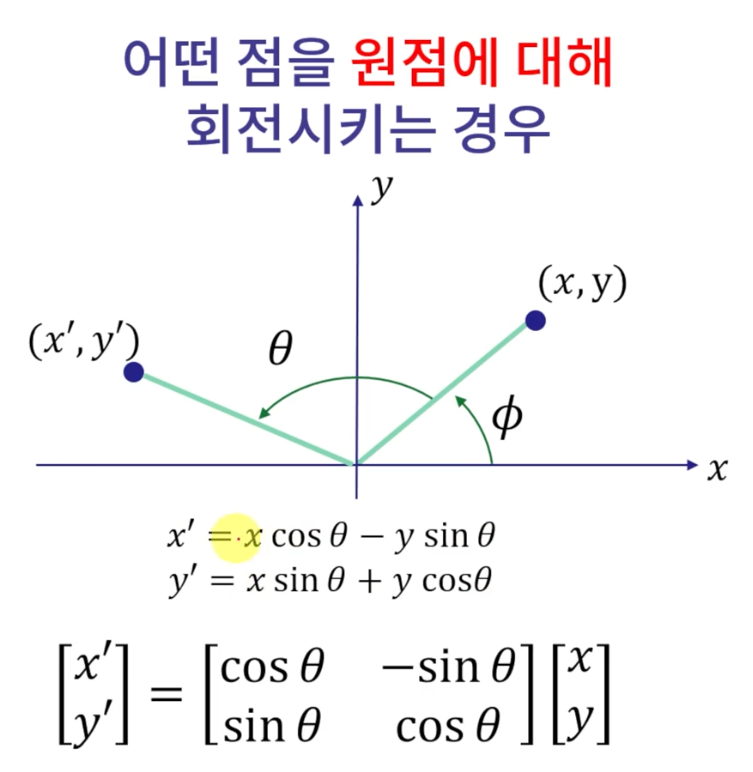
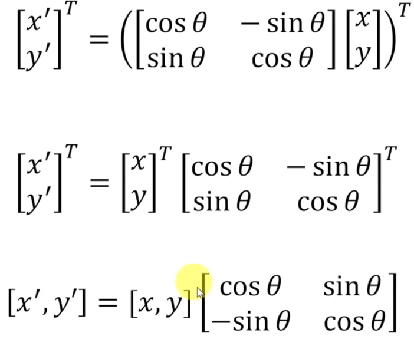
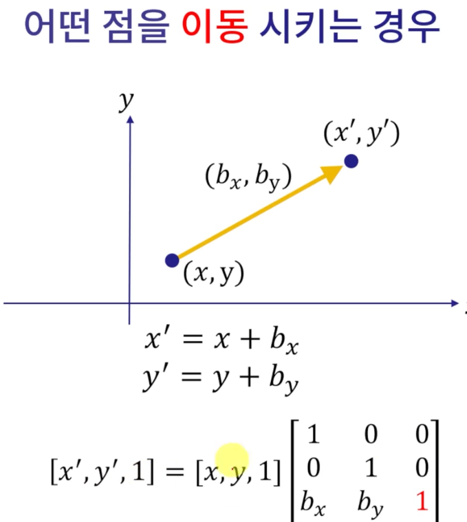
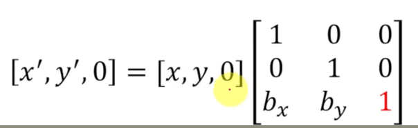
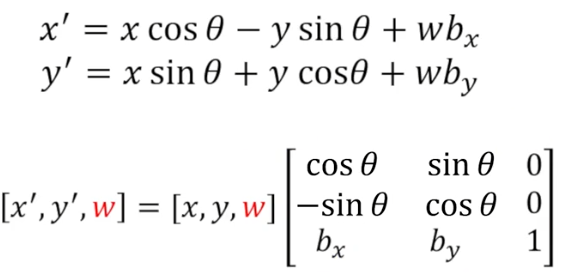

---

<b>2차원상의 점의 회전</b>

pc에서 간편하게 사용하기 위해 행렬로 만들어 계산시키면 된다.

<b>row major matrix로 변환하려면 아래처럼 하면된다.</b>

<b>점의 이동</b>

<b>x, y에 1이랑 행렬에 빨간 글시로 1이 왜 있을까?</b>

- <b>Homogeneous Coordinates (동차 좌표계)</b>
  - 1이 있으면 point라고 표현할 수 있다.
  - <b>반대로</b>
    

    벡터는 방향과 크기만 가지고 있고 위치정보는 가지고 있지 않기 때문에

    point의 끝에 0을 넣어주면 벡터로 계산할 수 있는것이다.

  

  동차 좌표계의 특성을 이용하면

  회전, 이동을 하나의 행렬로 표시할 수 있다.

---

회전행렬의 역행렬은 회전행렬의 전치행렬이다.
