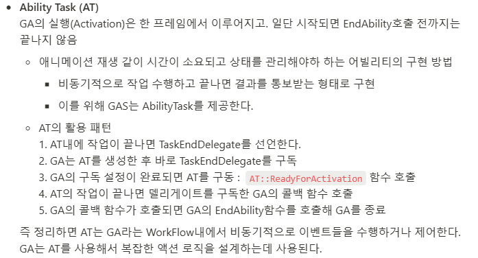
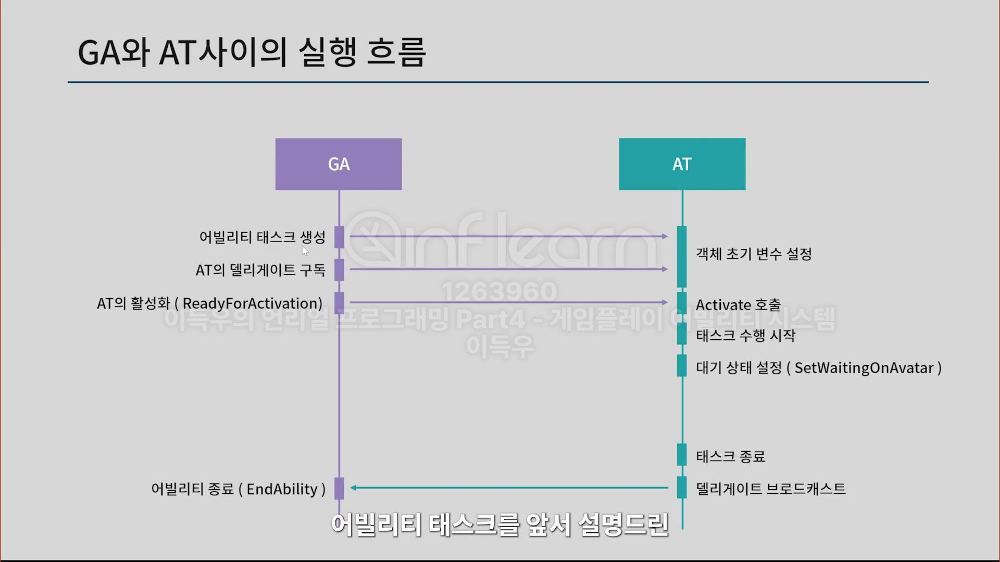

상위 문서에 작성한 내용



---

### AT의 제작 규칙

- UAbilityTask 클래스를 상속받아 제작
- 일반적으로 자기자신의 AT인스턴스를 생성해 반환하는 static함수를 선언해 구현
  ```c++
  // static
  UABAT_JumpAndWaitForLanding* UABAT_JumpAndWaitForLanding::CreateTask(UGameplayAbility* OwningAbility)
  {
      UABAT_JumpAndWaitForLanding* NewTask = NewAbilityTask<UABAT_JumpAndWaitForLanding>(OwningAbility);

      return NewTask;
  }
  ```
- AT가 종료되면 GA에 알려줄 델리게이트 선언
- 시작과 종료 처리를 위해 Activate와 OnDestroy함수를 재정의한다.
  ```c++
  void UABAT_JumpAndWaitForLanding::Activate()
  {
      Super::Activate();

      ACharacter* Character = CastChecked<ACharacter>(GetAvatarActor());
      Character->LandedDelegate.AddDynamic(this, &UABAT_JumpAndWaitForLanding::OnLandedCallback);
      Character->Jump();
      SetWaitingOnAvatar();
  }

  void UABAT_JumpAndWaitForLanding::OnDestroy(bool AbilityEnded)
  {
      ACharacter* Character = CastChecked<ACharacter>(GetAvatarActor());
      Character->LandedDelegate.RemoveDynamic(this, &UABAT_JumpAndWaitForLanding::OnLandedCallback);
      Super::OnDestroy(AbilityEnded);
  }
  ```
- 시간이 걸리는 AT는 활성화시 SetWatitingOnAvatar함수를 호출해 Waiting상태로 설정
- Tick 키고싶으면 bTickingTask 변수를 true 로 설정
- AT종료되면 델리게이트 브로드캐스팅


