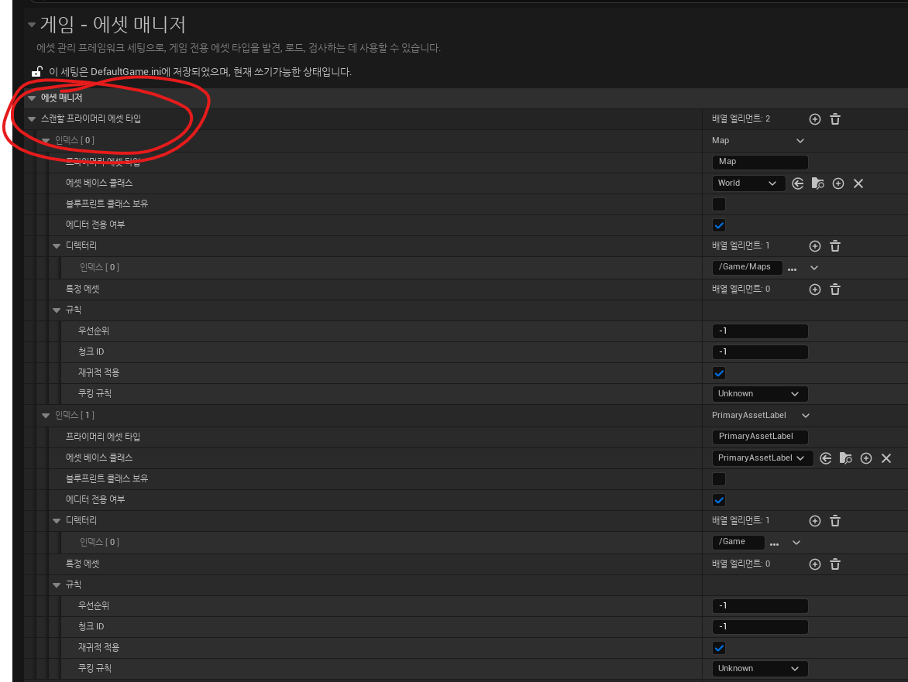
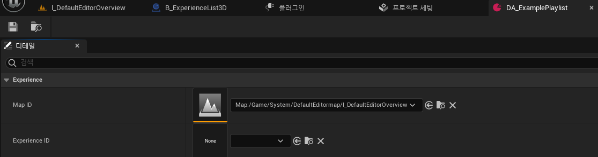
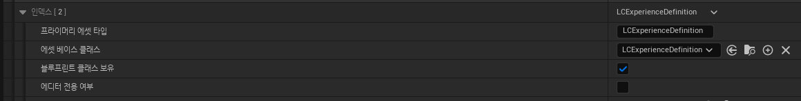

---



<b>에셋매니저에 에셋을 등록하려면 프로젝트 설정의 스캔 기능을 사용</b>한다.<br />(스캔은 로드와 다르다 스캔은 해당 에셋의 경로만 알고있는 상태이다)

아래는 UserFacingExperience를 상속받아 만든 DataAsset이다.

<details>
<summary><b>UserFacingExperience 코드</b></summary>

```c++
UCLASS()
class LYRACLONE_API ULCUserFacingExperience : public UPrimaryDataAsset
{
	GENERATED_BODY()
public:
	UPROPERTY(BlueprintReadWrite, EditAnywhere, Category ="Experience", meta =(AllowedType = "Map"))
	FPrimaryAssetId MapID; // Key Value 맵 말고 진짜 그 게임 맵ID

	UPROPERTY(BlueprintReadWrite, EditAnywhere, Category = "Experience", meta = (AllowedType = "LCExperienceDefinition"))
	FPrimaryAssetId ExperienceID;

};
```

</details>

Map Type으로 AssetType일 제한한 FPrimaryAssetId인 MapID를 보자



보면 MapID에 항목이 들어가있는걸볼 수 있는데<br />에셋 스캔에서 특정 에셋에 해당 Map에셋을 넣어줬기때문에 저기서 받을수가 있는 것

추가로 에셋을 등록하려면 인덱스 추가 후 타입지정부터 다시 한다.<br />프라이머리 에셋 타입 부분에는 <code>meta = (AllowedType = "LCExperienceDefinition")</code> 이렇게 AllowedType으로 지정한 문자열과 똑같이 입력해야한다.



블루프린트 클래스가 있으면 블루프린트 클래스 보유도 체크해준다.
