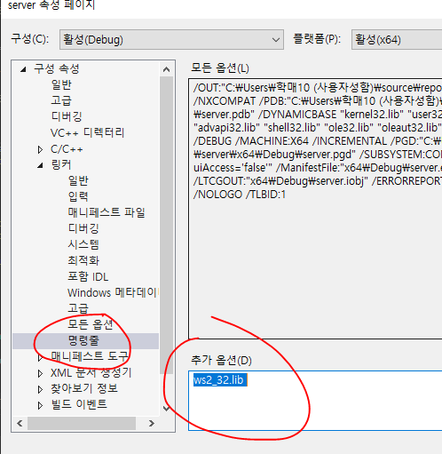
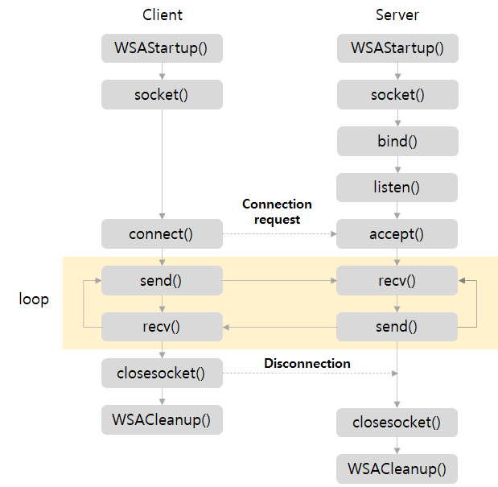

무엇이 필요할지 간단하게 생각해봅시다.

---

통신은 상호 통신이기 때문에 <b>tcp 통신</b>을 사용한다.

라이브러리는 winsock2 를 사용한다.

### <b>Winsock이란?</b>

- <b>Winsock은 </b><b><u>Windows Sockets API(WSA)</u></b><b>라는 Windows API이다. </b>
- <b>인터넷 네트워크 및 소켓과 관련된 함수들을 제공해준다. </b>
- Winsock은 버전1과 버전2가 있으며 Winsock1에 여러 기능이 좀 더 추가된 것이 Winsock2라고 한다. 여기선 버전 2를 사용한다.

winsock 사용을 위해서는 설정 변경이 필요함



### <b>서버와 클라이언트의 기본 로직</b>

코드로 구현하기 전에 서버와 클라이언트의 각 로직을 알면 더 구현하기 쉽다.

TCP/IP 프로토콜을 사용한다.

메인쓰레드로 서버 로직을 돌리고

서브 쓰레드로 클라이언트의 소켓들을 처리한다.

<b>Server</b>

- <b>member</b>
  ```c++
  WSADATA WSdata; // 윈속2 라이브러리
  WORD    Version;
  SOCKET ServerSocket; // 서버소켓 : 클라이언트 연결 수락 및 클라이언트 소켓 생성 담당  
  std::vector<SOCKET> ClientSockets; // 클라이언트 소켓들을 담는 벡터

  sockaddr_in LocalAddr; // 서버소켓이 바인딩 될 로컬주소                  //send한 message 크기
  ```

1. Winsock을 사용할 수 있도록 <u>초기화(Initialize)</u>한다.
   ```c++
   void Initialize()
   {
       Version = MAKEWORD(2, 2);
       int wsResult = WSAStartup(Version, &WSdata);
       if (wsResult != 0)
       {
           ErrorHandling(L"WSAStartup() error!");
       }
       else
       {
           std::cout<<"Winsock2 library initialized.\n";
       }
   }
   ```
2. 리스닝 소켓을 <u>생성(create)</u>한다.
   ```c++
   void CreateSocket()
   {
       ServerSocket = socket(AF_INET, SOCK_STREAM, 0); // 서버 소켓 생성
       if (ServerSocket == INVALID_SOCKET)
       {
           ErrorHandling(L"socket() error!");
       }
       else
       {
           std::cout << "Server socket created.\n\n";
       }
   }
   ```
3. IP 주소와 포트번호를 설정한다.
   ```c++
   void SetServerDetails()
   {
       LocalAddr.sin_family = AF_INET; // IPv4로 주소 체계 설정
       LocalAddr.sin_port = htons(DEFAULT_PORT); // 포트넘버 설정
       LocalAddr.sin_addr.S_un.S_addr = INADDR_ANY; // 아이피 주소 설정 (INADDR_ANY 키워드로 모든 네트워크 인터페이스에서 들어오는 연결을 수락)}
   }
   ```
4. IP 주소와 PORT 번호와 같은 정보를 소켓에 <u>묶어(bind)</u>준다.
   ```c++
   void BindServerSocket()
   {
       if (bind(ServerSocket, (sockaddr*)&LocalAddr, sizeof(LocalAddr)) == SOCKET_ERROR)
       {
           ErrorHandling(L"bind() error!");
       }
   }
   ```
5. 서버가 클라이언트의 <u>요청을 받을 수 있는 상태(listen)</u>가 되도록 한다.
   ```c++
   void ListenServerSocket()
   {
       if (listen(ServerSocket, SOMAXCONN) == SOCKET_ERROR)
       {
           ErrorHandling(L"listen() error!");
       }
   }
   ```
6. 클라이언트의 접근을 수락한다.
   ```c++
   void AcceptClient(sockaddr_in& _clientAddr, SOCKET& _clientSocket)
   {
       int clientAddrSize = sizeof(_clientAddr);
       _clientSocket = accept(ServerSocket, (sockaddr*)&_clientAddr, &clientAddrSize);

       if (_clientSocket == INVALID_SOCKET)
       {
           closesocket(_clientSocket);
           closesocket(ServerSocket);
           ErrorHandling(L"accept() error!");
       }
       else
       {
           // 클라이언트 쓰레드함수 실행
           JoinClient(_clientAddr, _clientSocket);
       }
   }
   ```
7. <u>send/recv</u>와 같은 함수를 통해 클라이언트와 데이터를 주고 받는다. (Do something loop)
   ```c++
   void JoinClient(sockaddr_in& _clientAddr, SOCKET& _clientSocket)
   {
       char clientIP[INET_ADDRSTRLEN];
       ZeroMemory(clientIP, INET_ADDRSTRLEN);
       if (NULL == inet_ntop(AF_INET, &_clientAddr.sin_addr, clientIP, INET_ADDRSTRLEN)) // inet_ntop ip 주소를 문자열 형태로 변환
       {
           ErrorHandling(L"inet_ntop() error!");
       }
       else
       {
           std::cout << "[Client IP: " << clientIP << "::" << ntohs(_clientAddr.sin_port) << "]" << std::endl;
           ClientSockets.push_back(_clientSocket);

           std::thread clientThread(HandleClient, _clientSocket);
           clientThread.detach();
       }
   }
   ```
8. 7번 동작이 끝나면, 클라이언트와 연결된 소켓을 <u>닫는다(close).</u>
9. Winsock의 사용을 <u>종료(cleanup, terminate)</u>한다. (1번과 대칭되는 단계)=> terminate라고도 한다.

<b>Client</b>

1. Winsock을 <u>초기화(Initialize)</u>한다.
2. 소켓을 <u>생성(create)</u>한다.
3. 소켓, IP주소, PORT 번호와 함께 서버에 연결(connect)한다.=> 연결을 제외하면 서버의 3번의 bind와 비슷한 기능 소켓과 IP주소, PORT를 묶어줌
4. <u>send/recv</u>와 같은 함수를 통해 서버와 데이터를 주고 받는다. (Do something)
5. 클라이언트의 소켓을 닫는다.
6. Winsock의 사용을 <u>종료(cleanup)</u>한다.


