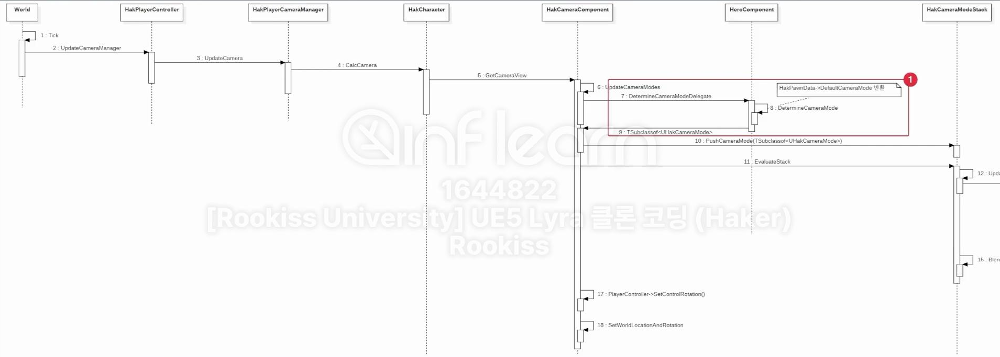
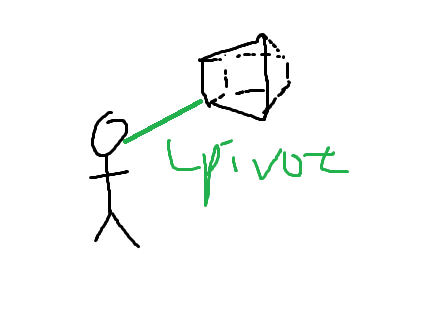
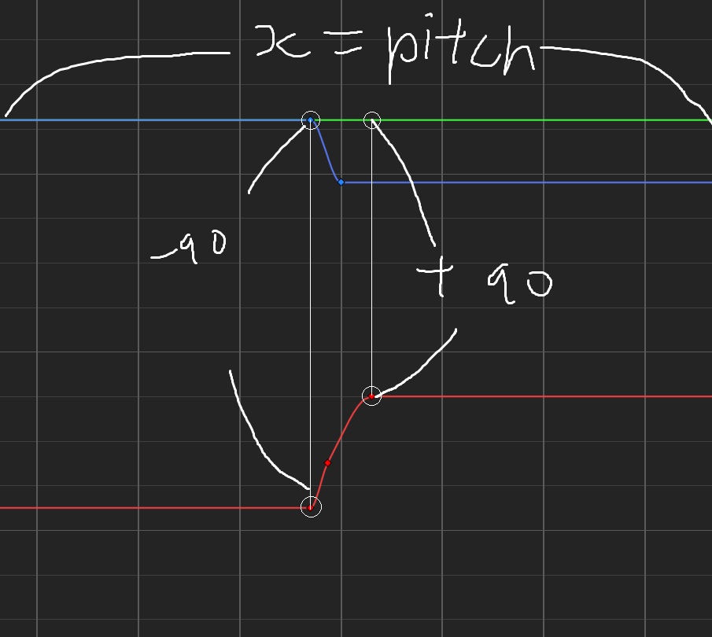
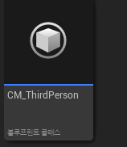
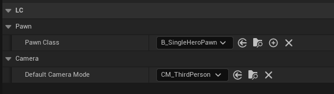
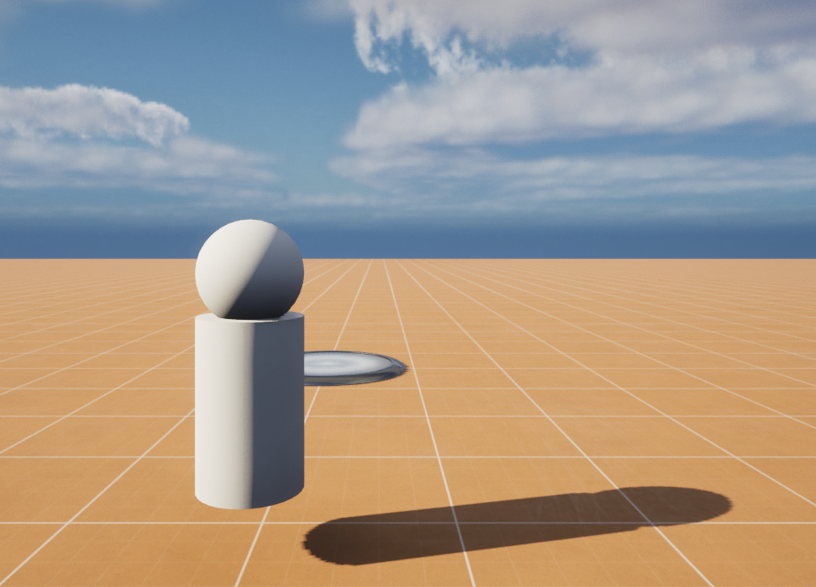

게임의 모듈화를 통해 다양한 게임을 편하게 만들기위해 플레이어의 게임경험의 기본이 되는 카메라를 모듈화한다.

---

Lyra에서는 <b>CameraMode</b>라는 개념을 만들고 해당 모드를 교체해가며 플레이어가 화면을 보는 방식을 결정한다.<br />Ex) Fps모드, Tps모드, 스나이퍼모드 등등

또한 <b>CameraMode간의 전환</b>을 보간을 통해 자연스럽게 하는 개념을 <b>Camera Blending</b>이라고 부른다.

이 <code>CameraMode</code>들은 <code>CameraComponent</code>가 들고 있고 <code>CameraComponent</code> 는 Player가 사용할 Pawn에 부착된다.

---

아래는 참고사항이다

<br><em>카메라 컴포넌트는 다른 컴포넌트와 다르게 WorldTick에서 Update되는게 아니라 PlayerController를 통해 Update된다.카메라 컴포넌트가 Scene을 찍긴 하지만 렌더링은 담당하지 않고, 해당 정보들을 종합해서 CameraManager에게 전달하면CameraManager가 렌더링을 한다. ⇒ Player의 Controller이나 Pawn등은 너무 가변적이어서 Component가 맡게되면렌더링에 문제가 생길수 있다. 그래서 Player에게 종속시키지않고 CameraManager가 담당하면 보다 안전하다.</em>

---

<b>초기화</b>

```c++
void ULCCameraComponent::OnRegister()
{
	Super::OnRegister();

	if (!CameraModeStack)
	{
		// 초기화(Beginplay같은)가 필요없는 객체이기 때문에 NewObject로 할당
		// Constructor가 아니라 OnRegister에서 하기 때문에 LCCharacter에 CameraComponent가 부착되고 난 다음에 CameraModeStack이 생성된다.
		CameraModeStack = NewObject<ULCCameraModeStack>(this);		
	}
}

// 매 프레임 호출!
void ULCCameraComponent::GetCameraView(float DeltaTime, FMinimalViewInfo& DesiredView)
{
	//Super::GetCameraView(DeltaTime, DesiredView);

	check(CameraModeStack);
	
	UpdateCameraModes();
	
	// EvaluateStack은 CameraStack에 있는 CameraMode를 업데이트,
	// 블렌딩 하고 CameraModeStack의 Bottom->Top까지 업데이트된 CameraMode에 대해 보간을 진행한다.
	// 이에 대한 결과는 CameraModeView에 캐싱된다.
	FLCCameraModeView CameraModeView;
	CameraModeStack->EvaluateStack(DeltaTime, CameraModeView);
}

void ULCCameraComponent::UpdateCameraModes()
{
	check(CameraModeStack);

  // DetermineCameraModeDelegate 
  // DECLARE_DELEGATE_RetVal(TSubclassOf<class ULCCameraMode>, FLCCameraModeDelegate)
	// DetermineCameraModeDelegate is Bound To HeroComponent::DetermineCameraModeDelegate
	if (DetermineCameraModeDelegate.IsBound())
	{
		// 현재 pawndata의 DefaultCameramode를 return한다.
		if (const TSubclassOf<ULCCameraMode> CameraMode = DetermineCameraModeDelegate.Execute())
		{
			CameraModeStack->PushCameraMode(CameraMode);	
		}
	}
}
```

위 코드를 보면 매 프레임 호출되는 <code>GetCameraView</code> 함수를 통해 <code>UpdateCameraModes</code>함수가 호출된다.<br />그리고 <span>CameraModeStack</span>에 계속 CameraMode를 추가해주는것을 볼 수 있다.

<b>ULCHeroComponent::DetermineCameraMode</b>

```c++
TSubclassOf< ULCCameraMode> ULCHeroComponent::DetermineCameraMode() const
{
	APawn* Pawn = GetPawn<APawn>();
	if (!Pawn)
	{
		return nullptr;
	}

	if (ULCPawnExtensionComponent* PawnExtensionComponent = ULCPawnExtensionComponent::FindPawnExtensionComponent(Pawn))
	{
		if (const ULCPawnData* PawnData = PawnExtensionComponent->GetPawnData<ULCPawnData>())
		{
			return PawnData->DefaultCameraMode;
		}
	}
	return nullptr;
}

```

<code>DetermineCameraMode</code>함수는 <code>DefaultCameraMode</code> 즉 현재 사용중인 CameraMode를 반환한다.<br /><code>DetermineCameraMode</code>함수는 앞서 InitState를 진행하다 만나는 <code>HandleChangeInitState</code> 함수에서 진행하게 된다.

```c++
void ULCHeroComponent::HandleChangeInitState(UGameFrameworkComponentManager* Manager, FGameplayTag CurrentState,
	FGameplayTag DesiredState)
{
	const FLCGameplayTags& InitTags = FLCGameplayTags::Get();

...
		// Input, Camera Handling
		...
		if (bIsLocallyControlled && PawnData)
		{
			if ( ULCCameraComponent* CameraComponent = ULCCameraComponent::FindCameraComponent(Pawn))
			{
				CameraComponent->DetermineCameraModeDelegate.BindUObject(this, &ThisClass::DetermineCameraMode);
			}
		}
	}
}
```

<p> </p>

<code>ULCCameraComponent::UpdateCameraModes</code> 에서 계속 호출되는 함수들이다.<br />함수를 보면 <code>PushCameraMode</code> 에서 인자로 들어온 현재 <code>PawnData</code>의 <code>DefaultCameraMode</code> 를<br /><code>GetCameraModeInstance</code> 함수로 보내고

<code>GetCameraModeInstance</code> 함수에서 해당 CameraModeClass 기반으로 만들어진 CameraModeInstance를 캐싱하고 있는것을 확인할 수 있다.

캐싱되었거나 캐싱되있던 CameraMode를 가져와서 <code>PushCameraMode</code> 에서 사용한다.

<code>PushCameraMode</code> 함수는 새로 들어왔거나 기존에 있던 CameraMode가 들어왔을때<br />해당 CameraMode에 <b>Blend가중치를 설정하는 역할</b>을 한다.<br />해당 계산 과정에 대해선 더 아래서 설명한다.

```c++
ULCCameraMode* ULCCameraModeStack::GetCameraModeInstance(TSubclassOf<ULCCameraMode>& CameraModeClass)
{
	check(CameraModeClass);

	// 같은 클래스의 카메라 모드 인스턴스가 이미 있으면 재사용한다.
	for (ULCCameraMode* CameraMode : CameraModeInstance)
	{
		if ((CameraMode != nullptr) && (CameraMode->GetClass() == CameraModeClass))
		{
			return CameraMode;
		}
	}

	// 없으면 새로 생성하고 캐시에 등록한다.
	ULCCameraMode* NewCameraMode = NewObject<ULCCameraMode>(GetOuter(), CameraModeClass, NAME_None, RF_NoFlags);
	check(NewCameraMode);

	CameraModeInstance.Add(NewCameraMode);
	return NewCameraMode;
}

void ULCCameraModeStack::PushCameraMode(TSubclassOf<ULCCameraMode> CameraModeClass)
{
	if (!CameraModeClass)
	{
		return;
	}

	// 클래스별 단일 인스턴스를 가져온다.
	ULCCameraMode* CameraMode = GetCameraModeInstance(CameraModeClass);
	check(CameraMode);

	int32 StackSize = CameraModeStack.Num();

	// 이미 최상단에 있으면 순서도, 블렌드 상태도 바꿀 필요가 없다.
	if ((StackSize > 0) && (CameraModeStack[0] == CameraMode))
	{
		return;
	}

	int32 ExistingStackIndex = INDEX_NONE;
	float ExistingStackContribution = 1.0f;

	// 스택을 위에서 아래로 탐색하면서
	// 1) 같은 모드가 기존에 어디 있었는지 찾고
	// 2) 그 모드가 현재 최종 결과에 실제로 얼마나 기여하고 있었는지 계산한다.
	for (int32 StackIndex = 0; StackIndex < StackSize; ++StackIndex)
	{
		if (CameraModeStack[StackIndex] == CameraMode)
		{
			ExistingStackIndex = StackIndex;

			// 지금까지 위쪽 모드들이 남긴 영역에서
			// 이 모드가 실제로 차지하던 비율을 계산한다.
			ExistingStackContribution *= CameraMode->BlendWeight;
			break;
		}

		// 아직 찾는 모드가 아니므로,
		// 현재 모드가 덮고 남긴 비율만 다음 단계로 넘긴다.
		ExistingStackContribution *= (1.0f - CameraModeStack[StackIndex]->BlendWeight);
	}

	// 기존에 스택 안에 있던 모드면 제거 후 최상단으로 다시 올린다.
	if (ExistingStackIndex != INDEX_NONE)
	{
		CameraModeStack.RemoveAt(ExistingStackIndex);
		StackSize--;
	}
	else
	{
		// 새 모드라면 기존 기여도가 없으므로 0에서 시작한다.
		ExistingStackContribution = 0.0f;
	}

	// 블렌드 가능한 상황이면 기존 기여도에서 이어서 시작하고,
	// 아니면 즉시 최상단 모드가 되도록 1.0으로 시작한다.
	const bool bShouldBlend = ((CameraMode->BlendTime > 0.f) && (StackSize > 0));
	const float BlendWeight = (bShouldBlend ? ExistingStackContribution : 1.0f);
	CameraMode->BlendWeight = BlendWeight;

	// 새로 활성화된 모드는 항상 스택 최상단에 둔다.
	CameraModeStack.Insert(CameraMode, 0);

	// 최하단 모드는 남은 영역을 전부 책임져야 하므로 항상 1.0이어야 한다.
	CameraModeStack.Last()->BlendWeight = 1.0f;
}
```

그 이후 <code>ULCCameraComponent::GetCameraView</code> 함수로 돌아가서 <code>EvaluateStack</code> 을 진행하게 된다.

```c++
void ULCCameraModeStack::EvaluateStack(float DeltaTime, FLCCameraModeView& OutCameraModeView)
{
	// Top -> Bottom [0 -> Num]까지 순차적으로 Stack에 있는 Camera Update
	UpdateStack(DeltaTime);

	// Bottom -> Top까지 CameraModeStack에 대해 Blending 진행
	BlendStack(OutCameraModeView);
}
```

<b>UpdateStack</b>

<code>UpdateStack</code> 함수는 CameraModeStack을 <b>가장 최신의 CameraMode</b>부터 <b>가장 오래된 CameraMode</b>까지 순회하며 UpdateCameraMode함수를 호출해준다.<br />그리고 블렌딩이 완료된 카메라모드는 Stack에서 제거한다.

```c++
void ULCCameraModeStack::UpdateStack(float DeltaTime)
{
	// 카메라 모드 스택이 비어있으면 할 필요 없음
	const int32 StackSize = CameraModeStack.Num();
	if (StackSize <= 0)
	{
		return;
	}

	// CameraModeStack을 순회하며, CameraMode를 업데이트한다 
	// (가장 최신 데이터부터 가장 나중 데이터까지 순회)
	// 현재 내가 쓰고있는 데이터부터 썼던데이터들을 쭉 돌아보는것
	int32 RemoveCount = 0;
	int32 RemoveIndex = INDEX_NONE;
	for (int32 StackIndex = 0; StackIndex < StackSize; ++StackIndex)
	{
		ULCCameraMode* CameraMode = CameraModeStack[StackIndex];
		check(CameraMode);

		// UpdateCameraMode를 확인해보자:
		CameraMode->UpdateCameraMode(DeltaTime);

		// 만약 하나라도 CameraMode가 BlendWeight가 1.0에 도달했다면, 
		// 그 이후 모든 CameraMode를 제거한다
		if (CameraMode->BlendWeight >= 1.0f)
		{
			RemoveIndex = (StackIndex + 1);
			RemoveCount = (StackSize - RemoveIndex);
			break;
		}
	}

	if (RemoveCount > 0)
	{
		// 생각해보면 이거 때문에 Pop하고 Push를 안한거일지도?
		CameraModeStack.RemoveAt(RemoveIndex, RemoveCount);
	}

}
```

<b>UpdateCameraMode</b>

```c++
void ULCCameraMode::UpdateCameraMode(float DeltaTime)
{
	// Actor를 활용하여, Pivot[Location,Rotation]을 계산하여 View 업데이트
	UpdateView(DeltaTime);

	// BlendingWeight, Deltatime을 활용하여 BlendAlpha 계산후 BlendFunction에 맞게 
	// 재매핑하여 최종 계산
	UpdateBlending(DeltaTime);
}

void ULCCameraMode::UpdateView(float DeltaTime)
{
	// OwnerPawn의 Location과 ControlRotation을 활용하여 View업데이트
	
	// CameraMode를 가지고 있는 CameraComp의 Owner인 Character를 활용하여 Loc, Rot를 반환함
	FVector PivotLocation = GetPivotLocation();
	FRotator PivotRotation = GetPivotRotation();

	// Pitch값에 대해 MinMax Clamp
	PivotRotation.Pitch = FMath::ClampAngle(PivotRotation.Pitch, ViewPitchMin, ViewPitchMax);

	// CameraView에 해당 Loc Rot 사용
	View.Location = PivotLocation;
	View.Rotation = PivotRotation;

	// ControlRotation을 Pivot으로 사용
	View.ControlRotation = PivotRotation;
	View.FieldOfView = FieldOfView;
}

void ULCCameraMode::UpdateBlending(float DeltaTime)
{
	// BlendAlpha를 DeltaTime을 통해 계산
	if (BlendTime > 0.f)
	{
		// BlendTime은 Blending 하는 과정 (초)
		// BlendAlpha는 Blending Elapse
		BlendAlpha += (DeltaTime / BlendTime); // BlendTime초가 지나면 BlendAlpha가 1이 되어있음
	}
	else
	{
		BlendAlpha = 1.f;
	}

	// BlendWeight를 BlendFunction에 맞게 재매핑
	const float Exponent = (BlendExponent > 0.f) ? BlendExponent : 1.f;
	switch (BlendFunction)
	{
	case ELCCameraModeBlendFunction::Linear:
		BlendWeight = BlendAlpha;
		break;
	case ELCCameraModeBlendFunction::EaseIn:
		BlendWeight = FMath::InterpEaseIn(0.f ,1.f, BlendAlpha, Exponent);
		break;
	case ELCCameraModeBlendFunction::EaseOut:
		BlendWeight = FMath::InterpEaseOut(0.f ,1.f, BlendAlpha, Exponent);
		break;
	case ELCCameraModeBlendFunction::EaseInOut:
		BlendWeight = FMath::InterpEaseInOut(0.f ,1.f, BlendAlpha, Exponent);
		break;
	default:
		checkf(false, TEXT("UpdateBlending : Invalid BlendFunction [%d]\n"), static_cast<uint8>(BlendFunction));
		break;
	}
}

CCameraComponent* ULCCameraMode::GetLCCameraComponent() const
{
// 이 코드는 아래서 설명한다.
	return CastChecked<ULCCameraComponent>(GetOuter()); 
}

AActor* ULCCameraMode::GetTargetActor() const
{
	const ULCCameraComponent* LCCameraComponent = GetLCCameraComponent();
	return LCCameraComponent->GetTargetActor();
}
FVector ULCCameraMode::GetPivotLocation() const
{
	const AActor* TargetActor = GetTargetActor();
	check(TargetActor);

	if (const APawn* TargetPawn = Cast<APawn>(TargetActor))
	{
		// BaseEyeHeigh(보통88)을 고려하여 ViewLocation을 반환
		return TargetPawn->GetPawnViewLocation();
	}
	return TargetActor->GetActorLocation();
}

FRotator ULCCameraMode::GetPivotRotation() const
{
	const AActor* TargetActor = GetTargetActor();
	check(TargetActor);

	if (const APawn* TargetPawn = Cast<APawn>(TargetActor))
	{
		// 보통 Pawn의 ContolRotation반환 ContolRotation(마우스의 이동이 컨트롤러에 적용이되는데 그곳에있는 Rotation을 가져옴)
		return TargetPawn->GetViewRotation();
	}
	return TargetActor->GetActorRotation();
}

```

여기서 나오는 Pivot은 SpringArm을 생각하면 쉽다.<br />OwnerPawn의 움직임에 따라 카메라 위치와 회전이 변하는것



근데 여기서 <code>CameraComponent</code>와 그의 <code>OwnerPawn</code>을 가져오려면 일단 <code>CameraComponent</code>를 알아야한다.<br />그런데 <code>CameraMode</code>는 그냥 <code>UObject</code>이기때문에 알 수가 없다.

그래서 <code>CameraModeStack</code>에서 <b><code>CameraModeClassType</code></b><b>으로 </b><b><code>CameraMode</code></b><b>를 만들거나 찾아오던 함수</b>인 <b><code>ULCCameraModeStack::GetCameraModeInstance</code></b><b> </b>에서<b> CameraMode</b>를 만들 때

```c++
ULCCameraMode* NewCameraMode = 
NewObject<ULCCameraMode>(GetOuter(), CameraModeClass, NAME_None, RF_NoFlags);
```

이렇게 <code>CameraModeStack</code>의 Outer을 넣어줬었다! 그리고 <code>CameraModeStack-&gt;Outer</code> 은

```c++
void ULCCameraComponent::OnRegister()
{
	Super::OnRegister();
	if (!CameraModeStack)
	{
		CameraModeStack = NewObject<ULCCameraModeStack>(this);		
	}
}

```

<code>ULCCameraComponent</code> 이다!

그래서 CameraMode에서 GetOuter하면 현재 캐릭터에 붙어있는 <code>CameraComponent</code> 를 가지고 올 수 있다.

---

<details>
<summary><b>CustomCameraMode를 만들고 적용시켜보자!</b></summary>

아래의 <code>LCCameraMode_ThirdPerson</code> 클래스를보자

```c++
UCLASS(Abstract, Blueprintable)
class LYRACLONE_API ULCCameraMode_ThirdPerson : public ULCCameraMode
{
	GENERATED_BODY()
public:
	ULCCameraMode_ThirdPerson(const FObjectInitializer& ObjectInitializer);

	/*
	 * ULCCameraMode Interface
	 */
	virtual void UpdateView(float DeltaTime) override;

	/*
	 * Member Variables
	 */

	UPROPERTY(EditDefaultsOnly, Category = "Third Person")
	TObjectPtr<const class UCurveVector> TargetOffsetCurve;
};

```

기본적으로 CameraMode는 <code>Abstract</code> 키워드로 자체 인스턴스 생성을 막아두었다.<br />Blueprint사용을 권장하는것으로 보인다.

<code>UpdateBlending</code> 함수는 Blending로직은 대부분 똑같을것이기 때문에 부모함수로 쓰고<br />View는 카메라마다 다르게 가져가기 때문에 UpdateView를 상속받아 사용한다.

```c++
void ULCCameraMode_ThirdPerson::UpdateView(float DeltaTime)
{
	FVector PivotLocation = GetPivotLocation();
	FRotator PivotRotation = GetPivotRotation();

	PivotRotation.Pitch = FMath::ClampAngle(PivotRotation.Pitch, ViewPitchMin, ViewPitchMax);
	View.Location = PivotLocation;
	View.Rotation = PivotRotation;
	View.ControlRotation = PivotRotation;
	View.FieldOfView = FieldOfView;

	// TargetOffsetCurve가 오버라이드 되어있으면 Curve에 값을 가져와서 적용 진행
	// -Camera관점에서 Character의 어느 부분에 Target으로 할 지 결정하는 것으로 이해하면 됨
	if (TargetOffsetCurve)
	{
		// Pitch값에 따른 Offset값 가져옴
		const FVector TargetOffset = TargetOffsetCurve->GetVectorValue(PivotRotation.Pitch);
		// 현재 액터 위치로부터 회전방향으로 더해줌
		View.Location = PivotLocation + PivotRotation.RotateVector(TargetOffset); 
	}
}
```

코드를 보면 Pitch값에 따라 Curve에서 벡터를 가져오게 되는데



x축이 pitch값이고 해당 축 위의 xyz값을 가져오는것





<code>ULCCameraMode_ThirdPerson</code> 를 상속받아 Blueprint를 만들고 기존에 사용중이던 PawnDataAsset에<br />BP로 만든 CameraMode를 바인딩한다.



</details>

---
