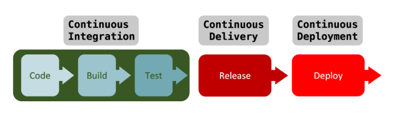
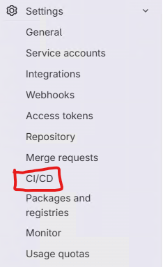
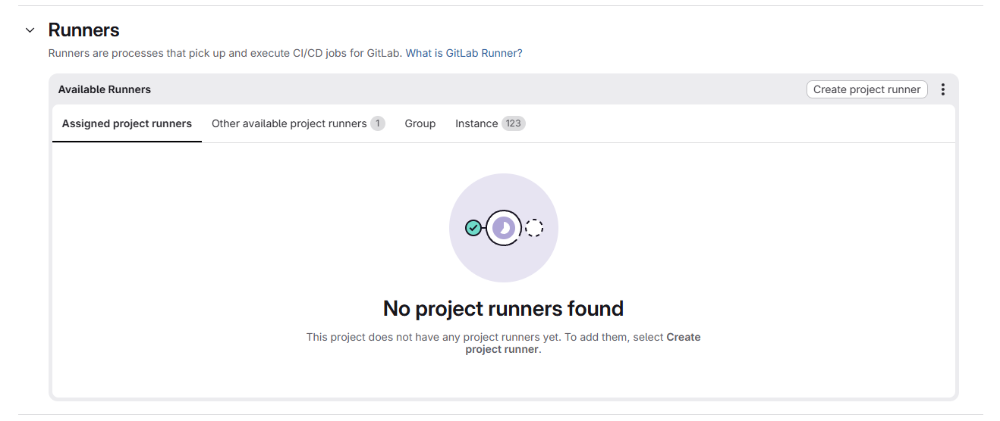
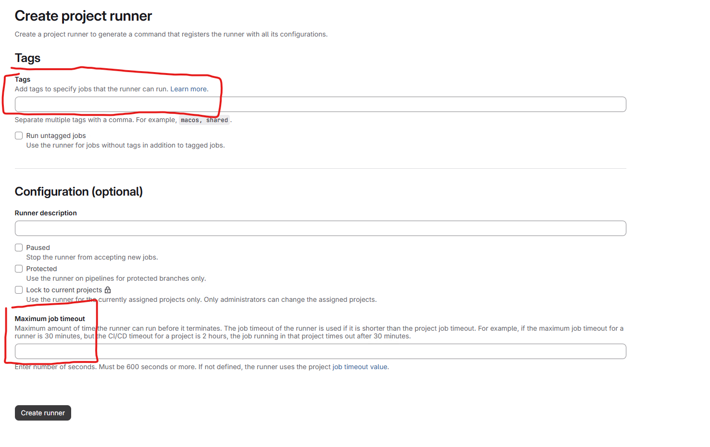
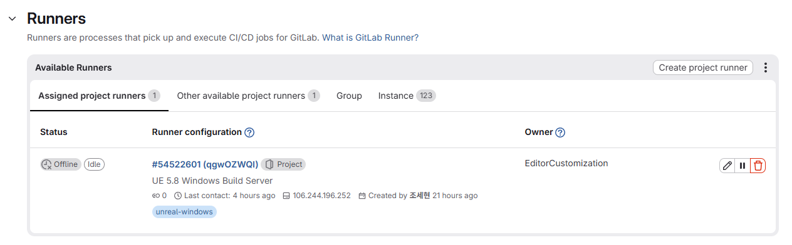
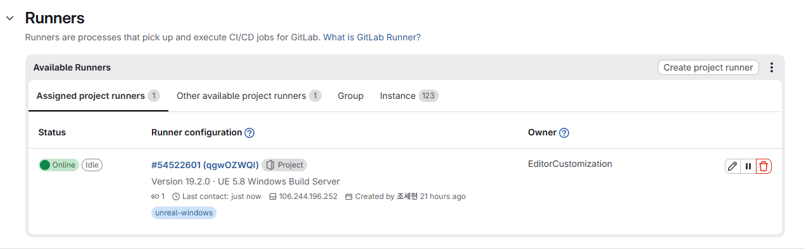
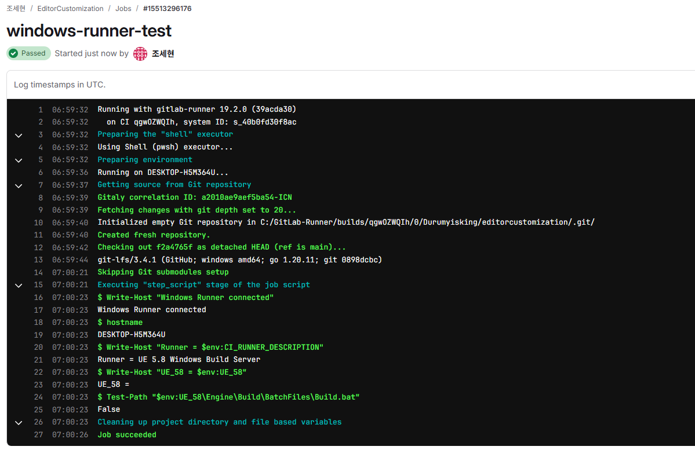

---

## <b>CI/CD란?</b>

애플리케이션 개발 \~ 배포 때까지의 모든 단계를 자동화를 통해 좀 더 <b>빠르고, 효율적이고, 빈번하게</b> 사용자들에게 배포할 수 있는 것을 말한다.

## <b>CI (Continuous Integration) 지속적 통합</b>

- 애플리케이션의 새로운 코드 변경이 주기적으로 빌드 및 테스트되고, 공유되는 Repo에 Merge 되는 것을 의미한다.<br />즉 <b>통합할 준비가 되면 자동으로 통합을 진행한다는 것이다.</b>

여러 개발자들이 형상관리 툴을 사용해 하나의 프로젝트를 진행하고 있다.<br />개발자들이 Merge를 자주 하는게 아니라 오랜 기간동안의 개발 내용을 한 번에 Merge를 하면<br />많은 코드들이 충돌하고, 이를 해결하기 위해 시간 낭비가 발생할 것이다.

<b>→ 때문에 가능한 작은 단위로 나누어서 주기적으로 빈번하게 개발, 통합해나가는 것이 중요하다.</b>

<i><b>하지만!</b></i>

빈번하게 다른 사람의 코드를 <b>Checkout, Merge, Build</b>하게 된다면 시간이 오래 걸리는건 마찬가지일 것이다.

이때 위의 과정들을 <b>자동으로, 지속적</b>으로 수행해준다면?<br />개발자는 빌드된 소스를 받아서 버그만 잡으면 되기 때문에 시간이 단축될 것이다.

CI을 도와주는 툴들은 형상관리 툴에 통합된 코드들을 알아서 빌드해주고 테스트해준다.

따라서 아래의 장점들이 따라온다.

- <b>코드 검증에 들어가는 시간 단축</b>
- <b>개발 편의성 증가</b>
- <b>테스트 코드를 통과한 코드만 Repo에 올라가기 때문에 좋은 코드 퀄리티 유지</b>

## <b>CD (Continuous Delivery/Deployment) 지속적 제공/배포</b>

- 제공과 배포를 통틀어서 의미한다. (따로 부르는게 아니라는 뜻)<br />CI단계에서 <b>Build되고 Test된 후</b>에, 배포 단계에서 release할 준비 단계를 거치고 <b>문제가 없는지 파악 후 배포를 수동적으로 진행</b>하는 것이 <b>지속적 제공</b>이다.<br />또한, <b>배포할 준비가 되자마자 자동화를 통해 배포</b>를 진행하는 것을 <b>지속적 배포</b>라고 한다.



---

## GitLab을 써서 CICD를 직접 만들어보자!

1. Gitlab 레포지토리를 만들어준다.
2. Runner을 만들어준다.



```javascript
.\gitlab-runner.exe register `
  --url "https://gitlab.com" `
  --token "새 Runner 토큰"
```





태그는 Pipeline 스크립트에서 Job에 Tag를 지정했을때 어떤 Tag가 부여된 Job만 처리할지 정하는 기능이다.

Timeout은  job을 최대 몇초까지 수행하게 할거냐이다 



---

이렇게하면 Gitlab에 Runner가 등록자리와 토큰을 생성한 것이고, 로컬에서 돌아갈 runner을 설치해서 Gitlab과 연결해야한다.

아래의 명령어로 gitlab\_runner.exe를 설치한다.

```javascript
New-Item -ItemType Directory -Path "C:\GitLab-Runner" -Force

Invoke-WebRequest `
  -Uri "https://gitlab-runner-downloads.s3.amazonaws.com/latest/binaries/gitlab-runner-windows-amd64.exe" `
  -OutFile "C:\GitLab-Runner\gitlab-runner.exe"

// 설치가 잘 되면 버전이 출력된다.
cd C:\GitLab-Runner
.\gitlab-runner.exe --version
```

Runner을 생성하면서 받은 토큰을 아래 명령어에 넣고 명령어를 실행한다.

```javascript
.\gitlab-runner.exe register `
  --url "https://gitlab.com" `
  --token "새 Runner 토큰"
```

이제 설치된 폴더로 이동해 exe파일에을 명령어로 실행하면된다.

```javascript
cd C:\GitLab-Runner

.\gitlab-runner.exe install
.\gitlab-runner.exe start
.\gitlab-runner.exe status
.\gitlab-runner.exe verify

//성공시 아래 메시지
Service is running
Verifying runner... is valid
```

이때 

```javascript
gitlab-runner: Access is denied.
```

이런식으로 문구가 나오면 PowerShell을 관리자 권한으로 실행을 안했을 확률이 높으니 아래의 문구를 실행해 관리자버전으로 열면된다.

```javascript
Start-Process powershell -Verb RunAs
```

이거하고나면\~\~ 잘 돌고있다



파이프라인도 잘 된다!


