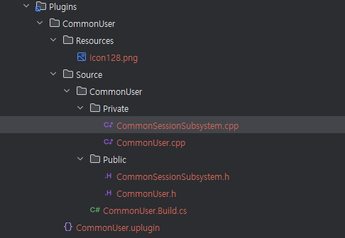

Lyra에서는 서버와 연동되어 더 복잡하긴한데 우리는 레벨 전환을 위해 사용한다고 한다.

---

CommonUser라는 기능은 플러그인으로 만들어서 구현한다.



---

<b>UCommonSessionSubsystem.h</b>

```c++
/**
 * UCommonSession_HostSessionRequest를 만들어 UCommonSessionSubsystem 에 전달하면 UCommonSessionSubsystem 에서 MapID와 CmdArgs로 최종적인 CmdArgs를 만들어준다
 */

// 사용할 맵과 Experience를 요청하는 Form
UCLASS(BlueprintType)
class UCommonSession_HostSessionRequest: public UObject
{
	GENERATED_BODY()
public:
	// MapID -> Text변환
	FString GetMapName() const;

	// ServerTravel에 전달할 최종 URL생성
	FString ConstructTravelURL() const;

	// 준비할 Map 경로
	UPROPERTY(BlueprintReadWrite, Category = Session)
	FPrimaryAssetId MapID;

	// 전달할 CmdArgs (Experience 이름 전달)
	UPROPERTY(BlueprintReadWrite, Category = Session)
	TMap<FString, FString> ExtraArgs;
	
};

// UGGameSession_HostSessionRequest으로 만든 요청을 수행해줌
UCLASS()
class COMMONUSER_API UCommonSessionSubsystem : public UGameInstanceSubsystem
{
	GENERATED_BODY()
public:
	UCommonSessionSubsystem() {}

 // 위에서 말한 요청 수행하는 함수
	UFUNCTION(BlueprintCallable, Category = Session)
	void HostSession(APlayerController* HostingPlayer, UCommonSession_HostSessionRequest* Request);

	// 맵의 경로
	FString PendingTravelURL;
	
};

```

<br /><br /><b>UCommonSession\_HostSessionRequest Methods</b>

```c++
// 단순하게 Map경로 반환하는 함수
FString UCommonSession_HostSessionRequest::GetMapName() const
{
	// MapID으로부터 AssetData를 반환하고 AssetData내의 PackageName을 통해 Map 경로 반환
	FAssetData MapAssetData;
	if (UAssetManager::Get().GetPrimaryAssetData(MapID, MapAssetData))
	{
		return MapAssetData.PackageName.ToString();
	}
	return FString();
}


FString UCommonSession_HostSessionRequest::ConstructTravelURL() const
{
	/*
	 * Map : MyMap
	 * Exp : FPSMode
	 * result : MyMap?Experience=FPSMode
	 */
	
	FString CombinedExtraArgs;
	for (const auto& ExtraArg : ExtraArgs)
	{
		if (ExtraArg.Key.IsEmpty())
		{
			continue;
		}

		/*
		 * ?를 Separate(구분자)로 복수개의 ExtraArgs를 추가
		 *  Key값 유무에 따라 =(Assignment)를 통해 알맞는 Cmdarg생성
		 */
		if (ExtraArg.Value.IsEmpty())
		{
			CombinedExtraArgs += FString::Printf(TEXT("?%s"), *ExtraArg.Key);
		}
		else
		{
			CombinedExtraArgs += FString::Printf(TEXT("?%s=%s"), *ExtraArg.Key, *ExtraArg.Value);
		}
	}
	return FString::Printf(TEXT("%s%s"), *GetMapName(), *CombinedExtraArgs);
}
```

<br /><b>UCommonSessionSubsystem Methods</b>

```c++
void UCommonSessionSubsystem::HostSession(APlayerController* HostingPlayer, UCommonSession_HostSessionRequest* Request)
{
	ULocalPlayer* LocalPlayer = (nullptr != HostingPlayer) ? HostingPlayer->GetLocalPlayer() : nullptr;
	if (!LocalPlayer)
	{
		return;
	}

	// Lyar원본에서는 ClientTravel을 통해 자기자신이 다른 서버로 접속할 수 있도록 해준다.
	// HostingPlayer->ClientTravel()

	// 우리는 로컬환경이니까 월드에서 이동
	// HostSessionRequest에서 MapID와 ExtraArgs를 통해 URL생성하여, MapLoad를 시작
	GetWorld()->ServerTravel(Request->ConstructTravelURL());
}
```

<code>APlayerController::ClientTravel</code> 함수는클라이언트에서 호출되면 다른 데디서버로 이동시키는 함수이다.

만약 해당 함수가 <b>서버에서 호출</b>되면 <b>해당 클라이언트를 </b><i><b>다른 맵</b></i><b>으로 이동</b>시키는데 사용된다. <br />(현재 서버 유지)

<code>UWorld::ServerTravel </code>함수는 서버 전용이고 서버를 새 레벨로 이동하면서 서버에 접속된 모든 클라이언트에게 APlayerController::ClientTravel 함수를 호출시킨다.

---

이제 MapID와 ExperienceID 모두 알고있는 녀석

<code>ULCUserFacingExperience</code> 를 통해 요청폼<code>UCommonSession_HostSessionRequest</code>을 생성한다.

```c++
UCommonSession_HostSessionRequest* ULCUserFacingExperience::CreateHostingRequest() const
{
	const FString ExperienceName = ExperienceID.PrimaryAssetName.ToString();

	// 
	UCommonSession_HostSessionRequest* Result = NewObject<UCommonSession_HostSessionRequest>();
	Result->MapID = MapID;
	Result->ExtraArgs.Add(TEXT("Experience"), ExperienceName);

	return Result;
}
```
