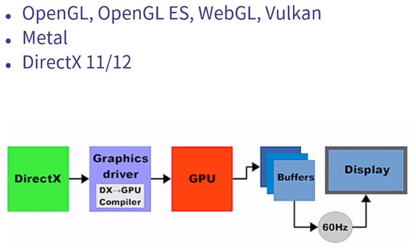

---

<b>DXGI</b> : 어떤 버전의 directX에서든 공통적으로 사용할 수 있도록 directX의 저수준 제어의 묶음

device Init

```javascript
const D3D_DRIVER_TYPE driverType = D3D_DRIVER_TYPE_HARDWARE;

    // 여기서 생성하는 것들
    // m_device, m_context, 
    // m_swapChain,
    // m_renderTargetView, m_screenViewport, m_rasterizerSate

    // m_device와 m_context 생성

    UINT createDeviceFlags = 0;
#if defined(DEBUG) || defined(_DEBUG)
    createDeviceFlags |= D3D11_CREATE_DEVICE_DEBUG;
#endif


		// 다른 pc환경에서도 디바이스 객체가 잘 생성되는지 확인하기 위해
		// 멤버변수에 초기화하는게 아니라 G-Device가 잘 생성되면 멤버변수에 복사해주는 방법을 사용한다.
    ComPtr<ID3D11Device> device;
    ComPtr<ID3D11DeviceContext> context;

    const D3D_FEATURE_LEVEL featureLevels[2] = {
        D3D_FEATURE_LEVEL_11_0, // 더 높은 버전이 먼저 오도록 설정
        D3D_FEATURE_LEVEL_9_3};
    D3D_FEATURE_LEVEL featureLevel;

    if (FAILED(D3D11CreateDevice(
            nullptr,                  // Specify nullptr to use the default adapter.
            driverType,               // Create a device using the hardware graphics driver.
            0,                        // Should be 0 unless the driver is D3D_DRIVER_TYPE_SOFTWARE.
            createDeviceFlags,        // Set debug and Direct2D compatibility flags.
            featureLevels,            // List of feature levels this app can support.
            ARRAYSIZE(featureLevels), // Size of the list above.
            D3D11_SDK_VERSION, // Always set this to D3D11_SDK_VERSION for Microsoft Store apps.
            &device,           // Returns the Direct3D device created.
            &featureLevel,     // Returns feature level of device created.
            &context           // Returns the device immediate context.
																// deferred context를 사용하면 최적화 가능
            ))) {
        cout << "D3D11CreateDevice() failed." << endl;
        return false;
    }
```

<b>deferred context</b>

<ul>
<li>
immediate 방식을 사용하면 우리가 gpu에 내리는 명령을 즉시 처리하지만

deferred를 사용하면 명령들을 list에 넣어뒀다가 우리가 원하는 타이밍에 처리 할 수 있다.
</li>
<li>
보통 dx12, vulkan등에서 최적화를 위해 사용하고, 멀티쓰레딩으로 처리할 때 사용한다. 

<a href="https://learn.microsoft.com/en-us/windows/win32/direct3d11/overviews-direct3d-11-devices-intro#deferred-context">learn.microsoft.com</a>

</li>
</ul>

<b>ID3D11Texture2D</b>

- 컬러값들이 저장되는 2차원 배열정도로 알고있음댐
  - 이렇게 알고있으라는거지 많이 다름!!!

DirectX에서는 row major을 기본으로 지원한다.

하지만 hlsl은 col major을 기본으로 사용하기 때문에

- [MSAA 사용법](msaa-%EC%84%A4%EC%A0%95-50533355.md)


---

### Graphics API



그래픽카드 제조사마다 그래픽카드의 사용법을 정해두었다.

(ex 점은 일케찍고 선을 절케 그어라)

그걸 프로그래머들이 더 쉽게 사용할 수 있게 만든게 Graphics API이다.
