---

언리얼에서 게임 규칙은 대게 게임 모드에서 관리한다<br />예를들어 FPS게임에서 AOS게임으로 모드를 전환한다고 할 때 보통은 게임 모드를 변환한다.

하지만 언리얼엔진의 게임모드는 무겁다.<br />GameModeBase를 상속받아도 게임모드의 변경이 무겁다고 한다

그래서 <b>라이라에서는 1개의 GameMode만 사용한다.</b>

라이라에서는 모드를 변경하고싶을때 Experience라는 것을 변경함으로써 이를 실현시킨다.

<b>Experience : 게임 모드를 대체하는 작은 게임모드</b>

---

Experience는<b> </b>UPrimaryDataAsset을 상속받아서 만든다.<br /> 

아래는 유저가 처음 맞이할 Experience다

<b>ULCUserFacingExperience.h</b>

```c++
UCLASS()
class LYRACLONE_API ULCUserFacingExperience : public UPrimaryDataAsset
{
	GENERATED_BODY()
public:
	UPROPERTY(BlueprintReadWrite, EditAnywhere, Category ="Experience", meta =(AllowedType = "Map"))
	FPrimaryAssetId MapID; // Key Value 맵 말고 진짜 그 게임 맵ID

	UPROPERTY(BlueprintReadWrite, EditAnywhere, Category = "Experience", meta = (AllowedType = "LCExperienceDefinition"))
	FPrimaryAssetId ExperienceID;

};
```

<b>ULCExperienceDefinition .h<br />유저가 사용할 Pawn과 게임의 규칙을 담당한다.</b>

```c++
UCLASS()
class LYRACLONE_API ULCExperienceDefinition : public UPrimaryDataAsset
{
	GENERATED_BODY()
public:
	ULCExperienceDefinition();

	UPROPERTY(EditDefaultsOnly, Category = "Gameplay")
	TObjectPtr<class ULCPawnData> DefaultPawnData;

	/*
		아래 변수는 단순히 마킹 및 기억용으로 남겨둔다.
		- 게임모드에 따른 GameFeature plugin을 로딩하는데 이에 대한 연결고리라고 생각하면 된다.
		- 후일 ShooterCore 관련 Plugin할때 사용할거임
	*/
	UPROPERTY(EditDefaultsOnly, Category = "Gameplay")
	TArray<FString> GameFeaturesToEnable;

};
```

<b>ULCPawnData .h<br />유저가 사용할 Pawn의 정보를 들고있다.</b>

```c++
UCLASS()
class LYRACLONE_API ULCPawnData : public UPrimaryDataAsset
{
	GENERATED_BODY()
	
public:
	ULCPawnData(const FObjectInitializer& ObjectInitializer = FObjectInitializer::Get());

	/*
		어떤 폰을 생성할지
		입력은 어떻게 받을지
		스킬은 어떻게 쓸지등의 정보를 가진다.	
	*/
};
```

구조를 보면 UserFacingExperience→ExperienceDefinition→ LCPawnData로 포함관계가 되어있는걸 확인할 수 있다.

아래는 기본적으로 라이라의 Base Experience구조이다.

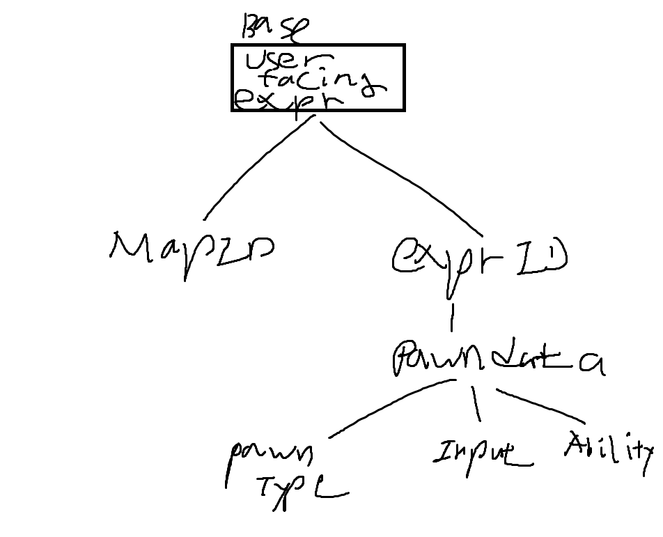

<b>GameMode에서 UserFacingExperience를 읽어서 관련된 데이터들을 불러온다.</b>

이제 월드세팅에서 GameMode를 변경하지 않고 프로젝트 세팅에서 디폴트 게임모드를 쭉 사용할 GameMode로 변경한다.

---

아래에 보이는 사진의 판넬 개수가 전부 라이라에서 사용중인 <b>UserFacingExperience</b>들이다.<br />(데스매치, 테스트게임, 메인메뉴 등등)

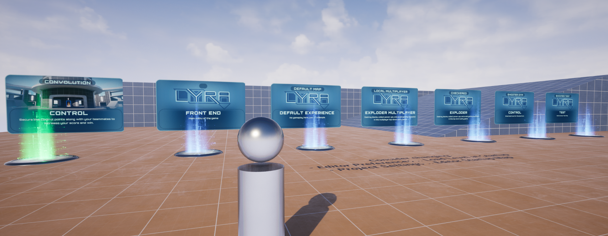

---

우리의 목표는 아래의 Playlist폴더에 추가될 UserFacingExperience들을 사용하는 레벨로 향하는 포탈들을 액터로써 레벨에 띄우는 것

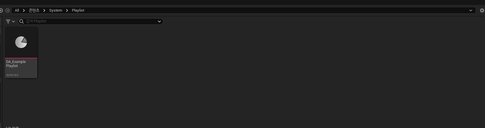

UserFacingExperience들을 띄울 액터인 <b>B\_ExperienceList3D</b>의 동작 목표이다

1. <b>UserFacingExperience에셋들을 Playlist에서 전부 불러온다 (비동기 로드 사용)</b>

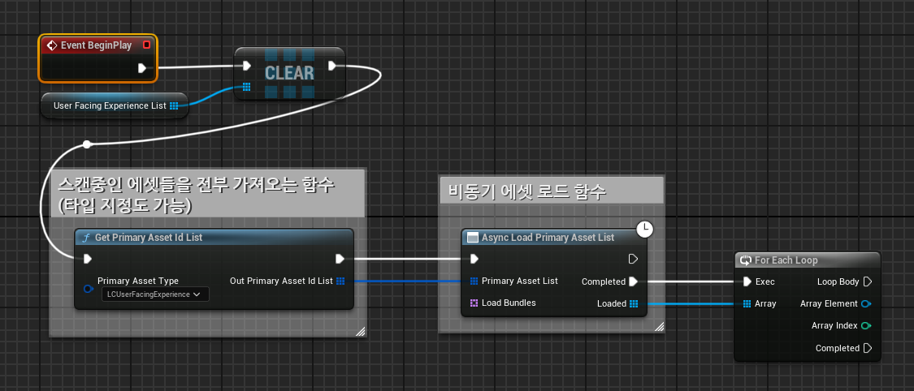

2. <b>모든 에셋을 불러오면 멤버변수의 배열에 저장한다.</b>

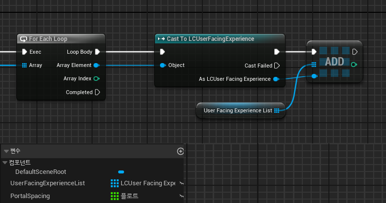

3. <b>배열에 추가된 UserExperience들로 텔레포트 액터 일정한 간격으로 생성</b>

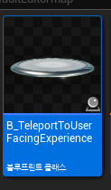<br><em>얘를 생성한다.</em>

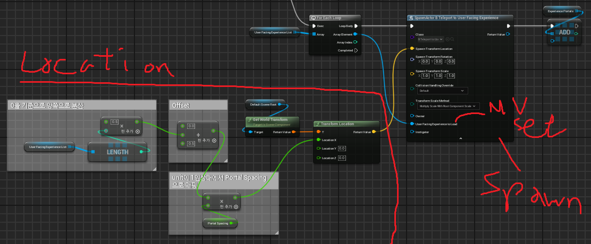<br><em>클래스 변수에 스폰시 노출 켜놓으면 저렇게 스폰과 동시에 값세팅이 가능하다.</em>

<b>결과<br /></b>

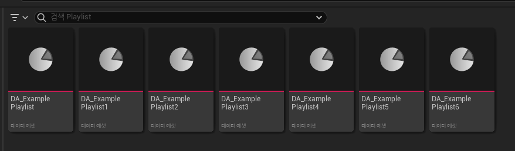

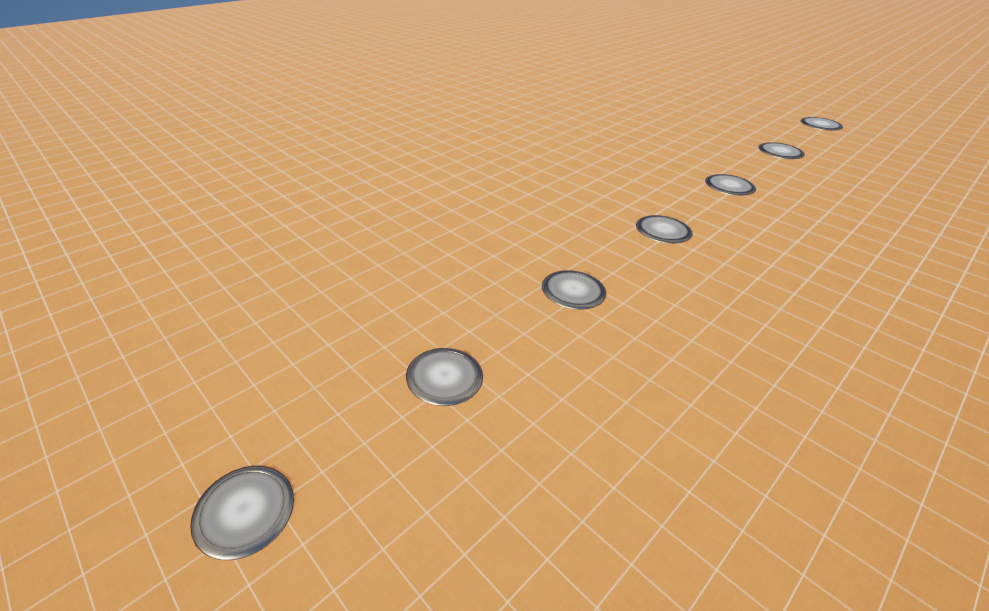

Playlist내 에셋개수만큼 포탈이 생겼다.

---

Experience와 연계해서 사용할 기본 요소들

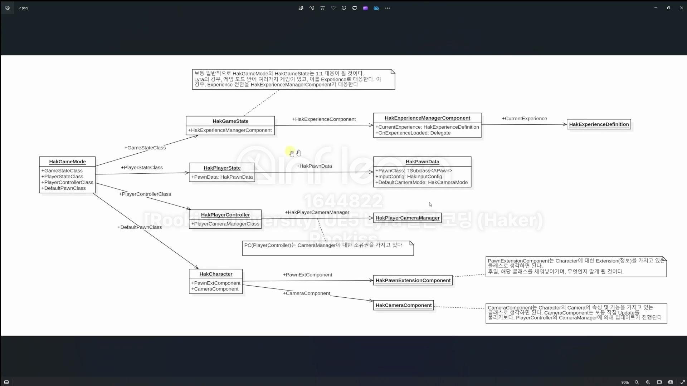

라이라의 프로젝트 초기 흐름이다.<br />게임 초기에 게임모드가 어떤 Experience를 로딩할지 결정하는 함수 <br /><b><code>HandleMatchAssignmentIfNotExpectingOne</code></b> 를 호출해야하는데, InitGame당시에는<br /> ExperienceLoad를 맡을 ExperienceManagerComponent가 생성되어있지 않아 로딩된 Experience들이 없다.<br />그렇다고해서 뭐 델리게이트쓰거나 시점을 어렵게 잡기보다는<br />다음 프레임 시작전에 ExperienceManagerComponent를 가지는 GameState를 스폰을 하고 <br /><b>SetTimerForNextTick</b>으로 다음프레임에 자동으로 해당 함수가 호출되도록 한다.

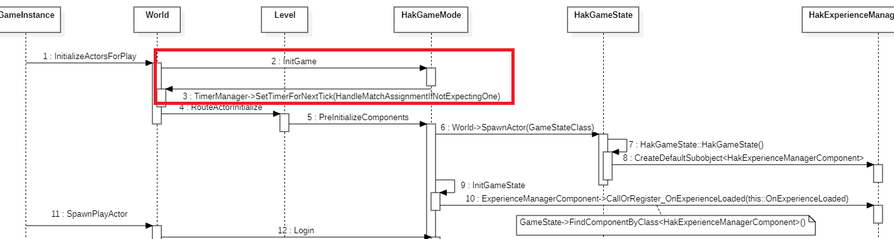

프로젝트 첫 프레임에는 ExperienceLoad를 맡을 ExperienceManagerComponent가 생성되어있지 않음<br />아래 코드 확인

```c++
void ALCGameModeBase::InitGame(const FString& MapName, const FString& Options, FString& ErrorMessage)
{
	Super::InitGame(MapName, Options, ErrorMessage);


	// 한 프레임 뒤로 미루는 이유는
	// Experience의 로딩은 ExperienceManagerComponent에서 맡는데 Init 게임 시점에서는 해당 컴포넌트를 가지는 액터가 스폰되어있지 않다.
	// 그래서 스폰이후로 시점을 잡기위해 타이머로 한 틱 미룬다.
	GetWorld()->GetTimerManager().SetTimerForNextTick(this, &ThisClass::HandleMatchAssignmentIfNotExpectingOne);
	
}
```

---

ExperienceLoad를 맡을 ExperienceManagerComponent 클래스이다.

```c++
enum class ELCExperienceLoadState
{
	Unloaded,Loading,Loaded,Deactivating,
};

DECLARE_MULTICAST_DELEGATE_OneParam(FOnLCExperienceLoaded, const ULCExperienceDefinition*);

/**
ULCExperienceManagerComponent
- 말 그대로, 해당 컴포넌트는 GameState를 Owner로 가지면서 Experience의 상태 정보를 가지고 있는 컴포넌트이다.
- 뿐만 아니라, Manager라는 단어가 포함되어 있듯 Experience 로딩 상태 업데이트 및 이벤트 관리를 맡는다.

 
 */
UCLASS()
class LYRACLONE_API ULCExperienceManagerComponent : public UGameStateComponent
{
	GENERATED_BODY()

public:
	bool IsExperienceLoaded() const { return (LoadState == ELCExperienceLoadState::Loaded) && (CurrentExperience != nullptr); }

	// OnExperienceLoaded에 바인딩하거나 Experience로딩이 완료되었다면 즉시 호출 
	void CallorRegister_OnExperienceLoaded(FOnLCExperienceLoaded::FDelegate&& Delegate);

public:
	UPROPERTY()
	TObjectPtr<class ULCExperienceDefinition> CurrentExperience;

	// Experience상태 모니터링
	ELCExperienceLoadState LoadState = ELCExperienceLoadState::Unloaded;

	// Experience 로딩이 완료된 이후 Broadcasting Delegate
	FOnLCExperienceLoaded OnExperienceLoaded; 
};

```

이 함수는 Experience의 로딩이 정확히 언제되는지 모르기때문에 로딩을 요청했을때 이미  로딩이 완료되었으면 델리게이트 즉시 Execute, 아니면 일단 델리게이트에 추가

```c++
void ULCExperienceManagerComponent::CallorRegister_OnExperienceLoaded(FOnLCExperienceLoaded::FDelegate&& Delegate)
{
	if (IsExperienceLoaded())
	{
		Delegate.Execute(CurrentExperience);
	}
	else
	{
		/*
		 * Delegate 객체를 살펴보면, 내부적으로 필요한 변수들은 메모리 할당해놓는다
		 * TArray<int> a = {1,2,3}
		 * delegate_type delegate = [a]()
		 * {
		 *		return a.Num();
		 * }
		 * a는 delegate_type 내부에 동적할당 되어있다. 복사비용을 낮추기위해 Move사용하는것을 잊지말자
		 */
		
		OnExperienceLoaded.Add(MoveTemp(Delegate));
	}
}
```

GameMode의 GameState가 생성되고 호출되는 함수 <b>InitGameState에서 OnExperienceLoadedDelegate바인딩</b>해준다.

```c++
void ALCGameModeBase::InitGameState()
{
	// GameState생성 이후에 호출되는 함수
	Super::InitGameState();

	// Experience 비동기 로딩을 위한 Delegate 준비한다.
	ULCExperienceManagerComponent* ExperienceManagerComponent = GameState->FindComponentByClass<ULCExperienceManagerComponent>();
	check(ExperienceManagerComponent);

	// OnExperienceLoaded 등록
	ExperienceManagerComponent->CallorRegister_OnExperienceLoaded((FOnLCExperienceLoaded::FDelegate::CreateUObject(this, &ThisClass::OnExperienceLoaded)));
}
```

위에서 델리게이트 바인딩하면 여기로 넘어오게 되는데

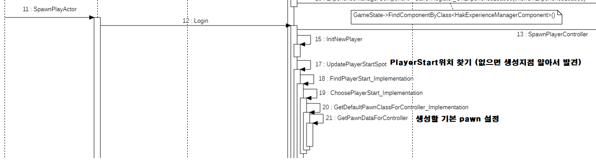

아직 <b>이때는 Experience가 로딩이 되었을리가 없다! (next tick에 로딩하라고 명령했기 때문)</b>

그래서 아래 표시한 부분을 지나 Experience가 로딩되고 나면

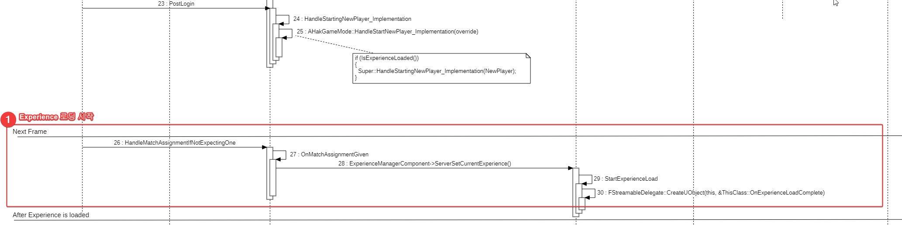

RestartPlayerAtPlayerStart를 통해 위의 11.SpawnPlayActor 섹터부터 다시 시작하게 된다.

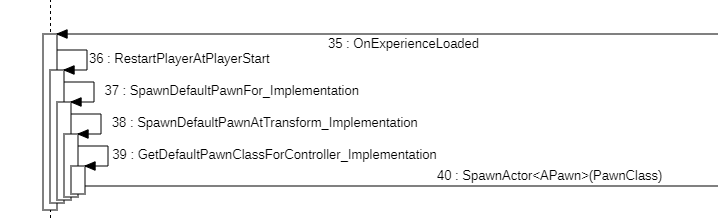

그 전까지 11.SpawnPlayActor 섹터는 <b>Experience로딩 여부가 확인되지 않으면 실행되지 않게 처리할 것이다.</b>

```c++
void ALCGameModeBase::HandleStartingNewPlayer_Implementation(APlayerController* NewPlayer)
{
	if (IsExperienceLoaded())
	{
		// 이거 실행 안하면 SpawnDefaultPawnAtTransform_Implementation같은 다음 프로세스의  함수들 호출이 되지 않는다.
		Super::HandleStartingNewPlayer_Implementation(NewPlayer); 
	}
}

APawn* ALCGameModeBase::SpawnDefaultPawnAtTransform_Implementation(AController* NewPlayer,
	const FTransform& SpawnTransform)
{
	UE_LOG(LogLC, Log, TEXT("SpawnDefaultPawnAtTransform_Implementation is Called!"));
	return Super::SpawnDefaultPawnAtTransform_Implementation(NewPlayer, SpawnTransform);
}
bool ALCGameModeBase::IsExperienceLoaded() const
{
	check(GameState);
	ULCExperienceManagerComponent* ExperienceManagerComponent = GameState->FindComponentByClass<ULCExperienceManagerComponent>();
	check(ExperienceManagerComponent);

	return ExperienceManagerComponent->IsExperienceLoaded();
}
```

<b>Experience로딩이 안되어있으면 HandleStartingNewPlayer\_Implementation 함수의 호출을 막는다.</b>

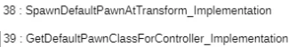

그럼 이 함수들이 실행이 안되고 디폴트폰 스폰이 되지 않는다.

---

```c++
void ALCGameModeBase::InitGame(const FString& MapName, const FString& Options, FString& ErrorMessage)
{
	...
		GetWorld()->GetTimerManager().SetTimerForNextTick(
		this, &ThisClass::HandleMatchAssignmentIfNotExpectingOne);
	
}

```

아무튼 InitGame의 다음 틱에 HandleMatchAssignmentIfNotExpectingOne이 실행된다.

<b>HandleMatchAssignmentIfNotExpectingOne</b>함수를 보자

```c++
void ALCGameModeBase::HandleMatchAssignmentIfNotExpectingOne()
{
	// 우리는 Experience로딩을 선택하는 과정에서만 쓸건데
	// 라이라에서는 지금 Experience가(데디서버든, 에디터모드든) 예상된 것이 들어왔는지 아닌지 확인하는 함수로 쓰인다고 한다.
	// 지금 우리는 디폴트BP만 불러오지만 내부 코드를 보면 우선순위를 통해 현재 우선순위에 맞는 Experience인지를 확인하고 불러온다.
	// 그리고 모든 Experience로딩에 실패했을떄 Default를 로딩한다.
	
	// precedence order (highest wins)
	// - matchmaking assignment (if present)
	// ... 이 외 다양한 Experience체크
	// - default experience


	// 해당 함수에서는 우리가 로딩할 Experience에 대해 PrimaryAssetId를 생성하여, OnMatchAssignmentGiven으로 넘긴다.
	FPrimaryAssetId ExperienceId;

	UWorld* World = GetWorld();

	// 현재 활성화된 ExperienceId가 없으면 디폴트로 사용하기 위해 만들어준 BPClass로 세팅한다.
	// 우리가 에셋매니저에 올려놨기때문에 아래처럼 사용이 가능하다.
	if (!ExperienceId.IsValid())
	{
		ExperienceId = FPrimaryAssetId(FPrimaryAssetType("LCExperienceDefinition"), FName("B_LCDefaultExperience"));	
	}
	
		OnMatchAssignmentGiven(ExperienceId);
}
```

위 코드에서 마지막에 호출된 <b>OnMatchAssignmentGiven함수</b>이다<b>.</b>

```c++
void ALCGameModeBase::OnMatchAssignmentGiven(FPrimaryAssetId ExperienceId)
{
	// ExperienceManagerComponent로 Experience를 로딩하기 위해, ExperienceManagerComponent의 ServerSetCurrentExperience를 호출한다.
	check(ExperienceId.IsValid());

	ULCExperienceManagerComponent* ExperienceManagerComponent = GameState->FindComponentByClass<ULCExperienceManagerComponent>();
	check(ExperienceManagerComponent);
	ExperienceManagerComponent->ServerSetCurrentExperience();
}
```

라이라는 데디서버 기반이기때문에 ServerSetCurrentExperience이런식으로 이름 지은거임<br />그리고 원래는 Experience는 서버에서만 로드됨

```c++
void ULCExperienceManagerComponent::ServerSetCurrentExperience(FPrimaryAssetId ExperienceId) // 우리 플젝에서는 인자로 ExperienceDefinitionDefault가 들어왔을 것이다.
{
	ULCAssetManager& AssetManager = ULCAssetManager::Get();
	
	TSubclassOf<ULCExperienceDefinition> AssetClass;
	{
		// ExperienceDefinition에셋 경로 가져와서
		FSoftObjectPath AssetPath = AssetManager.GetPrimaryAssetPath(ExperienceId);
		// 동기로드
		AssetClass = Cast<UClass>(AssetPath.TryLoad());
	}

	// CDO가져오기
	const ULCExperienceDefinition* Experience = GetDefault<ULCExperienceDefinition>(AssetClass);
	check(Experience != nullptr);
	check(CurrentExperience == nullptr); // 첫 로딩인데 CurrentExperience가 있을 수 없음
	{
		// 그리고 CDO로 CurrentExperience를 설정한다.
		CurrentExperience = Experience;
	}
		StartExperienceLoad();
}
```

아니 근데 <code>AssetPath.TryLoad()</code> 으로 로딩했는데 왜 또 <code>StartExperienceLoad()</code> 라는 함수로 로딩해요?

물론 Experience객체 자체는 로드가 되었는 안에 있는 다른 데이터들이 로드되지 않았다.

그건 아래서 진행한다.

```c++
void ULCExperienceManagerComponent::StartExperienceLoad()
{
	check(CurrentExperience);
	check(LoadState == ELCExperienceLoadState::Unloaded); // 로드 되어있으면 안된다
	
	LoadState = ELCExperienceLoadState::Loading;

	ULCAssetManager& AssetManager = ULCAssetManager::Get();

	TSet<FPrimaryAssetId> BundleAssetList;
	// AssetManager.GetPrimaryAssetId()의 결과로
	// ALCGameModeBase::HandleMatchAssignmentIfNotExpectingOne 여기서 해준
	// FPrimaryAssetId(FPrimaryAssetType("LCExperienceDefinition"), FName("B_LCDefaultExperience"));
	// 해당 Id가 불러와 진다고 한다. 
	BundleAssetList.Add(AssetManager.GetPrimaryAssetId()); // 이러면 

	// load assets associated with the experience
	// 아래는 우리가 후일 GameFeature를 사용하여, Experience에 바인딩된 GameFeature Plugin을 로딩할 Bundle 이름을 추가한다.
	// - Bundle
	/* 로딩할 에셋의 카테고리 이름
	 * 예를들어 BundleAssetList에 수많은 에셋들이 있는데 여기서 BundleName으로 분류된 특정 에셋들을 가져오고 싶으면
	 * AssetManager.ChangeBundleStateForPrimaryAssets함수의 인자 BundlesToLoad로 Bundle이름들을 전달하면
	 * 전달한 Bundle이름을 가진 Asset들이 BundleAssetList에 추가되게된다.
	 * (Ex: 직업으로 분류된 에셋리스트에서 "전사" 라는 번들을 넣으면 전사관련 에셋들만 불러올 수 있다. 
	*/
	
	TArray<FName> BundlesToLoad;
	{
		// 여기서 주목할 부분은 OwnerNetMode가 NM_Standalone이면 Client/Server 둘 다 로딩에 추가된다는 부분
		const ENetMode OwnerNetMode = GetOwner()->GetNetMode();
		bool bLoadClient = GIsEditor || (OwnerNetMode != NM_DedicatedServer); // 에디터거나 데디가 아니면
		bool bLoadServer  = GIsEditor || (OwnerNetMode != NM_Client); // 에디터거나 클라가 아니면
		if (bLoadClient)
		{
			BundlesToLoad.Add(UGameFeaturesSubsystemSettings::LoadStateClient /*TEXT("Client")*/);
		}
		if (bLoadServer)
		{
			BundlesToLoad.Add(UGameFeaturesSubsystemSettings::LoadStateServer /*TEXT("Server")*/);
		}
	}
	FStreamableDelegate OnAssetsLoadedDelegate = FStreamableDelegate::CreateUObject(this, &ThisClass::OnExperienceLoadComplete);

	// 아래도, 후일 Bundle을 우리가 GameFeature에 연동하면서 더 깊게 알아보기로 하고 일단 디폴트Experience를 로딩해주는 함수라고 생각하자.
	TSharedPtr<FStreamableHandle> Handle = AssetManager.ChangeBundleStateForPrimaryAssets( // 번들을 비동기로 로딩해주는 함수래요
		BundleAssetList.Array(),
		BundlesToLoad,
		{}, false, FStreamableDelegate(), FStreamableManager::AsyncLoadHighPriority);
	
	if (!Handle.IsValid() || Handle->HasLoadCompleted())
	{
		// 로딩이 완료되었으면 ExecuteDelegate를 통해 OnAssetsLoadedDelegate를 호출
		FStreamableHandle::ExecuteDelegate(OnAssetsLoadedDelegate);
	}
	else
	{
		// 로딩 완료 안됐으면 
		Handle->BindCompleteDelegate(OnAssetsLoadedDelegate); // 로딩 완료됐을때 OnAssetsLoadedDelegate호출명령
		Handle->BindCancelDelegate(FStreamableDelegate::CreateLambda([OnAssetsLoadedDelegate]()
		{
			// 만약 문제가 생겨서 취소 되었으면 OnAssetsLoadedDelegate 안전하게 호출
			OnAssetsLoadedDelegate.ExecuteIfBound();
		}));
	}
}

void ULCExperienceManagerComponent::OnExperienceLoadComplete()
{
	// check Framenubmer
	static int32 OnExperienceLoadComplete_FrameNumber = GFrameNumber;

	// 해당 함수가 불리는 것은 앞서 보았던 StreamableDelegateDelayHelper에 의해 불림
	OnExperienceFullLoadCompleted();
}

void ULCExperienceManagerComponent::OnExperienceFullLoadCompleted()
{
	LoadState = ELCExperienceLoadState::Loaded;
	OnExperienceLoaded.Broadcast(CurrentExperience);
	OnExperienceLoaded.Clear();
}
```

여기까지가 Experience로딩 과정의 끝이다.

<details>
<summary><b>Experience의 로딩 과정정리</b></summary>

<ol>
<li>
<b><code>GameMode::InitGame</code></b>에서 다음틱에 GameState의 ExperienceLoadedComponent가 <code>HandleMatchAssignmentIfNotExpectingOne</code> 함수를 호출하도록 설정
</li>
<li>
<b><code>GameMode::InitGameState</code></b>에서 <code>ExperienceManagerComponent</code> 가 로딩을 마치면 <code>ALCGameModeBase::OnExperienceLoaded</code> 를 호출하도록 ExperienceManagerComponent의 델리게이트 구독 
</li>
<li>
PlayerController가 Spawn되고 나서 PlayerState Spawn
</li>
<li>
PlayerState가 Spawn되면서 <code>ALCPlayerState::PostInitializeComponents</code> 가 호출되고, <code>ExperienceManagerComponent</code> 가 로딩을 마치면 <code>ALCPlayerState::OnExperienceLoaded</code> 를 호출하도록 ExperienceManagerComponent의 델리게이트 구독 
</li>
<li>
PlayActor가 생성될 차례지만 <code>ALCGameModeBase::HandleStartingNewPlayer_Implementation</code> 에서 <code>IsExperienceLoaded</code> 함수로 Experience가 로딩이 되지 않았으면 PlayActor생성을 막음
</li>
<li>
엔진틱 다음틱으로 넘어감
</li>
<li>
ExperienceLoadedComponent가<code>HandleMatchAssignmentIfNotExpectingOne</code> 함수 호출
</li>
<li>
우선순위 따라서 로드할 ExperienceId고르고 ExperienceLoadedComponent에 해당 Id전달
</li>
<li>
ExperienceId를 사용해 ExperienceDefinition에셋 로드 및 클래스 얻음
</li>
<li>
<code>StartExperienceLoad</code> 를 통해 Experience로드 시작
</li>
<li>
<code>StartExperienceLoad</code> 함수내에서 에셋 번들 비동기 로드 시작 및 로드 완료 이벤트로 <code>OnExperienceLoadComplete</code> 함수 구독
</li>
<li>
위의 <code>ALCGameModeBase::OnExperienceLoaded</code> (2번)와 <code>ALCPlayerState::OnExperienceLoaded</code> (4번)가 구독중인 <code>OnExperienceLoaded</code>  델리게이트 브로드 캐스팅
</li>
</ol>

</details>

---

<b>Experience 로드 이후</b>

<b>ALCPlayerState::OnExperienceLoaded</b>

```c++
	void ALCPlayerState::OnExperienceLoaded(const class ULCExperienceDefinition* CurrentExperience)
{
	if (ALCGameModeBase* GameMode = GetWorld()->GetAuthGameMode<ALCGameModeBase>())
	{

		const ULCPawnData* NewPawnData = GameMode->GetPawnDataForController(GetOwningController());
		check( NewPawnData);

		SetPawnData(NewPawnData);
	}
}

```

위에서 호출된 <b>ALCGameModeBase::GetPawnDataForController</b> 함수이다.

```c++
const ULCPawnData* ALCGameModeBase::GetPawnDataForController(const AController* InController) const
{
	// 게임 도중에 PawnData가 Override 되었을 경우, PawnData는 PlayerState에서 가져오게 됨
	if (InController)
	{
		if (const ALCPlayerState* LCPS = InController->GetPlayerState<ALCPlayerState>())
		{	
			if (const ULCPawnData* PawnData = LCPS->GetPawnData<ULCPawnData>())
			{
				return PawnData;	
			}
		}
	}
}
```

함수의 첫번째 분기를 보면 분명히 PlayerState에서 GameMode의 함수를 호출했는데 다시 PlayerState의 PawnData를 받아와서 반환해주는 걸 알 수있다.

(이 함수는 OnExperience이후에 호출하면 PlayerState의 PawnData를 반환하고, 초기에는 DefaultPawnData를 반환해서 PawnData를 하나의 함수로 받아오기 위함으로 보인다

 만약 이후에 PlayerState에 캐싱 안되어있어도 디폴트 받아오니까 안정성도 굳, PlayerState와 GameState의 느슨한 결합도 구현)

<b>ALCGameMode::OnExperienceLoaded</b>

```c++
void ALCGameModeBase::OnExperienceLoaded(const class ULCExperienceDefinition* CurrentExperience)
{
	for (FConstPlayerControllerIterator Iterator = GetWorld()->GetPlayerControllerIterator(); Iterator; ++Iterator)
	{
		APlayerController* PC = Cast<APlayerController>(*Iterator);

		// PlayerController가 Pawn을 Possess하지 않았다면 RestartPawn을 통해 다시 spawn
		// 한 번 OnPossess를 보도록 하자
		if (PC && PC->GetPawn() == nullptr)
		{
			if (PlayerCanRestart(PC))
			{
				RestartPlayer(PC);
			}
		}
	}
}
```

RestartPlayer를 왜해주냐

→ 아까 우리가

```c++
void ALCGameModeBase::HandleStartingNewPlayer_Implementation(APlayerController* NewPlayer)
{
		if (IsExperienceLoaded())
	{
		// 이거 실행 안하면 SpawnDefaultPawnAtTransform_Implementation같은 다음 프로세스의  함수들 호출이 되지 않는다.
		Super::HandleStartingNewPlayer_Implementation(NewPlayer); 
	}
}
```

이렇게 플레이어의 생성을 막아버렸기 때문에 해당 프로세스를 다시 호출하여야 한다.<br /><code>RestartPlayer</code>내부에서 <code>SetPawn</code>이 호출된다

Character액터가 생성된 걸 볼 수있다.

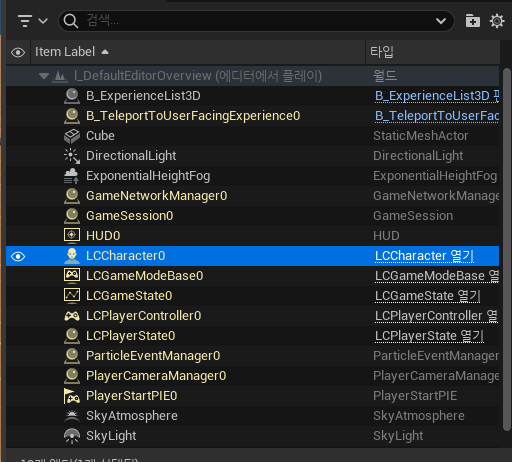

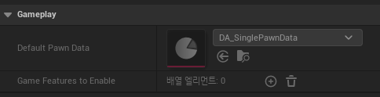

하지만 우리는 아래의 친구가 소환되길 원하고 있는데 타입을보면 LCCharacter인것을 볼 수가 있다.

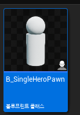

그 이유는 언리얼이 내부적으로 <b><span>Pawn을 생성하려고 하기위해 PawnClass를 Get 하는 함수인</span></b> <b><code>GetDefaultPawnClassForController_Implementation</code></b><b>함수가 DefaultPawnClass</b>를 반환하기 때문이다.

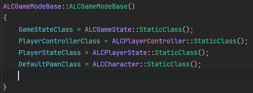

따라서 <b>GetDefaultPawnClassForController\_Implementation오버라이딩</b>해서 함수 수정해야한다.

```c++
UClass* ALCGameModeBase::GetDefaultPawnClassForController_Implementation(AController* InController)
{
	// GetPawnDataForController를 활용해 PawnData로부터 PawnClass를 유도한다.
	if (const ULCPawnData* PawnData = GetPawnDataForController(InController))
	{
		if (PawnData->PawnClass)
		{
			return PawnData->PawnClass;
		}
	}
	
	return Super::GetDefaultPawnClassForController_Implementation(InController);
}
```

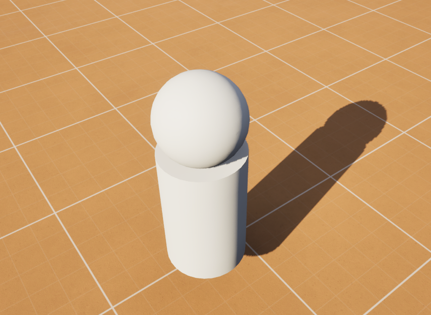

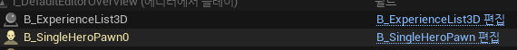

<details>
<summary><b>PawnData의 로딩 과정정리</b></summary>

1. Experience로드 후 <code>ALCGameModeBase::OnExperienceLoaded</code> <code>ALCPlayerState::OnExperienceLoaded</code> 델리게이트 브로드 캐스팅
2. <code>ALCGameModeBase::OnExperienceLoaded</code> 에서  Experience를 로드하지 못해 생성하지 못했던 플레이어를 <b><code>RetartPlayer</code></b>함수를 통해 Spawn시도합니다.<br />이때 RestartPlayer내부에서 폰을 설정할때 <code>GetDefaultPawnClassForController_Implementation</code> 함수를 통해 DefaultPawnClass로 Pawn을 생성하려고 하므로 CustomPawnClass를 return해주기 위해서는 <code>GetDefaultPawnClassForController_Implementation</code><br />함수를 오버라이딩하고 함수 내부에서  <code>ALCGameModeBase::GetPawnDataForController</code> 함수를 통해 PawnData를 받고 PawnData내의 PawnClass를 반환시킵니다.
3. <code>ALCPlayerState::OnExperienceLoaded</code> 에서 <code>ALCGameModeBase::GetPawnDataForController</code> 함수를 통해 PawnData를 Setting합니다.

---

</details>

마지막으로 플레이어 Start 세팅도 잘 동작하는걸 확인할 수 있다.

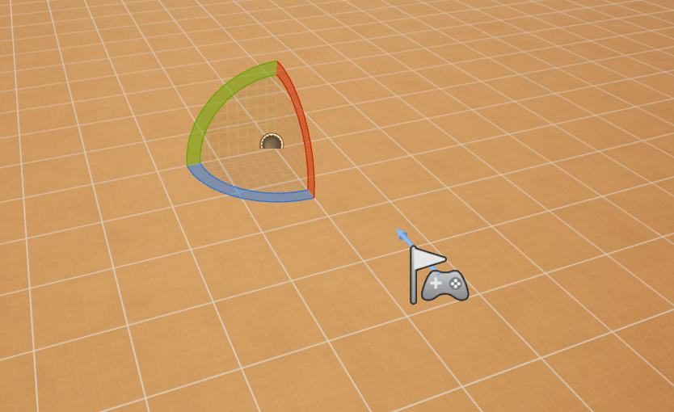

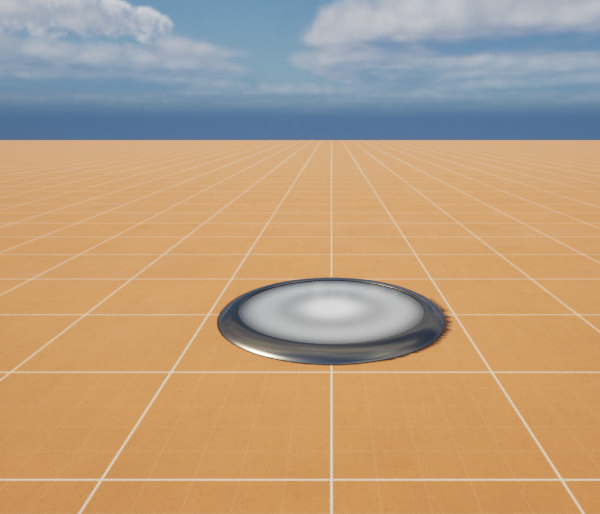

---

- <code>AOWGameMode</code> : 어떤 Experience를 쓸지 고르고, 플레이어 시작을 조율
- <code>AOWGameState</code> : <code>UOWExperienceManagerComponent</code>를 소유
- <code>UOWExperienceManagerComponent</code> : Experience 로드, Bundle 로드, GameFeature 활성화, Action 실행
- <code>UOWExperienceDefinition</code> : 기본 PawnData, GameFeature 목록, ActionSet/Action 소유

```c++
void AOWGameMode::InitGame(const FString& InMapName, const FString& InOptions, FString& OutErrorMessage)
{
    Super::InitGame(InMapName, InOptions, OutErrorMessage);
    GetWorld()->GetTimerManager().SetTimerForNextTick(this, &ThisClass::HandleMatchAssignmentIfNotExpectingOne);
}
```

<code>InitGame</code>에서 바로 Experience를 정하지 않고 다음 틱으로 미룬다.

왜냐하면 GameState와 GameStateComponent 준비 타이밍을 기다려야 하기 때문이다.

```c++
void AOWGameMode::HandleStartingNewPlayer_Implementation(APlayerController* InNewPlayer)
{
    if (IsExperienceLoaded())
    {
        Super::HandleStartingNewPlayer_Implementation(InNewPlayer);
    }
}
```

Experience가 로드되기 전에는 Pawn spawn을 막는다.

PawnClass는 <code>DefaultPawnClass</code>가 아니라 <code>PawnData</code>에서 결정되기 때문에, Experience 로드 전에는 플레이어를 시작시키면 안된다.

```c++
const UOWPawnData* AOWGameMode::GetPawnDataForController(const AController* InController) const
{
    if (InController)
    {
        if (const AOWPlayerState* PlayerState = InController->GetPlayerState<AOWPlayerState>())
        {
            if (const UOWPawnData* PawnData = PlayerState->GetPawnData<UOWPawnData>())
            {
                return PawnData;
            }
        }
    }

    const UOWExperienceDefinition* Experience = ExperienceManagerComponent->GetCurrentExperienceChecked();
    return Experience->DefaultPawnData;
}
```

이 함수가 굳 포인트다.

나중에 영웅 선택 같은 것으로 PlayerState가 PawnData를 override하면 그 값을 쓰고, 아니면 Experience의 기본 PawnData를 쓴다.

즉 GameMode는 "어디서 가져올지"만 조율하고, 실제 데이터의 소유는 PlayerState/Experience 쪽에 남겨둔다.

<details>
<summary><b>Experience 로딩 과정정리</b></summary>

1. <code>AOWGameMode::InitGame</code>에서 다음 틱에 <code>HandleMatchAssignmentIfNotExpectingOne</code> 예약
2. URL Option의 <code>Experience</code> 값을 우선 확인하고, 없으면 기본 Experience 사용
3. <code>AOWGameMode::OnMatchAssignmentGiven</code>이 <code>UOWExperienceManagerComponent::ServerSetCurrentExperience</code> 호출
4. Experience PrimaryAsset을 로드하고 <code>CurrentExperience</code> 설정
5. <code>StartExperienceLoad</code>에서 Experience와 ActionSet의 Bundle을 Client/Server NetMode에 맞게 로드
6. <code>OnExperienceLoadComplete</code>에서 Experience/ActionSet의 <code>GameFeaturesToEnable</code>을 모아 GameFeature Plugin 로드 및 활성화
7. <code>OnExperienceFullLoadCompleted</code>에서 Experience Actions와 ActionSet Actions를 실행
8. <code>OnExperienceLoaded</code> 브로드캐스트
9. GameMode는 대기 중이던 PlayerController를 <code>RestartPlayer</code>로 정상 시작

</details>
