라이라에서 사용하고 언리얼에서 전폭으로 지원중인 GameFeature플러그인에 대해 알아보자

---

기존의 게임 규칙을 정의하던 GameMode라는 모듈에서는 점령전, 깃발뺏기등의 규칙을 정의하는데 사용했다면<br />GameFeature는 이 모듈을 더 작은단위로 쪼개서 사용 가능하다는것 같다.

- [CommonUser](commonuser-22583382.md)

GameFeature플러그인을 추가했으면 

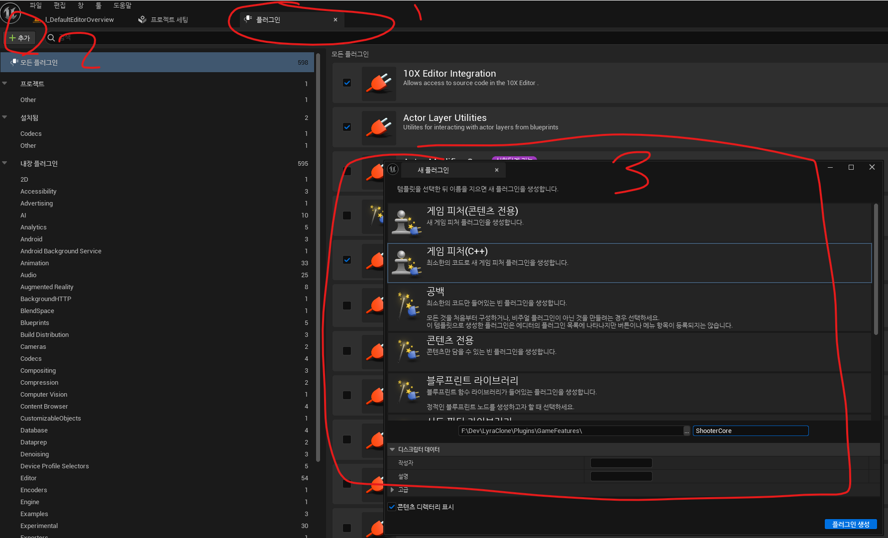

추가버튼을 눌러서 GameFeature을 추가할 수 있다. (ShooterCore라는 이름으로 만들었다)

GameFeature는 아래사진의 GameFeatures폴더 밑에 있어야만 동작한다.

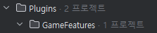

아무튼 위처럼 GameFeature을 추가하면 내가 GameFeature을 사용해서 <b>ShooterCore라는 Plugin을 만든 것</b>이다. 이제 ShooterCore플러그인을 추가한다. 

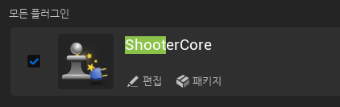

---

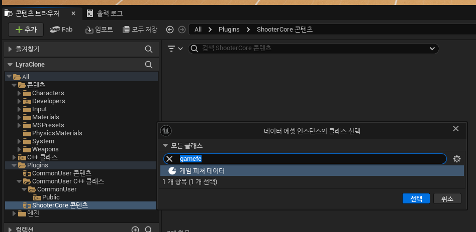

플러그인을 추가하면 <b>Plugin폴더에 ShooterCore콘텐츠 폴더</b>가 생기는데 거기에 <b>게임피처 데이터로 DataAsset</b>을 만든다

해당 DataAsset의 데이터를 보면 아래처럼 생겼다.

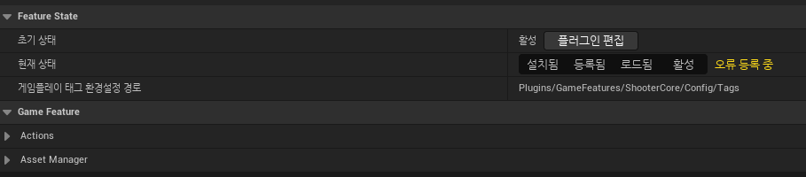

현재 상태

<b>설치됨 </b>: GameFeature 플러그인이 설치만 되어있는 상태

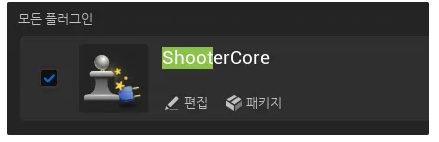<br><em>여기에 체크만 안되어있다고 생각하면된다.</em>

<b>등록됨</b> : GameFeature 플러그인을 사용한다고 체크를 한 상태 (뭐 빌드에 포함이 되는 정도일듯?)

<b>로드됨</b> : GameFeature가 메모리에 올라감

<b>액티브 </b>: GameFeature가 실행중임

---

GameFeature가 왜좋냐 하면

[<b><u>위의 멤버</u></b>](game-feature%EC%9D%98-%EA%B5%AC%EC%A1%B0%EC%99%80-%ED%99%9C%EC%84%B1%ED%99%94-22583382.md)들을 보면 Action이라는 멤버가 있는데

이 액션에다가 “모든 <code>ACharacter</code>가 날 수 있음” 이라는 기능을 넣어두고 <b><u>런타임중에</u></b><b> </b>이 GameFeature을 활성화시키면

그 순간 모든 <code>ACharacter</code> 가 날 수 있게된다. (WOW!!!)

마지막으로 <b><u>위의 멤버</u></b>의 AssetManager를 보면 이 GameFeature에서만 사용할 에셋들을 등록할 수 있게 되어있다.

ShooterCore Plugin 컨텐츠 폴더에 DefaultExperience처럼 폴더와 파일들을 넣어준다.<br />(userfacingexperience, map, experiencedefinition,  pawndata)

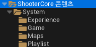

그리고 플러그인의 Root폴더에 위에서 설명한 GameFeatureDataAsset를 만들고 해당 데이터 에셋의 Assetmanager부분에 하위에 추가한 항목들을 에셋 스캔에 포함시키면된다 

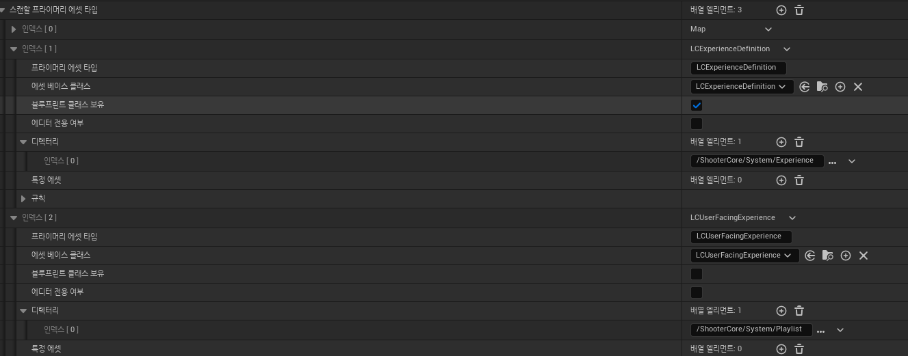

그럼 스캔된 에셋에 ShooterCore\_UserFacingExperience가 포함되어 포탈이 생기게 된다.

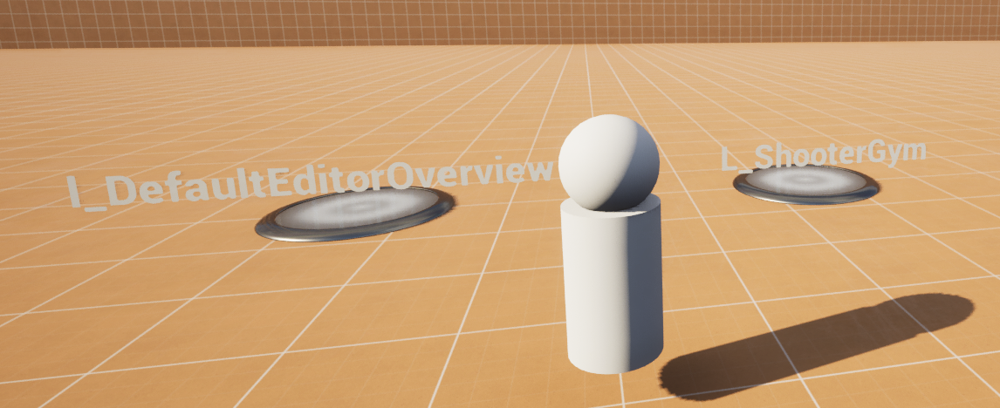

---

근데 위처럼하면 맵은 로드되어 들어가지는데 ExperienceDefinition은 로드가 안된상태라 들어갈 수 없다. 그 이유는 아직 CommonUser시스템을 통해 받은 URL을 사용하지 않았기 때문..

Level이 로드될때 호출되는 InitGame단계의 <code>ALCGameModeBase::HandleMatchAssignmentIfNotExpectingOne</code> 함수를 확인한다.

<code>ALCGameModeBase::HandleMatchAssignmentIfNotExpectingOne</code> 함수는 현재 들어온 Experience가 의도된것인지 확인하는 역할을 한다.

```c++
void ALCGameModeBase::HandleMatchAssignmentIfNotExpectingOne()
{
...
	// ?Experience=Name // 이렇게 파라미터가 넘어오는데 여기서 Name을 뽑아서 사용한다.
	// ParseOption함수를 사용하면 Experience가 가리키는 값을 가져온다.
	// 우리가 앞서, URL과 함께 ExtraArgs로 넘겼던 정보는 OptionString에 저장되어잇다.
	if (!ExperienceId.IsValid() && UGameplayStatics::HasOption(OptionsString, TEXT("Experience")))
	{
		const FString ExperienceFromOptions = UGameplayStatics::ParseOption(OptionsString, TEXT("Experience"));
		ExperienceId = FPrimaryAssetId(FPrimaryAssetType(ULCExperienceManagerComponent::StaticClass()->GetFName()), FName(*ExperienceFromOptions));
	}

	OnMatchAssignmentGiven(ExperienceId);
}
```

우리는 <code>ULCUserFacingExperience</code> 에서 아래와 같이 URL을 만들어 주었기 때문에

```c++
UCommonSession_HostSessionRequest* ULCUserFacingExperience::CreateHostingRequest() const
{
	const FString ExperienceName = ExperienceID.PrimaryAssetName.ToString();
	
	UCommonSession_HostSessionRequest* Result = NewObject<UCommonSession_HostSessionRequest>();
	Result->MapID = MapID;
	Result->ExtraArgs.Add(TEXT("Experience"), ExperienceName);

	return Result;
}
```

?ExperienceName=B\_LCShooterGame\_ControlPoint 이런식으로 들어오게 된다.

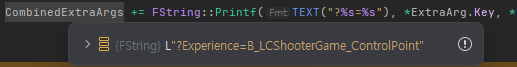<br><em>이런식으로 Arg가 들어온다.</em>

```c++
ExperienceId = FPrimaryAssetId(FPrimaryAssetType("LCExperienceDefinition"), FName("B_LCShooterGame_ControlPoint "));
```

즉 이렇게 된다는 뜻

---

```c++
UCLASS()
class LYRACLONE_API ULCExperienceDefinition : public UPrimaryDataAsset
{
	GENERATED_BODY()
public:
	ULCExperienceDefinition(const FObjectInitializer& ObjectInitializer = FObjectInitializer::Get());
...
	UPROPERTY(EditDefaultsOnly, Category = "Gameplay")
	TArray<FString> GameFeaturesToEnable;
};

```

GameFeaturesToEnable 이 친구가 기억날것이다.

이 친구들을 로드하기 위해<br />Experience로드 과정에 GameFeaturePluginLoad를 추가한다. 

```c++
void ULCExperienceManagerComponent::OnExperienceLoadComplete() // GameFeature로드 및 활성화
{
	// Look FrameNumber carefully
	static int32 OnExperienceLoadComplete_FrameNumber = GFrameNumber;

	check(LoadState == ELCExperienceLoadState::Loading);
	check(CurrentExperience);

	// 이전 활성화된 GameFeature Plugin의 URL 클리어
	GameFeaturePluginURLs.Reset();

	auto CollectGameFeaturePluginURLS = [This = this] (const UPrimaryDataAsset* Context, const TArray<FString>& FeaturePluginList)
	{
		// GameFeaturePluginList를 순회하며, PluginUYRL을 ExperienceManagerComponent의 GameFeaturePluginURLS에 추가해준다.
		for (const FString& PluginName : FeaturePluginList)
		{
			FString PluginURL;
			if (UGameFeaturesSubsystem::Get().GetPluginURLByName(PluginName, PluginURL)) // 플러그인 이름 넣으면 플러그인 URL반환해주는 함수
			{
				This->GameFeaturePluginURLs.AddUnique(PluginURL);
			}
		}
	};

	// GameFeaturesToEnable에 있는 Plugin만 일단 활성화할 GameFeature Plugin 후보군으로 등록
	CollectGameFeaturePluginURLS(CurrentExperience, CurrentExperience->GameFeaturesToEnable);

	// GameFeaturePluginURL에 등록된 Plugin을 로딩 및 활성화
	NumGameFeaturePluginsLoading = GameFeaturePluginURLs.Num();
	if ( NumGameFeaturePluginsLoading )
	{
		LoadState = ELCExperienceLoadState::LoadingGameFeatures;
		for (const FString& PluginURL : GameFeaturePluginURLs)
		{
			// 매 plugin이 로딩 및 활성화 이후 OnGameFeaturePluginLoadComplete 콜백 함수 등록															// 로드 끝나면 해당 함수 호출된다.
			UGameFeaturesSubsystem::Get().LoadAndActivateGameFeaturePlugin(PluginURL, FGameFeaturePluginLoadComplete::CreateUObject(this ,&ThisClass::OnGameFeaturePluginLoadComplete));
			
		}
	}
}

void ULCExperienceManagerComponent::OnGameFeaturePluginLoadComplete(const UE::GameFeatures::FResult& Result)
{
	// 매 GameFeature plugin이 로딩될 때 이 함수가 콜백으로 불린다.
	NumGameFeaturePluginsLoading--;
	if (0 == NumGameFeaturePluginsLoading)
	{
		// GameFeaturePlugin 로딩과 활성화과 끝났다면 UGameFeatureAction을 활성화한다.
		OnExperienceFullLoadCompleted();
	}
	
	// 해당 함수가 불리는 것은 앞서 보았던 StreamableDelegateDelayHelper에 의해 불림
}

```

---

## GameFeatureAction Input

HeroComponent를 갖는 B\_DefaultHero를 상속받아 각 Experience에서 사용할 캐릭터를 만들고 세팅한다.

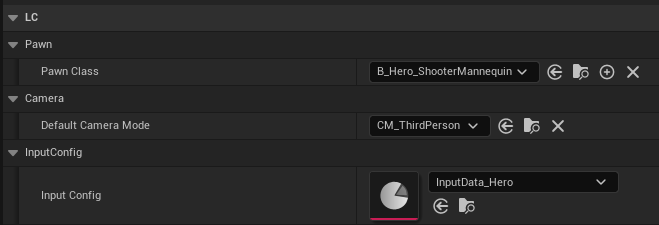

사용자가 사용하는 캐릭터는<b> Experience마다 input이 달라질수도 있을것</b>이다.<br />지금 이 Input처리를 HeroComponent에서 아래처럼 하고있는데

```c++
void ULCHeroComponent::InitializePlayerInput(UInputComponent* PlayerInputComponent)
{

	// PawnExtensionComponent -> PawnData - >InputConfig 존재 유무 판단.
	if (ULCPawnExtensionComponent* PawnExtensionComponent = ULCPawnExtensionComponent::FindPawnExtensionComponent(Pawn))
	{
		if (const ULCPawnData* PawnData = PawnExtensionComponent->GetPawnData<ULCPawnData>())
		{
			if (const ULCInputConfig* InputConfig = PawnData->InputConfig)
			{
				const FLCGameplayTags GameplayTags = FLCGameplayTags::Get();

				// HeroComponent가지고 있는 InputMapping Context를 순회하며 EnhancedInputLocalPlayerSubsystem에 추가
				for (const FLCMappableConfigPair& Pair : DefaultInputConfigs)
				{
					if (Pair.bShouldActivateAutomatically)
					{
						FModifyContextOptions Options = {};
						Options.bIgnoreAllPressedKeysUntilRelease = false;

						// 내부적으로 Input Mapping Context를 추가한다.
						SubSystem->AddPlayerMappableConfig(Pair.Config.LoadSynchronous(), Options);
					}
				}
				ULCInputComponent* LCIC = CastChecked<ULCInputComponent>(PlayerInputComponent);
				{
					LCIC->BindNativeAction(InputConfig, GameplayTags.InputTag_Move, ETriggerEvent::Triggered, this ,&ThisClass::Input_Move, false);
					LCIC->BindNativeAction(InputConfig, GameplayTags.InputTag_Look_Mouse, ETriggerEvent::Triggered, this ,&ThisClass::Input_LookMouse, false);
				}
			}
		}
	}
}
```

볼드처리 한 부분을 보면 <b>어떤 인풋에 어떤액션과 함수가 있을줄 알고</b> 여기에 코드를 작성하고 있는데딱봐도 <b>하드코딩</b>이 심할것으로 예측된다.

이걸 피하기 위해 이제 <b>Input</b>은 <b>Action</b>과 연결지을것이다.

<b>Action은 GameFeatrue에 종속적</b>으로 <b>GameFeature이 꺼지면 사용 가능했던 액션들은 사용 불가능</b>해진다.

<code>ULCExperienceActionSet</code>  클래스는 GameFeature가 사용할 액션을 모아놓은 Wrapper클래스이다.

```c++
class LYRACLONE_API ULCExperienceActionSet : public UPrimaryDataAsset
{
	GENERATED_BODY()
public:
	ULCExperienceActionSet();

	UPROPERTY(EditAnywhere, Category="Actions To Perform")
	TArray<TObjectPtr<UGameFeatureAction>> Actions;
	
};
```

이 클래스를 ExperienceDefinition이 들고있는다.

```c++
UCLASS()
class LYRACLONE_API ULCExperienceDefinition : public UPrimaryDataAsset
{
	GENERATED_BODY()
public:
	ULCExperienceDefinition(const FObjectInitializer& ObjectInitializer = FObjectInitializer::Get());

	UPROPERTY(EditDefaultsOnly, Category = "Gameplay")
	TObjectPtr<class ULCPawnData> DefaultPawnData;

	/*
		아래 변수는 단순히 마킹 및 기억용으로 남겨둔다.
		- 게임모드에 따른 GameFeature plugin을 로딩하는데 이에 대한 연결고리라고 생각하면 된다.
		- 후일 ShooterCore 관련 Plugin할때 사용할거임
	*/
	UPROPERTY(EditDefaultsOnly, Category = "Gameplay")
	TArray<FString> GameFeaturesToEnable;

	// ExperienceActionSet은 UGameFeatureAction의 Set이며, Gameplay용도에 맞게 분류의 목적으로 사용한다.
	UPROPERTY(EditDefaultsOnly, Category = "Gameplay")
	TArray<TObjectPtr<class ULCExperienceActionSet>> ActionSets;

	// 일반적인 GameFeatureAction으로서 추가
	UPROPERTY(EditDefaultsOnly, Category = "Action")
	TArray<TObjectPtr<class UGameFeatureAction>> Actions; 

};

```

코드를 보면 <code>UGameFeatureAction</code> 의 Wrapper라던  <code>ULCExperienceActionSet</code> 을 들고있는데 <br /><code>UGameFeatureAction</code> 를 또 들고있는걸 볼 수 있는데

Wrap을 하는 이유는 <b>분류의 목적</b>이라고 한다.

<code>UGameFeatureAction</code> 의 기능을 보면 기본적으로 아래의 기능들을 제공한다.

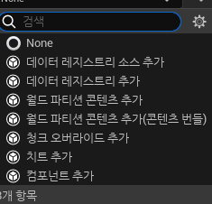

---

Experience의 로딩이 끝나면 Experience내의 Action들을 로딩해준다.<br />코드에서 집중할부분은 <code>OnGameFeatureActivating</code> 함수를 위해 WorldContext를 가져오고 바인딩 해야한다 정

```c++
void ULCExperienceManagerComponent::OnExperienceFullLoadCompleted()
{
	check(LoadState != ELCExperienceLoadState::Loaded);
	// 여기서 Action이 실행된다.
	// GameFeature Plugin의 로딩과 활성화 이후 GameFeature Action들을 활성화 시키자
	{
		LoadState = ELCExperienceLoadState::ExecutingActions;

		// GameFeatureAction 활성화를 위한 Context준비
		FGameFeatureActivatingContext Context;
		{
			// World의 Handle세팅
			// 아래코드는 PIE에서 여러 클라이언트를 편하게 테스트하기위해 사용한다.
			// 현재 클라이언트의 WorldContext를 GEngine->GetWorldContextFromWorld로 가져옴으로
			// 액션에 현재 액션을 사용하려고하는 올바른 클라이언트의 컨텍스트를 넘겨줄 수있다.
			const FWorldContext* ExistingWorldContext = GEngine->GetWorldContextFromWorld(GetWorld());
			if (ExistingWorldContext)
			{
				Context.SetRequiredWorldContextHandle(ExistingWorldContext->ContextHandle);	
			}
		}
		auto ActivateListOfActions = [&Context](const TArray<UGameFeatureAction*>&	ActionList)
		{
			for (UGameFeatureAction* Action : ActionList)
			{
				// 명시적으로 GameFeatureAction에 대해 Registering -> Loading -> Activating순으로 호출한다.
				if (Action)
				{
					Action->OnGameFeatureLoading();
					Action->OnGameFeatureLoading();
					Action->OnGameFeatureActivating(Context);
				}
			}
		};

		// 1. Experience의 actions
		ActivateListOfActions(CurrentExperience->Actions);

		// 2. Experience의 ActionSets
		for (const ULCExperienceActionSet* ActionSet : CurrentExperience->ActionSets)
		{
			ActivateListOfActions(ActionSet->Actions);
		}
	}
	
	LoadState = ELCExperienceLoadState::Loaded;
	OnExperienceLoaded.Broadcast(CurrentExperience);
	OnExperienceLoaded.Clear();
}

```

GameFeatureAction의 Base로 사용할 Class

<b>헤더</b>

```c++
UCLASS(Abstract)
class UGameFeatureAction_WorldActionBase : public UGameFeatureAction
{
	GENERATED_BODY()
public:
	/**
	 * UGameFeatureAction's interface
	 */
	virtual void OnGameFeatureActivating(FGameFeatureActivatingContext& Context) override;

	/**
	 * interface
	 */
	virtual void AddToWorld(const FWorldContext& WorldContext, const FGameFeatureStateChangeContext& ChangeContext) PURE_VIRTUAL(UGameFeatureAction_WorldActionBase::AddToWorld, );
};
```

<b>cpp</b>

```c++
#include UE_INLINE_GENERATED_CPP_BY_NAME(GameFeatureAction_WorldActionBase)

void UGameFeatureAction_WorldActionBase::OnGameFeatureActivating(FGameFeatureActivatingContext& Context)
{
	// 엔진 내 월드 순회하면서
	for (const FWorldContext& WorldContext : GEngine->GetWorldContexts())
	{
		// For문 변수인 현재 WorldContext랑, 해당함수를 호출한 WorldContext가 일치하는지 확인
		// 각 월드 내의 요소들에게 작용하려면 Context를 알아야 하기 때문에 AddToWorld의 인자로 넘겨준 것으로 보인다.
		if (Context.ShouldApplyToWorldContext(WorldContext))
		{
			AddToWorld(WorldContext, Context);
		}
	}
}
```

---

가장 먼저 만들려고했던 Hero들에 InputConfig를 바인딩해주는 InputConfigAction을 만들어보자

<b>헤더</b>

```c++
UCLASS()
class UGameFeatureAction_AddInputConfig : public UGameFeatureAction_WorldActionBase
{
	GENERATED_BODY()
public:
	/**
	 * UGameFetaureAction interface
	 */
	virtual void OnGameFeatureActivating(FGameFeatureActivatingContext& Context) override;
	virtual void OnGameFeatureDeactivating(FGameFeatureDeactivatingContext& Context) override;

	/**
	 * UGameFeatureAction_WorldActionBase interface
	 */
	virtual void AddToWorld(const FWorldContext& WorldContext, const FGameFeatureStateChangeContext& ChangeContext) override;

private:
	// 각 Client의 Context들을 들고있는 느낌이다.
	struct FPerContextData
	{
		TArray<TSharedPtr<FComponentRequestHandle>> ExtensionRequestHandles;
		TArray<TWeakObjectPtr<APawn>> PawnsAddedTo;
	};

	/** GameFeatureState  */
	void HandlePawnExtension(AActor* Actor, FName EventName, FGameFeatureStateChangeContext ChangeContext);

	/** InputConfig EnhancedInputLocalPlayerSubsystem */
	void AddInputConfig(APawn* Pawn, FPerContextData& ActiveData);
	void RemoveInputConfig(APawn* Pawn, FPerContextData& ActiveData);

	/** ActiveData를 초기화 */
	void Reset(FPerContextData& ActiveData);

	/** world -> (extension request, pawn) */
	TMap<FGameFeatureStateChangeContext, FPerContextData> ContextData;

	UPROPERTY(EditAnywhere)
	TArray<FLCMappableConfigPair> InputConfigs;
};
```

<b>cpp</b>

함수들을  살펴보자

<b><code>UGameFeatureAction_AddInputConfig::Reset</code></b><b> </b>

```c++
void UGameFeatureAction_AddInputConfig::Reset(FPerContextData& ActiveData)
{
	// ExtensionRequestHandles초기화
	ActiveData.ExtensionRequestHandles.Empty();

	// Valid한 Pawn은 InputConfig제거해주고 Valid하지 않은 Pawn은 관리에서 제거한다.
	// GameFeatureAction은 Engine단위이기 때문에 엔진이 꺼지지 않으면 메모리에 남아있기때문에 초기화가 되어있지 않다.
	// 따라서 게임을 껐다켜도 PawnsAddedTo에 메모리를 참조하고 있을수가 있다는 뜻이다.
	// 따라서 명시적으로 초기화한다.
	while (!ActiveData.PawnsAddedTo.IsEmpty())
	{
		TWeakObjectPtr<APawn> PawnPtr = ActiveData.PawnsAddedTo.Top();
		if (PawnPtr.IsValid())
		{
			RemoveInputConfig(PawnPtr.Get(), ActiveData);
		}
		else
		{
			ActiveData.PawnsAddedTo.Pop();
		}
	}
}

```

이 함수를 보면 Engine단위의 리소를 사용할때 조심해야 하는 부분이 잘 적혀있다.

<br /><b><code>OnGameFeatureActivating/Deactivating</code></b>

이 함수는 PIE에서 생길 수 있는 문제때문에 재정의했다고 한다.<br />안전하게 Reset하는걸 볼 수 있다.

<br /><b><br /></b><b><code>UGameFeatureAction_AddInputConfig::AddToWorld</code></b>

```c++
void UGameFeatureAction_AddInputConfig::AddToWorld(const FWorldContext& WorldContext, const FGameFeatureStateChangeContext& ChangeContext)
{
	UWorld* World = WorldContext.World();
	UGameInstance* GameInstance = WorldContext.OwningGameInstance;
	FPerContextData& ActiveData = ContextData.FindOrAdd(ChangeContext);

	if (GameInstance && World && World->IsGameWorld())
	{
		// UGameFrameworkComponentManager(GFCM)를 이용해 ExtensionHandler를 추가하여 등록 진행
		// -HandlePawnExtension 콜백 함수로 연결
		if (UGameFrameworkComponentManager* ComponentManager = UGameInstance::GetSubsystem<UGameFrameworkComponentManager>(GameInstance))
		{
			// 클래스 내에 using FExtensionHandlerDelegate = FExtensionHandlerDelegateInternal;이렇게 선언되어있음
			UGameFrameworkComponentManager::FExtensionHandlerDelegate AddConfigDelegate =
				UGameFrameworkComponentManager::FExtensionHandlerDelegate::CreateUObject(this, &ThisClass::HandlePawnExtension, ChangeContext);

			// 등록된 콜백 함수(HandlePawnExtension)의 핸들을 ActiveData의 ExtensionRequestHandle에 등록
			// 모든 Pawn에게 Call이 오면 HandlePawnExtension를 호출하도록 해준것
			TSharedPtr<FComponentRequestHandle> ExtensionRequestHandle = ComponentManager->AddExtensionHandler(APawn::StaticClass(), AddConfigDelegate);
			ActiveData.ExtensionRequestHandles.Add(ExtensionRequestHandle);
		}
	}
}
```

<code>HandlePawnExtension</code>

```c++
void UGameFeatureAction_AddInputConfig::HandlePawnExtension(AActor* Actor, FName EventName, FGameFeatureStateChangeContext ChangeContext)
{
 	APawn* AsPawn = CastChecked<APawn>(Actor);
 	FPerContextData& ActiveData = ContextData.FindOrAdd(ChangeContext);
 
 	if (EventName == UGameFrameworkComponentManager::NAME_ExtensionAdded || EventName == ULCHeroComponent::NAME_BindInputsNow)
 	{
 		AddInputConfig(AsPawn, ActiveData);
 	}
 	else if (EventName == UGameFrameworkComponentManager::NAME_ExtensionRemoved )
 	{
 		RemoveInputConfig(AsPawn, ActiveData);
 	}
 }
```

<b><code>Add/RemoveInputConfig</code></b>

```c++
void UGameFeatureAction_AddInputConfig::AddInputConfig(APawn* Pawn, FPerContextData& ActiveData)
{
	APlayerController* PlayerController = Cast<APlayerController>(Pawn->GetController());
	if (ULocalPlayer* LP = PlayerController ? PlayerController->GetLocalPlayer() : nullptr)
	{
		if (UEnhancedInputLocalPlayerSubsystem* Subsystem = LP->GetSubsystem<UEnhancedInputLocalPlayerSubsystem>()) //UEnhancedInputLocalPlayerSubsystem은 LocalPlayerSubsystem이다.
		{
			FModifyContextOptions Options = {};
			Options.bIgnoreAllPressedKeysUntilRelease = false;

			// 추가된 InputConfig를 순회하며, EnhancedInputSubsystem에 PlayerMappableConfig를 추가
			for (const FLCMappableConfigPair& Pair : InputConfigs)
			{
				if (Pair.bShouldActivateAutomatically)
				{
					Subsystem->AddPlayerMappableConfig(Pair.Config.LoadSynchronous(), Options);
				}
			}
			// InputConfig가 추가된 Pawn은 캐싱
			ActiveData.PawnsAddedTo.AddUnique(Pawn);
		}
	}
}

void UGameFeatureAction_AddInputConfig::RemoveInputConfig(APawn* Pawn, FPerContextData& ActiveData)
{
	APlayerController* PlayerController = Cast<APlayerController>(Pawn->GetController());
	if (ULocalPlayer* LP = PlayerController ? PlayerController->GetLocalPlayer() : nullptr)
	{
		if (UEnhancedInputLocalPlayerSubsystem* Subsystem = LP->GetSubsystem<UEnhancedInputLocalPlayerSubsystem>())
		{
			// 인자로 들어온 Pawn에 대한 InputConfig제거
			for (const FLCMappableConfigPair& Pair : InputConfigs)
			{
				Subsystem->RemovePlayerMappableConfig(Pair.Config.LoadSynchronous());
			}

			ActiveData.PawnsAddedTo.Remove(Pawn);
		}
	}
}

```

ActiveData에 각 Context들을 추가하는것을 볼 수 있다.

중요한점은 <code>UGameFeatureAction_AddInputConfig</code>은 Experience의 Resource이고, <code>UEnhancedInputLocalPlayerSubsystem</code>은 Local에서 가져온 것이다.

Add나 Remove시에 서브시스템을 가져오는데 이 함수를 직접 호출하는 객체는 Local이지만

---

ExperienceDefinition에 ActionSet/Action추가하고

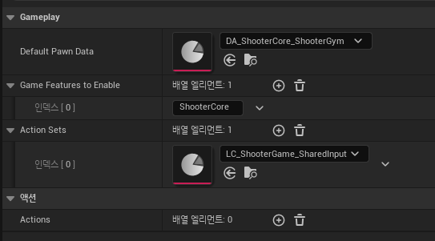

ActionSet내에서 Action들을 추가하면

플러그인에 액션들이 잘 바인딩된다.

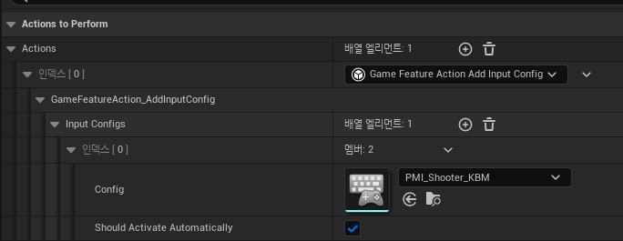<br><em>Action에 엘리먼트를 추가해보면 Index의 Key값에 따라 아래의 Value의 멤버들이 달라지는걸 볼 수 있다.이거 공부해보</em>


---

---

<b>GameFeatureData, ExperienceDefinition 둘 다 Action이 있는데 왜 나누어져 있을까?</b>

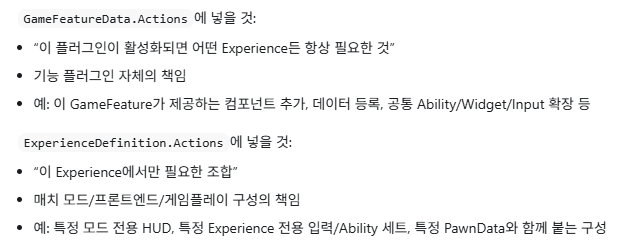

그니까 한마디로 FPS게임인데 화물밀기, 점령하기에서 공통적으로 사용할 부분이랑 아닌부분이 있기때문

---
