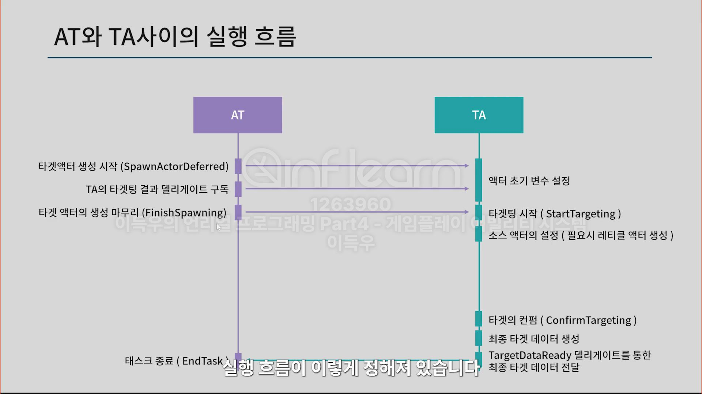

(이하 TA)

---

<code>AGameplayAbilityTargetActor</code>를 상속받아서 구현

<b>GA의 타겟을 설정하는 방법</b>

- Trace를 사용해 즉시 타겟 검출 (사실이거는 TA필요없으나 확장을 위해 만든다)
- 사용자의 최종 확인을 추가로 거치는 방법 ex) 원거리 범위 공격
- 공격 범위 확인을 위한 추가 시각화<br />이때 시각화를 수행하는 액터를 <b>WorldReticle</b>이라고 한다.

<b>TA의 주요함수</b>

- StartTargeting : 타겟팅을 시작
- ConfirmTargetingAndContinue : 타겟팅을 확정하고 이후 남은 프로세스를 진행
- ConfirmTargeting : 태스크 진행 없이 타겟팅만 확정
- CancelTargeting : 타겟팅을 취소

<b>TA 데이터</b>

- 타겟 액터에서 판정한 결과를 담은 데이터
  - TraceHit Result
  - 판정된 다수의 액터 포인터
  - 시작 지점
  - 끝 지점
- 타겟 데이터를 여러 개 묶어 전송하는 것이 일반적<br />이를 묶어주는게 <code>GameplayAbilityTargetDataHandle</code>

<b>실행 흐름</b>



```c++
// AMyGameplayAbilityTargetActor.cpp
void AABTA_Trace::StartTargeting(UGameplayAbility* Ability)
{
	Super::StartTargeting(Ability);
	// SourceActor에 대한 설정..
	// 일단은 초기화만
	SourceActor = Ability->GetCurrentActorInfo()->AvatarActor.Get();
}
```

AbilityTask가 Activate될때 TargetActor를 생성한다.

```c++
// AMyTaskAbility.cpp
void UABAT_Trace::Activate()
{
    Super::Activate();

    SpawnAndInitializeTargetActor();
    FinalizeTargetActor();

    SetWaitingOnAvatar();
}

void UABAT_Trace::SpawnAndInitializeTargetActor()
{
    SpawnedTargetActor = Cast<AABTA_Trace>(Ability->GetWorld()->SpawnActorDeferred<AGameplayAbilityTargetActor>(TargetActorClass, FTransform::Identity, nullptr, nullptr, ESpawnActorCollisionHandlingMethod::AlwaysSpawn));
    if(SpawnedTargetActor)
    {
        SpawnedTargetActor->SetShowDebug(true);
        
        // ConfirmTargetingAndContinue에서 Broadcast될 Delegate
        SpawnedTargetActor->TargetDataReadyDelegate.AddUObject
        (this, &UABAT_Trace::OnTargetDataReadyCallBack);
    }
}

void UABAT_Trace::FinalizeTargetActor()
{
    UAbilitySystemComponent* ASC = AbilitySystemComponent.Get();
    if (ASC)
    {
        const FTransform SpawnTransform = ASC->GetAvatarActor()->GetTransform();
        ASC->SpawnedTargetActors.Emplace(SpawnedTargetActor);
        
        // SourceActor 초기화
        SpawnedTargetActor->StartTargeting(Ability);
				// 내부에서 SpawnedTargetActor의 ConfirmTargetingAndContinue을 호출한다
        SpawnedTargetActor->ConfirmTargeting();
    }
}

void UABAT_Trace::OnTargetDataReadyCallBack(const FGameplayAbilityTargetDataHandle& DataHandle)
{
    if (ShouldBroadcastAbilityTaskDelegates())
    {
        OnComplete.Broadcast(DataHandle);
    }
    EndTask();
}
```

```c++
// AMyGameplayAbilityTargetActor.cpp
void AABTA_Trace::ConfirmTargetingAndContinue()
{
	//Super::ConfirmTargetingAndContinue();
		// 내부에서 TargetDataReadyDelegate을 Broadcast한다
	// 나는 내가 원하는 시점에 해야함

	if (SourceActor)
	{
		// Trace당하는 Target을 만든다! (찾는다!)
		FGameplayAbilityTargetDataHandle DataHandle = MakeTargetData();

		// 위의 OnTargetDataReadyCallBack 호출
		TargetDataReadyDelegate.Broadcast(DataHandle);
	}
}

// 대충 SweepSingleByChannel트레이스해서 맞은 액터 가져오는 함수
FGameplayAbilityTargetDataHandle AABTA_Trace::MakeTargetData() const
{
	FHitResult OutHitResult;
	SweepSingleByChannel(OutHitResult);
	FGameplayAbilityTargetDataHandle DataHandle;
	if (bHitDetected)
	{
	// 간만에 보는 동적할당.. 
	// FGameplayAbilityTargetDataHandle내에서 해제해주니 걱정하지 않아도 된다.
		FGameplayAbilityTargetData_SingleTargetHit* SingleTargetHit =
		 new FGameplayAbilityTargetData_SingleTargetHit(OutHitResult);
		 
		DataHandle.Add(SingleTargetHit);
	}

	return DataHandle;
}
```

아래의 GA에서 ActivateAbility가 호출되는순간 위의 일련의 작업들이 순서대로 진행되게 된다!

```c++
void UABGA_AttackHitCheck::ActivateAbility(const FGameplayAbilitySpecHandle Handle, const FGameplayAbilityActorInfo* ActorInfo, const FGameplayAbilityActivationInfo ActivationInfo, const FGameplayEventData* TriggerEventData)
{
	Super::ActivateAbility(Handle, ActorInfo, ActivationInfo, TriggerEventData);

	UABAT_Trace* AttackTraceTask = UABAT_Trace::CreateTask(this, AABTA_Trace::StaticClass());
	AttackTraceTask->OnComplete.AddDynamic(this, &UABGA_AttackHitCheck::OnTraceResultCallback);
	AttackTraceTask->ReadyForActivation();
}
void UABGA_AttackHitCheck::OnTraceResultCallback(const FGameplayAbilityTargetDataHandle& TargetDataHandle)
{
	if (UAbilitySystemBlueprintLibrary::TargetDataHasHitResult(TargetDataHandle, 0))
	{
		// Logging
	}

	bool bReplicatedEndAbility = true;
	bool bWasCancelled = false;
	EndAbility(CurrentSpecHandle, CurrentActorInfo, CurrentActivationInfo, bReplicatedEndAbility, bWasCancelled);

}

```

<b>AbilityTask Trace가 종료 될 때까지의 프로젝트 플로우 요약</b>

마우스 좌클릭 → EnhanceInput에 바인딩된 GASInputPressed(1)호출 → <br />ASC->TryActivateAbility(Spec->Handle /\*GA Attack이 Activate됨\*/ ) →<br />UAbilityTask\_PlayMontageAndWait 태스크 실행 →<br />UAnimNotify\_GASAttackHitCheck노티파이에서<br />UAbilitySystemBlueprintLibrary::SendGameplayEventToActor로 AttackHitCheck Tag전달 →<br />Character에는 이미 AttackHitCheck Tag가 지정된 GA AttackHitCheck가 Give되어있음 →<br />따라서  AttackHitCheck→ActivateAbility 호출 →<br />이하의 작업은 위의 작업 순서대로
