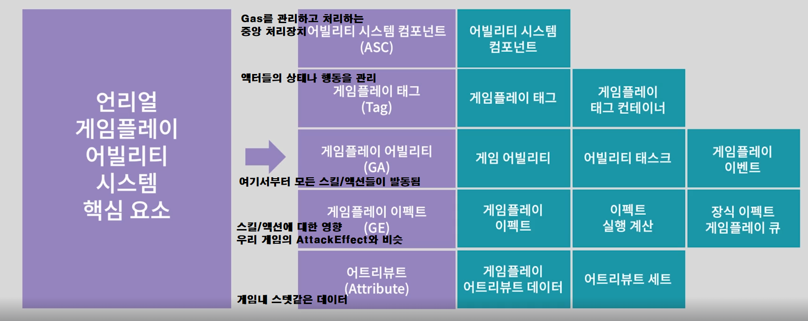
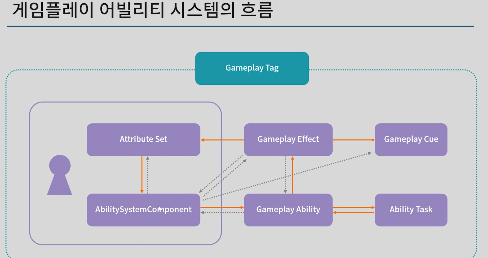
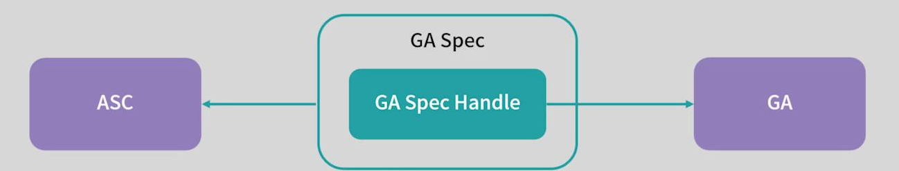

---

### <b>GAS란?</b>

대형 네트워크 게임서비스에서 유용하게 사용하는 시스템

- 흔히 게임에서 액터들이 사용하는 어빌리티/스킬 액터간의 인터렉션 기능을 제공하는 프레임워크
- <b>GAS의 장점</b> <b>유연성과 확장성</b> : 다양한 게임 제작에 대응이 가능하다 <b>의존성 </b>: 각 모듈간의 의존성이 최소화되도록 설계 <b>네트워크 지원 </b>: 리슨및 데디에서 편하게 활용 가능하게 설계 및 함수제공 <b>데이터 기반 설계</b> : 아직 먼말인지 모르겠음 <b>완성도</b> : 포트나이트 이거로 만듬
- <b>GAS의 단점</b> 프레임워크가 너무 크고 무거움

### 구성요소

<b>주황색 선</b>이 기본적인 로직의 흐름

<ul>
<li>
<b>ASC </b> 액터가 해당 컴포넌트를 들고있게 되고 하위의 모든 요소를 직접 제어가 가능 ASC를 붙인 다른 액터와 GAS시스템 상호작용이 가능해짐
</li>
<li>
<b>GamePlay Tag</b> 프로젝트 단위에서 모든 요소를 가지고있음, 특정 로직을 전개하게 될때 GamePlay Tag를 통해 현재 상태 기록하고 파악하게 될 것 
</li>
<li>
<b>GamePlayAbility (GA) </b>ASC가 발동시키는 액션 명령 (공격, 스킬 등등) 발동된 GA에는 FGameplayAbilitySpec구조체 안에 발동한 액터와 실행 정보가 기록됨

- <b>FGameplayAbilitySpec - </b>ASC는 직접 GA들을 관리하지 않고 <b>GameplayAbilitySpec(이하 스펙/Spec)</b>를 통해 관리하도록 되어있다. - ASC는 직접 GA들을 직접 참조하지 않고 스펙 정보만 들고 있다. - 스펙은 GA의 현재 상태와 같은 다양한 정보를 가지고 있다. - ASC로부터 어빌리티를 다루고자 할 경우 스펙 내 Handle을 이용해 컨트롤 - 핸들 값은 전역이며 스펙 생성시 자동으로 1씩증가 (Default = -1) 즉 <b>GA정보 : 스펙, GA인스턴스에 대한 Ref : 스펙 Handler</b>
  
- Handle : 발동된 어빌리티에 대한 핸들 GA클래스 정보를 직접 사용하지는 않고 해당 Handler를 통해서 사용한다.
- ActivationInfo : 발동 방식에 대한 정보

<b>알아야 할 주요 함수</b>

- CanActivateAbility : 어빌리티가 발동 될 수 있는지 파악
- <b>ActivateAbility </b>: 어빌리티가 발동될 때 호출
- <b>CancelAbility </b>: 어빌리티가 취소될 때 호출
- EndAbility 스스로 어빌리티를 마무리할 때 호출
</li>
<li>
<b>Ability Task (AT)</b> GA의 실행(Activation)은 한 프레임에서 이루어지고. 일단 시작되면 EndAbility호출 전까지는 끝나지 않음

- 애니메이션 재생 같이 시간이 소요되고 상태를 관리해야하 하는 어빌리티의 구현 방법
  - 비동기적으로 작업 수행하고 끝나면 결과를 통보받는 형태로 구현
  - 이를 위해 GAS는 AbilityTask를 제공한다.
- AT의 활용 패턴 1. AT내에 작업이 끝나면 TaskEndDelegate를 선언한다. 2. GA는 AT를 생성한 후 바로 TaskEndDelegate를 구독 3. GA의 구독 설정이 완료되면 AT를 구동 :  <code>AT::ReadyForActivation</code> 함수 호출 4. AT의 작업이 끝나면 델리게이트를 구독한 GA의 콜백 함수 호출 5. GA의 콜백 함수가 호출되면 GA의 EndAbility함수를 호출해 GA를 종료

즉 정리하면 AT는 GA라는 WorkFlow내에서 비동기적으로 이벤트들을 수행하거나 제어한다. GA는 AT를 사용해서 복잡한 액션 로직을 설계하는데 사용된다.
</li>
</ul>

- <b>흐름 </b>액터가 들고잇는 ASC가 GamePlayAbilty를 발동시킨다 (어빌리티들을 시간순으로 사용하고싶을때 Ability Task를 사용하여 여러 Ability들을 조합할 수 있다) → Ability의 대상에 GamePlayEffect가 처리된다. → 이때 액터의 Attribute 즉 데이터가 변화된다. → GamePlayEffect에 대한 Seseable Effect는 Cue라는 애로 처리된다.

- [GAS 사용 기초](gas-%EC%82%AC%EC%9A%A9-%EA%B8%B0%EC%B4%88-18283382.md)

- [플레이어 캐릭터 ASC설정](%ED%94%8C%EB%A0%88%EC%9D%B4%EC%96%B4-%EC%BA%90%EB%A6%AD%ED%84%B0%EC%9D%98-asc-%EC%84%A4%EC%A0%95-18383382.md)

- [Animation과 연계 (GameplayEvent)](%EC%95%A0%EB%8B%88%EB%A9%94%EC%9D%B4%EC%85%98%EA%B3%BC-gameplay-event-18e83382.md)

- [AbilityTask](abilitytask-18e83382.md)

- [Gameplay Ability Target Actor](gameplay-ability-target-actor-19183382.md)

- [Attribute](attribute-19183382.md)
