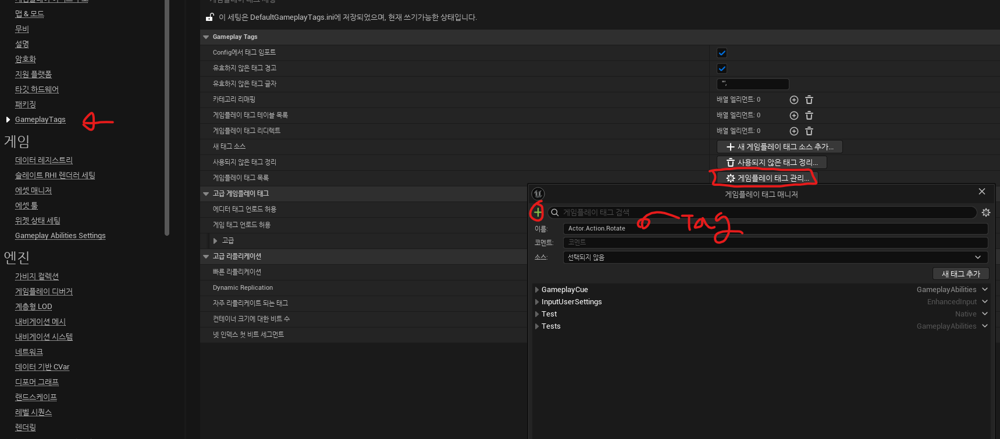
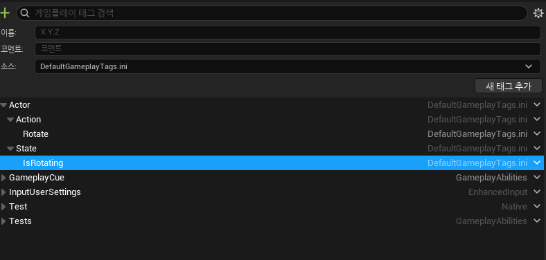

### 기본 사용법

<ol>
<li>
액터가 IAbilitySystemInterface를 상속받는다.

```c++
class ARENABATTLEGAS_API AABGASFountain : public AABFountain, public IAbilitySystemInterface
```
</li>
<li>
ASC(UAbilitySystemComponent)를 액터에 부착한다 (하나만 가능)

```c++
// Actor's Constructor
ASC = CreateDefaultSubobject<UAbilitySystemComponent>(TEXT("ASC"));
```
</li>
<li>
액터 생성하면서 InitAbilityActorInfo를 반드시 호출한다.

```c++
// After Actor Construct ex) AActor::PostInitializeComponents()
ASC->InitAbilityActorInfo(this/*Owner*/, this/*Avatar*/);
```
</li>
<li>
ASC의 GiveAbility함수를 사용해 ASC에 GA를 등록 

```c++
// UABGA_Rotate타입에 대한 Ability를 수행할 준비
FGameplayAbilitySpec RotateAbilitySpec(UGameplayAbility::StaticClass());
// 처음부터 GA인스턴스를 생성해서 전부 관리하면 부하가 생길 수 있기 때문에 타입정보만 넘겨주어 부하를 줄인다.
ASC->GiveAbility(RotateAbilitySpec);
```
</li>
<li>
ASC 의 TryActivateAbility함수로 GA 발동 명령<br />3,4 번을 진행할때 GA의 인스턴스를 전달하는게 아니라 타입을 전달한다.

```c++
// AMyActor.cpp
// Actor가 수행할 Action의 세부사항은 UGameplayAbility를 상속받아 만든 클래스에 구현
// Actor는 해당 액션을 사용할 타이밍?만 결정
void AABGASFountain::TimerAction()
{
	// 해당 타입에 대한 Ability찾아옴
	FGameplayAbilitySpec* RotateAbilitySpec = 
					ASC->FindAbilitySpecFromClass(UABGA_Rotate::StaticClass());
	if (!RotateAbilitySpec)
	{
		ABGAS_LOG(LogABGAS, Error, TEXT("No Rotate Spec Found!!"));
		return;
	}

	if (!RotateAbilitySpec->IsActive())
	{
		// 아래의 ActivateAbility호출
		ASC->TryActivateAbility(RotateAbilitySpec->Handle);
	}
	else
	{
		// 아래의 CancelAbility 호출
		ASC->CancelAbilityHandle(RotateAbilitySpec->Handle);
	}
}

```

```c++
// UMyGameplayAbility.cpp
void UABGA_Rotate::ActivateAbility(const FGameplayAbilitySpecHandle Handle, const FGameplayAbilityActorInfo* ActorInfo, const FGameplayAbilityActivationInfo ActivationInfo, const FGameplayEventData* TriggerEventData)
{
	Super::ActivateAbility(Handle, ActorInfo, ActivationInfo, TriggerEventData);

	AActor* Avatar = ActorInfo->AvatarActor.Get();
	if (Avatar)
	{
		URotatingMovementComponent* RotatingMovementComponent = Cast<URotatingMovementComponent>(Avatar->GetComponentByClass(URotatingMovementComponent::StaticClass()));
		if (RotatingMovementComponent)
		{
			RotatingMovementComponent->Activate(true);
		}
	}
}

void UABGA_Rotate::CancelAbility(const FGameplayAbilitySpecHandle Handle, const FGameplayAbilityActorInfo* ActorInfo, const FGameplayAbilityActivationInfo ActivationInfo, bool bReplicateCancelAbility)
{
	Super::CancelAbility(Handle, ActorInfo, ActivationInfo, bReplicateCancelAbility);

	AActor* Avatar = ActorInfo->AvatarActor.Get();
	if (Avatar)
	{
		URotatingMovementComponent* RotatingMovementComponent = Cast<URotatingMovementComponent>(Avatar->GetComponentByClass(URotatingMovementComponent::StaticClass()));
		if (RotatingMovementComponent)
		{
			RotatingMovementComponent->Deactivate();
		}
	}
}

```
</li>
</ol>

### GamePlayTag 활용

- FName으로 관리되는 표식 데이터<br />(액터나 컴포넌트에 지정했던 태그와 다른 데이터)
- 프로젝트 설정에서 태그를 별도로 관리 가능 (DefaultGameplayTags.ini에 저장)
- 계층구조임<br />Actor.Action.Rotate (행동 계층)<br />Actor.State.IsRotating(상태 태그)
- GA시스템과 독립적으로 사용이 가능

GamePlayTag들은 <b>GamePlayTagContainer</b>라는곳에 저장

<b>GamePlayTagContainer</b>

- 계층 구조를 지원하는 검색 기능
- <b>주요함수</b>
  <ul>
  <li>
  <b>HasTagExact </b>: 컨테이너에 A.1태그가 있는 상황에서 A로 찾으면 false (<b>완전동일 요구</b>)
  </li>
  <li>
  <b>HasAny</b> : 컨테이너에 A.1태그가 있는 상황에서 A와 B로 찾으면 true (둘 중 아무거나 포함)
  </li>
  <li>
  <b>HasAnyExact </b>: 컨테이너에 A.1태그가 있는상황에서 A와 B로 찾으면 false 
  </li>
  <li>
  <b>HasAll </b>: 컨테이너에 A.1태그와 B.1태그가 있는 상황에서 A와 B로 찾으면 true
  </li>
  <li>
  <b>HasAllExact </b>: 컨테이너에 A.1태그와 B.1태그가 있는 상황에서 A와 B로찾으면 false
  </li>
  </ul>

<br /><b>사용 예</b>

GA에는 이미 구현된 다양한 태그들이 있는데<br />예를들어 어빌리티가 실행시 태그를 설정하면 해당 어빌리티가 활성화 되는 동안 ASC에 활성화됨





이렇게 생성된다.

GameplayAbilitySpec을 사용해서 동작시켰던 로직을 Tag를 사용해서 동작시켜본다.

```c++
// AMyActor.cpp
// 파랗게 표시한 UABGA_Rotate::StaticClass()를 사용할 필요가 없어져서
// 헤더 의존성이 줄어들게 된다.

void AABGASFountain::PostInitializeComponents()
{
	Super::PostInitializeComponents();

	RotatingMovement->bAutoActivate = false;
	RotatingMovement->Deactivate();

	ASC->InitAbilityActorInfo(this/*Owner*/, this/*Avatar*/);


	// 의존성 줄이기 위해 아래의 방법을 사용한다.
	//FGameplayAbilitySpec RotateAbilitySpec(UABGA_Rotate::StaticClass()); 
	//ASC->GiveAbility(RotateAbilitySpec);

	for (const auto& GA : StartAbilities)
	{
		FGameplayAbilitySpec StartSpec(GA);
		ASC->GiveAbility(StartSpec);
	}

}

void AABGASFountain::TimerAction()
{
	//// GAS사용 O
	//FGameplayAbilitySpec* RotateAbilitySpec = ASC->FindAbilitySpecFromClass(UABGA_Rotate::StaticClass());
	//if (!RotateAbilitySpec)
	//{
	//	ABGAS_LOG(LogABGAS, Error, TEXT("No Rotate Spec Found!!"));
	//	return;
	//}

	//if (!RotateAbilitySpec->IsActive())
	//{
	//	ASC->TryActivateAbility(RotateAbilitySpec->Handle);
	//}
	//else
	//{
	//	ASC->CancelAbilityHandle(RotateAbilitySpec->Handle);
	//}

	// Gas사용 O GamePlayTag사용 O
	FGameplayTagContainer TargetTag(ABTAG_ACTOR_ROTATE);
	if (!ASC->HasMatchingGameplayTag(ABTAG_STATE_ISROTATING))
	{
		// 어빌리티 Tag에 인자정보가 있는 태그를 검색해서 동작시켜주는 함수
		// UABGA_Rotate 인스턴스는 이때 생성된다.
		ASC->TryActivateAbilitiesByTag(TargetTag); // 복수의 태그가 들어갈 수 있으니 Container로 넣어준다.
	}
	else
	{
		ASC->CancelAbilities(&TargetTag); 
	}
}

```

```c++
// UMyGameplayAbility.cpp
UABGA_Rotate::UABGA_Rotate()
{
	// 어빌리티가 발동되면 해당 태그가 심어진다.
	AbilityTags.AddTag(ABTAG_ACTOR_ROTATE);
	ActivationOwnedTags.AddTag(ABTAG_STATE_ISROTATING);
}
```
