😡언리얼 대표적인 털 렌더링 플러그인인 GFurComponent를 사용하던 도중 렌더링/LOD 관련 문제를 발견했다. 

1. 우선 가장 큰 문제는, <b>Fur객체가 화면 밖에 있어도, 렌더링 자원을 먹는다</b>는 것이다.<br />(Draw인지, 별다른 처리를 계속 하는것인지 확인을 해야함.)

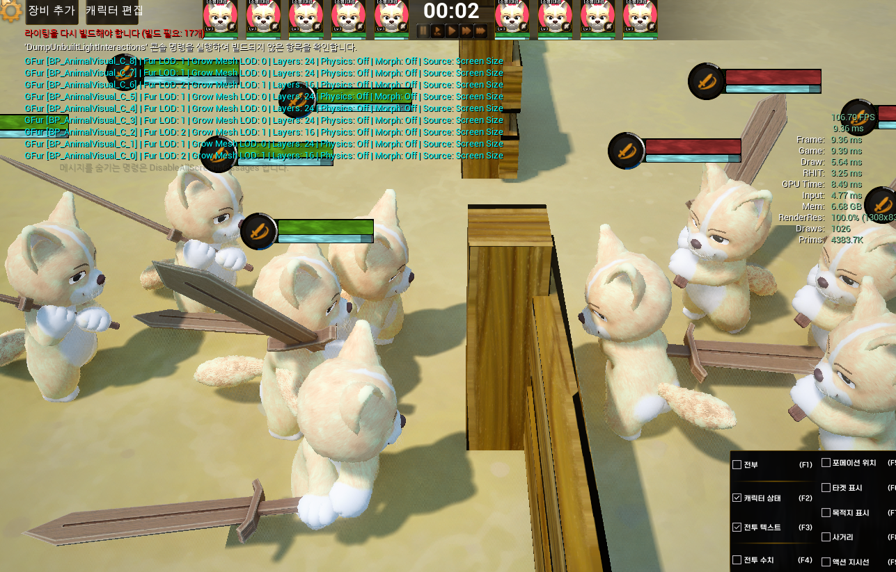

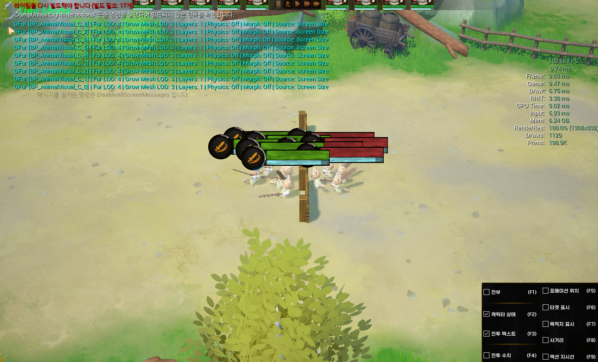

화면에 캐릭터들이 많이 잡혀있을때는 당연히 렌더링 비용이 많이 나오고, LOD설정도 화면에 잡힌 크기에 따라서 갱신이 된다. (Cyan색 로그를 보자)

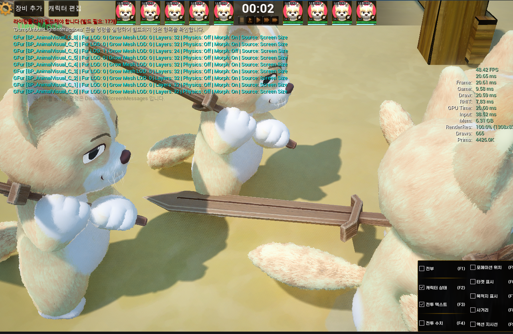

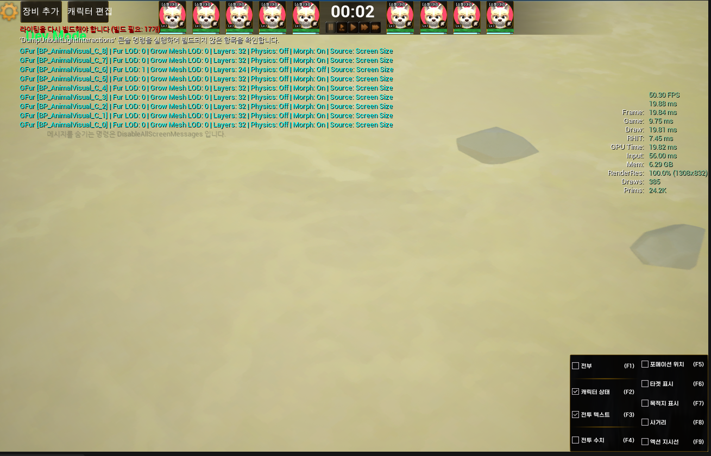

하지만 이 두 사진을 보면 화면에 잡힌 캐릭터가 적은데 LOD옵션은 계속 출력되고있고, 아예 해당 자리를 이탈해도 같은 문제가 발생한다는 것이다.

그리고 LOD옵션은 다시 화면에 잡힐때 해당 기준으로 갱신된다.

아래 3개의 사진은 <b>캐릭터가 잡혀있을때/안잡혀있을때/LOD부하 줄였을때의 각 스레드 처리시간이다</b>.<br />1/2는 차이가 없고<br />3은 렌더링/GPU 관련된 시간이 많이 빨라진걸 볼 수 있다.

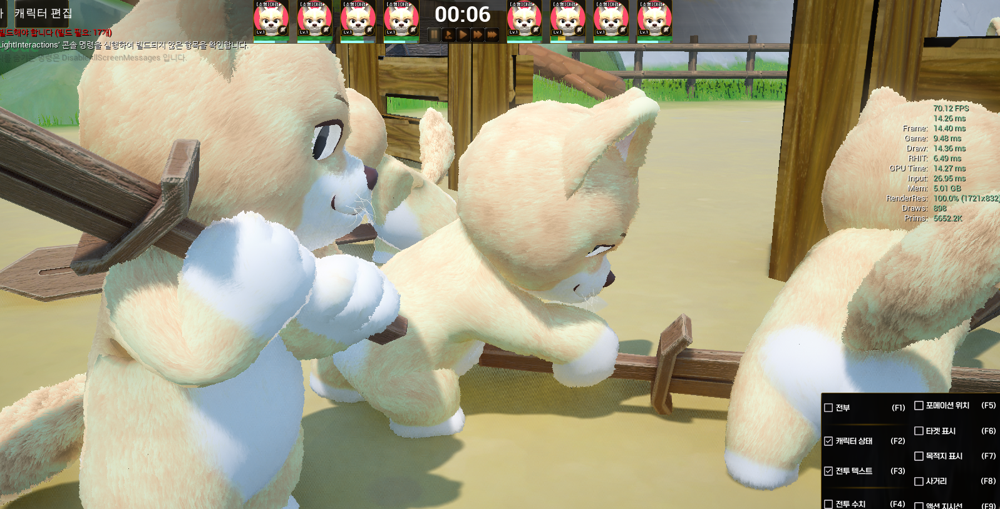

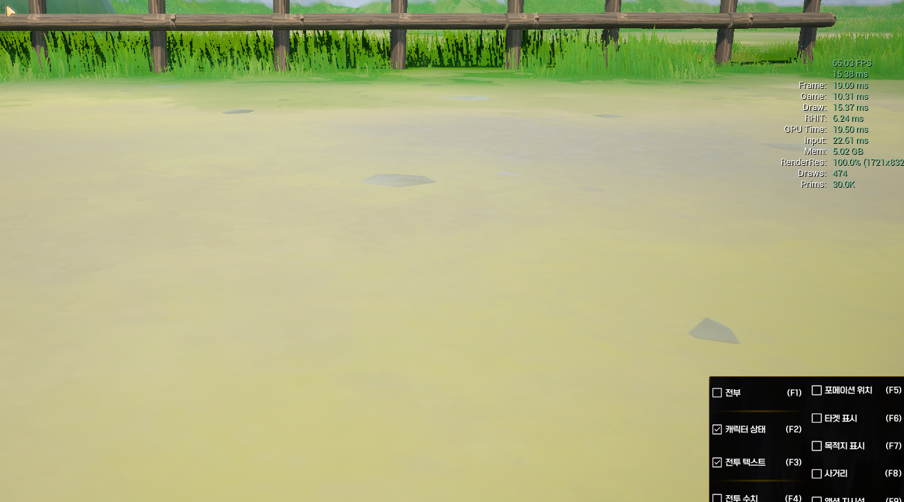

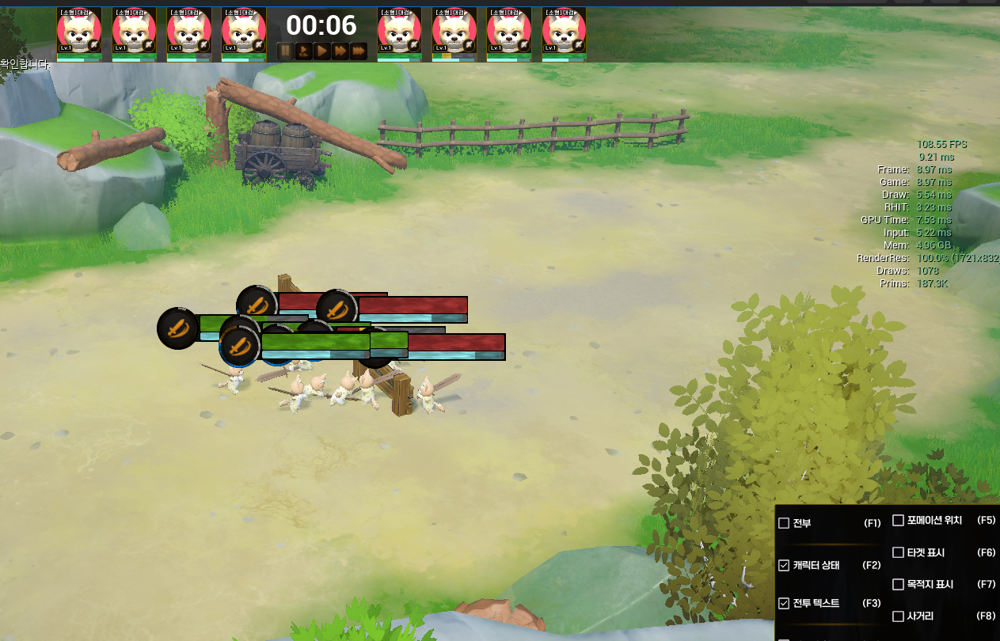

 <b>디버깅</b>으로 먼저 체크를 해보니 아래 두개의 함수가 화면에 잡히지 않았을때도 호출이 된다.

<b><code>updateFur</code></b><b> </b>

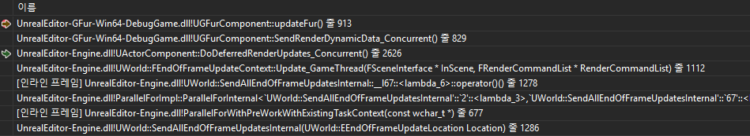

<b><code>GetDynamicMeshElements</code></b><b> </b>

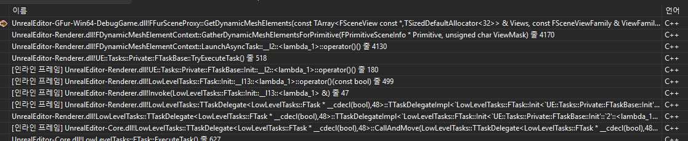

<p> </p>

다음은 프로파일링 결과이다.

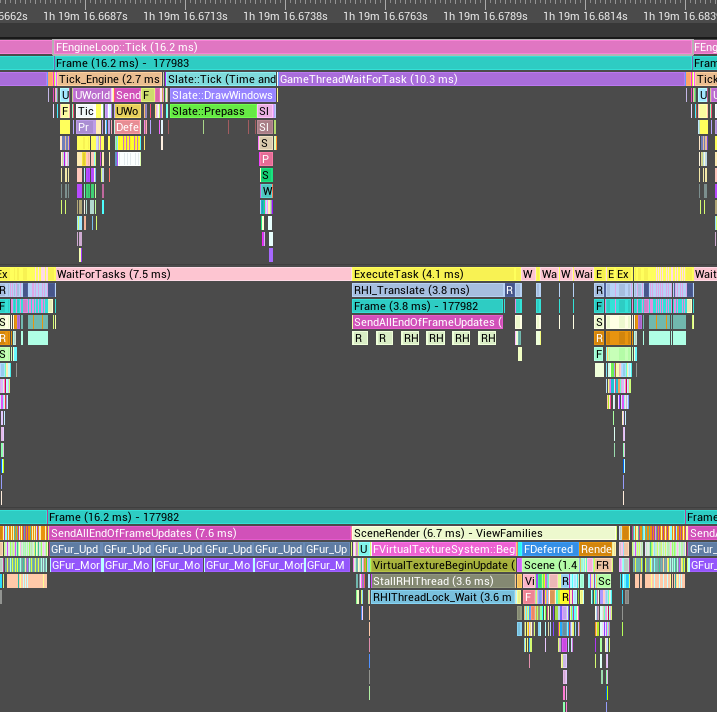

<b><code>updateFur</code></b><b> </b>

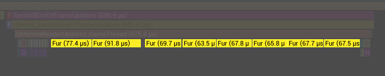

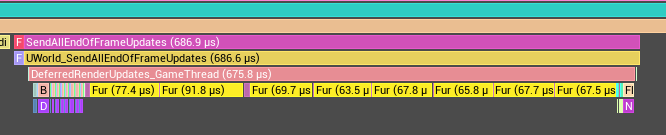

updateFur은 무죄로 밝혀졌다 사실 호출이 안되는게 베스트이지만 일단 지금 LOD설정이 갱신되지 않는것에 대한 프레임 저하에 큰 문제를 끼치지는 않는다. (결국 같이 해결될것임)

<b><code>GetDynamicMeshElements</code></b>

얘는 보이지도 않는다.<br />근데 당연한게 애초에 부하는 렌더링쪽에서 발생했다.

---

생각해보니까 이미 느려짐의 범인은 모프타겟임을 알고있었다;; 진작 여기 볼걸<br />아무튼 UpdateFur이던 MorphUpdate건 호출이 되는것 자체가 문제이다.

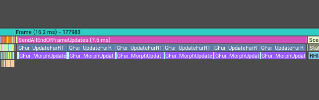

코드를 보면 updateFur의 마지막 구간에서 렌더Worker에 updateFur\_RenderThread를 시킨다.

```javascript
		ENQUEUE_RENDER_COMMAND(SkelMeshObjectUpdateDataCommand)
		(
			[this, Discontinuous, ActiveMorphTargets, MorphTargetWeights](FRHICommandListImmediate& RHICmdList) {
				UpdateFur_RenderThread(RHICmdList, Discontinuous, ActiveMorphTargets, MorphTargetWeights);
			});
```

```javascript

void UGFurComponent::UpdateFur_RenderThread(FRHICommandListImmediate& RHICmdList, bool Discontinuous, const FMorphTargetWeightMap& ActiveMorphTargets, const TArray<float>& MorphTargetWeights)
{
	FFurSceneProxy* FurProxy = (FFurSceneProxy*)SceneProxy;

	if (FurProxy)
	{
	// 프로파일링에 찍힌 그것! 여기다!
		GFUR_PROFILE_SCOPE(UpdateFurRT, STAT_GFur_UpdateFurRT, UpdateFurRT);
		GFUR_PROFILE_COUNT(RTUpdate);
...
			// FurMorphObject라는 객체의 Update_RenderThread에서 모프를 업데이트중이다.
				FurProxy->GetMorphObject(true)->Update_RenderThread(RHICmdList, ActiveMorphTargets, MorphTargetWeights, MorphRemapTables, FurProxy->GetCurrentMeshLodLevel());
...
}

void FFurMorphObject::Update_RenderThread(FRHICommandListImmediate& RHICmdList, const FMorphTargetWeightMap& ActiveMorphTargets, const TArray<float>& MorphTargetWeights, const TArray<TArray<int32>>& InMorphRemapTables, int InMeshLod)
{
// 모든 경로 확인 완료
	GFUR_PROFILE_SCOPE(MorphUpdateRT, STAT_GFur_MorphUpdateRT, MorphUpdateRT);
}

```

즉 화면에 안잡힐때 updateFur만 막으면 해결된다\^\_\_\^

<b><code>updateFur</code></b>은 RenderState생성시, 뭔진 모르지만 <code>SendRenderDynamicData_Concurrent</code> 에서만 호출된다.

```javascript
void UGFurComponent::CreateRenderState_Concurrent(FRegisterComponentContext* Context)
{
	GFUR_PROFILE_SCOPE(CreateRenderState, STAT_GFur_CreateRenderState, CreateRenderState);
...
	updateFur();
}

void UGFurComponent::SendRenderDynamicData_Concurrent()
{
	Super::SendRenderDynamicData_Concurrent();

	updateFur();
}
```

애초에 근데 화면에 안잡힐때만 updateFur의 일련의 과정을 되니까 <b><code>updateFur</code></b>에서 처리한다.<br />뒷감당은 일단 바꾸고 나서 문제가 생기나 QA를 해본다.

```javascript
void UGFurComponent::updateFur(bool bInitialize)
{
	if (!SceneProxy || (!SkeletalGrowMesh && !StaticGrowMesh))
		return;

	const UWorld* World = GetWorld();
	if (!ensureMsgf(World, TEXT("GFur update requires a world: %s"), *GetName()))
	{
		return;
	}

	// Initialize shader data once; subsequent updates require recent on-screen rendering.
	const float RenderTimeThreshold = FMath::Max(GFUR_ON_SCREEN_RENDER_TOLERANCE, World->GetDeltaSeconds() + UE_KINDA_SMALL_NUMBER);
	if (!bInitialize && World->GetTimeSeconds() - GetLastRenderTimeOnScreen() > RenderTimeThreshold)
	{
		OldPositionValid = false;
		return;
	}

```

함수를 이와같이 교체했다.<br />bInitialize 는 RenderState생성시에는 TOLERANCE 검사를 피하기 위해서 만들었다.

```javascript
// 렌더 상태 생성: 아직 화면에 그려지기 전에도 초기 데이터가 필요
updateFur(true);

// 이후 매 프레임 갱신: 화면 판정 적용
updateFur();
```

TOLERANCE이상 화면에 노출되지 않으면 return한다.

<code>OldPositionValid</code>는 <b>Fur 물리 계산에 사용할 이전 위치·변환 데이터가 유효한지</b> 나타내는 기존 변수

- <b><code>true</code></b>: 이전 위치와 현재 위치의 차이를 계산해서 털의 흔들림에 반영
- <b><code>false</code></b>: 현재 위치를 새 기준으로 잡고, 물리 오프셋과 속도를 0으로 초기화

화면 밖에서 갱신을 멈추면 이전 위치가 오래된 상태로 남게된다. 그대로 재개하면 <b>안 보이는 동안 이동한 거리 전체가 한 번의 움직임처럼 계산돼 털이 크게 튈 수 있기때문에 fales처리 한다.</b>

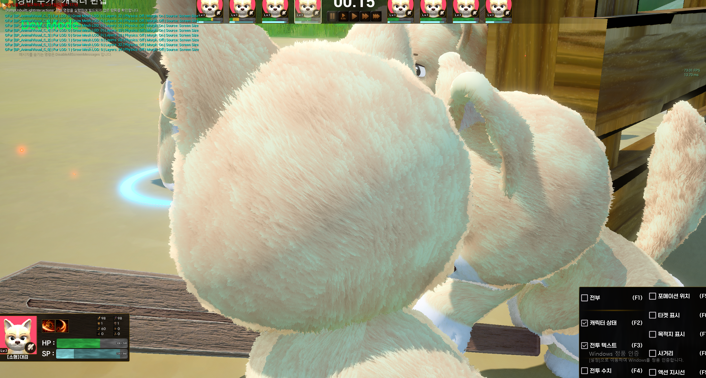

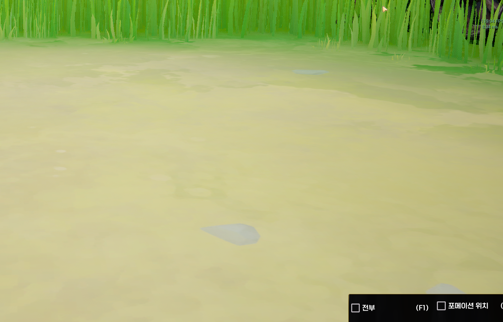

<b>우선 잘 처리된다<br /></b>그런데 Morph는 2명정도부터 부하가 너무 심하다.

따라서 LOD설정을 건드려보는게 나을 것 같다.
