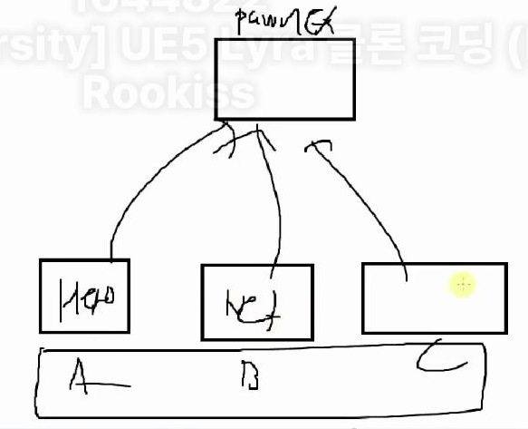
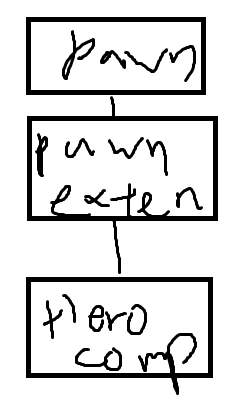
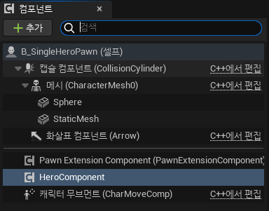
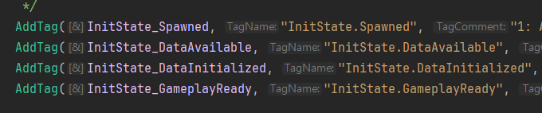
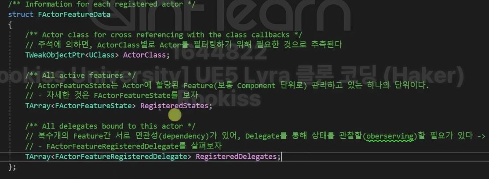
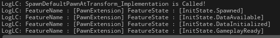
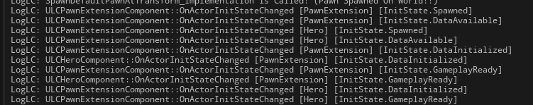
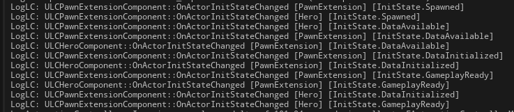

Pawn에다가 이것저것 컴포넌트 붙이면 종속성 문제가 크다고 한다<br />(근데 애초에 종속성 줄이려고한게 컴포넌트 방식 아닌가..?>?)<br />아무튼 이거 쓰면 종속성 더 줄일 수 있나보다 써보면서 느껴보자

---

<br><em>아래서도 설명할거지만 맨 상단의 PawnExtensionComponent는 하위 컴포넌트들의 초기화 과정을 관리한다.</em>

아래의 컴포넌트 ABC가있을때 나는 ABC의 준비가 끝나면 그 이후에 ABC순으로 초기화를 진행하고 싶다고 해보자<br />근데 준비가 끝나는 시점이 재각각이면 ABC순으로 초기화를 할 수가 없을 것이다.<br /><s>너가 생각한 당연한 방법 당연한거 맞다 델리게이트 써서 해결한다. </s>

<details>
<summary><b>예시</b></summary>

PawnExtension이 생성되고 A,B,C가 생성되야 된다고 했을때<br />A가 PawnExtension보다 먼저 생겨버리면 원래는 PawnExtension이 A를 관리하고 순서를 중재해야하는데 관리해줄애도 없으니 그냥 A혼자 쭉 생성되어버릴 것  

```c++
void ULCHeroComponent::CheckDefaultInitialization()
{
	const FLCGameplayTags& InitTags = FLCGameplayTags::Get();
	static const TArray<FGameplayTag> StateChain = { InitTags.InitState_Spawned, InitTags.InitState_DataAvailable, InitTags.InitState_DataInitialized, InitTags.InitState_GameplayReady };
	ContinueInitStateChain(StateChain);
}
```

</details>

이를 해결하기 위한 방법이 <b>InitStateChange</b>이다.

<b>InitStateChange</b>기능을 위해 GameplayTag를 사용한다.<br />GameplayTag에 커스텀GameplayTag인 InitState타입?의 태그를 만들어 해당 태그로 컴포넌트들의<br />상태를 추적한다.<br />c++에서 사용하고싶은 GameplayTag를 만들려면 아래와 같이 싱글톤 구조체를 만들어서<br />에디터 실행 전 에셋매니저에 올려서 사용한다.

```c++
void FLCGameplayTags::InitializeNativeTags() // Call On AssetManager
{
	UGameplayTagsManager& GameplayTagsManager = UGameplayTagsManager::Get();
	GameplayTags.AddAllTags(GameplayTagsManager);
}

void FLCGameplayTags::AddTag(FGameplayTag& OutTag, const ANSICHAR* TagName, const ANSICHAR* TagComment)
{
	// 에디터상에 태그 올리는 코드
	OutTag = UGameplayTagsManager::Get().AddNativeGameplayTag(FName(TagName), FString(TEXT("(Native) ")) + FString(TagComment));
}

void FLCGameplayTags::AddAllTags(class UGameplayTagsManager& Manager)
{
	/**
	 * GameFrameworkComponentManager init state tags
	 */
	AddTag(InitState_Spawned, "InitState.Spawned", "1: Actor/Component has initially spawned and can be extended");
	AddTag(InitState_DataAvailable, "InitState.DataAvailable", "2: All required data has been loaded/replicated and is ready for initialization");
	AddTag(InitState_DataInitialized, "InitState.DataInitialized", "3: The available data has been initialized for this actor/component, but it is not ready for full gameplay");
	AddTag(InitState_GameplayReady, "InitState.GameplayReady", "4: The actor/component is fully ready for active gameplay");
}

```

```c++
void ULCAssetManager::StartInitialLoading()
{
	Super::StartInitialLoading();

	FLCGameplayTags::InitializeNativeTags(); // 에디터 실행 전에 호출된다.
}
```

---

<b>InitStateChangeSystem</b>은 <code>UPawnExtensionComponent</code> 을 사용해서 구현한다.<br /><code>UPawnExtensionComponent</code> 은 Pawn 부착하는 컴포넌트고 해당 Pawn이 들고있는 모든 FeatureComponent의 초기화를 관리하는 컴포넌트이다.<br /><span>FeatureComponent란 </span><span><code>IGameFrameworkInitStateInterface</code></span><span> 를 상속받는 컴포넌트를 말하는 것으로 보인다.</span>



초기 구조는 위와같다.<br />2번째의 <code>ULCPawnExtensionComponent</code> 는 초기화와 관련된 모든 컴포넌트들을 관리하고 중재한다.<br />3번째의 <code>ULCHeroComponent</code> 카메라, 입력같이 플레이어가 세팅하는 부분을 처리

<b>우리의 목표</b>

<code>ULCPawnExtensionComponent</code> 의 생성을 확인하고 <code>ULCHeroComponent</code> 등의 다른 컴포넌트들이 <br /><code>ULCPawnExtensionComponent</code> 에 부착받기를 윈한다.

---

```c++
UCLASS()
class LYRACLONE_API ALCCharacter : public ACharacter
{
	GENERATED_BODY()

...
public:
// ULCPawnExtensionComponent를 CDO에 추가해준다.
	UPROPERTY(VisibleAnywhere, BlueprintReadOnly, Category = "LC|Character")
	TObjectPtr<class ULCPawnExtensionComponent> PawnExtensionComponent;
	
};

ALCCharacter::ALCCharacter()
{
 	// 모든 과정을 델리게이트로 처리할 것이기 때문에 틱은 꺼준다.
	PrimaryActorTick.bStartWithTickEnabled = false;
	PrimaryActorTick.bCanEverTick = false;

	// create pawn ext Comp
	PawnExtensionComponent = CreateDefaultSubobject<ULCPawnExtensionComponent>("PawnExtensionComponent");;
}


```

이후 해당 캐릭터를 상속받은 BP클래스에서 다른 컴포넌트들을 추가한다.



이렇게 하면 BP생성자는 cpp생성자보다 늦게 호출되기 때문에 반드시<br /><code>HeroComponent</code>같은 다른 컴포넌트 대비  <code>ULCPawnExtensionComponent</code> 의 생성이 먼저 될 것을 보장 받았다.

<b>ULCPawnExtensionComponent 초기화 과정</b>

```c++
void ULCPawnExtensionComponent::OnRegister() 
{
	Super::OnRegister();
	// 생성 시점의 매우 초반에 호출된다.
	// OnRegister에서 Pawn에 부착하는 단계가 이루어지기때문에 아래 코드는 실패할수가 없다.

	// 올바른 액터에 등록되었는지 확인
	if (!GetPawn<APawn>())
	{
		UE_LOG(LogLC, Error, TEXT("this component has been added to a BP whose base class is not a pawn!!"));
	}

	// GameFrameworkComponentManager에 InitState 사용을 위해 '등록'진행
	// - 등록은 상속받았던 IGameFrameworkInitStateInteface::RegisterInitStateFeature() 를 활용
	RegisterInitStateFeature();

	// 디버깅
	UGameFrameworkComponentManager* Manager = UGameFrameworkComponentManager::GetForActor(GetOwningActor()); 
}

```

우리가 만들었던 InitState을 사용하려면



이 반드시 <b>‘등록’</b> 이라는 과정을 거쳐야 한다.<br />등록하기위해 <code>IGameFrameworkInitStateInterface</code>를 상속받은 후 <code>RegisterInitStateFeature</code>함수를 호출한다. 이거면 별다른거 안해도 등록 된다.

그래도 등록 과정이 어떻게 되는지 알아보자

<b>IGameFrameworkInitStateInterface::RegisterInitStateFeature</b>

```c++
void IGameFrameworkInitStateInterface::RegisterInitStateFeature()
{
	UObject* ThisObject = Cast<UObject>(this);
	AActor* MyActor = GetOwningActor();
	
	UGameFrameworkComponentManager* Manager = UGameFrameworkComponentManager::GetForActor(MyActor);
	
	// Feature은 일단 PawnComponent를 하나의 GameFeature단위라고 생각하자
	// PhysicsCompo, audiocomp 이런것들을 생각해보면 기능단위로 Component로서 액터에
	// 해당 Feature들을(Physics, audio) 할당하는 것으로 생각하면 된다.

	const FName MyFeatureName = GetFeatureName(); // 인터페이스 상속받으면 오버라이딩해서 원하는 FeatureName넣는다.

	if (MyActor && Manager)
	{
		// 	RegisterFeatureImplementer는 Actor에 ThisObject를 FeatureName으로 할당하는 로직
	
		// - 내부적으로 GameFrameworkComponentManager의 ActorFeatureMap에 의해 관리된다.
		// ActorFeatureMap의 Key는 FObjectKey이고
		// Value는 아래 나오는 FActorFeatureData이다.		
		Manager->RegisterFeatureImplementer(MyActor, MyFeatureName, ThisObject);
		// FObjectKey의 대상은 MyActor이고, ActorFeatureMap의 RegisteredStates에
		// MyActor의 컴포넌트들이 들어간다.
	}
}
```

<b>UGameFrameworkComponentManager::RegisterFeatureImplementer<br /></b>Actor의 State를 FeatureName을 사용해 찾아서 RegisteredState에 해당 Feature을 등록한다.<b> </b>

```c++
bool UGameFrameworkComponentManager::RegisterFeatureImplementer(AActor* Actor, FName FeatureName, UObject* Implementer)
{
	...
	FActorFeatureData& ActorStruct = FindOrAddActorData(Actor);
	// 내부적으로 

	FActorFeatureState* FoundState = nullptr;
	for (FActorFeatureState& State : ActorStruct.RegisteredStates)
	{
		if (State.FeatureName == FeatureName)
		{
			// TODO what if it's already in the desired state?
			FoundState = &State;
		}
	}
	
	if (!FoundState)
	{
		FoundState = &ActorStruct.RegisteredStates.Emplace_GetRef(FeatureName);
	}

	FoundState->Implementer = Implementer;
	return true;
}
```

FActorFeatureData의 멤버들



OnRegister다음으로 Beginplay에 들어오게 된다.

```c++
void ULCPawnExtensionComponent::BeginPlay()
{
	Super::BeginPlay();

	// 아래 함수의 FeatureName에 Name_None을 넣으면 Actor에 등록된 모든 Feature의 모든InitState 상태를 관찰하겠다는 의미이다.
	// 특정 컴포넌트만 관찰할거면 해당 컴포넌트의 FeatureName넣으면 될 것
	BindOnActorInitStateChanged(NAME_None, FGameplayTag(), false);
	// 내부 함수를 보니까 Register에 성공했을때 IGameFrameworkInitStateInterface::OnActorInitStateChanged를 호출하는 델리게이트를
	// ActorInitStateChangedHandle에 등록한다. (가능하면 즉시호출도 하는걸로 보임)

	// 다른 예시로
	// BindOnActorInitStateChanged(NAME_None, FLCGameplayTags::Get().InitState_DataInitialized(), false);
	// 이렇게 하면 내 모든 Feature(Component)들을 관찰을 할건데 InitState_DataInitialized단계로 넘어가는 컴포넌트만 관찰을 해달라고 요청하는 것
	// 즉 모든 Feature들이 Data_Initialized단계로넘어갔을때 OnActorInitStateChanged를 호출한다.

	// ULCPawnExtensionComponent는 모든 Feature에 대한 모든 State를 관리하는 컴포넌트니까 위의 코드처럼 작성한다.

	// InitState_Spawned로 상태 변화
	// TryToChangeInitState는 인자로 넣은 State로 상태변화를 시도한다 (실패 가능성도 있다!)
	// -TryToChangeInitState는 아래와 같이 진행된다.
	// 1. CanChangeInitState로 상태 변환 가능성 유무 판단.
	// 2. HandleChangeInitState로 내부 상태 변경 (Feature Componnet)
	// 3. 위에서 BindOnActorInitStateChanged로 Bind된 Delegate를 조건에 맞게 호출해 줌
	//		- LCPawnExtensionComponent의 경우, 모든 Actor의 Feature 상태 변화에 대해 OnActorInitStateChanged()가 호출됨
	ensure(TryToChangeInitState(FLCGameplayTags::Get().InitState_Spawned));
	
	// ForceUpdateInitState를 하는 함수이다  (CanChangeInitState와 HandleChangeInitState를 진행한다.).
	CheckDefaultInitialization();
}
```

주석이 많은데 간단하게 정리하면<br /><b>ULCPawnExtensionComponent에서는 OwnerActor에 붙은 모든 Feature에 대한 모든State를 감시</b>

그리고 감시에 등록하면 InitState가 변화할때 OnActorInitStateChanged함수를 호출해줄거임<br />위에서 <b>InitState가 변화가 발생했을때</b> <code>BindOnActorInitStateChanged</code> 이 함수 내부에서

<code>ActorInitStateChangedHandle</code> (인터페이스 내 DelegateHandler)에 등록했던 함수가 호출될 수 있음

마지막으로 CheckDefaultInitialization함수까지 살펴보자

```c++
void ULCPawnExtensionComponent::CheckDefaultInitialization()
{
	// ULCPawnExtensionComponent은 FeatureComponent들의 초기화를 관장하는 Component이다.
	// - 따라서 Actor에 바인딩된 Feature Comp들에 대해 CheckDefaultInitialization을 호출하게 한다. (바인딩된 FComp들에 대해 강제로 초기화 시키는 느낌)
	// 위의 기능은 Interface내에 CheckDefaultInitializationForImplementers를 호출하면 수행된다.
	// Implementers는 FeatureComp를 의미한다.
	CheckDefaultInitializationForImplementers();

	const FLCGameplayTags& InitTags = FLCGameplayTags::Get();

	// 사용자 정의 InitState를 직접 넘겨줘야 한다.
	static const TArray<FGameplayTag> StateChain
	 = { InitTags.InitState_Spawned, InitTags.InitState_DataAvailable, InitTags.InitState_DataInitialized, InitTags.InitState_GameplayReady };

	// CanChangeInitState()와 HandleChangeInitState() 그리고 ChangeFeatureInitState 호출을 통한 OnActorInitStateChanged Delegate호출까지 진행해준다

	ContinueInitStateChain(StateChain);
}

```

<code>CheckDefaultInitializationForImplementers</code> 함수를 호출해 OwnerActor의 모든 FeatureComponent들에 대해 <code>CheckDefaultInitialization</code>을 호출하게 한다.<br />그 다음 <code>ContinueInitStateChain</code> 함수를 통해 내 상태를 InitState\_GameplayReady 상태까지 업데이트 한다.

<code>ContinueInitStateChain</code> 함수 내부를 보면 인자로 전해준 StateChain상태를 순회하면서 가능할때까지 CurrentState를 업데이트 시키는 것을 볼 수 있다.<br />또  <code>HandleChangeInitState</code>함수를 계속해서 호출해서 <code>OnActorInitStateChanged</code> 콜백을 받을 수 있다.

```c++
FGameplayTag IGameFrameworkInitStateInterface::ContinueInitStateChain(const TArray<FGameplayTag>& InitStateChain)
{
	int32 ChainIndex = 0;
	FGameplayTag CurrentState = Manager->GetInitStateForFeature(MyActor, MyFeatureName);
	// For each state in chain before the last, see if we can transition to the next state
	while (ChainIndex < InitStateChain.Num() - 1)
	{
		if (CurrentState == InitStateChain[ChainIndex])
		{
			FGameplayTag DesiredState = InitStateChain[ChainIndex + 1];
			if (CanChangeInitState(Manager, CurrentState, DesiredState))
			{
				// Perform the local change
				HandleChangeInitState(Manager, CurrentState, DesiredState);
				// Update state and check again
				CurrentState = Manager->GetInitStateForFeature(MyActor, MyFeatureName);
			}
		}
		ChainIndex++;
	}

	return CurrentState;
}
```

---

지금까지의 과정

1. ULCPawnExtensionComponent의 OnRegister에서 InitState를 사용하기 위해<br /><code>RegisterInitStateFeature</code>함수를 사용해 <code>GameFrameComponentManager</code>에 등록
2. Beginplay에서 <code>BindOnActorInitStateChanged</code> 함수로 OwnerActor의 모든 FeatureComponent들의 모든 Initstate변화 관리를 위해 <code>OnActorInitStateChanged</code> 함수로 콜백 등록
3. ULCPawnExtensionComponent의 상태를 InitState\_Spawned로 변경 시도
4. <code>CheckDefaultInitialization</code> 함수에서 하위의 FeatureComponent들이 <code>CheckDefaultInitialization</code> 함수 호출하게 처리 (내부에서 ContinueInitStateChain)
5. 결과적으로 ULCPawnExtensionComponent의 상태를 InitState\_GameReady상태로 만듬

---



<code>OnActorInitStateChanged</code> 에다가 로그 찍으면 잘찍히는거 볼 수있다. 

아래는 InitState는 뭐고 왜 <code>ULCPawnExtensionComponent</code> 를 사용해서 초기화를 하지\~\~? 라는 의문을 풀 수 있는 <code>CanChangeInitState</code>함수이다. 

```c++
bool ULCPawnExtensionComponent::CanChangeInitState(UGameFrameworkComponentManager* Manager, FGameplayTag CurrentState,
	FGameplayTag DesiredState) const
{
	// true 면 CurrentState에서 DesireState로 넘어가는 함수
	
	check(Manager);

	APawn* Pawn = GetPawn<APawn>();
	const FLCGameplayTags& InitTags = FLCGameplayTags::Get();

	// InitState_Spawned초기화
	if (!CurrentState.IsValid() && DesiredState == InitTags.InitState_Spawned)
	{
		// Pawn이 잘 세팅되어있으면 Spawned로 넘어간다.
		if (Pawn)
		{
			return true;
		}
	}

	// Spawned -> DataAvailable
	if (CurrentState== InitTags.InitState_Spawned && DesiredState == InitTags.InitState_DataAvailable)
	{
		if (!PawnData)
		{
			return false;
		}

		// LocallyControlled인 Pawn이 Controller가 없으면 에러
		const bool bIsLocallyControlled = Pawn->IsLocallyControlled();
		if (bIsLocallyControlled)
		{
			if (!GetController<AController>())
			{
				return false;
			}
		}
		return true;
	}

	// DataAvailable -> DataInitialized
	if (CurrentState== InitTags.InitState_DataAvailable && DesiredState == InitTags.InitState_DataInitialized)
	{
		// Pawn에 바인드된 모든 Feature들이 DataAvailable상태일 때 DataInitialized로 넘어감.
		return Manager->HaveAllFeaturesReachedInitState(Pawn, InitTags.InitState_DataAvailable);
	}

	// DataInitialized -> GameplayReady
	if (CurrentState== InitTags.InitState_DataInitialized && DesiredState == InitTags.InitState_GameplayReady)
	{
		return true;
	}
	
	return false;
}
```

<code>ContinueInitStateChain</code> 내에서 <br /><code>CanChangeInitState</code> 함수와 <code>HandleChangeInitState</code> 함수를 반복해서 호출하게되는데

위의 <code>CanChangeInitState</code>함수 구현부를 보면 <code>HaveAllFeaturesReachedInitState</code> 에서 모든 Feature의 상태를 체크한 후 다음상태로 넘어가기 때문에 안전한 게임 플로우를 보장받을 수 있다.

---

<b>HeroComponent</b>

얘가 뭔 특별한 역할을 하는것을 설명하기 보다는 <code>ULCPawnExtensionComponent</code>가 관리하는 FeatureComponent의 하나라는 것에 집중한다.

이친구도 Feature이고 <code>IGameFrameworkInitStateInterface</code> 를 상속받은 클래스이기 때문에

<code>ULCPawnExtensionComponent</code> 와 비슷한 초기화 과정을 수행한다.

```c++
void ULCHeroComponent::BeginPlay()
{
	Super::BeginPlay();

	// ULCPawnExtensionComponent의 모든 상태를 추적한다.
	BindOnActorInitStateChanged(ULCPawnExtensionComponent::NAME_ActorFeatureName, FGameplayTag(), false);

		// InitState_Spawned로 초기화
	ensure(TryToChangeInitState(FLCGameplayTags::Get().InitState_Spawned));

	// Forceupdate진행
	CheckDefaultInitialization();
}
```

<code>BindOnActorInitStateChanged</code> 의 인자로 들어있는 <code>ULCPawnExtensionComponent::NAME_ActorFeatureName</code> 이 <code>ULCPawnExtensionComponent</code> 과 다른것을 확인할 수 있다.

<code>ULCPawnExtensionComponent</code> 에서는 Name\_None으로 하위의 모든 FeatureComp의 상태를 추적하려고 했었고, 여기서는 <code>ULCPawnExtensionComponent</code> 의 상태를 추적한다.

여기서는 <code>CheckDefaultInitializationForImplementers();</code> 이 함수가 호출이 되지 않은걸 확인할 수 있는데

당연한게 <code>HeroComponent</code>는 <code>ULCPawnExtensionComponent</code> 의 Implementer이기 때문

<code>HeroComponent</code> 도 <code>CanChangeInitState</code> 를 구현해야한다.

<b>다른 점</b>을 확인하면 <code>Spawned -&gt; DataAvailable</code> 단계에서 Controller가 아니라 PlayerState를 확인하는거을 볼 수 있다.

그리고 <code>DataAvailable -&gt; DataInitialized</code> 단계를 확인하면<br /><code>ULCPawnExtensionComponent</code>가 <code>InitState_DataInitialized</code>상태가 되는 것을 기다리는데

위의 <code>ULCPawnExtensionComponent::CanChangeInitState</code> 를 확인해보면<br /><code>InitState_DataAvailable</code> 상태에서 모든 하위 Feature들이 <code>InitState_DataAvailable</code> 상태가 되는 것을 기다린 다음에 <code>InitState_DataInitialized</code> 로 넘어가는것을 확인 할 수 있다.

따라서 의도된 Flow를 보장하고있다.

```c++
bool ULCHeroComponent::CanChangeInitState(UGameFrameworkComponentManager* Manager, FGameplayTag CurrentState,
	FGameplayTag DesiredState) const
{
	ALCPlayerState* LCPS = GetPlayerState<ALCPlayerState>();
...
	// Spawned -> DataAvailable
	if (CurrentState== InitTags.InitState_Spawned && DesiredState == InitTags.InitState_DataAvailable)
	{
		if (!LCPS)
		{
			return false;
		}
		return true;
	}

	// DataAvailable -> DataInitialized
	if (CurrentState== InitTags.InitState_DataAvailable && DesiredState == InitTags.InitState_DataInitialized)
	{
			// ULCPawnExtensionComponent가 InitState_DataInitialized상태로 넘어갔으면 그때 this도 InitState_DataInitialized로 넘어감
		return LCPS &&  Manager->HasFeatureReachedInitState(Pawn, ULCPawnExtensionComponent::NAME_ActorFeatureName, InitTags.InitState_DataInitialized);
	}
...
	return false;
}

```

```c++
void ULCHeroComponent::OnActorInitStateChanged(const FActorInitStateChangedParams& Params)
{
	if (Params.FeatureName == ULCPawnExtensionComponent::NAME_ActorFeatureName) 
	{
		// ULCPawnExtensionComponent의 State가 InitState_DataInitialized인것을 확인하고
		// HeroComponent도 InitState_DataInitialized로 변경한다.
		const FLCGameplayTags& InitTags = FLCGameplayTags::Get();
		if (Params.FeatureState == InitTags.InitState_DataInitialized)
		{
			CheckDefaultInitialization();
		}
	}
}

```

그런데 문제가 있다.

모든 하위 Feature들이 <code>InitState_DataAvailable</code> 가 되는것을 기다린다고 했는데<br />그걸 어딘가에서 계속 관찰하고 콜백을 받아야 한다.

<br />그 콜백은 <code>ULCPawnExtensionComponent::OnActorInitStateChanged</code> 여기서 처리한다.

```c++
void ULCPawnExtensionComponent::OnActorInitStateChanged(const FActorInitStateChangedParams& Params)
{
	if (Params.FeatureName != NAME_ActorFeatureName) // 하위 Feature들만 받겠다는 뜻
	{
		// ULCPawnExtensionComponent::CanChangeInitState에 다른 Feature들의 상태가 DataAvailable로 변하는지 관찰하여 Sync를 맞추는 구간이 있다.
		// 이를 가능하게 하기 위해 여기서 지속적으로 CheckDefaultInitialization을 호출하여 상태를 확인한다.
		const FLCGameplayTags& InitTags = FLCGameplayTags::Get();
		if (Params.FeatureState == InitTags.InitState_DataAvailable)
		{
			CheckDefaultInitialization();
		}
	}
}
```

보면 하위 Feature들의 정보가 해당 함수에 들어왔을때 해당 Feature의 InitState가<br /><code>InitState_DataAvailable</code> 이면 <code>CheckDefaultInitialization</code> 을 호출해서 아래의 과정을 실행하는 것!

```c++
void ULCPawnExtensionComponent::CheckDefaultInitialization()
{
	CheckDefaultInitializationForImplementers();
	const FLCGameplayTags& InitTags = FLCGameplayTags::Get();.
	static const TArray<FGameplayTag> StateChain = { InitTags.InitState_Spawned, InitTags.InitState_DataAvailable, InitTags.InitState_DataInitialized, InitTags.InitState_GameplayReady };
	ContinueInitStateChain(StateChain);
}
```

그럼 어? <code>OnActorInitStateChanged</code> 에서 나 말고도 다른 Feature들의 State도 받아요?? 라고 할 수 있는데

함수를 좀 살펴보면 확인이 가능! (주석친부분만 보자)

우선 결론부터 말하면 <code>BindOnActorInitStateChanged(NAME_None, FGameplayTag(), false);</code> <br />우리가 <code>ULCPawnExtensionComponent</code> 에서 하위의 모든 Feature들을 State들을 추적하기로 했으니까 <br /><code>OnActorInitStateChanged</code> 에서 하위 Feature의 상태를 받게 되는 것이다. (그래도 못믿으면 로그찍어)

```c++
void UGameFrameworkComponentManager::ProcessFeatureStateChange(AActor* Actor, const FActorFeatureState* StateChange)
{
	StateChangeQueue.Emplace(Actor, *StateChange);

	if (CurrentStateChange == INDEX_NONE)
	{
		CurrentStateChange = 0;

		while (CurrentStateChange < StateChangeQueue.Num())
		{
			// 여기서 OnActorInitStateChanged호출!
			CallFeatureStateDelegates(StateChangeQueue[CurrentStateChange].Key, StateChangeQueue[CurrentStateChange].Value);
			CurrentStateChange++;
		}

		StateChangeQueue.Empty();
		CurrentStateChange = INDEX_NONE;
	}
}
```

위의 함수는 아래의 <code>UGameFrameworkComponentManager::ChangeFeatureInitState</code>함수에서 호출되는 것을 볼 수 있다.

```c++
bool UGameFrameworkComponentManager::ChangeFeatureInitState(AActor* Actor, FName FeatureName, UObject* Implementer, FGameplayTag FeatureState)
{
	if (Actor == nullptr || FeatureName.IsNone() || !FeatureState.IsValid())
	{
		// TODO Ensure?
		return false;
	}

	FActorFeatureData& ActorStruct = FindOrAddActorData(Actor);

	FActorFeatureState* FoundState = nullptr;
	// 등록된 FeatureState들을 순회하면서 (InitState랑은 관계X)
	for (FActorFeatureState& State : ActorStruct.RegisteredStates)
	{
		if (State.FeatureName == FeatureName)
		{
			FoundState = &State;
		}
	}

	if (!FoundState)
	{
		FoundState = &ActorStruct.RegisteredStates.Emplace_GetRef(FeatureName);
	}

	FoundState->CurrentState = FeatureState;
	FoundState->Implementer = Implementer;

	ProcessFeatureStateChange(Actor, FoundState);

	return true;
}

```

그리고 이 함수는<code>GameFrameworkInitStateInterface::</code><b><code>ContinueInitStateChain</code></b><b> </b>여기서 호출한다!!!

흐름을 파악할 수 있따!

정리하면 모든 Feature들은 <code>OnActorInitStateChanged</code> 에서 자신이 추적중인 모든 Feature들의 상태의 변화를 콜백으로 받는다는 것!

---

지금까지의 구조를 보면<br /><code>ULCPawnExtensionComponent</code> 는 하위의 어떠한 컴포넌트도 알 필요가 없는것을 확인할 수 있다.<br />코드의 결합도가 매우 느슨해 어떠한 코드의 흐름을 볼때 각 Feature들만 확인해도 된다는 뜻이다.

상속관계는 아니지만 부모의 관계를 적절하게 가지고 있다고 생각한다.

---

사실 위의 코드만 가지고는 의도된 InitState프로세스를 완료할수 없다.<br />아직 Pawn의 Possess가 호출되기 전이라 Controller가 없어서<br /><code>ULCPawnExtensionComponent::CanChangeInitState</code> 는 <b>Spawned -> DataAvailable </b>과정에서 막히고

```c++
	// Spawned -> DataAvailable
	if (CurrentState== InitTags.InitState_Spawned && DesiredState == InitTags.InitState_DataAvailable)
	{
		if (!PawnData)
		{
			return false;
		}

		// LocallyControlled인 Pawn이 Controller가 없으면 에러
		// 기존에는 LocallyControlled가 아니여서 되었던것
		const bool bIsLocallyControlled = Pawn->IsLocallyControlled();
		if (bIsLocallyControlled)
		{
			if (!GetController<AController>())
			{
				return false;
			}
		}
		return true;
	}
```

PlayerController가 없으면 PlayerState도 없기에 <br />(GameMode에서 HeroPawn을 DefaultPawn으로 설정하도록 유도했었으니까 PlayerController가 맞음)<br /><code>ULCHeroComponent::CanChangeInitState</code> 도 <b>Spawned -> DataAvailable </b>과정에서 막히게 된다.

```c++
 	// Spawned -> DataAvailable
	if (CurrentState== InitTags.InitState_Spawned && DesiredState == InitTags.InitState_DataAvailable)
	{
		if (!LCPS)
		{
			return false;
		}
		return true;
	}
```

---

그럼 Possess이후 나머지 과정을 처리하면 될 것이다.<br />그러기 위해 Lyra에서는 Possess가 되었음을 반드시 보장받는 함수<br /><b><code>APawn::SetupPlayerInputComponent</code></b> 를 사용해 나머지 과정을 수행했다.

```c++
void ALCCharacter::SetupPlayerInputComponent(UInputComponent* PlayerInputComponent)
{
	Super::SetupPlayerInputComponent(PlayerInputComponent);

	// 반드시 PlayerController가 존재하는 상태이기 때문에 Spawned->DataAvailable상태를 넘어갈 수 있다.
	PawnExtensionComponent->SetupPlayerInputComponent();
}
=========================================================================================
void ULCPawnExtensionComponent::SetupPlayerInputComponent()
{
	// InitStateForceUpdate
	CheckDefaultInitialization();
}
```

<details>
<summary><b>플로우 정리</b></summary>

ExtComp Beginplay에서<br />ExtComp가spawned로 변신 성공<br />(ExtComp::OnActorInitStateChanged)<br />beginplay 마지막에 CheckDefaultInitialization호출

CheckDefaultInitialization안에서 CheckDefaultInitializationForImplementers을 호출하나<br />Implementers들이 아직 Beginplay 전이라서 아무 변화 없음

ExtComp 본인의 ContinueInitStateChain호출하면서 Spawned -> DataAvailable 검사

- LocallyControlled가 아닐때<br />ExtComp가 DataAvailable로 변신 성공<br />(ExtComp::OnActorInitStateChanged)<br />DataAvailable -> DataInitialized 검사<br />HaveAllFeaturesReachedInitState로 모든하위 FeatureComp들이 InitState\_DataAvailable인지 검사<br />당연하게도 전부다 실패 HeroComp의 State는 Beginplay전이라 None임
- LocallyControlled일때<br />PlayerController 바인딩 안되서 실패

HeroComp의 Beginplay에서<br />HeroComp가 spawned로 변신 성공<br />(ExtComp::OnActorInitStateChanged)

CheckDefaultInitialization에서 ContinueInitStateChain호출

HeroComp의 Spawned -> DataAvailable검사하나<br />PlayerState없어서 실패

엔진 내부에서 플레이어 디폴트 폰의 Possesses호출 PlayerState생성 및 PlayerController 바인딩<br />엔진 내부에서 플레이어 디폴트 폰의 SetupPlayerInputComponent호출<br />SetupPlayerInputComponent함수 내부에서 ExtComp::SetupPlayerInputComponent호출

ExtComp의 SetupPlayerInputComponent에서 CheckDefaultInitialization 호출<br />CheckDefaultInitializationForImplementers을 다시 호출

HeroComp가 Spawned -> DataAvailable검사 및 PlayerState가 있으므로<br />HeroComp가 DataAvailable로 변신 성공<br />(ExtComp::OnActorInitStateChanged,

```txt
ExtComp::OnActorInitStateChanged내부에서
	[HeroPawn의 상태 == InitTags.InitState_DataAvailable] 분기에 걸려서
	ExtComp::CheckDefaultInitialization 호출----
		CheckDefaultInitializationForImplementers을 다시 호출

		HeroComp가 DataAvailable -> DataInitialized 시도하나
		[(ExtComp의 상태 == InitTags.InitState_DataInitialized)]함수가 false를 반환해서
		변신에 실패

		ExtComp가 아직 OnActorInitStateChanged에서 이어진 CheckDefaultInitialization이였으니까 스스로 ContinueInitStateChain호출
		ExtComp가 DataAvailable -> DataInitialized 시도
		[모든 하위 FeatureComp들이 InitState_DataAvailable인지 검사]
		HeroComp의 상태가 DataAvailable으니까 true반환
		ExtComp가 가 DataInitialized로 변신 성공
		Chain에서 계속 CanChangeInitState호출 및 DataInitialized -> GameplayReady통과
		ExtComp가 가 GameplayReady로 변신 성공
	ExtComp::CheckDefaultInitialization함수 탈출----
ExtComp의 OnActorInitStateChanged 함수 탈출

```

(ExtComp::OnActorInitStateChanged,<br />인자로 들어온 InitState는 아직 GameplayReady가 아니라 DataInitialized<br />HeroComp::OnActorInitStateChanged<br />인자로 들어온 InitState는 아직 GameplayReady가 아니라 DataInitialized

```txt
이제서야 HeroComp는 ExtComp가 DataInitialized로 변했다는 콜백을 받음
[ExtComp가 DataInitialized상태인지 확인 (현재는 GameplayReady상태지만 함수로 들어온 인자는 아직 DataInitialized이다.)]
통과 및 HeroComp자신의 CheckDefaultInitialization호출
[(ExtComp의 상태 == InitTags.InitState_DataInitialized)]함수가 true반환
HeroComp가 DataInitialized로 변신 성공
Chain에서 계속 CanChangeInitState호출 및 DataInitialized -> GameplayReady통과

```

(ExtComp::OnActorInitStateChanged, HeroComp::OnActorInitStateChanged) ExtComp의 GameplayReady변화 콜백

(ExtComp::OnActorInitStateChanged)	HeroComp의 DataInitialized이다변화 콜백<br />(ExtComp::OnActorInitStateChanged)	HeroComp의 GameplayReady변화 콜백



<b>만약 LocallyControlled가 true라면</b>



이렇게 나올 것이다.<br /><br />쉽게 정리하면 ExtComp와 HeroComp의 Beginplay에서 어느정도 InitState가 업데이트 되다가<br />PlayerState와 PlayerController때문에 잠시 멈췄다가<br />PlayerController의 Possess단계에서 나머지 InitState가 업데이트 된다.

</details>

---

아래는 지금까지의 진행 과정에서 InitState의 실사용 예시이다

```c++
void ULCHeroComponent::HandleChangeInitState(UGameFrameworkComponentManager* Manager, FGameplayTag CurrentState,
	FGameplayTag DesiredState)
{
	const FLCGameplayTags& InitTags = FLCGameplayTags::Get();

	// DataAvailable -> DataInitialized성공 단계
	if (CurrentState == InitTags.InitState_DataAvailable && CurrentState == InitTags.InitState_DataInitialized)
	{
		APawn* Pawn = GetPawn<APawn>();
		ALCPlayerState* LCPS = GetPlayerState<ALCPlayerState>();
		if (!ensure(Pawn && LCPS))
		{
			return;
		}

		const bool bIsLocallyControlled = Pawn->IsLocallyControlled();
		const ULCPawnData* PawnData = nullptr;
		if (ULCPawnExtensionComponent* PawnExtensionComponent = ULCPawnExtensionComponent::FindPawnExtensionComponent(Pawn))
		{
			PawnData = PawnExtensionComponent->GetPawnData<ULCPawnData>();
		}
	}
}
```

HeroComp의 DataAvailable -> DataInitialized 상태 전환의 <code>CanChangeInitState</code> 시험을 통과했을때<br />호출된는 <code>HandleChangeInitState</code> 에서는 PlayerState를 필요로 하기 때문에 PlayerState가 반드시 있음을 보장받아야한다.

---

<b>쉽게정리</b>

1. PawnExtensionComp는 하위 Feature들을 관리하는 컴포넌트이다.
2. OnRegister단계에서 Feature들을 ‘<b>등록</b>’하고<br />UGameFrameworkComponentManager에 액터를 ‘<b>등록</b>’한다.
3. PawnExtensionComp→CheckDefaultInitialization으로 초기화를 시작한다.
4. ContinueInitStateChain가 CanChangeInitState로 검사 후 HandleChangeInitState을 호출하면서<br />다음 State로 나아간다.
5. PawnExtensionComp은 모든 Feature의 모든 State들에 대해  감시중이기 때문에OnActorInitStateChanged으로 콜백을 받고, 하위 Feature들은 감시 등록한 Feature에 대해 OnActorInitStateChanged으로 콜백을 받는다.
6. 마지막 단계까지 끝나면 초기화 끝
