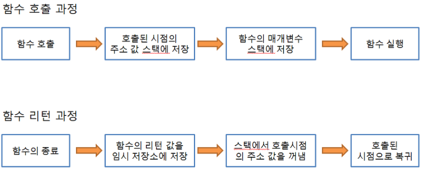

인라인함수 헤더에 선언하면 알아서 된다는데 뭐에요??

---



코딩을 하다보면 Getter, Setter을 정말 많이 만들고 사용하게 된다.

그러다보면 위의 <b>함수의 호출/리턴 과정이 빈번하게 일어나는데</b>

이러한 것들이 수십, 수백, 수천번 반복되게 되면 처리시간, 메모리, cpu자원이 불필요하게 쓰이게 된다.

이것을 가르켜 <b>오버헤드(overhead) 현상</b>이라고 부른다고 한다.

이러한 과정을 없애기 위해 C++에서는 inline이라는 문법을 만들었다.

### <b>Inline이란?</b>

- 컴파일러가 컴파일하면서 Inline 함수로 지정된 함수의 이름을 만났을때 해당 함수의 구현부를 그대로 함수 이름과 치환한다
  Define 매크로와 똑같이 적용된다고 생각하면 된다.

```c++
void GetName() const { return mName; }

void main()
{
	GetName(); // 컴파일러가 여기를 만났을때 함수 주소값을 스택에 저장하고~~ 하는 과정 없이
 =>	{ return mName; } // 바로 여기서 실행시킬수 있게 만든다.

}
```
