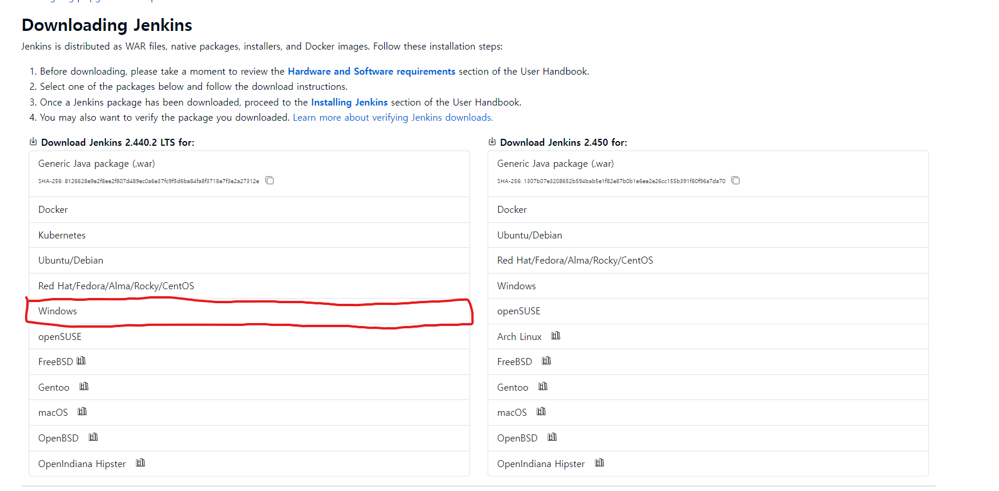
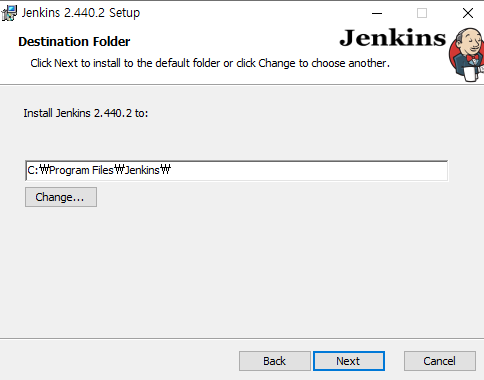
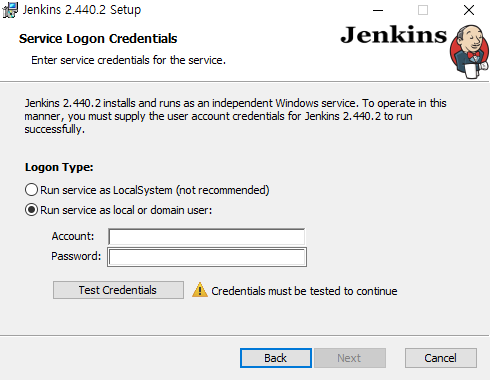
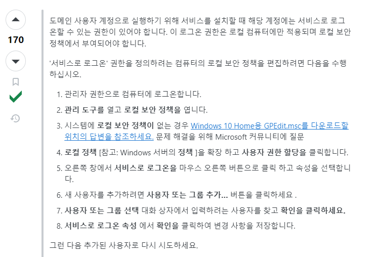
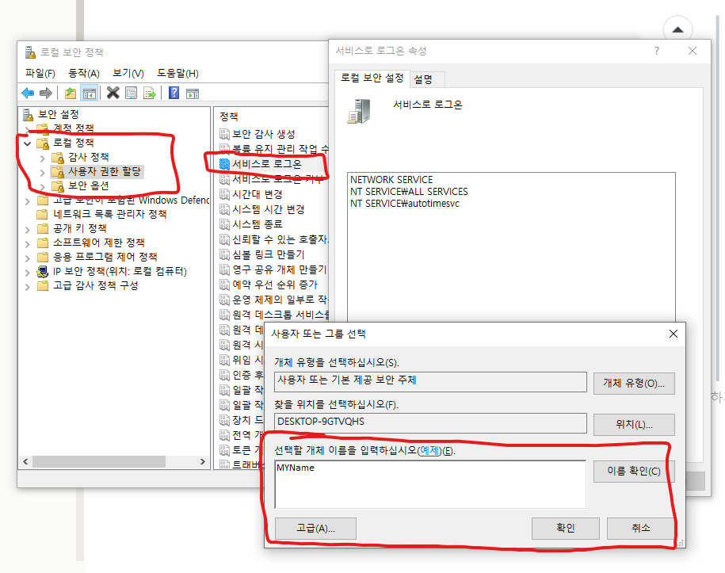
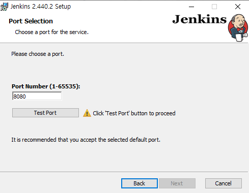
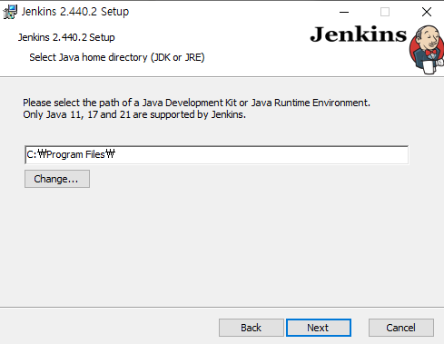
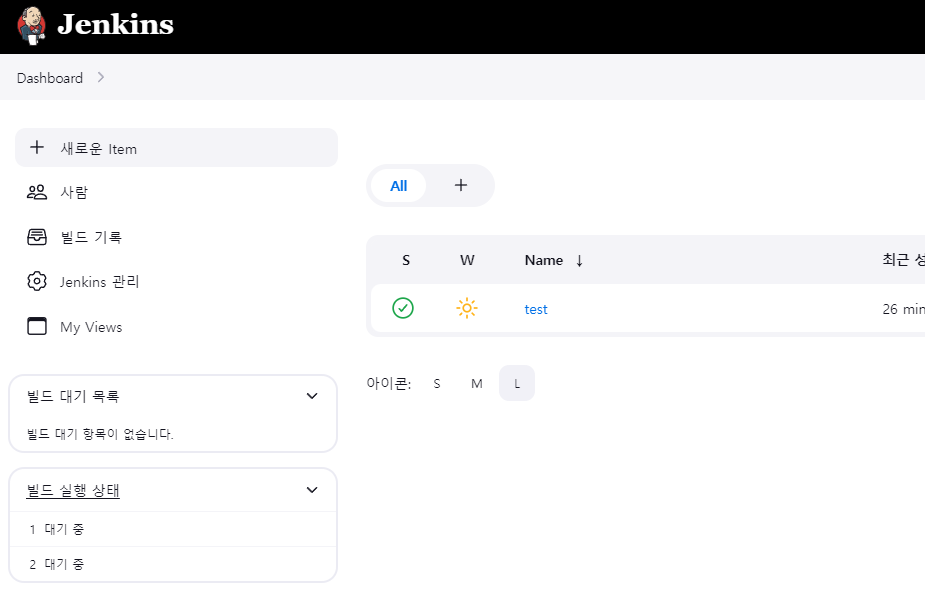
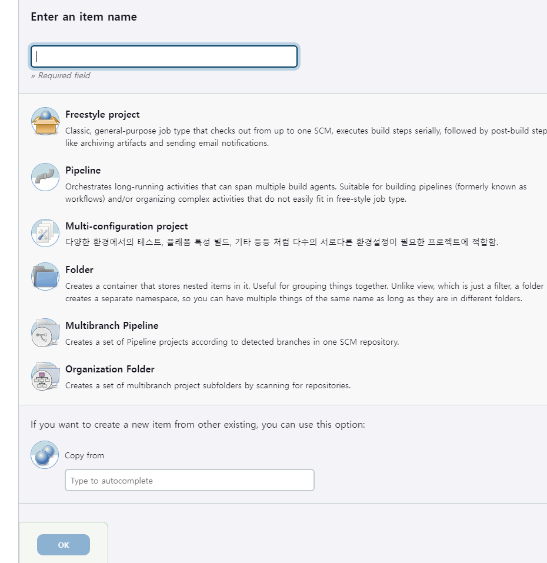
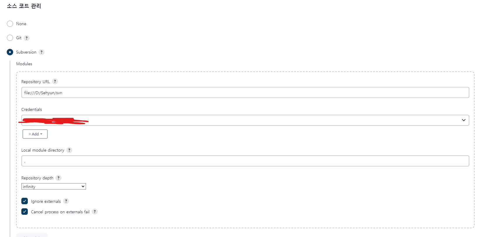

---

설치

<a href="https://www.jenkins.io/download/">www.jenkins.io</a>

나는 위 링크에 들어가서 Windows 버전을 깔았다. .war 버전을 사용하는 블로거도 있었는데 저게 뭔지 몰라서 우선 윈도우로 설치를 진행했다

설치 경로를 고르면

위와 같은 창이 나오는데 무슨 Account를 의미하는지 알 수 없어서 해당 내용에 관해 찾아보니

<a href="https://stackoverflow.com/questions/63410442/jenkins-installation-windows-10-service-logon-credentials/63582616#63582616">stackoverflow.com</a>

그래서 내가 Jenkins에서 사용할 닉네임을 적으란 소리인줄 알았는데 그건 아니고 이 PC에서 해당 기능을 사용하려는 사용자의 이름을 적으라는 말인 것 같다.

NETWORD SERVICE등의 이름을 넣어봤지만 잘 되지 않아서 <b>LocalSystem 방식을 사용했다.</b>

포트를 설정한다. Test후 사용이 가능한 포트면 Next가 가능함

프로그램이 자바로 만들어졌는지 자바가 설치되어 있어야 한다. 나는 가운데에 있는 17썼다.

<a href="https://www.oracle.com/java/technologies/javase/jdk17-archive-downloads.html">www.oracle.com</a>

@Todo

깔고 로그인 하는 설명 추가 필요

프로젝트 생성

새로운 Item을 누르면 프로젝트를 추가시킬수 있다.

기본적인 사용을 원한다면 FreeStyle을 고르고

내가 원하는 Jenkins Pipeline을 원한다면 Pipeline을 고르면 된다.

Pipeline을 고르면 내가 원하는 작업을 pipeline별로 분류해서 처리할 수 있다. (update, merge등) 

<a href="https://sihyung92.oopy.io/e5300d92-1a4e-40f4-b927-a93b2bbb17d2#dd29b34d-6c73-4759-94d1-bd9a7f3e57e3">sihyung92.oopy.io</a>

형상관리 툴을 정할수 있다.

Git같은경우 원래 깔려있고 svn연동을 위해서는 Subversion 플러그인을 별도로 설치해야한다.

URL을 넣고 크리덴셜에 svn계정을 넣고 저장을하면 빌드할 수 있게된다.

배포

배포를 위해서는 배포 받고싶은 컴퓨터의 SSH Key를 입력해야 한다.

<i><b>SSH</b></i>는 네트워크 상 <b>다른 컴퓨터의 쉘을 사용</b>할 수 있게 해 주는 프로그램 혹은 그 프로토콜을 의미한다.

<b>SSH Key 생성</b>

- 사용자 root 폴더에 .ssh 디렉토리를 생성한다.
- 해당 폴더에 key를 생성한다.
  <ul>
  <li>
  cmd에 ssh-keygen 명령어로 key를 생성할 수 있다. 

  나는 ssh-keygen -t rsa 명령어를 사용했다.

  <a href="https://learn.microsoft.com/ko-kr/azure/virtual-machines/linux/create-ssh-keys-detailed#generate-keys-with-ssh-keygen">learn.microsoft.com</a>
  </li>
  <li>
  RSA key란?

  ['암호화할 때에는 마음대로였겠지만 해독할 때에는 아니다'](https://namu.wiki/w/%EB%93%A4%EC%96%B4%EC%98%AC%20%EB%95%8C%EB%8A%94%20%EB%A7%88%EC%9D%8C%EB%8C%80%EB%A1%9C%EC%98%80%EA%B2%A0%EC%A7%80%EB%A7%8C%20%EB%82%98%EA%B0%88%20%EB%95%8C%EB%8A%94%20%EC%95%84%EB%8B%88%EB%9E%80%EB%8B%A4)를 기본 모토로 한 공개키 암호체계 중 하나이다.[\[1\]](https://namu.wiki/w/RSA%20%EC%95%94%ED%98%B8%ED%99%94#fn-1) 공개키와 개인키가 한 쌍을 이루며, 공개키로 암호화한 내용은 개인키로만, 개인키로 암호화한 내용은 공개키로만 해독할 수 있다.  
  </li>
  </ul>

 나같은 경우는 배포하는 script를 pipeline에 작성

main project를 관리하는 item을 따로 생성 해서 사용할 것이다. 

