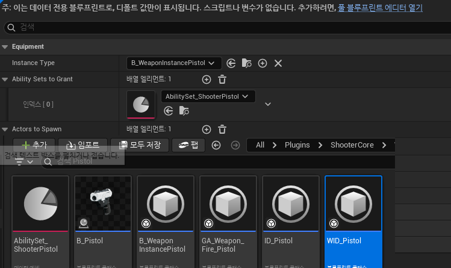
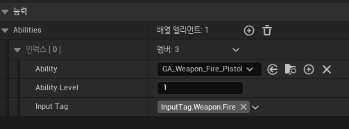
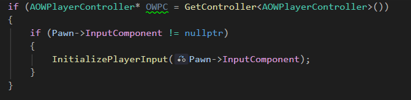
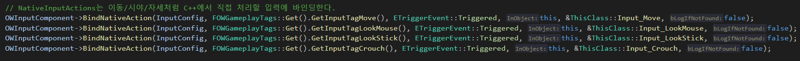

---

Skill은 만드는 방법도 제각각이고 요즘 대규모 온라인게임도 많아지는데 수많은 캐릭터들에게 스킬을 컴포넌트 식으로 붙여주자는 개념에서 나온 시스템이다.

라이라에서는

공격, 스킬 이외에도

점프, 죽음, 정보창열기 등을 모두 GAS로 구현되어있다.

---

액터들은 액터에게 AbilitySystemComponent를 장착하는 것으로 능력을 갖게된다.<br />예를들어 트레이서ASC를 장착하면 그 액터는 그때부터 트레이서가 되는것

---

기본적인 요약.

<ol>
<li>
ASC가 특정 폰의 어빌리티 관리
</li>
<li>
어빌리티 발동 성공
</li>
<li>
어빌리티가 이펙트를 남김 (일반적으로 데미지를 준다고 생각하면 됨)
</li>
<li>
이펙트의 영향을 받은 폰의 어트리뷰트를(스탯) 수정
</li>
<li>
예를들어 체력이 0이되면 해당 폰의 death 어빌리티 발동
</li>
<li></li>
</ol>

---

우선 <code>UAbilitySystemComponent</code> 과 <code>UGameplayAbility</code> 을 만든다.

<code>UAbilitySystemComponent</code> 은 Character나 PlayerState에 장착한다.<br />PlayerState에 장착하는 이유는<code>AbilitySystemComponent</code> 은 Pawn이 죽든, 다른Pawn으로 교체되던 살아있어야하기 때문이다 (예를들면 오버워치의 궁극기 게이지라던지 그런게 확 바뀌면 안되잖음)

만약 싱글게임이고 캐릭터 변경이 없다면 캐릭터에 장착하도 무방하나 멀티플레이어 게임이면 playerstate를 사용한다<br />(일반적으로 PlayerState는 Player의 정보중 남이 알아야하는 정보들을 상대방에게 넘기기 위해 사용되기 때문이다.<br />근데 AbilitySystem은 hp, mp, 애니메이션등의 정보등이 전달이 되어야 하기 때문에 PS에 장착한다.)<br />

왜냐하면character면 Possess하는 타이밍이 모호한데 ps는 herocomp에서 되는것을 우리가 보장하기 때문이다

그리고 상대적으로 네트워크 수명이 안정적이기 때문이다.

```c++
AOWPlayerState::AOWPlayerState()
{
	AbilitySystemComponent = CreateDefaultSubobject<UOWAbilitySystemComponent>(TEXT("AbilitySystemComponent"));
}

void AOWPlayerState::PostInitializeComponents()
{
	Super::PostInitializeComponents();

	if (!AbilitySystemComponent)
	{
		check(AbilitySystemComponent);
		return;
	}

// PS는 PC가 생긴 이후에 생긴다.
// 처음 InitAbilityActorInfo를 호출하면 OwnerActor와 AvatarActor가 모두 PlayerState가 된다.
/*	
void UAbilitySystemComponent::InitializeComponent()
{
	// Look for DSO AttributeSets (note we are currently requiring all attribute sets to be subobjects of the same owner. This doesn't *have* to be the case forever.
	AActor *Owner = GetOwner();
	InitAbilityActorInfo(Owner, Owner);	// Default init to our outer owner
	여기서 Owner는 PlayerState임
}	
*/	
	
	
	// 허나 OwnerActor은 PS가 맞지만 AvatarActor는 PC가 소유하는 대상Pawn이 되어야 한다.

	// 이를 위해 Pawn을 AvatarActor로 다시 연결한다.
	// 하지만 아직 PC가 Pawn을 Possess하지 않은 상태라면 GetPawn()은 nullptr이므로 InitAbilityActorInfo를 호출하지 않는다.
	AbilitySystemComponent->InitAbilityActorInfo(this, GetPawn());

	UWorld* World = GetWorld();
	if (World && World->IsGameWorld() && World->GetNetMode() != NM_Client)
	{
		const AGameStateBase* GameState = World->GetGameState();
		if (GameState)
		{
			if (UOWExperienceManagerComponent* ExperienceManagerComponent = GameState->FindComponentByClass<UOWExperienceManagerComponent>())
			{
				ExperienceManagerComponent->CallOrRegister_OnExperienceLoaded(FOnOWExperienceLoaded::FDelegate::CreateUObject(this, &ThisClass::OnExperienceLoaded));
				// 내부에서 AOWPlayerState::SetPawnData
			}
		}
	}
}

// Experience로드가 끝나면 PawnData의 어빌리티들을 꺼내와서 부여해준다.
void AOWPlayerState::SetPawnData(const UOWPawnData* InPawnData)
{
	PawnData = InPawnData;

	// PawnData의 AbilitySet을 순회하며 ASC에 Ability를 부여한다.
	// 이 단계에서 ASC의 ActivatableAbilities에 GameplayAbilitySpec이 추가된다.
	for (UOWAbilitySet* AbilitySet : PawnData->AbilitySets)
	{
		if (AbilitySet)
		{
			AbilitySet->GiveAbilitySystem(AbilitySystemComponent, nullptr);
		}
	}
	ForceNetUpdate();
}


```

위 코드의 주석대로라면 어디선가 Pawn을 AvatarActor로 다시 연결해주는 작업이 필요할 것이다.<br />만약 <code>AbilitySystemComponent-&gt;InitAbilityActorInfo(this, GetPawn());</code> 여기서 이미 GetPawn이 성공 했으면 상관 없겠지만 실패를하면 확실한 어딘가에서 해줘야할 것이다.

이 작업은 UOWHeroComponent에서 해준다.<br />왜? ⇒ HandleChangeInitState에서 Pawn의 생명주기가 가장 확실하게 추적이 가능하기 때문이다.

```javascript
void UOWHeroComponent::HandleChangeInitState(UGameFrameworkComponentManager* InManager, FGameplayTag InCurrentState, FGameplayTag InDesiredState)
{
	... 
	// DataInitialized 확인!
	if (InCurrentState != InitTags.InitState_DataAvailable || InDesiredState != InitTags.InitState_DataInitialized)
	{
		return;
	}

	// DataAvailable -> DataInitialized 단계에서 Pawn은 Controller에 possess되어 준비된 상태다.
	APawn* Pawn = GetPawn<APawn>();
	AOWPlayerState* PlayerState = GetPlayerState<AOWPlayerState>();
	const UOWPawnData* PawnData = nullptr;

	if (UOWPawnExtensionComponent* PawnExtensionComponent = UOWPawnExtensionComponent::FindPawnExtensionComponent(Pawn))
	{
		PawnData = PawnExtensionComponent->GetPawnData<UOWPawnData>();

		// DataInitialized까지 오면 Pawn이 Controller에 Possess되어 준비된 상황이다.
		// 그니까 InitializeAbilitySystem에서 올바른 아바타 액터를 장착이 가능해지는 것이다.

		// PlayerState는 지속 데이터를 소유한다. (죽음과 여러 폰에 걸쳐 지속되는 상태)
		// ASC도 PlayerState에 있으므로 PawnExtension을 통해 현재 Pawn을 AvatarActor로 연결한다.
		PawnExtensionComponent->InitializeAbilitySystem(PlayerState->GetOWAbilitySystemComponent(), PlayerState);
	}
}

```

여기까지 왔으면 안전하게 초기화가 됐을것이고 Experience로드까지 끝나면 <code>UOWAbilitySet::GiveAbilitySystem</code> 이 호출이 되었을것

```javascript
void UOWAbilitySet::GiveAbilitySystem(UOWAbilitySystemComponent* InASC, FOWAbilitySet_GrantedHandles* OutGrantedHandles, UObject* SourceObject) const
{
	
	// GA를 허용
	// 컴포넌트에 데이터 내 모든 능력을 부여한다.
	for (int32 AbilityIndex = 0; AbilityIndex < Abilities.Num(); ++AbilityIndex)
	{
		const FOWAbilitySet_GameplayAbility& AbilityToGrant = Abilities[AbilityIndex];
		if (!IsValid(AbilityToGrant.Ability))
		{
			continue;
		}

		// GiveAbility에서 만약 EGameplayAbilityInstancingPolicy가 InstancePerActor인 경우, 내부적으로 Instance를 생성하지만
		// 그렇지 않으면 CDO에서 GetDefaultObject를 통해 객체를 생성한다.
		// - 이를 통해 UObject개수를 줄여 부하 줄일 수 있다.

		// CCProject에서 InstancedStruct를와 CDO로직을 병행했던 것이랑 비슷한 구조라고 볼 수 있겠다.
		UOWGameplayAbility* AbilityCDO = AbilityToGrant.Ability->GetDefaultObject<UOWGameplayAbility>();

		// FGameplayAbilitySpec는 AbilityCDO능력을 부여할건데 어떤 정보를 가지고 부여할것인지 정의
		// AbilitySpec은 GiveAbility로 전달되어 ActivatableAbilities에 추가된다.
		FGameplayAbilitySpec Spec(AbilityCDO, AbilityToGrant.AbilityLevel);
		Spec.SourceObject = SourceObject;
		Spec.GetDynamicSpecSourceTags().AddTag(AbilityToGrant.InputTag); // 이 능력은 어떤 태그랑 매치시킬거야~ 라고 명시


		// 여담으로 언리얼에서는 항상 Handle을 사용한다.
		// 이는 객체의 직접 비교를 막고 int데이터로만 비교를 하는게 더 가볍기 때문이다)
		const FGameplayAbilitySpecHandle AbilitySpecHandle = InASC->GiveAbility(Spec);
		if (OutGrantedHandles)
		{
			OutGrantedHandles->AddAbilitySpecHandle(AbilitySpecHandle);
		}
	}
}
```

GiveAbility는 내부적으로<br /><code>FGameplayAbilitySpec&amp; OwnedSpec = ActivatableAbilities.Items[ActivatableAbilities.Items.Add(Spec)]; 이렇게 추가가된다.</code> 

<code>FGameplayAbilitySpecHandle</code> 은 Handle이니까 내부에 int의 Handle값을 들고 있는데 이Handle값은 <code>ActivatableAbilities</code> 의 배열 인덱스를 의미한다. ⇒ 성능적으로 유리

---

점프처럼 공통적이고 기본적인 Ability들은 보통 PawnData에 추가한다고 한다.

이제 무기에 어빌리티들을 바인딩 해야한다. 총에서 총알나가는것도 어빌리티다

그러기 위해서는 무기 데이터에 어빌리티가 추가가 되어야 할 것이다.<br />무기 데이터 정의는 <code>UOWEquipmentDefinition</code> 에 하고있다.<br />따라서 여기에 추가하면 되겠다.

```javascript
/** 장착 가능한 장비의 데이터 정의다. 런타임 상태는 EquipmentInstance가 소유한다. */
UCLASS(Blueprintable, Const, Abstract, BlueprintType)
class OVERWATCH_API UOWEquipmentDefinition : public UObject
{
	GENERATED_BODY()

public:
	UOWEquipmentDefinition(const FObjectInitializer& ObjectInitializer = FObjectInitializer::Get());

	/** 이 장비가 장착될 때 생성할 런타임 인스턴스 타입 */
	/** 장착 가능한 장비의 데이터 정의다. 런타임 상태는 EquipmentInstance가 소유한다. */
	// 인스턴스 객체는 맞음 맞는데 Equipment주체가 아니라 해당 Equipment를 관리하는 방식을 결정하는 클래스라고 생각하면 될듯

	/** 이 장비가 장착될 때 생성할 런타임 상태 객체 타입이다. 장비별 동작 차이는 이 타입의 override로 확장한다. */
	UPROPERTY(EditDefaultsOnly, Category = Equipment)
	TSubclassOf<UOWEquipmentInstance> InstanceType;
	
		/** 장착 중 Pawn에 부착할 표현용 Actor 정의 목록이다. 실제 스폰/제거된 Actor의 런타임 상태는 EquipmentInstance가 소유한다. */
	UPROPERTY(EditDefaultsOnly, Category = Equipment)
	TArray<FOWEquipmentActorToSpawn> ActorsToSpawn;

	/** 장착 중 ASC에 부여하고 해제 시 회수할 AbilitySet 목록이다. 부여/회수 핸들은 EquipmentList 엔트리가 소유한다. */
	UPROPERTY(EditDefaultsOnly, Category = Equipment)
	TArray<TObjectPtr<const UOWAbilitySet>> AbilitySetsToGrant;
};

```

<code>FOWEquipmentList::AddEntry</code> 가 기억 날것이다.<br />Equipment추가 관련해 모든것을 해주던.. (인스턴스 캐싱, Actor 스폰)<br />이제 여기서 ASC 부여까지 해줄것이다.

```javascript

UOWEquipmentInstance* FOWEquipmentList::AddEntry(TSubclassOf<UOWEquipmentDefinition> EquipmentDefinition)
{
	// 여기서 모든게 진행된다. (인스턴스 캐싱, ASC 부여, Actor 스폰)
	FOWAppliedEquipmentEntry& NewEntry = Entries.AddDefaulted_GetRef();
	NewEntry.EquipmentDefinition = EquipmentDefinition; // Definition 부여

// 어빌리티 부여
	if (UOWAbilitySystemComponent* AbilitySystemComponent = GetAbilitySystemComponent())
	{
	// Definition의 AbilitySetsToGrant가져와서 런타임데이터로 추가!
		for (const TObjectPtr<const UOWAbilitySet>& AbilitySet : EquipmentCDO->AbilitySetsToGrant)
		{
			if (AbilitySet)
			{
				AbilitySet->GiveAbilitySystem(AbilitySystemComponent, &NewEntry.GrantedHandles, NewEntry.Instance);
			}
		}
	}

	NewEntry.Instance->SpawnEquipmentActors(EquipmentCDO->ActorsToSpawn); // 스폰
	return NewEntry.Instance;
}

```

추가된 Ability는 <code>FOWAbilitySet_GrantedHandles GrantedHandles</code> 여기로 들어간다.

```javascript

/** Pawn에 적용된 단일 장비 항목이다. */
USTRUCT(BlueprintType)
struct FOWAppliedEquipmentEntry : public FFastArraySerializerItem
{
	GENERATED_BODY()

	FString GetDebugString() const;

private:
	friend struct FOWEquipmentList;
	friend class UOWEquipmentManagerComponent;

	// 아래 변수들은 FastArrayDeltaSerialize에 의해 자동으로 직렬화되려고 한다.
	// 그래서 직렬화 안할애한테는 NotReplicated를 붙여야 한다. (FastArrayDeltaSerialize는 FFastArraySerializerItem을 상속받은 구조체의 UPROPERTY를 직렬화한다.)

	UPROPERTY()
	TSubclassOf<UOWEquipmentDefinition> EquipmentDefinition;

	UPROPERTY()
	TObjectPtr<UOWEquipmentInstance> Instance = nullptr;

	/** 장착 시 부여된 AbilitySet 핸들은 서버에서만 보관하고 해제 시 회수한다. 부여된 능력을 관리하기위해 사용 */
	UPROPERTY(NotReplicated)
	FOWAbilitySet_GrantedHandles GrantedHandles;
};
```

---



이제 무기에 만든 어빌리티를 넣었다.

그런데 지금 어빌리의 내부는 구현되어있지 않다.<br />



AbilitySet은 Ability와 InputTag의 집합이다.<br />InputTag를 저렇게 넣어줬으니까, 이제 마우스 클릭할때 저 태그를 호출해주면 될것같은 느낌

<code>BindAbilityActions</code> 에서 BindAction을 처리한다.<br /><code>BindAbilityActions</code> 은 특이하게 트리거 이벤트를 정해서 받는게 아니라 2개 둘 다 받는다.

```javascript
template <class UserClass, typename PressedFuncType, typename ReleasedFuncType>
void UOWInputComponent::BindAbilityActions(const UOWInputConfig* InInputConfig, UserClass* InObject, PressedFuncType InPressedFunc, ReleasedFuncType InReleasedFunc, TArray<uint32>& OutBindHandles)
{
	// AbilityAction에 대해서는 그냥 모든 InputAction에 바인딩시킨다.
	for (const FOWInputAction& Action : InInputConfig->AbilityInputActions)
	{
		if (Action.InputAction && Action.InputTag.IsValid())
		{
			if (InPressedFunc)
			{
				// Triggered는 Ability 입력 Pressed로 취급하고, InputTag를 함께 전달한다.
				OutBindHandles.Add(BindAction(Action.InputAction, ETriggerEvent::Triggered, InObject, InPressedFunc, Action.InputTag).GetHandle());
			}

			if (InReleasedFunc)
			{
				// Completed는 Ability 입력 Released로 취급하고, InputTag를 함께 전달한다.
				OutBindHandles.Add(BindAction(Action.InputAction, ETriggerEvent::Completed, InObject, InReleasedFunc, Action.InputTag).GetHandle());
			}
		}
	}
}

```

BindAction(Action.InputAction, ETriggerEvent::Triggered, InObject, InPressedFunc, Action.InputTag)

함수의 마지막엔 InputTag를 받는다.<br />InPressedFunc 이후에 오는 매개변수들은 전부 InPressedFunc로 넘어간다고한다.

HandleChangeInitStated의 DataInitialized에서 플레이어 인풋을 초기화 한다.



바인딩할때 위에서 만든 Trigger/Complete 둘 다 되는 함수에 한 번 바인딩하는 것으로 바인딩을 마친다.

```javascript
	// AbilityInputActions는 GameplayTag를 ASC에 전달하여 GameplayAbility가 직접 입력으로 활성화되게 한다.
	// 그래서 바인딩할때 태그로 구분하는거니까 하나만 바인딩해도 된다.
	OWInputComponent->BindAbilityActions(InputConfig, this, &ThisClass::Input_AbilityInputTagPressed, &ThisClass::Input_AbilityInputTagReleased, BindHandles);
```

원래 NativeBinding은 함수별로 바인딩해줘야한다.



여기서 Press함수와 Release함수를 동시에 바인딩 한 이유가 나온다<br />AbilityInput에 넣은 함수들은 키 누를 때 AbilityInputTagPressed 호출되고 뗄 때 AbilityInputTagReleased호출되는게 전부

```javascript
void UOWHeroComponent::Input_AbilityInputTagPressed(FGameplayTag InInputTag)
{
	// ASC가 GameplayTag와 매칭되는 AbilitySpec을 찾아 Pressed/Held 큐에 넣는다.
	AbilitySystemComponent->AbilityInputTagPressed(InInputTag);
}

void UOWHeroComponent::Input_AbilityInputTagReleased(FGameplayTag InInputTag)
{
	// ASC가 GameplayTag와 매칭되는 AbilitySpec을 찾아 Released 큐에 넣고 Held에서 제거한다.
	AbilitySystemComponent->AbilityInputTagReleased(InInputTag);
}
```

그럼 위에서 호출하는 2개의 함수를 보자<br />함수를 보면 누르거나 뗀 어빌리티들을 어빌리티 큐에 모아넣는걸 볼 수 있다. (여기서 Held는 계속 누르고 있는것)

```javascript

void UOWAbilitySystemComponent::AbilityInputTagPressed(const FGameplayTag& InInputTag)
{
	// 부여된 모든 GameplayAbilitySpec을 순회하며 
	// 입력 태그와 매칭되는 Ability를 Pressed/Held 큐에 넣는다.
	for (const FGameplayAbilitySpec& AbilitySpec : ActivatableAbilities.Items)
	{
		if (AbilitySpec.Ability && AbilitySpec.GetDynamicSpecSourceTags().HasTagExact(InInputTag))
		{
			InputPressedSpecHandles.AddUnique(AbilitySpec.Handle);
			InputHeldSpecHandles.AddUnique(AbilitySpec.Handle);
		}
	}
}

void UOWAbilitySystemComponent::AbilityInputTagReleased(const FGameplayTag& InInputTag)
{
	// Released 큐에 추가하고 Held 큐에서는 제거한다.
	for (const FGameplayAbilitySpec& AbilitySpec : ActivatableAbilities.Items)
	{
		if (AbilitySpec.Ability && AbilitySpec.GetDynamicSpecSourceTags().HasTagExact(InInputTag))
		{
			InputReleasedSpecHandles.AddUnique(AbilitySpec.Handle);
			InputHeldSpecHandles.Remove(AbilitySpec.Handle);
		}
	}
}

```

위에서 인풋이 들어와서 모아놓은 어빌리티들을 처리한다.<br />Held → Pressed목록을 가져와서 활성화 시켜주고 Released 이벤트를 전달하는 순으로 처리된다.

```javascript

void UOWAbilitySystemComponent::ProcessAbilityInput(float InDeltaTime, bool bInGamePaused)
{
	TArray<FGameplayAbilitySpecHandle> AbilitiesToActivate;

	// InputHeldSpecHandles에서 WhileInputActive 정책 Ability를 찾아 활성화 대상으로 모은다.
	for (const FGameplayAbilitySpecHandle& SpecHandle : InputHeldSpecHandles)
	{
		// ActivatableAbilities에서 Handle로 GameplayAbilitySpec을 찾는다.
		if (const FGameplayAbilitySpec* AbilitySpec = FindAbilitySpecFromHandle(SpecHandle))
		{
			if (AbilitySpec->Ability && !AbilitySpec->IsActive())
			{
				const UOWGameplayAbility* AbilityCDO = CastChecked<UOWGameplayAbility>(AbilitySpec->Ability);
				if (AbilityCDO->GetActivationPolicy() == EOWAbilityActivationPolicy::WhileInputActive)
				{
					// ActivationPolicy가 WhileInputActive이면 입력이 유지되는 동안 활성화를 시도한다.
					AbilitiesToActivate.AddUnique(AbilitySpec->Handle);
				}
			}
		}
	}

	// 이번 프레임에 Pressed된 Ability를 처리한다.
	for (const FGameplayAbilitySpecHandle& SpecHandle : InputPressedSpecHandles)
	{
		if (FGameplayAbilitySpec* AbilitySpec = FindAbilitySpecFromHandle(SpecHandle))
		{
			if (AbilitySpec->Ability)
			{
				AbilitySpec->InputPressed = true;
				if (AbilitySpec->IsActive())
				{
					// 이미 활성화된 Ability라면 InputPressed 이벤트를 전달한다.
					AbilitySpecInputPressed(*AbilitySpec);
				}
				else
				{
					const UOWGameplayAbility* AbilityCDO = CastChecked<UOWGameplayAbility>(AbilitySpec->Ability);
					if (AbilityCDO->GetActivationPolicy() == EOWAbilityActivationPolicy::OnInputTriggered)
					{
						// ActivationPolicy가 OnInputTriggered이면 이번 Press에서 활성화를 시도한다.
						AbilitiesToActivate.AddUnique(AbilitySpec->Handle);
					}
				}
			}
		}
	}

	// 모아둔 Ability를 한 번에 활성화한다.
	for (const FGameplayAbilitySpecHandle& AbilitySpecHandle : AbilitiesToActivate)
	{
		TryActivateAbility(AbilitySpecHandle);
	}

	// 이번 프레임에 Released된 Ability를 처리한다.
	for (const FGameplayAbilitySpecHandle& SpecHandle : InputReleasedSpecHandles)
	{
		if (FGameplayAbilitySpec* AbilitySpec = FindAbilitySpecFromHandle(SpecHandle))
		{
			if (AbilitySpec->Ability)
			{
				AbilitySpec->InputPressed = false;
				if (AbilitySpec->IsActive())
				{
					// 활성화된 Ability라면 InputReleased 이벤트를 전달한다.
					AbilitySpecInputReleased(*AbilitySpec);
				}
			}
		}
	}

	// Held는 Released가 들어올 때 제거되므로 프레임 큐인 Pressed/Released만 비운다.
	InputPressedSpecHandles.Reset();
	InputReleasedSpecHandles.Reset();
}
```

```javascript
// 프레임의 모든 인풋이 처리되고나서 호출되는 함수
void AOWPlayerController::PostProcessInput(const float InDeltaTime, const bool bInGamePaused)
{
	if (UOWAbilitySystemComponent* AbilitySystemComponent = GetOWAbilitySystemComponent())
	{
		// UPlayerInput::ProcessInputStack 이후 모아둔 Ability 입력 큐를 ASC에서 처리한다.
		AbilitySystemComponent->ProcessAbilityInput(InDeltaTime, bInGamePaused);
	}

	Super::PostProcessInput(InDeltaTime, bInGamePaused);
}

```

이제 InputAction과 어빌리티를 연결하는 작업을 하면 된다. 

---

<details>
<summary><b>FGamePlayAbilityActorInfo</b></summary>

FGamePlayAbilityActorInfo는 Ability, Attribute, Tag, Montage등을 동작하는데 필수적인 구조체이다.<br />이 구조체가 초기화되지 않으면 능력이 실행이 되지 않거나, 속성부여가 안되는 버그가 있다.

</details>

<details>
<summary><b>UOWAbilitySet</b></summary>

캐릭터가 사용할 GameplayAbility 목록을 데이터로 정의하는 에셋이다.

<details>
<summary>코드</summary>

```c++
// Fill out your copyright notice in the Description page of Project Settings.

#pragma once

#include "CoreMinimal.h"
#include "Engine/DataAsset.h"
#include "AbilitySystemComponent.h"

/*
 * GA의 WrapperClass 
 */

class UOWAbilitySystemComponent;
class UOWGameplayAbility;

USTRUCT(BlueprintType)
struct FOWAbilitySet_GameplayAbility
{
	GENERATED_BODY()

	// 허용된 GameplayAbility
	UPROPERTY(EditDefaultsOnly)
	TSubclassOf<UOWGameplayAbility> Ability = nullptr;

	// Input처리를 위한 GameplayTag
	UPROPERTY(EditDefaultsOnly)
	FGameplayTag InputTag;

	// Ability의 금지 조건
	UPROPERTY(EditDefaultsOnly)
	TArray<FGameplayTag> BlockedTag;
};


USTRUCT(BlueprintType)
struct FOWAbilitySet_GrantedHandles
{
	GENERATED_BODY()
	
	void AddAbilitySpecHandle(const FGameplayAbilitySpecHandle& Handle);
	void TakeFromAbilitySystem(UOWAbilitySystemComponent* InASC) const;

	// 허용된 GameplayAbilitySpecHandle (int32)
	UPROPERTY()
	TArray<FGameplayAbilitySpecHandle> AbilitySpecHandles;
};
UCLASS()
class OVERWATCH_API UOWAbilitySet : public UPrimaryDataAsset
{
	GENERATED_BODY()
	
	
	UPROPERTY(EditDefaultsOnly, Category = "Abilities")
	TArray<FOWAbilitySet_GameplayAbility> Abilities;

public:
	void GiveAbilitySystem(UOWAbilitySystemComponent* InASC, FOWAbilitySet_GrantedHandles* OutGrantedHandles, UObject* SourceObject = nullptr) const;
};

// Fill out your copyright notice in the Description page of Project Settings.


#include "AbilitySystem/OWAbilitySet.h"

#include "OWAbilitySystemComponent.h"
#include "Abilities/OWGameplayAbility.h"


void FOWAbilitySet_GrantedHandles::AddAbilitySpecHandle(const FGameplayAbilitySpecHandle& Handle)
{
	if (Handle.IsValid())
	{
		AbilitySpecHandles.Add(Handle);
	}
}

void FOWAbilitySet_GrantedHandles::TakeFromAbilitySystem(UOWAbilitySystemComponent* InASC) const {}

void UOWAbilitySet::GiveAbilitySystem(UOWAbilitySystemComponent* InASC, FOWAbilitySet_GrantedHandles* OutGrantedHandles, UObject* SourceObject) const
{
	if (!InASC)
	{
		return;
	}

	if (!InASC->IsOwnerActorAuthoritative())
	{
		return;
	}


	// GA를 허용

	// 컴포넌트에 데이터 내 모든 능력을 부여한다.
	for (int32 AbilityIndex = 0; AbilityIndex < Abilities.Num(); ++AbilityIndex)
	{
		const FOWAbilitySet_GameplayAbility& AbilityToGrant = Abilities[AbilityIndex];
		if (!IsValid(AbilityToGrant.Ability))
		{
			continue;
		}

		// GiveAbility에서 만약 EGameplayAbilityInstancingPolicy가 InstancePerActor인 경우, 내부적으로 Instance를 생성하지만
		// 그렇지 않으면 CDO에서 GetDefaultObject를 통해 객체를 생성한다.
		// - 이를 통해 UObject개수를 줄여 부하 줄일 수 있다.

		// CCProject에서 InstancedStruct를와 CDO로직을 병행했던 것이랑 비슷한 구조라고 볼 수 있겠다.
		UOWGameplayAbility* AbilityCDO = AbilityToGrant.Ability->GetDefaultObject<UOWGameplayAbility>();

		// FGameplayAbilitySpec는 AbilityCDO능력을 부여할건데 어떤 정보를 가지고 부여할것인지 정의
		// AbilitySpec은 GiveAbility로 전달되어 ActivatableAbilities에 추가된다.
		FGameplayAbilitySpec Spec(AbilityCDO);
		Spec.SourceObject = SourceObject;
		Spec.DynamicAbilityTags.AddTag(AbilityToGrant.InputTag); // 이 능력은 어떤 태그랑 매치시킬거야~ 라고 명시


		// 여담으로 언리얼에서는 항상 Handle을 사용한다.
		// 이는 객체의 직접 비교를 막고 int데이터로만 비교를 하는게 더 가볍기 때문이다)
		const FGameplayAbilitySpecHandle AbilitySpecHandle = InASC->GiveAbility(Spec);
		if (OutGrantedHandles)
		{
			OutGrantedHandles->AddAbilitySpecHandle(AbilitySpecHandle);
		}
	}
}
```

</details>

즉, "솔저76은 어떤 Ability들을 가지는가"를 코드 분기 대신 데이터로 관리하기 위한 클래스이다.

GAS에서는 Ability를 ASC에 직접 하나씩 <code>GiveAbility()</code> 로 넣을 수 있는데,

캐릭터마다 부여해야 할 Ability가 많아지면 코드가 지저분해지고 관리 포인트가 흩어진다.

그래서 Ability 목록을 하나의 Asset으로 묶어두고, 필요할 때 ASC에 일괄 부여하는 방식으로 관리한다.

### 왜 필요한가

- 캐릭터별 Ability 구성을 데이터로 분리할 수 있다.
- 코드에서 <code>if Hero == Soldier76</code> 같은 분기를 줄일 수 있다.
- HeroData, PawnData 같은 상위 데이터에서 AbilitySet만 참조하면 된다.
- 리스폰, 영웅 선택, loadout 변경 시 같은 부여 로직을 재사용할 수 있다.

### 현재 구조

<code>FOWAbilitySet_GameplayAbility</code> 는 AbilitySet 안에 들어가는 개별 Ability 정의이다.

- <code>Ability</code>
  - 실제로 부여할 <code>UOWGameplayAbility</code> 클래스
- <code>InputTag</code>
  - 이 Ability가 어떤 입력 태그와 연결되는지 정의
  - 예: <code>InputTag.Ability.Skill1</code>
- <code>BlockedTag</code>
  - 해당 Ability가 막혀야 하는 조건 태그
  - 현재 구조에는 존재하지만 아직 실제 부여/활성 로직에는 반영되지 않았다.

즉, AbilitySet은

"어떤 Ability를 줄지"

"어떤 입력 태그와 연결할지"

를 데이터로 들고 있는 컨테이너라고 볼 수 있다.

### GiveAbilitySystem

<code>UOWAbilitySet::GiveAbilitySystem()</code> 은 AbilitySet 내부의 Ability들을 <code>UOWAbilitySystemComponent</code> 에 실제로 부여하는 함수이다.

동작 흐름은 다음과 같다.

1. 대상 ASC가 유효한지 확인한다.
2. ASC 소유자가 권한(authority)을 가지고 있는지 확인한다.
3. AbilitySet 안의 Ability 목록을 순회한다.
4. 각 Ability 클래스의 CDO를 가져온다.
5. <code>FGameplayAbilitySpec</code> 를 만든다.
6. <code>SourceObject</code> 와 <code>InputTag</code> 를 Spec에 설정한다.
7. <code>GiveAbility()</code> 로 ASC에 등록한다.
8. 반환된 <code>FGameplayAbilitySpecHandle</code> 을 저장한다.

여기서 중요한 점은

AbilitySet이 Ability를 "실행"하는 것이 아니라

ASC에 Ability를 "등록"하는 역할만 한다는 것이다.

### 왜 CDO를 사용하는가

코드에서는 Ability 클래스에서 <code>GetDefaultObject&lt;UOWGameplayAbility&gt;()</code> 를 통해 CDO를 가져온다.

이유는 <code>FGameplayAbilitySpec</code> 가 Ability 클래스의 기본 객체를 기반으로 능력을 등록하기 때문이다.

Ability가 무조건 인스턴스 객체 하나씩 생성되는 것이 아니라, Instancing Policy에 따라 CDO 기반으로 동작할 수도 있다.

즉, 여기서는

- Ability Asset/클래스 정의를 읽고
- Spec을 만들고
- ASC에 등록하기 위한 준비를 하는 것이다.

### FGameplayAbilitySpec

<code>FGameplayAbilitySpec</code> 는 "어떤 Ability를 어떤 조건으로 ASC에 부여할 것인가"를 담는 구조체이다.

현재 프로젝트 코드에서는 다음 정보가 들어간다.

- Ability CDO
- <code>SourceObject</code>
- <code>DynamicAbilityTags</code>

특히 <code>DynamicAbilityTags</code> 에 <code>InputTag</code> 를 넣는 부분이 중요하다.

이렇게 하면 나중에 ASC가 "입력 태그 기준으로 어떤 Ability를 활성화할지" 찾을 수 있다.

즉,<br />입력 -> InputTag 발생

ASC -> 해당 InputTag를 가진 AbilitySpec 검색

Ability 활성화

라는 흐름으로 이어질 수 있다.

### SourceObject

<code>Spec.SourceObject = SourceObject;</code>

<code>SourceObject</code> 는 이 Ability가 어떤 원본 객체로부터 왔는지를 기록하는 용도다.

보통 무기, 장비, 영웅 데이터, 장착 아이템 같은 소유/출처 정보를 추적할 때 유용하다.

예를 들어,

- 어떤 무기에서 부여된 Ability인지
- 어떤 HeroData에서 들어온 Ability인지<br />구분할 수 있게 된다.

### GrantedHandles

<code>FOWAbilitySet_GrantedHandles</code> 는 AbilitySet이 ASC에 부여한 Ability들의 Handle 목록을 저장하는 구조체이다.

이 구조체가 필요한 이유는

나중에 "이 AbilitySet이 넣었던 Ability만 다시 회수" 해야 할 수 있기 때문이다.

예를 들어,

- 영웅 변경
- 장비 해제
- 상태 종료
- 리스폰 시 재구성

같은 상황에서는 기존 Ability를 제거해야 한다.

이때 <code>FGameplayAbilitySpecHandle</code> 목록을 저장해두면, 그 Handle들만 정확히 찾아서 제거할 수 있다.

즉, <code>GrantedHandles</code> 는<br />"부여 기록"<br />이자<br />"나중에 회수하기 위한 추적 정보"<br />라고 보면 된다.

### TakeFromAbilitySystem

<code>TakeFromAbilitySystem()</code> 은 현재 비어 있지만, 의도는 명확하다.

- 저장해둔 <code>AbilitySpecHandle</code> 목록을 순회하면서
- ASC에서 해당 Ability들을 제거하고
- 필요하면 내부 목록도 정리하는 함수가 될 가능성이 높다.

즉, <code>GiveAbilitySystem()</code> 이 등록 함수라면

<code>TakeFromAbilitySystem()</code> 은 해제 함수 역할이다.

### 이 클래스의 책임

<code>UOWAbilitySet</code> 의 책임은 명확하게 제한하는 것이 좋다.

- Ability 목록을 데이터로 가진다.
- 그 Ability들을 ASC에 부여한다.
- 부여된 Handle을 추적할 수 있게 돕는다.

반대로 아래 책임은 여기 넣지 않는 것이 좋다.

- Ability 실행 로직
- 입력 처리 자체
- UI 갱신
- Hero 선택 결정
- Attribute 계산
- Pawn 제어

즉, AbilitySet은 "부여 데이터와 등록 절차"까지만 맡는 것이 좋다.

### 현재 프로젝트 버전에서 중요 포인트

현재 코드 기준으로 보면 <code>OWAbilitySet</code> 은 이미 좋은 출발점이다.

- Ability를 데이터 에셋으로 관리한다.
- InputTag를 AbilitySpec에 심어둔다.
- 부여된 Ability의 Handle을 따로 보관하려 한다.
- 서버 권한에서만 <code>GiveAbility()</code> 하도록 막아두었다.

이 구조는 나중에

- HeroData
- PlayerState ASC
- InputTag 기반 입력 처리<br />와 자연스럽게 연결된다.

### 아직 남은 부분

현재 코드 기준으로 앞으로 보완될 가능성이 큰 부분은 다음과 같다.

- <code>BlockedTag</code> 실제 반영
- <code>TakeFromAbilitySystem()</code> 구현
- Ability를 부여할 때 레벨 정보 포함 여부
- 중복 부여 방지 정책
- 동일 AbilitySet 재적용 시 처리 방식
- 입력 Pressed / Released 와 AbilitySpec 연결 방식

### 한 줄 요약

<code>UOWAbilitySet</code> 은 캐릭터가 가질 Ability 목록을 데이터로 정의하고,

그 목록을 ASC에 일괄 등록하며,

나중에 제거할 수 있도록 Handle까지 추적하는 GAS용 Ability 묶음 자산이다.

</details>
