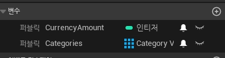
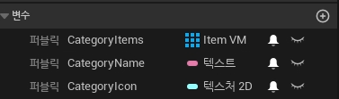
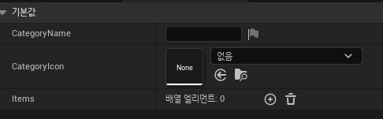
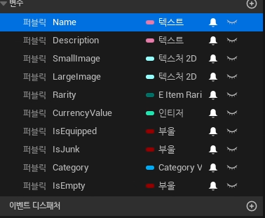
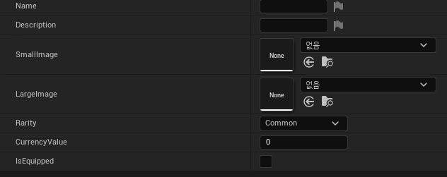
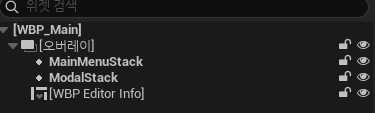
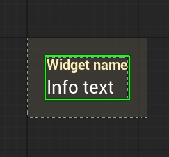
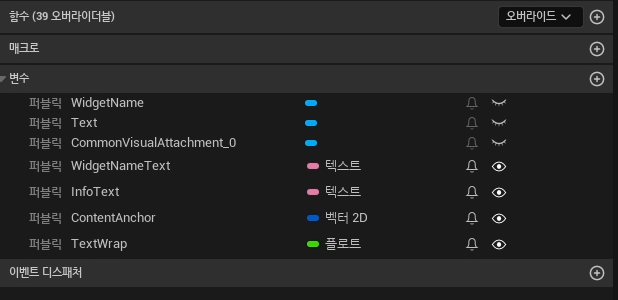
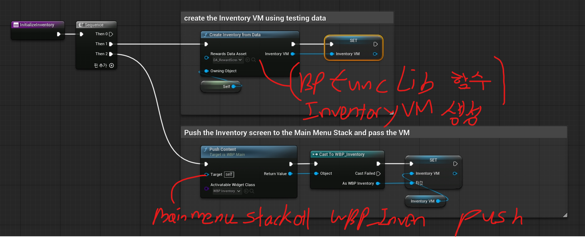
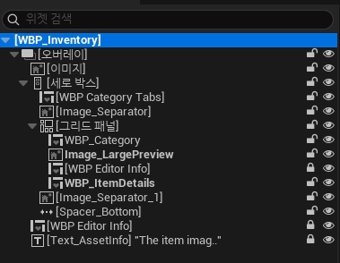

CommonUI와 MVVM을 둘 다 배울 수 있는 괜찮은 프로젝트라고 생각해 분석을 진행한다.

[MVVM과 일반 활성화 가능 위젯으로 UI 내비게이션 처리하기 \| Tutorial](https://dev.epicgames.com/community/learning/tutorials/KW0d/unreal-engine-mvvm-ui)

---

## 뷰 모델 종류 및 구성

각 MV는<b> 하위의 데이터는 VM</b>으로 들고있고 <b>본인 데이터는 그대로</b> 들고있다.

<b>InventoryVM</b>

<b>CategoryVM</b>

Category Struct

<b>ItemVM</b>

Item Struct

---

## 위젯 분석

<b>WBP\_Main</b>

<b>계층 및 구성</b>

- MainMenuStack 클래스 :  <b>CommonActivatableWidgetStack</b>
- ModalStack 클래스 : <b>CommonActivatableWidgetStack</b>
- WBP\_EditorInfo 클래스 : <b>UserWidget</b>
  

  단순하게 튜토리얼 설명을 위해 편하게 사용하려고 만든 위젯으로 보인다.

  멤버 : 

  

---

<b>흐름</b>

WBP\_Main은 PC의 <code>Beginplay</code>에서 생성된다.

생성하고 WBP\_Main의 <code>Construct</code>에서 위의 함수인 <code>InitializeInventory</code>함수가 호출된다.

<code>InitializeInventory</code>함수 내부에서는 InventoryVM을 DA\_RewardScreenData로부터 생성하고, <b>WBP\_Inventory</b>위젯을 MainMenuStack에 Push를 한다. 

<b>WBP\_Inventory</b>

