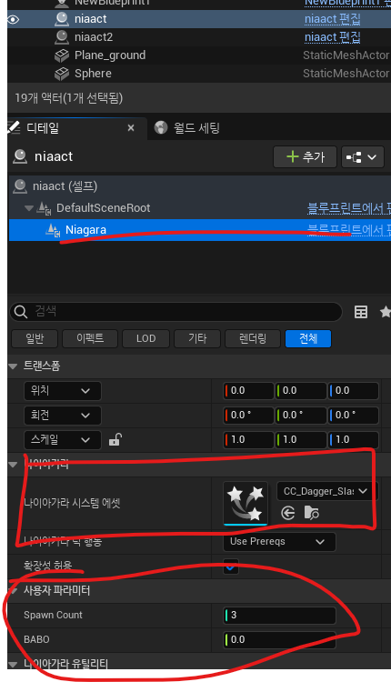
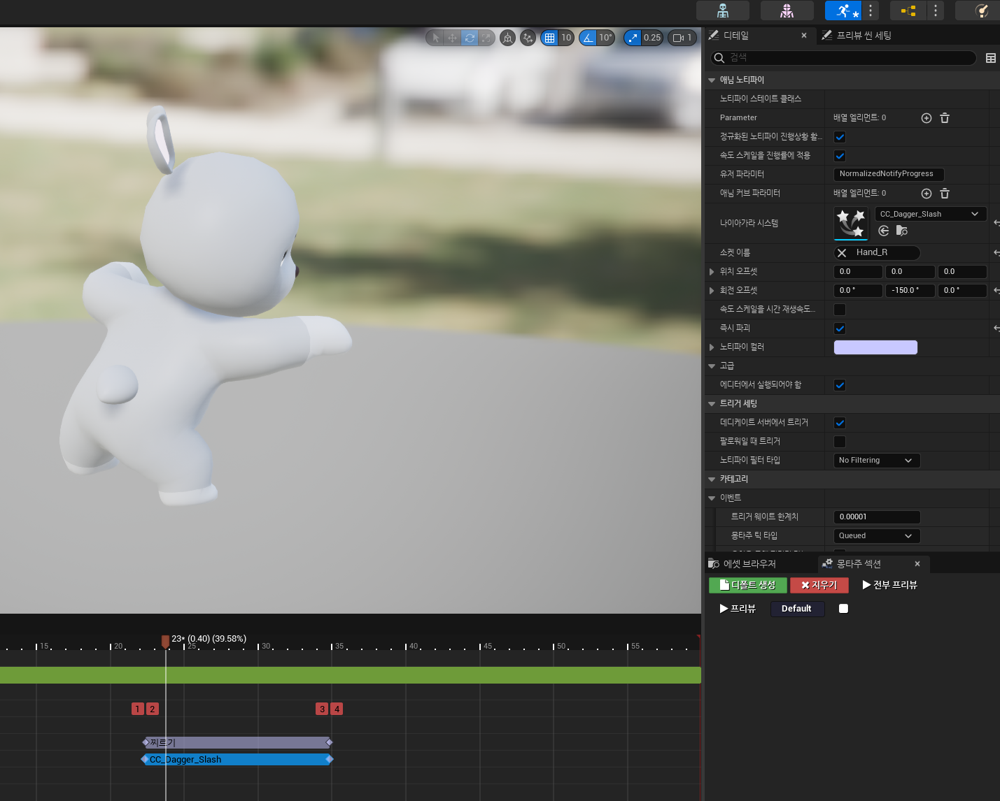

---

나이아가라 컴포넌트를 사용해보면



나이아가라 에셋을 교체했을때 맨 아래처럼 UserParmeter들이 나와서 해당값을 수정해서 바로 나이아가라에 적용이 가능하다.

 아래에서 사용한 노티파이는<br /><code>UAnimNotifyState_TimedNiagaraEffectAdvanced</code> 를 상속받은 나이아가라인데

디테일 패널을 보면 UserParameter이 안나오는걸 볼 수있다. (Parameter은 내가 시도한 흔적이다.)<br />왜 제공을 안한지는 모르겠는데 아무튼 있으면 좋은 기능이다.

그래서 내가 만들거임 ㅋ



```javascript
void UNiagaraComponent::PostEditChangeProperty(FPropertyChangedEvent& PropertyChangedEvent)
{
	FName PropertyName;
	if (PropertyChangedEvent.Property)
	{
		PropertyName = PropertyChangedEvent.Property->GetFName();
	}

	if (PropertyName == GET_MEMBER_NAME_CHECKED(UNiagaraComponent, Asset))
	{
		// 컴포넌트의 에셋 변경시
	  // 여기서 UserParameter를 갱신한다.
		SynchronizeWithSourceSystem();
		
		if (Asset != nullptr)
		{
			AssetExposedParametersChangedHandle = Asset->GetExposedParameters().AddOnChangedHandler(
				FNiagaraParameterStore::FOnChanged::FDelegate::CreateUObject(this, &UNiagaraComponent::AssetExposedParametersChanged));
		}
	}
	else if(PropertyName == GET_MEMBER_NAME_CHECKED(UNiagaraComponent, OverrideParameters))
	{
		SynchronizeWithSourceSystem();
	}
	else if (PropertyName == GET_MEMBER_NAME_CHECKED(UNiagaraComponent, TemplateParameterOverrides) ||
		PropertyName == GET_MEMBER_NAME_CHECKED(UNiagaraComponent, InstanceParameterOverrides))
	{
		// 파라미터 값 변경시 여길 ㅗ온다.
		ApplyOverridesToParameterStore();
	}
	
	ReinitializeSystem();
	
	Super::PostEditChangeProperty(PropertyChangedEvent);
}
```

```javascript
void UNiagaraComponent::SynchronizeWithSourceSystem()
{
	// Synchronizing parameters will create new data interface objects and if the old data
	// interface objects are currently being used by a simulation they may be destroyed due to garbage
	// collection, so preemptively kill the instance here.
	DestroyInstanceNotComponent();

	//TODO: Look through params in system in "Owner" namespace and add to our parameters.
	if (Asset == nullptr)
	{
#if WITH_EDITORONLY_DATA
		OverrideParameters.Empty();
		EditorOverridesValue_DEPRECATED.Empty();
		
		OnSynchronizedWithAssetParametersDelegate.Broadcast();
#endif
		return;
	}

#if WITH_EDITOR
	CopyParametersFromAsset();
	ApplyOverridesToParameterStore();
#endif

	OverrideParameters.Rebind();

	// 아래 델리게이트가 브로드캐스팅 되면서 변수가 갱신된다.
#if WITH_EDITORONLY_DATA
	OnSynchronizedWithAssetParametersDelegate.Broadcast();
#endif
}
```

```javascript
void FNiagaraComponentUserParametersNodeBuilder::GenerateChildContent(IDetailChildrenBuilder& ChildrenBuilder)
{
	if(Component.IsValid())
	{
		if (bDelegatesInitialized == false)
		{
			// 나이아가라 컴포넌트는 여기서 구독함으로써
			// 나이아가라 에셋이 바뀌었을때 사용자 파라미터를 갱신한다
			// 해당 사용자 파라미터는 SystemAsset->GetEditorData())->UserParameterHierarchy여기 들어잇는거같다.
			Component->OnSynchronizedWithAssetParameters().AddSP(this, &FNiagaraComponentUserParametersNodeBuilder::Rebuild);
			
			RegisterRebuildOnHierarchyChanged();
			bDelegatesInitialized = true;
		}

		ParameterProxies.Reset();

		UNiagaraSystem* SystemAsset = Component->GetAsset();
		if (SystemAsset == nullptr)
		{
			return;
		}
			
		TArray<FNiagaraVariable> UserParameters;
		SystemAsset->GetExposedParameters().GetUserParameters(UserParameters);
			
		ParameterProxies.Reserve(UserParameters.Num());
		
		// 여기서 파라미터들이 모인다.
		GenerateUserParameterRows(ChildrenBuilder, *Cast<UNiagaraSystemEditorData>(SystemAsset->GetEditorData())->UserParameterHierarchy.Get());
	}
}

```
