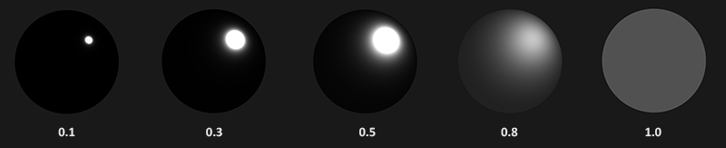
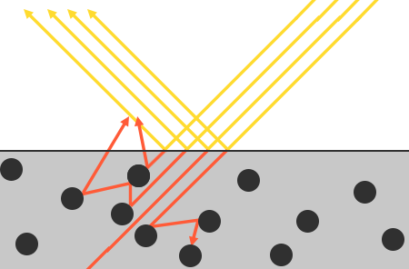
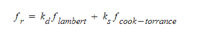
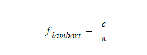
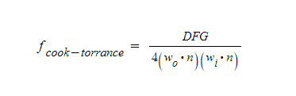
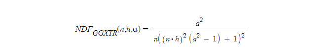
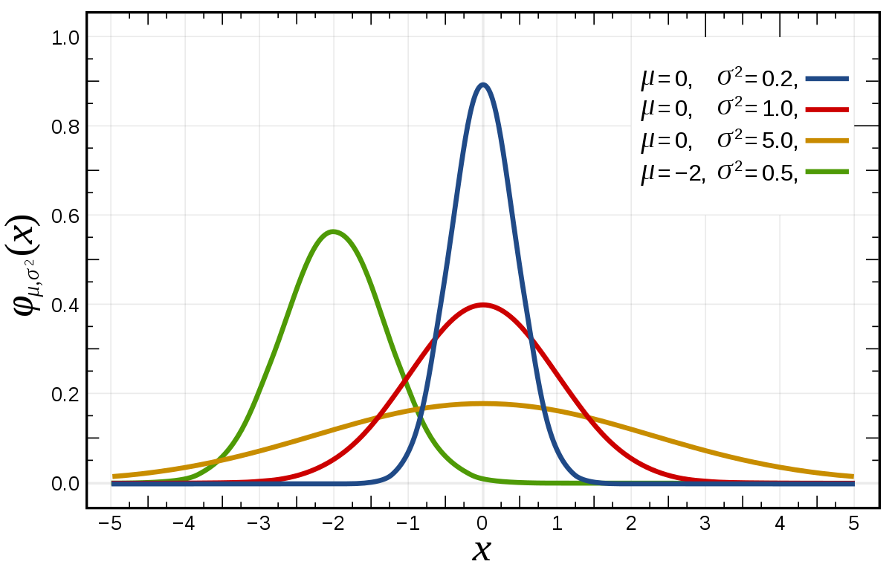
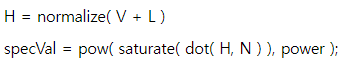
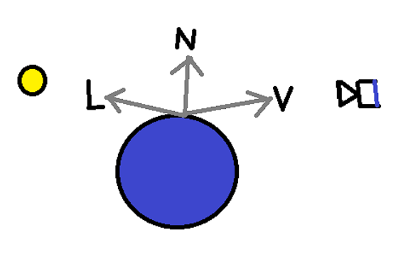
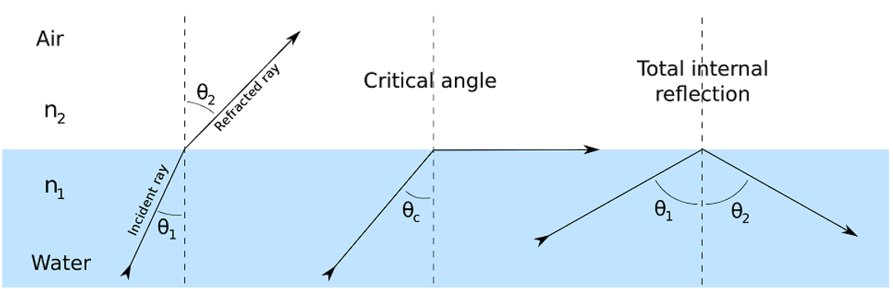

물리 기반 렌더링(Physically Based Rendering, PBR)에 대해 알아보자\~

---

<a href="https://blog.naver.com/sorkelf/221052520085">blog.naver.com</a>

<a href="https://m.blog.naver.com/edgerider/220365933918">m.blog.naver.com</a>

<a href="https://m.blog.naver.com/oovqiss/221666234384">m.blog.naver.com</a>

<a href="https://blog.naver.com/agagtmdtlr/222418055428">blog.naver.com</a>

---

<a href="https://lifeisforu.tistory.com/366">lifeisforu.tistory.com</a>

---

<a href="https://google.github.io/filament/Filament.html">google.github.io</a>

- 이 링크에 모든 정보가 있따.

우리는 게임에 더 사실적인 효과들을 원한다

따라서 똑똑이들은 머티리얼에 phongshading 대신 실제 물리지식들을 기반으로 한 쉐이딩 모델을 만들었다.

기본적인 3d쉐이딩인 phong쉐이딩은 들어오는 빛을 정점의 normal에 따라 100퍼센트 반사해낸다.

하지만 현실에서의 빛은 얼마나 표면이 매끈한지 어떤매질인지 등등에 따라서 투과, 반사하는 양이 다르다.

<b>PBR을 간단히 정리하면</b>

- <b>microfacet surface model</b>을 따라야 한다.
- 모든 재질은 열역학 제 1법칙 (<b>에너지 보존법칙)</b>을 따라야 한다.
  즉 <b>Diffuse + Reflection + Refraction(굴절) = Incoming light</b>

  위의 공식이 무조건 이루어져야 한다는 것이다.

- <b>BRDF 기반</b>으로 구현되어야한다

자연을 100프로 정확하게 표현하는건 불가능하지만

이를 구현하기 위해서는 몇가지 요소들을 고려해야한다.

- <b>전역조명 (IBL : 이미지 기반 라이팅)</b>
- <b>에너지 보존 법칙</b>
- <b>반사도 (diffuse specular)</b>
- <b>미세면 (roughness)</b>
- <b>프레넬 법칙</b>
- <b>금속성</b>

---

- [인간과 빛](%EC%9D%B8%EA%B0%84%EA%B3%BC-%EB%B9%9B-467aca61.md)

- [조도와 휘도](%EC%A1%B0%EB%8F%84%EC%99%80-%ED%9C%98%EB%8F%84-0f8b3147.md)

- [빛의 감쇠](%EB%B9%9B%EC%9D%98-%EA%B0%90%EC%87%A0-f507bea2.md)

- [광원의 밝기(광속)](%EA%B4%91%EC%9B%90%EC%9D%98-%EB%B0%9D%EA%B8%B0-%EA%B4%91%EC%86%8D-2aa738aa.md)

- [조도의 측정](%EC%A1%B0%EB%8F%84%EC%9D%98-%EC%B8%A1%EC%A0%95-6ac0e7c8.md)

- [휘도의 측정](%ED%9C%98%EB%8F%84%EC%9D%98-%EC%B8%A1%EC%A0%95-f9eeb76d.md)

---

### Microfacet model

pbr은 microfacet 이론에 기반한다.

즉 표면을 현미경으로 확대해서 봤을때 표면이 100프로 매끄럽지 못하는 물질들이 있다는 뜻이다.

위 그림과 같이 거친 표면은 빛이 서로 완전히 다른 방향으로 반사된다. 

반면 매끄러운 표면은 대부분 같은 방향으로 반사된다.

이렇듯 거친 표면은 빛의 반사가 흐리게 퍼지듯이 생길 것이고, 매끄러운 표면은 빛의 반사가 뚜렷하게 생길 것이다.

PBR 모델은 이런 표면을 표현하기 위해서 roughness map이라는 것을 사용하고 픽셀마다 표면이 거친 정도를 나타낸다.

---

### 에너지 보존법칙

앞서 설명한것처럼 에너지는 in == out을 성립해야 한다는 것이다.

그림을 보면 roughness가 커질수록 specular의 영역은 커진다.

만약 specular의 강도가 픽셀마다 동일하면 에너지 절약 법칙을 위반한다.

이런 에너지 보존 법칙을 표현하기 위해서는

<b>diffuse와 specular의 구분이 필요하다.</b>

빛이 물질 표면에 닿았을때 나타나는 현상은 refraction과 reflection으로 나뉜다.

reflection은 빛이 표면에 닿았을때 바로 반사하는 것을 말한다  (specular)

refraction은 빛이 표면에 닿았을때 흡수되는것을 말한다. (diffuse)

- 빛의 흡수는 표면에 닿자마자 이뤄지는게 아니라, 물체 입자와의 충돌에 의해서 서서히 흡수되는것

- 그림처럼 굴절된 빛이 모조리 흡수되는거는 아니고 입자랑 충돌할때 무작위 방향으로 산란을 하다가 에너지가 다하면 흡수되는것이다.
  - 이때 다시 표면 밖으로 나가는 빛은 표면의 색상에 영향을 준다.

뭐 이런저런 말을 했지만 PBR에서는 굴절된 모든 빛은 흡수되고 정해진 영역에서만 산란되도록 할 것이다. (subsurface scattering)

위에서 말한 반사와 굴절은 Metalic과 연관되어 있다.

Metalic 표면은 non-metalic 표면과 빛에 대해 다르게 반응한다

따라서 pbr 파이프라인 내에서 metalic과 non-metalic은 다르게 취급한다.

---

### BRDF

똑똑이들은 물체의 표면이 어떻게 빛을 반사하는지 설명하기 위해

빛의 입사 방향, 표면의 법선, 뷰어의 방향 등을 고려하여 반사되는 빛의 양을 계산하는

<b>BRDF</b>(Bidirectional Reflectance Distribution Function) 라는 함수를 만들었다.

BRDF함수는 두 개의 방향 벡터에 대한 함수로 표현된다.

첫 번째 방향벡터는 빛의 입사

두 번째 방향벡터는 카메라가 가리키는 방향벡터이다.

입사 방향과 카메라의 방향이 같은 경우에는 <b>반사</b>가 일어난다.

반대로 입사 방향과 카메라의 방향이 반대인 경우엔 물체가 빛을 <b>흡수하거나</b>

<b>산란</b>이 일어난다.

BRDF기법은 여러가지가 있지만.

주로 pbr 파이프라인에서는 <b>Cook-Torrance BRDF가 </b>사용된다.

<b>Cook-Torrance BRDF</b>는 정반사 난반사광 둘다 포함한다.<b> </b>

BRDF는 두 개의 반사 구성 요소를 고려한다

- <b>Diffuse light (난반사광)</b>
  주로 램버티안(Lambertian diffuse) 함수 사용

  

  c : albedo

  pi로 나눠서 난반사광을 정규화 시킨다.

- <b>Specular (정반사광)</b>
  주로 쿡-토렌스(Cook-Torrance specular) 함수 사용

  

  D : normal distribution - 노말 벡터(halfvector \<반사벡터>) 분포

  G : Geometry - 에너지 보존법칙

  F : Fresnel equation - 표면 각도에 따른 반사율

  DG는 roughness와 관련이 있고

  F는 metalic과 관련이 있다.

  언리얼엔진에서는

  Trowbridge-Reitz GGX(D), Fresnel-Schlick(F), 그리고 Smith's Schlick-GGX(G)를 사용한다고 한다.

### normal distribution

이 함수는 <b>반사벡터 h</b>와 일치하는 <b>미세표면 영역의 근사치</b>를 구한다.

정규분포 함수그래프인데 위의 식에서는 x가 a이고 y가 결과라고 한다;;

a는 roughness인데 a가 0에 근사할수록 뭐 밝기가 1이랑 가까워진다 그런소리인듯

### Geometry

### Fresnel

- <b>요약</b>
  <b>모든 물질은 프레널을 가진다.</b>

<b>프레널 이란?</b>

우리는 View vector와 빛이 표면에 반사된 Reflect vector가 마주보고 있을때 Specular의 세기가 최대가 될 것이라고 직관적으로 알고있다.

아래는 기본적인 블린퐁 모델의 스펙큘러 계산 코드이다.

이때 specVal의 최대 값은 V와 R이 마주보고 있을때도 맞지만

대충 이런상황일때도 R과 V가 180도로 최대가 일어날 수 있다.

이 현상은 스넬의 법칙때문에 일어난다

대충 요약하면 요런 현상이다. 임계점을 넘어가면 3번째 그림처럼 그냥 싹다 반사시켜버린다.

