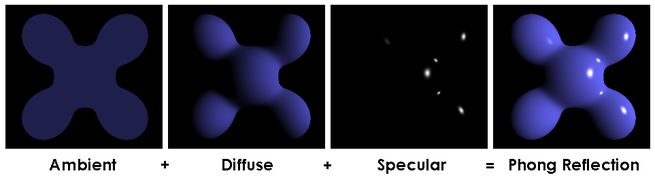
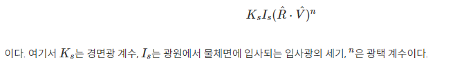
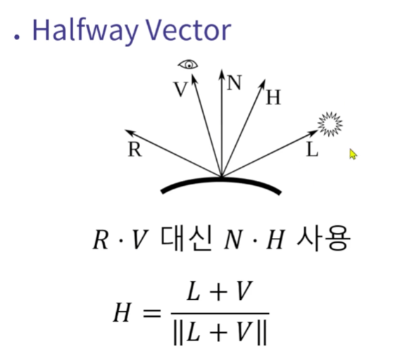

---

가장 기본적인 3d 렌더링 모델이다

그림처럼 주변광, 난반사광, 정반사광으로 3d쉐이딩 효과를 준다.

Phong의 specular Lobe를 코사인 함수로 모델링한 것으로 경면반사의 양을 cosθ⁡로 간주한다.

cosθ에 가해지는 승수 n에 의해 물체면의 매끄러운 정도를 반영한다.

이 승수를 <b>광택 계수(Shineness Coefficient)</b>라 한다.

n이 커질수록 하이라이트가 한 곳으로 모이는것을 확인할 수 있다.

<b>공식들 (유도 X)</b>

<b>a→d→s 순이다.</b>

---

---

기본 Phong 모델에서는 specular를 계산할 때 dot(R, V)를 하여 결과값이 클수록 반사를 많이 하고 있다고 간주했다.

- 이때 L의 반사벡터 R을 계산하는 행위가 연산량이 많아서
  V와 L의 중간벡터인 H를 계산해 dot(N, H)를 사용하는게 블린 퐁 모델이다.
