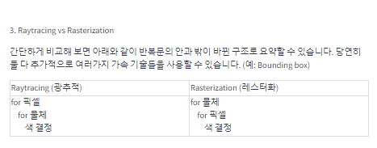
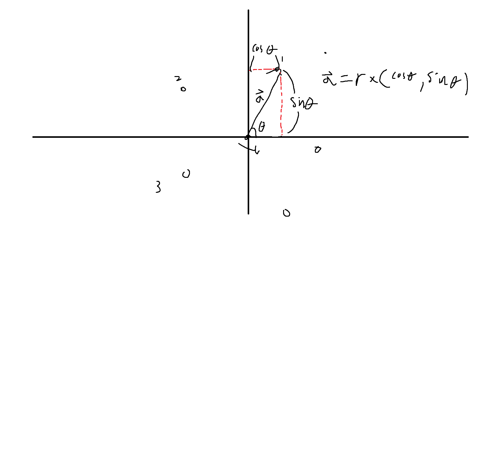

---

레이트레이싱은 모든 픽셀에 대해 ray를 쏘고 물체하고 부딪힐지 말지를 결정하는 방식이라

ray를 너무 많이 쏴야하지만.

레스터화는 우리가 렌더링 할 물체를 screen에 투영한 후,

바운딩 박스를 찾은 후 물체가 안에 있을때만 렌더링한다.

<b>바운딩박스</b>

- 오브젝트를 담을 수 있는 가장 작은 직사각형

<b>tip : 원 둘레의 점 구하기</b>

<b>Bary-centric coordinates interporation</b>

- [Barycentric coordinage system (질량 중심 좌표계)](%EB%AC%B4%EA%B2%8C%EC%A4%91%EC%8B%AC-%EC%A2%8C%ED%91%9C-1eee8fc0.md)

- Vertex Shader에서 연산이 끝난 정점들을 픽셀쉐이더로 넘겨 줄 때
  정점과 정점 사이의 픽셀들을 <b>Bary-centric coordinates interporation을 </b>사용해서 보간해준다.

- [Transfomation](%EB%9E%98%EC%8A%A4%ED%84%B0%ED%99%94%EC%97%90%EC%84%9C%EC%9D%98-%EC%A2%8C%ED%91%9C-%EB%B3%80%ED%99%98-283f4caf.md)

- [Depth Buffer](%EA%B9%8A%EC%9D%B4-%EB%B2%84%ED%8D%BC-dc082298.md)

- [BackFaceCulling](%EB%B0%B1%ED%8E%98%EC%9D%B4%EC%8A%A4-%EC%BB%AC%EB%A7%81-c07b94f3.md)

- [Perspective Projection](%EC%9B%90%EA%B7%BC-%ED%88%AC%EC%98%81-cc6d9cd4.md)
