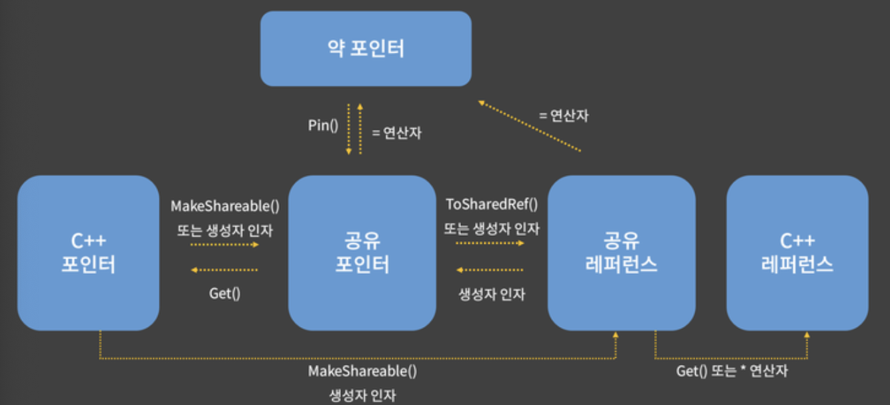
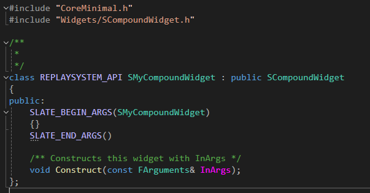
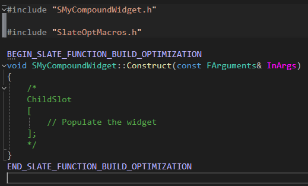
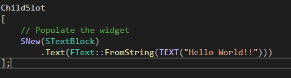
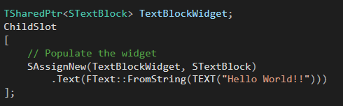
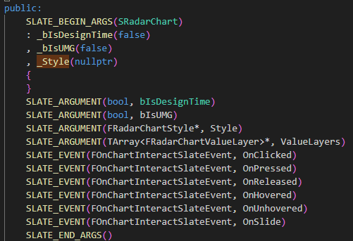
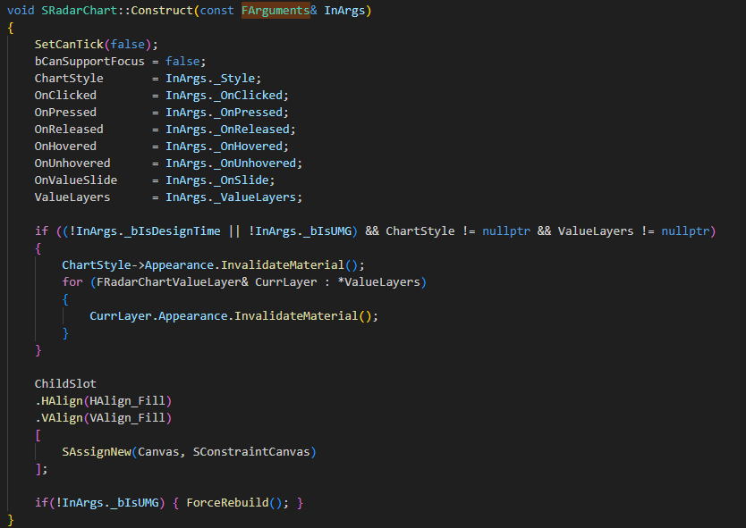
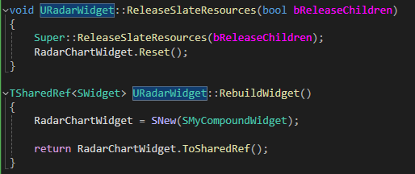

<b>Slate (슬레이트)</b> 는 언리얼 엔진 4 와 함께 제공되는 플랫폼 무관, 완벽한 커스텀 유저 인터페이스 프레임워크로, 언리얼 에디터와 같은 툴과 어플리케이션에 쓸 유저 인터페이스나 게임내 유저 인터페이스의 재미와 효율을 높일 수 있도록 디자인된 것입니다. 서술형(declarative) 문법에 쉬운 디자인, 레이아웃, 스타일 요소가 결합된 Slate 를 통해 쉬운 UI 제작 및 반복작업이 가능할 것입니다. 

Plugin SRadar Chart를 분석하면서 배워봅시다.

---

보통 언리얼에서 인게임 UI는 보통 UMG를 사용하고 에디터 UI는 보통 Slate를 사용하여 구성한다고 한다. 

위젯은 UWidget와 SWidget이 있는데 UWidget은 UObject로 SWidget은 SSlate를 부모로 가진다.  이 뿐만 아니라 언리얼 내의 블프에서 다룰 수 있는 위젯은 UWidget이고 실질적으로 나타나는 위젯은 SWidget이라고 한다.

SWidget에서 마우스 이벤트를 받아서 호출하면, 바인딩 된 UWidget의 함수가 호출되는 방식이다.

UButton에도 SButton을 가지고있고, SButton을 생성할 때 슬레이트의 기본값도 지정하고 이벤트도 바인딩한다.

그 다음 SButton에서는 생성될 때 받은 Argument들을 멤버변수에 지정한다.

---

 UI 시스템의 주축을 이루는 슬레이트(Slate)는 공유 레퍼런스 타입에서 동작하기 때문에 스마트포인터 라이브러리에 대한 이해가 필요하다

<a href="raii%EC%99%80-%EC%8A%A4%EB%A7%88%ED%8A%B8-%ED%8F%AC%EC%9D%B8%ED%84%B0-1ebe4990.md">스마트 포인터</a> 

c++ 기본 스마트 포인터와 유사하게 동작한다. (Shared Weak Unique 전부 제공)

언리얼에는 특이하게도 SharedRef도 존재하는데 이는 참조한 대상이 Null이 아님을 보장받기 위해 사용한다 (레퍼런스는 항상 대상이 존재하여야 받을 수 있다)

## Slate

- Slate에서 모든 이미지, 텍스트, 리스트, 버튼 등의 구성 요소는 SWidget을 상속받은 클래스이다.
- SCompoundWidget은 여러 위젯을 하나로 묶을 때 사용하는데 이 역시 SWidget을 상속받은 클래스이다.

언리얼 Slate 아키텍처 문서에서는 Slate의 Layout은 <b>2pass</b>로 이루어져 있다고 한다.

1. Pass 1: <b>Cache Desired Size</b> - 연관된 함수는 <b>SWidget::CacheDesiredSize</b> and <b>SWidget::ComputeDesiredSize</b>
2. Pass 2: <b>ArrangeChildren</b> - 연관된 함수는 <b>SWidget::ArrangeChildren</b>

Slate 그리기는<b> OnPaint 함수</b>에서 처리한다고 한다.

<b>SCompoundWidget</b>을 상속받아서 클래스를 생성하면

.h

.cpp

cpp를 보면 ChildSlot이라는 란이 있는데

### SNew, SAssignNew

SNew나 SAssignNew 매크로를 사용해서 위젯을 구성한다.

- Slate의 위젯들은 SNew와 SAssignNew를 통해 구성된다.
- SNew를 통해 원하는 위젯에 대한 Shared Reference를 만들어서 사용하거나원하는 위젯에 대한 SharedPointer를 먼저 만든 다음에 SAsisgnNew를 통해 Pointer에 할당할 수 있다.이 때 포인터는 <code>TSharedPtr&lt;WidgetClassName&gt;</code>으로 선언하면 된다.

 <em>SNew</em>

 <em>SAssignNew</em>

<b>-SRadarChart</b>

헤더를 보면 Slate Construct의 인자인 FArguments의 커스텀 멤버들을 지정 할 수 있다. 

cpp를보면 위에서 선언한 커스텀 멤버들을 사용하는 것을 확인이 가능하다 (원래는 전부 없는 멤버들이다)

SMyCompound를 렌더링 해줄 UWidget을만든다. 이때 UserWidget이 아니라 UWidget을 상속받았다. 

 SNew로 SWidget을 생성해준다. SharedPtr Type의 RadarChartWidget으로 받는다. ReleaseSlateResources 함수를 반드시 오버라이드 해야 안전하게 SharedPtr이 제거된다.
