Standard Template Library

- 기본적으로 자주 사용하는 템플릿들이 있는 라이브러리

## <b>Vector</b>

- Size : 벡터의 데이터 개수
- Capacity : 벡터의 최대idx → 이거 넘어가면 capacity늘려서 오류 안나게함
- 벡터의 크기가 꽉찼을때 새로운 데이터가 들어오면 그 벡터의 capacity보다 크게 (우리껀2배)
  동적할당한 새로운 벡터로 교체 및 데이터 저장

- 순회할때 for문으로 순회

## Map

- Key와 Data의 집합으로 구성됨
- map내에는 pair라는 구조체들로 구성되어있음
- pair는 key와 data를 가짐 → insert는 pair를 넣어주고 find는 pair를 반환한다.

<details>
<summary>Graph</summary>

그래프는 객체간의 연결 관계를 가지는 자료구조이다.

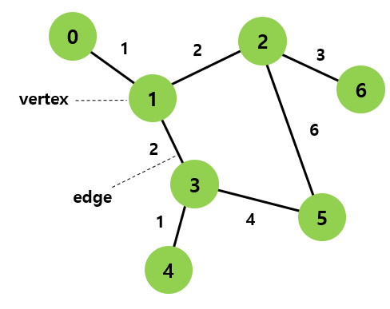

그림처럼 노드와 간선으로 이루어져 있고 서로 연결관계를 나타낸다.

그래프 종류는 아래처럼 여러가지가 있다.

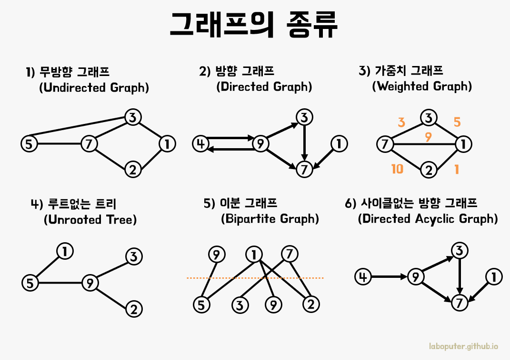

우리가 알고있는 트리도 그래프의 일종이다. (방향그래프, 계층관계 O 등의 특성을 가짐)

</details>

<details>
<summary><b>Tree</b></summary>

배열과 리스트는 선형 자료 구조이다.

트리는 계층적인 구조를 가지고 있다.

간단히 생각해 우리 컴터의 폴더 구조나 회사 조직도를 생각하면된다.

- <b>구현 방법</b>
  배열 구현법 리스트 구현법이 있다.

  배열 구현법은 완전 이진트리라면 배열 공간의 낭비가 생기지 않지만

  한쪽으로 몰리는 경사 트리라면 낭비가 생긴다.

  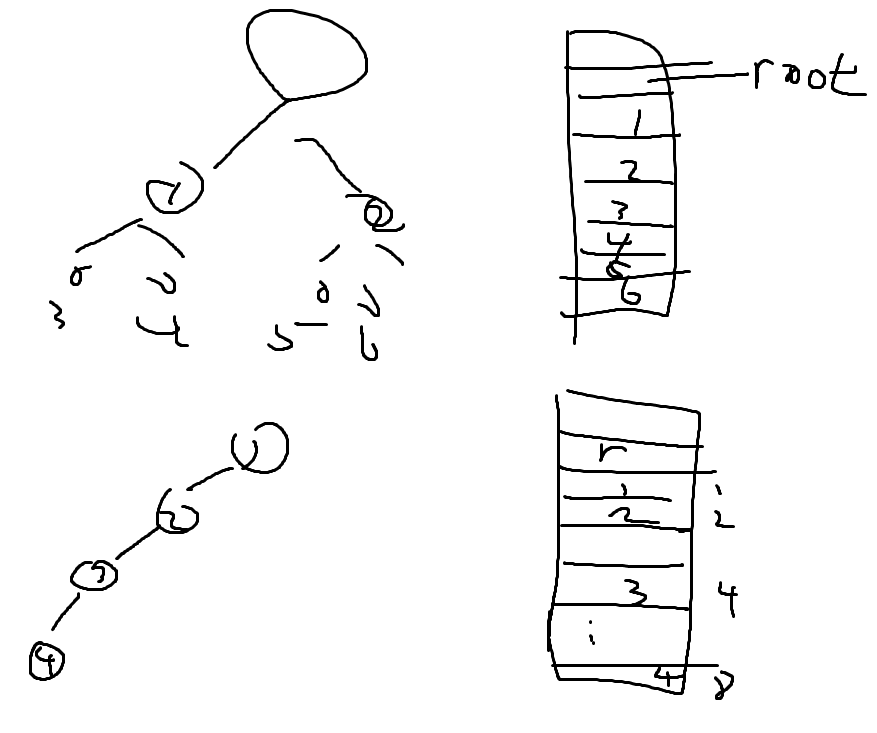

  직접 접근은 느릴거같긴한데 배열 구현법 문제가 좀 크다보니 리스트 구현법 쓰나보다

- 현재 노드보다 값이 작으면 왼쪽 크면 오른쪽으로 데이터 정렬
- DFS BFS알고리즘으로 순회
- 재귀!! 재귀!!!! 재귀!!!!!!

</details>

### <b>DFS vs BFS</b>

<b>DFS </b>: 모든 노드를 탐색해야 할때 더 쎔

소스코드 짧고 디버깅 편함

<b>BFS </b>: 최소 Level에 있는 노드를 찾을때 어 쎔

소스코드 길고 디버깅 불편

<b>Tree 인접행렬 DFS</b>

- now에서 자식 노드들을 찾을 때 마다, 다시 재귀호출
- 자식노드 없으면 return

```c++
int map[5][5];


void run(int now)
{
		for(int i=0; i<5; ++i)
		{
		 if(map[now][i] == 1)
		     run(i)
		}
}

main ()
{
 run(0);
}
```

<b>BFS</b>

- 큐를 사용함
- lv 0부터 오른쪽으로 순회하면서 자식 노드가 있으면 큐에 pushback 결국 레벨별로 좌에서 우로 순회하는것
- head == tail되면 순회를 마친것

<b>BST(Binary Search Tree) 이진탐색트리</b>

- Data들을 빨리 검색할 수 있게 체계적으로 자료를 저장해놓음
- 시간복잡도 logn임
- 탐색 개빠름

<details>
<summary><b>HEAP</b></summary>

- 최대값, 최소값을 빨리 뽑고 싶을때 사용
- 최대값 뽑으려고 만든놈은 maxheap 반대는 minheap이다.
- Heap에 자료를 넣을때 최대값이나 최소값을 말단에 넣는것

기본적으로 힙은 벡터로 구성되어있다.

아래같은 구조일때

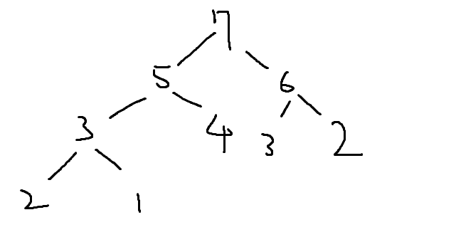

빨간 화살표 방향으로 배열에 저장된다.

따라서 왼쪽 자식노드의 idx는 부모idx/2이고 오른쪽은 부모idx/2 + 1이다.

반대로 자식에서 부모가려면 자식idx \* 2 하면된다.

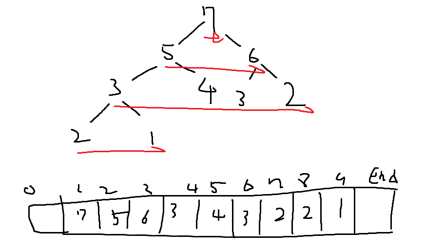

<b>삽입</b>

힙에 들어온 새로운 데이터는 End부분에 삽입된다.

하지만 이러면 힙의 성질을 잃을수도 있기때문에 정렬을 시작한다.

새로운 데이터 <b><span>8</span></b>이 End에 들어온다.

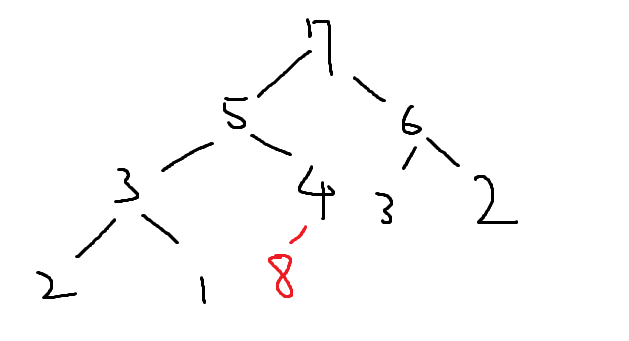

반복한다.

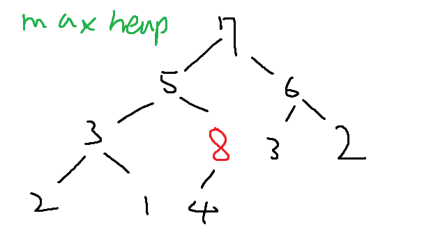

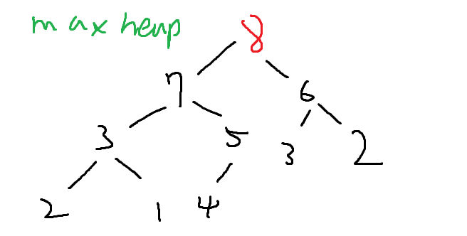

<b><span>8</span></b>과 부모(4)중 누가 더 큰지 <b><span>비교</span></b>한다.

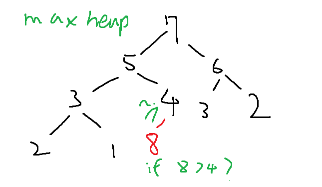

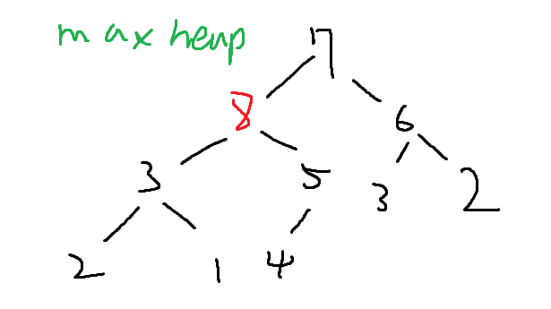

<b>삭제</b>

힙에서의 삭제는 무조건 root 부터 삭제한다.

당연히 루트 사라지니까 정렬 해줘야한다.

루트인 8 삭제

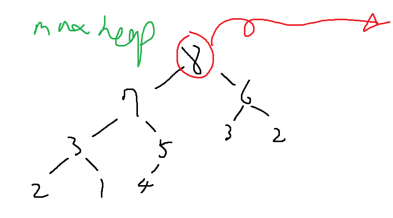

루트의 자식들중 큰 자식(max heap) 선택 및 교체

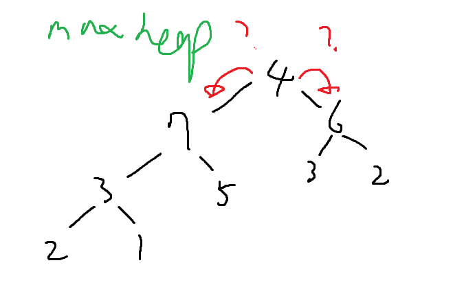

완성!

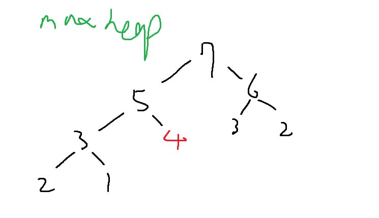

말단노드인 4 루트로 이동

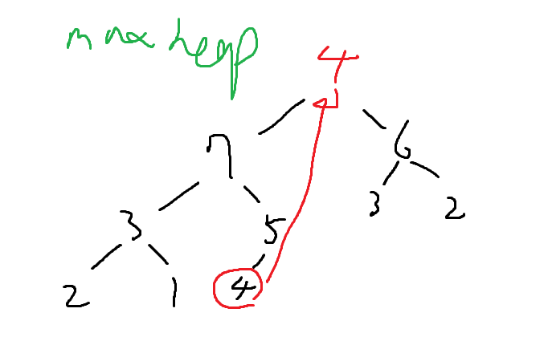

반복한다.

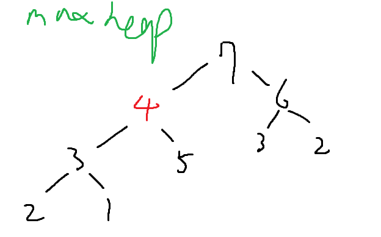

</details>

<details>
<summary>우선순위 큐</summary>

우선순위 큐는 모든 데이터가 우선순위를 가지고 있고, 들어온 순서와 상관 없이

<b>우선순위가 높은데이터가 먼저 출력</b>되는 구조이다..

우선순위 큐는 네트워크 트래픽 제어, 운영 체제에서의 작업 스케줄링등에서 사용된다.

우선순위 큐는 배열, 리스트 같은 자료구조들로 구현이 가능하지만 heap이 가장 효율적이다.

우선순위가 정해진 heap 트리를 우선순위 큐라고 부른다.

- 데이터를 삽입할때 이진트리 구조를 따라서 이가 가능한 것

우선순위 큐는 다음 기능을 지원한다.

- enqueue()- 큐에 새 요소를 삽입한다.
- dequeue() - 큐에서 최대 우선 순위 요소를 삭제하고 그 값을 반환한다.
- peek() - 에서 최대 우선순위 요소를 반환한다.

선언

```c++

priority_queue<int> pq;
priority_queue<int,vector<int>,less<int> > pq; // 위 코드와 같은 코드
							자료형  구현체    비교 연산자
```

- <b>자료형 </b>: 우리가 비교로 사용할 데이터
- <b>구현체 </b>: 우선순위 큐가 어떤 자료구조에서 돌아갈 것인지
- <b>비교연산자</b>
  - <b>less </b>: 비트 값이 큰 데이터 부터
  - <b>greater </b>: 비트 값이 낮은 데이터부터

</details>

<details>
<summary>Hash Table</summary>

해시는 해시 함수를 사용해서 구현된다.

<b>해시 함수</b> : key를 <i>고정된 길이</i>의 hash로 변경해주는 역할을 한다(hashing)

<b>해시 테이블 구성</b>

- <b>key</b>
  - 고유한 값, hash function의 input이 된다.
    hash가 아니라 key값을 index로 사용할 경우 key의 길이만큼의 정보를 저장할 공간도 따로 마련해야 한다. (고정 길이 hash 사용 이유)

- <b>hash function</b>
  - key를 고정된 길이의 hash로 변경해주는 역할을 한다.
  - 해시 충돌
    <ul>
    <li>
    서로 다른 key가 같은 hash를 뱉어내는 경우
    </li>
    <li>
    당근당근 해시 충돌 확률이 낮을수록 좋다 
    </li>
    <li>
    해시 충돌이 균등하게 발생하도록 하는것도 중요하다

    모든 키가 같은 해시값이 나오게 되면 데이터 저장시 비효율성이 커지고 보안도 나쁘다.

    </li>
    </ul>
- <b>value</b>
  - 저장소(버킷 슬롯)에 최종적으로 저장되는 값. hash와 매칭되어 저장된다.

- <b>hash table</b>
  - 해시 함수를 사용하여 키를 해시값으로 매핑하고 이 해시값을 주소또는 색인 삼아
    (key, value)를 저장하는 자료구조

  - 테이블 내 저장되는 공간을 버킷, 슬롯이라고 부른다.

- <b>장점</b>
  해시 테이블은 key-value가 1:1 매칭이라서 삽입,삭제, 검색 과정이 모두 평균적으로

  O(1)이다.

- <b>단점</b>

</details>

<b>map</b>

- <b> </b>insert 할때 정렬이 되어서 삽입된다 (링크드리스트로 구현된 트리구조)

<b>unordered\_map</b>

- 얜 그냥 넣는대로 들어감 (내부가 배열로 되어있음 (정확히는 해시테이블))

<b>MST (Minimum Spanning Tree) 최소 신장트리</b>

- 그래프에서 최소 비용으로 모든 구간을 연결한 Tree
- <b>크루스칼, 다익스트라, 프림</b> 알고리즘을 사용한다.
- Tree이기 때문에 Cycle이 존재하면 안됨
- 복수 정답 가능

<b>Greedy 그리디 알고리즘</b>

<ul>
<li>
맨 위에서 출발후 아래로 내려갈때
</li>
<li>
루트의 합이 가장 큰 값을 출력
</li>
<li>
매 선택마다 현재에서 최적의 값만 선택해서 내려감
</li>
<li></li>
</ul>

<b>Brute Force</b> <b>브루트포스</b>

- 조합 가능한 모든 값을 대입해서 해결하는 방식
- 그냥 모든 경우의수를 탐색하는것
