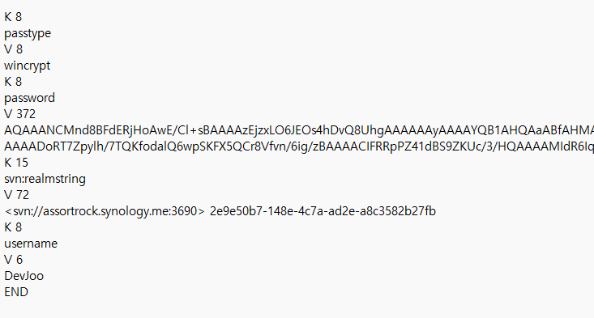

<a href="https://sm-code.tistory.com/entry/SVN-설치-관련-자료">sm-code.tistory.com</a>

---

# 계정 확인 및 변경

아래 폴더에서 가능하다.

C:\\Users\\유저명(로그인)\\AppData\\Roaming\\Subversion\\auth\\svn.simple

들어가면 위같은 내용들이 적혀있는데 <b>V6이 로그인 된 개인 계정</b>? 으로 보인다.

계정 바꾸고싶으면 해당 파일 삭제하고 svn 키면 로그인하라고 뜬단다.

# 계정별 프로젝트 접근

<a href="https://oingdaddy.tistory.com/208">oingdaddy.tistory.com</a>
