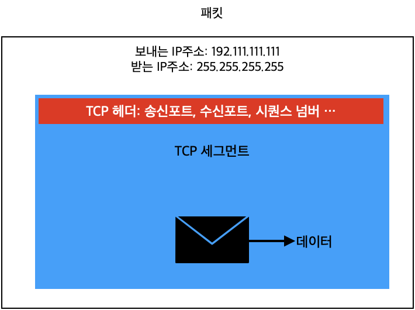

---

### <b>TCP(Transmission Control Protocol) </b>(socket 통신)

TCP는 IP 네트워크의 두 컴퓨터 간의 연결 지향 통신을 위한 전송 계층 호스트 간 프로토콜이다.

 TCP는 가상 포트를 사용하여 두 컴퓨터 간의 물리적 연결을 재사용 할 수 있는 가상 종단 간 연결을 만든다.. TCP는 [HTTP](https://developer.mozilla.org/ko/docs/Glossary/HTTP) 및 [SMTP](https://developer.mozilla.org/ko/docs/Glossary/SMTP) (email)과 같은 상위 레벨 프로토콜 데이터를 캡슐화한다.

<s><b>무슨 소린지 하나도 모르겠다.</b></s>

<b>쉽게 말해 </b>

<b>상호 통신을 지원하고</b>

<b>앞서말한 IP의 한계점을 극복할 수 있는 정보를 메세지에 먼저 감싼다는 이야기이다.</b>

TCP통신은 <b>Handshake라는</b> 과정으로

서로가 통신을 할 수 있는 <b>상태를 인증</b>을 하고 나서 통신을 하는 연결지향적인 <b>양방향 통신이다.</b>

이는 서로에게 언제든 <b>실시간</b>으로 상태를 보낼 수 있으며, 받을 수도 있다. 

HTTP통신도 기본적으로 TCP 위에서 작동이 되는 구조이고, Handshake라는 과정을 거치며 소켓을 각자 생성하여 서로에 대한 상태를 상시 확인할 수 있다.

<b>이는 Request를 했다고 해서 Response가 올 수도 있고, 안 올 수도 있으며, 물어보지도 않았는데 Response가올 수도 있다. </b>

이는 보통 실시간 처리에서 많이 사용이 됩니다. 예로 들어서 실시간 게임으로 예를 들 수 있다. 

또 다른 비슷한 예가 있지만, 방송과 라디오, 음성 통신 등은 TCP 통신에 해당되지 않습니다. 이는 UDP 통신이라고 이야기한다.

서로 연결이 됐는지 확인하고, 양방향성 통신을 한다.

TCP의 역할은 전송할 데이터를 스트림에서 받아 헤더에 송신포트, 수신포트, 시퀀스 넘버 등 전송 제어에 필요한 정보를 넣어서 캡슐화 해준다.

이렇게 캡슐화된 단위를 TCP segment라고 한다. 이를 다시 IP 데이터그램 혹은 패킷에 캡슐화해서 전송한다.

TCP헤더에는 어떤 프로그램에 사용될 정보인지, 패킷의 순서는 어떻게 되는지 등에 대한 정보를 담아 놓는다.

TCP 세그먼트를 캡슐화해서 보냄으로써, IP가 가지는 비신뢰성 문제를 해결 할 수 있다.
