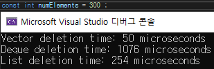
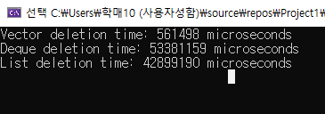
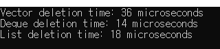

데이터가 많을 때 이론상 벡터가 가장 느리고 리스트가 가장 빠를 것이라고 

예상이 된다. 그 말이 사실인지 알아보자\~

<a href="vector-list-deque%EC%9D%98-%EA%B5%AC%EC%A1%B0%EC%99%80-%EC%97%B0%EC%82%B0-%EB%B9%84%EC%9A%A9-d1515b19.md">Vector vs List vs Deque</a> 

---

데이터 n개를 삽입 후 데이터 100개를 삭제하는 시간을 측정했다.

<details>
<summary>중간데이터 삭제</summary>

<details>
<summary><b>코드</b></summary>

```c++
#include <iostream>
#include <vector>
#include <deque>
#include <list>
#include <chrono>

int main() {
    const int numElements = 10000000;

    // 벡터
    std::vector<int> vectorContainer;
    for (int i = 0; i < numElements; ++i) {
        vectorContainer.push_back(i);
    }
    auto startVector = std::chrono::high_resolution_clock::now();
    for (size_t j = 0; j < 100; j++)
    {
        vectorContainer.erase(vectorContainer.begin() + numElements / 2);
    }
    auto endVector = std::chrono::high_resolution_clock::now();
    auto durationVector = std::chrono::duration_cast<std::chrono::microseconds>(endVector - startVector);
    std::cout << "Vector deletion time: " << durationVector.count() << " microseconds\n";

    // 덱
    std::deque<int> dequeContainer;
    for (int i = 0; i < numElements; ++i) {
        dequeContainer.push_back(i);
    }
    auto startDeque = std::chrono::high_resolution_clock::now();
    for (size_t j = 0; j < 100; j++)
    {
        dequeContainer.erase(dequeContainer.begin() + numElements / 2);
    }
    auto endDeque = std::chrono::high_resolution_clock::now();
    auto durationDeque = std::chrono::duration_cast<std::chrono::microseconds>(endDeque - startDeque);
    std::cout << "Deque deletion time: " << durationDeque.count() << " microseconds\n";

    // 리스트
    std::list<int> listContainer;
    for (int i = 0; i < numElements; ++i) {
        listContainer.push_back(i);
    }
    auto startList = std::chrono::high_resolution_clock::now();
    for (size_t j = 0; j < 100; j++)
    {
        auto it = listContainer.begin();
        std::advance(it, numElements / 2);
        listContainer.erase(it);
    }
    auto endList = std::chrono::high_resolution_clock::now();
    auto durationList = std::chrono::duration_cast<std::chrono::microseconds>(endList - startList);
    std::cout << "List deletion time: " << durationList.count() << " microseconds\n";

    return 0;
}
```

</details>

- <b>결과</b>

 <b>Vector</b>가 가장 빠르고 <b>Deque</b>이 가장 느렸다.

(데이터 300개, 1000만개 삽입 결과)





### 🧐예상

<ul>
<li>
삭제에 의한 비용이아니라 탐색에 의한 비용이 벡터가 더 효율적
</li>
<li>
리스트나 덱은 헤드부터 삭제 위한 Iterator까지 O(n)번 따라가야하는데 

벡터는 랜덤액세스라 탐색이 O(1)임
</li>
</ul>

그럼 삭제 데이터 이후의 데이터를 당기는 비용은?

</details>

<details>
<summary>Begin 데이터 100개 삭제</summary>

<details>
<summary><b>코드</b></summary>

```c++
#include <iostream>
#include <vector>
#include <deque>
#include <list>
#include <chrono>

int main() {
    const int numElements = 100;

    // 벡터
    std::vector<int> vectorContainer;
    for (int i = 0; i < numElements; ++i) {
        vectorContainer.push_back(i);
    }
    auto startVector = std::chrono::high_resolution_clock::now();

    for (size_t j = 0; j < 100; j++)
    {
        vectorContainer.erase(vectorContainer.begin());
    }
    auto endVector = std::chrono::high_resolution_clock::now();
    auto durationVector = std::chrono::duration_cast<std::chrono::microseconds>(endVector - startVector);
    std::cout << "Vector deletion time: " << durationVector.count() << " microseconds\n";

    // 덱
    std::deque<int> dequeContainer;
    for (int i = 0; i < numElements; ++i) {
        dequeContainer.push_back(i);
    }
    auto startDeque = std::chrono::high_resolution_clock::now();
    for (size_t j = 0; j < 100; j++)
    {
        dequeContainer.pop_front();
    }
    auto endDeque = std::chrono::high_resolution_clock::now();
    auto durationDeque = std::chrono::duration_cast<std::chrono::microseconds>(endDeque - startDeque);
    std::cout << "Deque deletion time: " << durationDeque.count() << " microseconds\n";

    // 리스트
    std::list<int> listContainer;
    for (int i = 0; i < numElements; ++i) {
        listContainer.push_back(i);
    }
    auto startList = std::chrono::high_resolution_clock::now();
    for (size_t j = 0; j < 100; j++)
    {
        listContainer.pop_front();
    }
    auto endList = std::chrono::high_resolution_clock::now();
    auto durationList = std::chrono::duration_cast<std::chrono::microseconds>(endList - startList);
    std::cout << "List deletion time: " << durationList.count() << " microseconds\n";

    return 0;
}
```

</details>

- <b>결과</b>
  데이터 100개만 해도 벡터가 꼴지다

  

</details>
