

<b>PIE</b>

### <b>게임 초기화 흐름</b>

<a href="%EC%97%94%EC%A7%84-%ED%95%B5%EC%8B%AC-%ED%81%B4%EB%9E%98%EC%8A%A4-3b383382.md">언리얼엔진 핵심 클래스</a> 

<b>UGameInstance</b> → <b>UWorld</b> → <b>UGameViewportClient</b> → <b>ULocalPlayer → AGameMode → AGameState → APlayerController → APlayerState → APlayerCameraManager → UPlayerInput → APawn</b>

<b>UEditorEngine::CreateInnerProcessPIEGameInstance</b>

<b>부모</b>

<a href="https://www.notion.so/3b98338216a880bfa3adc17f04c58ae5">image.png</a> 

---

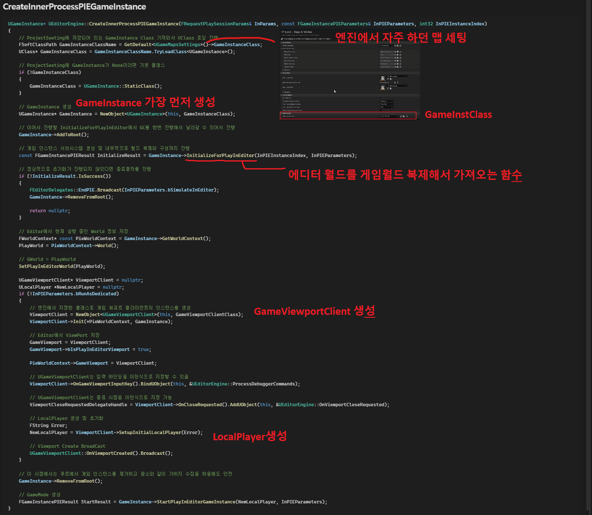 <em>사진을 보면 알 수 있듯 여기서는 액터상속 클래스를 하나도 생성하고 있지 않다.</em>

일련의 과정이 끝나고 가장 밑에 있는 <b><code>StartPlayInEditorGameInstnace</code></b><b> </b>함수를 통해 게임이 시작된다. (<b>이때 AGameMode가 생성된다.</b>)

<b>UGameInstance::InitializeForPlayInEditor</b>

<b>부모</b>

UEditorEngine::CreateInnerProcessPIEGameInstance 

---

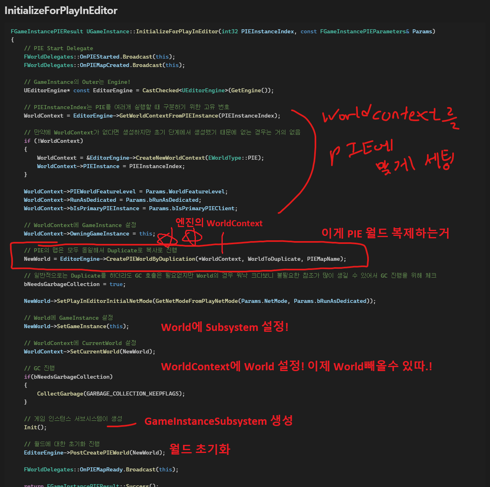CreatePIEWorldByDuplication</code>함수를 통해 EditorWorld를 게임월드로 복제한다.여기에 인자로 들어가는 WorldContext는  PIE에서 가져온걸 알 수 있다." loading="lazy" decoding="async"> <em>함수내에서 <code>CreatePIEWorldByDuplication</code>함수를 통해 EditorWorld를 게임월드로 복제한다.여기에 인자로 들어가는 WorldContext는  PIE에서 가져온걸 알 수 있다.</em>

맨 밑의 <code>EditorEngine-&gt;PostCreatePIEWorld(NewWorld)</code> 호출 후

<b><code>UWorld::InitWorld</code></b><b> 가 호출된다!</b>

<b>UEditorEngine::CreatePIEWorldByDuplication</b>

<b>부모</b>

UGameInstance::InitializeForPlayInEditor 

---

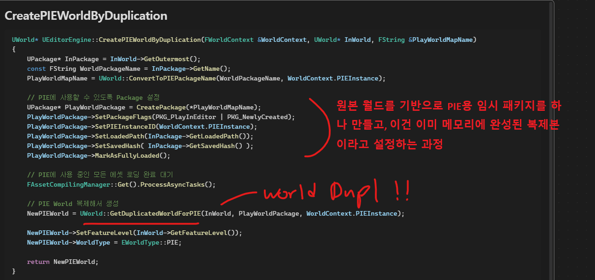

<code>PlayWorldPackage-&gt;SetPackageFlags(PKG_PlayInEditor | PKG_NewlyCreated);</code> 

이 코드는

> PIE용으로 복제된 월드는 이미 메모리의 원본 월드를 Duplicate해서 만들어졌으니, 이 복제 패키지를 별도의 <code>.umap</code> 파일에서 다시 읽으려고 하지 마.

라고 하는 것이다.

<b>UWorld::GetDuplicatedWorldForPIE</b>

<b>부모</b>

UEditorEngine::CreatePIEWorldByDuplication 

---

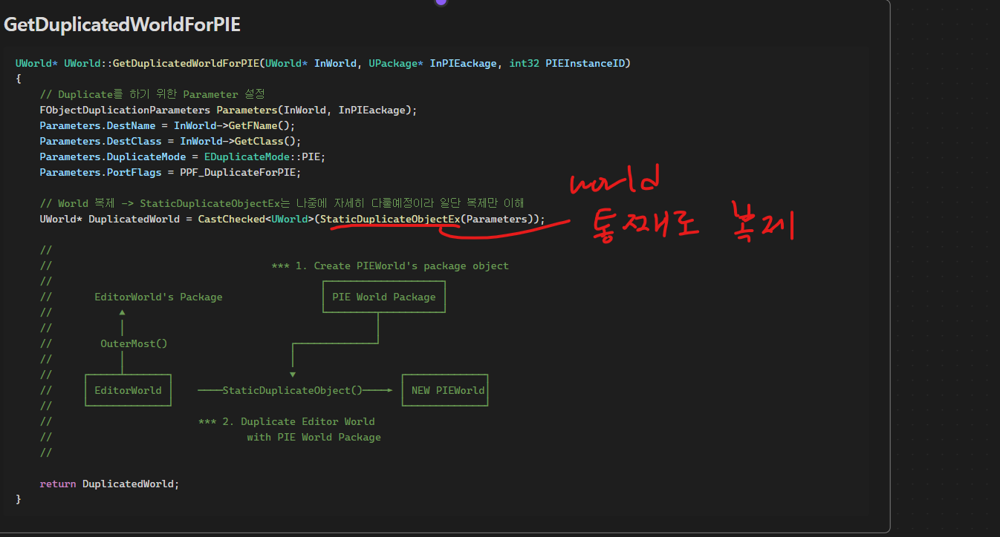

ULocalPlayer

> <b>ULocalPlayer</b>를 생성하고 관리하는 주체에 초점을 둔다.

<b>UGameViewportClient::SetupInitialLocalPlayer\~</b>

<b>부모</b>

UEditorEngine::CreateInnerProcessPIEGameInstance 

---

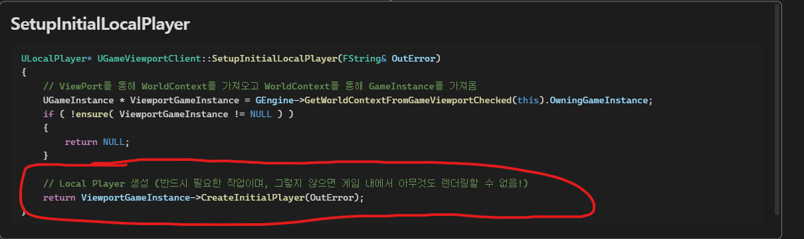 <em>LocalPlayer 생성 주체는 GameInstance이다. 요청은 GameViewportClient에서 한다.</em>

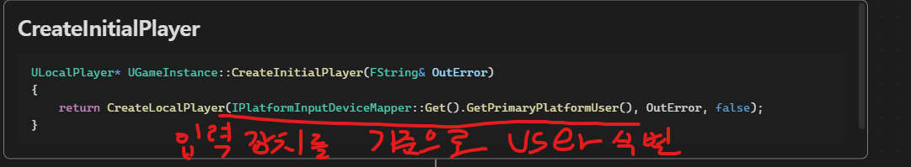 <em>로컬 싱글플레이는 무조건 0부여로컬 멀티플레이는 컨트롤러에 따라 0 1 2 …부여멀티에서도 플레이어에 따라 0 1 2 …부여</em>

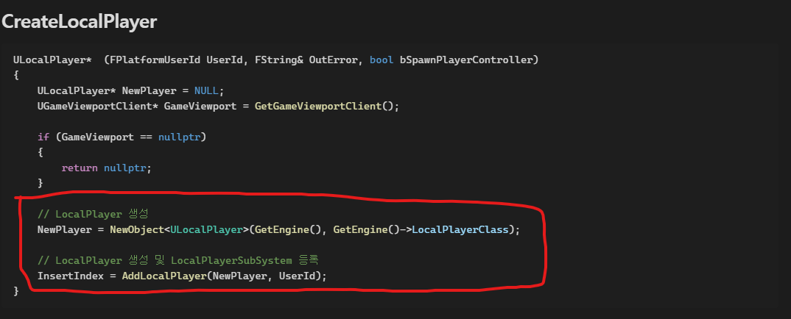

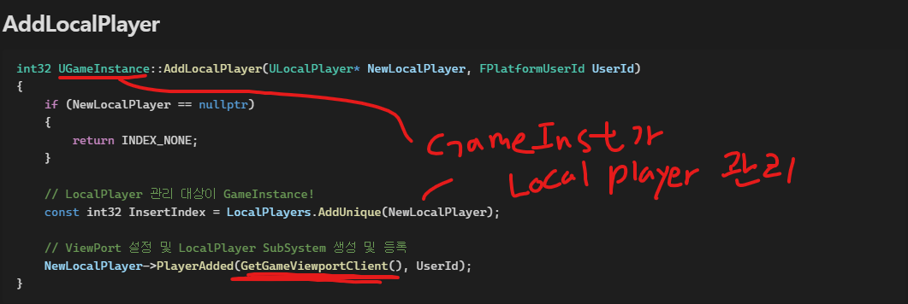

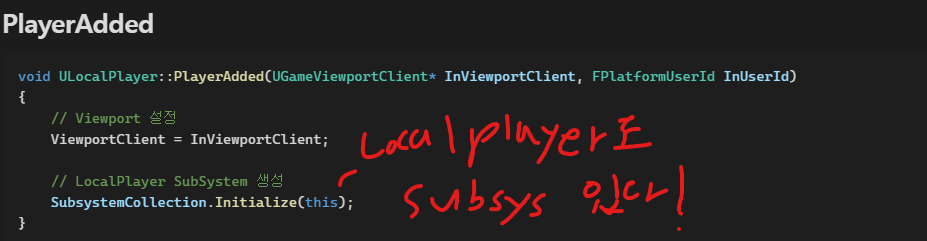

<b>지금까지 UGameInstance, UGameplayViewport, ULocalPlayer 월드에 종속되지 않은 필수클래스들이 생성되었다</b>

---

AGameMode

<b>UGameInstance::StartPlayInEditorGameInstance</b>

<b>부모</b>

UEditorEngine::CreateInnerProcessPIEGameInstance 

---

<b>AGameMode는 월드생성시 가장 먼저 생성되는 액터(오브젝트)</b>이다.

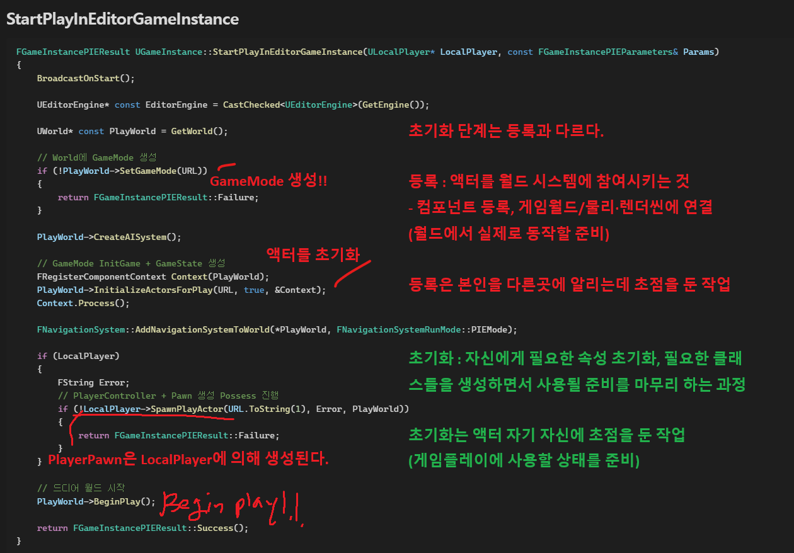

<b>UWorld::SetGameMode\~</b>

<b>부모</b>

UGameInstance::StartPlayInEditorGameInstance 

---

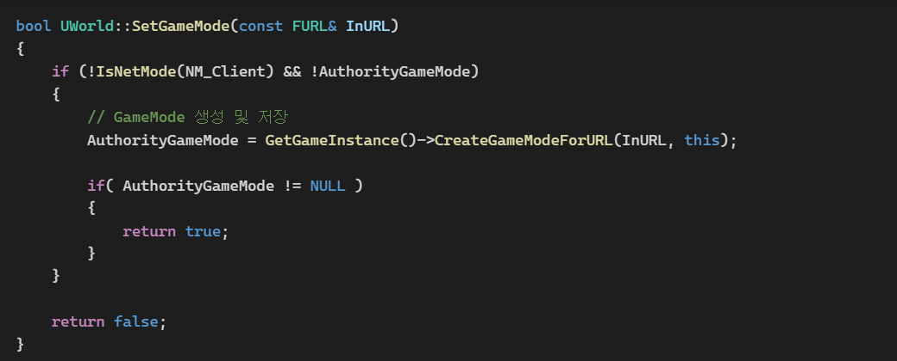

<b>게임에 있어 중요한 클래스들은 GameInstance가 만드는걸</b> 확인 가능

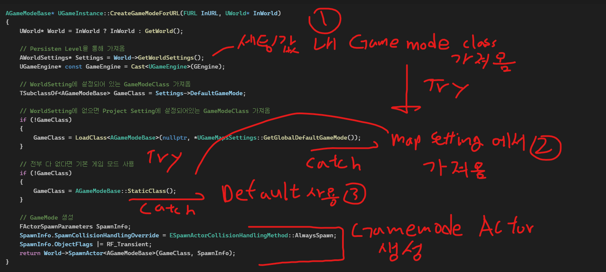 <em>GameModeClass는 World세팅이 Map세팅보다 우선순위가 높</em>

