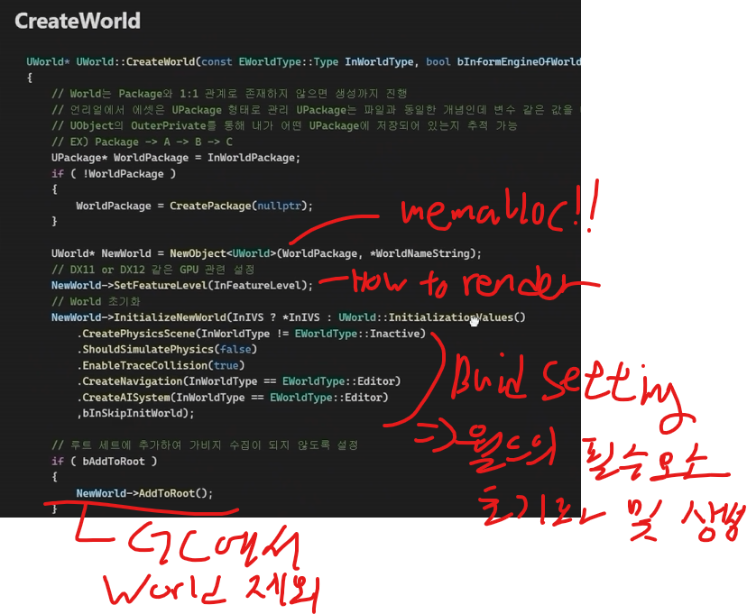
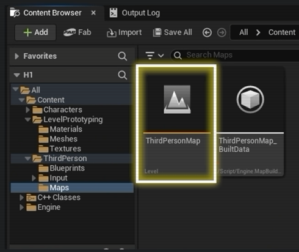
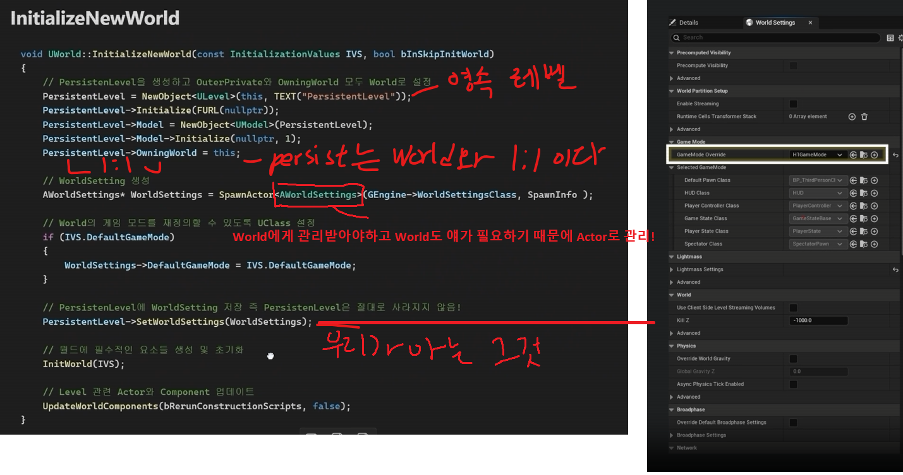
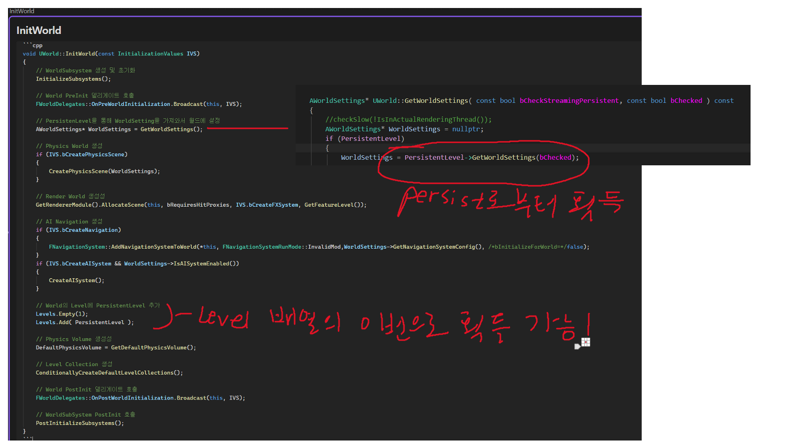

World 초기화

EngineInit.CreateWorld

<b>가장 먼저 WorldPackage라는 것을 만든다.</b>

Package란? : 언리얼에서의 에셋 데이터 저장 형태

그냥 데이터가 어딘가에 저장이 되어야할 것이다. 레벨로 예를들면 레벨 내의 오브젝트의 Transform등이 어딘가에 저장되어야 한다.

뭐 그 저장 형태가 메모장일수도 있고, Json일수도 있다

<b>언리얼에서는 그 형태를 UPackage라고 정의</b>한 것이고, 그걸 <b>에셋</b>이라고 부른다.

<aside class="callout">

어? 그럼 World도 에셋처럼 저장되요?

</aside>

⇒ <b>아니다</b>. 메모리상의 UPackage, 디스크상의 UPackage가 있는데

<b>메모리상의 Package</b> └─ UObject들을 묶고 이름/경로/소유 관계를 제공

<b>디스크상의 Package</b> └─ 위 내용을 .uasset 또는 .umap으로 저장한 것

그니까 초기 게임 키면 나오는 화면의 월드를 만드는 것으로 보인다.

그 다음 World 객체가 실제로 동적할당되고 이것저것 초기화를 해준다.

그리고 나서 bAddToRoot를 통해<b> 루트월드면 (엔진 첨 킬때 생기는 World) GC의 대상이 되지 않게 포인터 잡는다.</b>

World.InitializeNewWorld

여기선 World - PersistLevel - WorldSetting을 눈여겨 봐야한다.

PersistLevel은 World를 표시하기위한 필수적인 Level이라고 보면 된다. 따라서 <b>World : Level = 1 : n이지만 World : PersistLevel = 1 : 1</b>이다.

그리고 <b>WorldSetting은 세팅값인데 Actor</b>이다! 적어놨지만 WorldSetting은 World가 살아있는 한 절때 사라져서는 안되는 값이기 때문에 World에 올려놔야 한다 ⇒ 따라서 Actor로 만들게 된다.

<aside class="callout">

<b>AWorldSetting</b>을 <b>PersistLevel</b>에 저장하는 이유

</aside>

<b>맵에 저장되어야 하기 때문</b>

월드 설정은 보통 맵마다 다르다.

기본 GameMode, 중력, 월드 경계, 킬 Z , 피격 여부 , 라이트맵 관련 설정, 레벨 스트리밍 설정, 기본 물리 설정 등등 따라서 <code>.umap</code> 파일을 저장할 때 액터들과 함께 저장되어야 한다.

마지막에 <b>UpdateWorldComponent를 해서 우리가 World의 액터들을 볼 수 있게한다</b>.

World.InitWorld

<b>부모</b>

<a href="https://www.notion.so/3ba8338216a880e8a4a7cfd216c2c62a">UGameInstance::InitializeForPlayInEditor</a> 

---

<a href="%EC%97%94%EC%A7%84-%ED%95%B5%EC%8B%AC-%ED%81%B4%EB%9E%98%EC%8A%A4-3b383382.md">월드 안에는 여러개 레벨이 존재 가능하다.</a> 

<b>World 세팅 획득 후 PhysicsScene, RenderScene를 생성</b>한다.

World 초기화 단계가 완료되었다.

