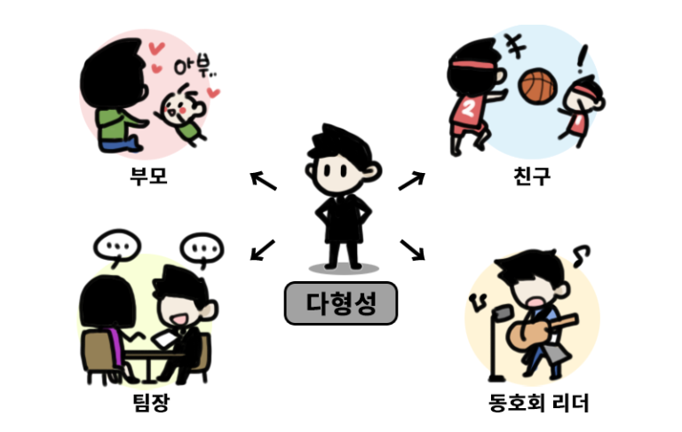
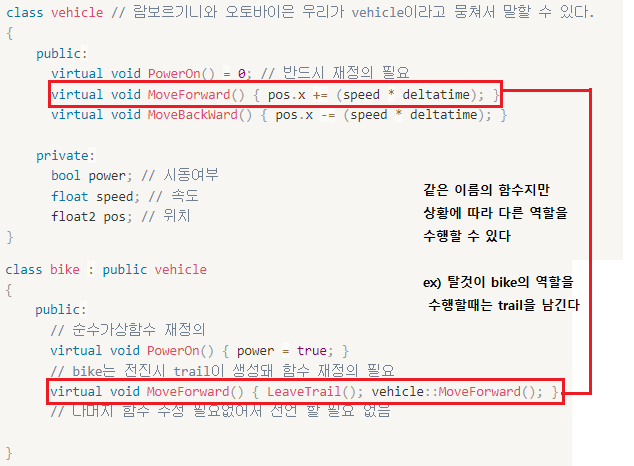

그놈의 객체지향이 뭔지 알아보자\~

---

### 객체지향 프로그래밍

<ul>
<li>
<b>객체 지향 프로그래밍</b>(<b>Object-Oriented Programming, OOP</b>)이란 

컴퓨터 프로그램을 어떤 데이터를 입력받아 순서대로 처리하고 결과를 도출하는 명령어들의 목록으로 보는 시각에서 벗어나 

<b>여러 독립적인 부품들의 조합,</b> <b>즉 객체들의 유기적인 협력과 결합으로 파악하고자 하는 컴퓨터 프로그래밍의 패러다임</b>을 의미한다.

</li>
<li>
<b>객체 지향 프로그래밍의 이점</b>

프로그램을 보다 <b>유연하고 변경이 용이</b>하게 만들 수 있다. 

코드의 <b>변경을 최소화</b>하고 <b>유지보수를 하는 데 유리</b>하다.

<b>코드의 재사용을 통해 반복적인 코드를 최소화</b>하고, 코드를 최대한 <b>간결하게 표현</b>할 수 있다.

<b>인간 친화적이고 직관적인 코드를 작성하기에 용이</b>하다.

</li>
</ul>

### <b>객체(object)란?</b>

<aside class="callout">

<b>객체는</b> <b>객체 지향 프로그래밍의 가장 기본적인 단위이자 시작점이다</b>. 

<u>객체 지향 개념의 가장 기본적인 전제는 실제 세계는 객체들로 구성</u>되어 있으며, 

보여지는 모든 현상과 발생하는 모든 사건은 이러한 

<b>객체들 간의 상호작용</b>을 통해 발생한다는 것에서 출발한다.

</aside>

<b>그렇다면 객체란 무엇일까?</b>

우리가 주변에서 흔히 볼 수 있는 <b>“모든 실재(實在)하는 대상” 뿐만 아니라 우리가 보고 느끼고 인지할 수 있는 그 모든</b> <b>것을 의미한다.</b>

이것들을 객체 지향 프로그래밍 언어에서는 <b>객체</b>라고 부른다.

---

### <b>객체 지향 프로그래밍의 4가지 특징</b>

객체지향을 구성하는 4가지 특징으로는 

추상화, 상속, 다형성, 캡슐화가 있다.

<details>
<summary>추상화</summary>

<b><span>추상</span></b>

사물을 정확하기 이해하기 위해 사물이 지닌 여러 가지 측면 중 특정한 측면만을 가려내 포착하는 것

<aside class="callout">

즉 객체의 중요한 부분만을 강조하기 위해 불필요한 세부 사항들은 제거하고, 공통성과 본질을 모아 추출하는 것이다.

</aside>

<b>람보르기니와 오토바이로 예를 들어보자</b>

람보르기니와 오토바이는 많은 차이점이 있지만 여기서는 공통점과 본질이 뭐가 있는지 살펴보자

우선 가장 크게는 탈 것 이라는 공통점이 있다.

그리고 모든 탈것은 <b>시동을 켜고 앞과 뒤로 움직이는 기능</b>을 가지고 있다.

C++에서는 공통적으로 사용되는 기능들을 자식 클래스에서 재정의 및 사용 할 수 있도록 <b>virtual</b>키워드를 붙여 선언한다.

이를 통해 자식 클래스들이 반드시 해당 기능을 가지고 있도록 명시할 수 있다.

```c++
class vehicle // 람보르기니와 오토바이은 우리가 vehicle이라고 뭉쳐서 말할 수 있다.
{
		public:
			virtual void PowerOn() = 0; // 반드시 재정의 필요
			virtual void MoveForward() { pos.x += (speed * deltatime); }
			virtual void MoveBackWard() { pos.x -= (speed * deltatime); }

		private:
			bool power; // 시동여부
			float speed; // 속도
			float2 pos; // 위치
}
```

```c++
class lambo : public vehicle 
{
		public:
			// 순수가상함수 재정의
			virtual void PowerOn() { power = true; sideBreak = false; }
			// 나머지 함수 수정 필요없어서 선언 할 필요 없음			

		private:
			bool sideBreak;
}
```

```c++
class bike : public vehicle 
{
		public:
			// 순수가상함수 재정의
			virtual void PowerOn() { power = true; } 
			// bike는 전진시 trail이 생성돼 함수 재정의 필요
			virtual void MoveForward() { LeaveTrail(); vehicle::MoveForward(); }
			// 나머지 함수 수정 필요없어서 선언 할 필요 없음	

}
```

</details>

<details>
<summary>상속</summary>

<b><span>상속</span></b>

상속은 간단하다. 말 그대로 부모에게 물려받는것이다.

<aside class="callout">

기존의 클래스를 이용하여 새로운 클래스를 작성하는 것

</aside>

앞서 봤었던 추상화의 연장선에서

<b><span>상속</span></b>은 클래스 간 공유될 수 있는 속성과 기능들을 <b>상위 클래스로</b> <b><span>추상화</span></b> 시켜 해당 

부모<b> 클래스로부터 확장된 여러 개의 자식 클래스들이 모두 상위 클래스의 속성과 기능들을 간편하게 사용</b>할 수 있도록 한다.

즉, 클래스들 간 <b>공유하는 속성과 기능들</b>을 반복적으로 정의할 필요 없이

한 번만 정의해두고 간편하게 <b>재사용</b>할 수 있어 <b>반복적인 코드를 최소화하고 공유하는 속성과 기능에 간편하게 접근</b>하여 사용할 수 있도록 한다.

<details>
<summary><b>예시</b></summary>

<b>부모 클래스</b>

```c++
class vehicle
{
		public:
			virtual void PowerOn() = 0; // 반드시 재정의 필요
			virtual void MoveForward() { pos.x += (speed * deltatime); }
			virtual void MoveBackWard() { pos.x -= (speed * deltatime); }

		protected:
			bool power; // 시동여부
		private:
			float speed; // 속도
			float2 pos; // 위치
}
```

<b>자식 클래스</b>

```c++
class lambo : public vehicle 
{
		public:
			// 순수가상함수 재정의
			// protected 변수 power 변수에 접근 (공유 속성에 간편 접근)
			virtual void PowerOn() { power = true; sideBreak = false; }

			// 나머지 함수 수정 필요없어서 선언 할 필요 없음 (반복 코드 최소화)		

		private:
			bool sideBreak;
}
```

```c++
class bike : public vehicle 
{
		public:
			// 순수가상함수 재정의
			// protected 변수 power 변수에 접근 (공유 속성에 간편 접근)
			virtual void PowerOn() { power = true; } 
			
			// bike는 전진시 trail이 생성돼 함수 재정의 필요
			virtual void MoveForward() { LeaveTrail(); vehicle::MoveForward(); }
						
			// 나머지 함수 수정 필요없어서 선언 할 필요 없음 (반복 코드 최소화)		
			
			// bike의 독자적인 함수 Trick(묘기) 추가
			void Trick();
}
```

</details>

</details>

<details>
<summary>다형성 (특히 중요)</summary>

<b><span>다형성</span></b>

<b>어떤 객체의 속성이나 기능이 상황에 따라 여러 가지 형태를 가질 수 있는 성질</b>을 의미한다.

<details>
<summary><b>쉬운 예시</b></summary>

어떤 남성이 있다고 했을 때 그 남자의 역할이 아내에게는 남편, 자식에게는 아버지, 부모님에게는 자식, 회사에서는 회사원, 동아리에서 총무 등 상황과 환경에 따라서 달라지는 것과 비슷하다고 할 수 있다.



</details>

<aside class="callout">

<b>어떤 객체의 속성이나 기능이 그 맥락에 따라 다른 역할을 수행할수 있는 객체 지향의 특성</b>을 의미

</aside>

위의 <b><span>추상화</span></b>에서 사용한 오버라이딩을 사용해 각각의 클래스의 역할에 맞게 재정의 한 것도 

<b><span>다형성</span></b>의 일부이다.



하지만 다형성의 핵심적인 정의는 따로 있다.

<aside class="callout">

객체 지향 프로그래밍에서 <b>다형성</b>이란 <b><span>super class type의 instance로</span></b> <br /><b><span>child class들의 객체를 참조</span></b>할 수 있도록 하는 것이다.

</aside>

위의 특성을 사용하면 코딩이 매우 편해진다

```c++
std::vector<CStage*> mStages; // CStage* 타입을 담는 벡터

									//  모두 CStage를 상속받는 클래스
mStages.push_back(new CStageTutorial); 
mStages.push_back(new CStage1);
mStages.push_back(new CStage2);
mStages.push_back(new CBossStage1);
mStages.push_back(new CStage3);
mStages.push_back(new CBossStage2);

for (size_t i = 0; i < mStages.size(); i++)
{
	// 모두 다른 타입의 클래스지만 superclass의 SetOwner를 사용가능하다.
	mStages[i]->SetOwner(this); 
}
```

쉽게 말해 다형성 없으면 아래처럼 코딩해야한다.

```c++
tutorialstage->SetOwner(this); 
stage1->SetOwner(this); 
stage2->SetOwner(this); 
stage3->SetOwner(this); 
...
stage1000->SetOwner(this); 
```

가상함수를 사용하면 다형성을 더 유용하게 이용할 수 있다.

```c++
std::vector<CStage*> mStages;
mStages.push_back(new CStageTutorial); 
mStages.push_back(new CStage1);
mStages.push_back(new CStage2);

for (size_t i = 0; i < mStages.size(); i++)
{
	mStages[i]->SetPlatforms(); // setowner은 가상함수라고 정의 
}
```

해당 코드에서 SetOwner를 호출 하면 CStageTutorial, CStage1, CStage2 각각의 SetOwner가 호출된다 (재정의 했을때만)

참고로 탬플릿도 다형성이다.

</details>

<details>
<summary>캡슐화</summary>

<b><span>Encapsulation</span></b>

<aside class="callout">

클래스 안에 <b>서로 연관있는 속성과 기능들을 하나의 캡슐로 만들어 데이터를 외부로부터 보호하는 것</b>

</aside>

<b>캡슐화의 이유</b>

- <b>데이터 보호(data protection)</b> – 외부로부터 클래스에 정의된 속성과 기능들을 보호
- <b>데이터 은닉(data hiding)</b> – 내부의 동작을 감추고 외부에는 필요한 부분만 노출

객체지향 언어에서는 <b><span>접근제한 지정자</span></b>와 <b><span>Getter/Setter</span></b>로 이를 구현할 수 있다.

C++에서는 <b>private, public, protected </b>를 사용한다.

```c++
class vehicle
{
		public: // 해당 파일을 포함하는 모든 파일이 접근 가능
						// 외부에서는 멤버들을 Getter/Setter로만 접근 가능
			void GetSpeed() const { return speed; } 
			void SetSpeed(float _speed) { speed = _speed; }

		protected: // 이 클래스를 상속받는 클래스는 해당 변수에 직접 접근 가능
			bool power; 

		private: // 해당 클래스에서만 이 변수에 직접 접근 가능
			float speed; 
			float2 pos;
}
```

데이터를 보호함으로써 클래스 내 멤버들을 보호하고

필요한 부분만 외부에 노출해 

객체 고유의 독립성과 책임 영역을 안전하게 지킬 수 있다

</details>
