---

<b>언리얼 프레임워크 기능 목록</b>

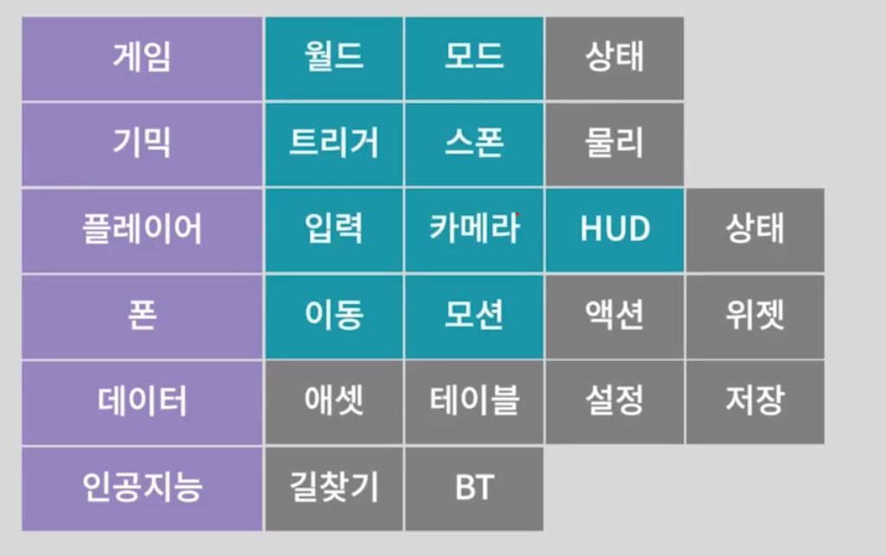

<b>초기화 프로세스</b>

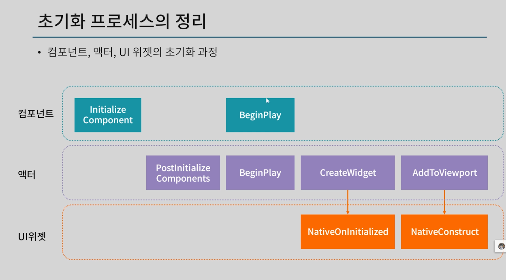

<details>
<summary>월드</summary>

- 게임 콘텐츠를 담기 위해 제공되는 가상의 공간
- 시간, 트랜스폼, 틱 제공
- 월드 세팅을 사용해 기본 환경설정 사용
- 기본 단위로 액터 사용

<b>게임이 시작하면 World의 BeginPlay가 호출된다.</b>

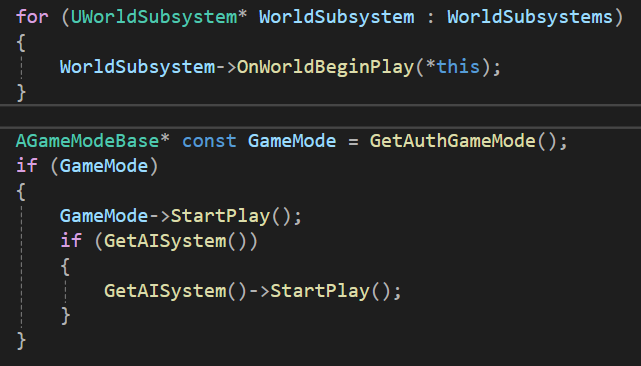

그리고 바로 GameMode의 StartPlay가 실행된다.

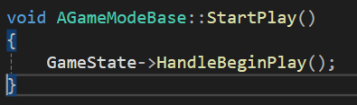

GameMode superclass의 StartPlay이다 HandleBeginPlay를 통해 월드 내 액터들의 BeginPlay를 호출한다.<br />그 후에 ChildClass의 StartPlay가 호출된다.<br />따라서 클라이언트 개발자들이 신경써야 될 부분은 재정의한 GameMode의 StartPlay는 반드시 BeginPlay보다 늦게 호출된다는 것이다.

</details>

<details>
<summary>게임 모드</summary>

- 게임 규칙을 지정하고 게임을 판정하는 최고 관리자 <b>액터</b>
- 1게임 1게임 모드
- 입장할 사용자의 규격 지정 가능
- 멀티플레이어 게임에서 판정 처리 (데이터 검증)

- GameMode 클래스 내에는 다른 기본 클래스들을 지정할 수 있는 기능을 제공한다.
  - Game Session Class : 로그인 승인과 같은 관리자 수준의 게임 흐름을 처리
  - Game State : 클라이언트가 게임에서 발생하는 상황을 볼 수 있도록<br />게임의 상태를 처리한다.
  - Player State : 게임 내 플레이어의 현재 상태를 지정한다.
  - HUD : 플레이어에게 보여주는 사용자 인터페이스를 처리한다.
  - 이외에 Player Controller, Default Pawn Class, Spectator 등등의 클래스도 지정이 가능

</details>

<details>
<summary>플레이어</summary>

- 게임에 입장한 사용자 액터 (형태 X)
- 게임 모드의 로그인을 통해 게임 월드에 입장한다 (서버를 통한 로그인 아님)
- 싱글 플레이 게임에서는 0번 플에이어 설정
- 실 사용자와 최종 커뮤니케이션 담당 (입출력 처리)

</details>

<details>
<summary>액터</summary>

- 월드에 속한 콘텐츠의 기본 단위이다.
- <b>모든 액터는 Transform을 </b>기본으로 가지고 월드로부터 틱, 시간 서비스 제공
- <b>사실 액터는 뭐 없고 여러 컴포넌트 감싸는 컨테이너이다.</b>
- <b>실질적 구현은 컴포넌트가 맡는다</b>
  - 다수의 컴포넌트를 대표하는 컴포넌트를 <b>루트 컴포넌트</b> 라고 부른다.
  - 액터는 이 <b>루트 컴포넌트를 반드시 가져야 한다.</b>
  - <b>액터의 트랜스폼은 루트 컴포넌트의 트랜스폼을 말한다.</b>

### <b>액터의 라이프 사이클</b>

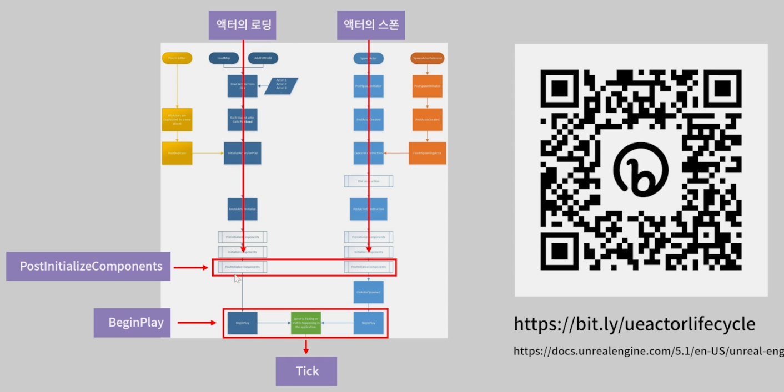

<b>초기화</b>

- 디스크에 저장된 레벨 정보가 되면서 초기화
- 스크립트를 사용해 런타임에서 초기화 (Spawn)
- <b>마지막 단계</b>
  - <b>PostInitializeComponents</b>
    모든 컴포넌트들이 초기화 완료된 후에 호출되는 함수

    액터초기화의 최종 마무리 할 때 사용

  - <b>BeginPlay</b>
    게임 시작할 때 초기화 

    틱이 시작된다.

<b>틱</b>

</details>

<details>
<summary>폰</summary>

- 액터를 상속받은 특별한 액터
- 플레이어가 빙의해 입출력 처리 가능
- 무형의 액터가 빙의해 플레이어와 연결되는 되는 액터
- 길찾기 사용 가능, 기믹 및 다른 폰과 상호작용
- 폰 중에서 인간형 폰을 별도로 <b>캐릭터</b>로 지칭
  <b>캐릭터</b>

  - 인간형 폰을 구성하도록 언리얼이 제공하는 전문 폰 클래스
  - 폰을 상속받아 만들어서 3가지 기본 컴포넌트가 있다
    - 캡슐 컴포넌트 (루트)
    - 스켈레탈 메시
    - 캐릭터 무브먼트

</details>

<details>
<summary>컴포넌트</summary>

### <b>기본 컴포넌트</b>

<b>씬 컴포넌트</b>

트랜스폼이 있는 컴포넌트 (씬에 직접 올라가니까 그런듯?

- 기믹과 상호작용하는 충돌 컴포넌트 (루트 컴포넌트)
- 시각적 비주얼 담당하는 메시 컴포넌트

<b>액터 컴포넌트</b>

트랜스폼이 없는 컴포넌트

- 액터의 기능을 확장할 때 컴포넌트로 분리해 모듈화 가능

ex) 움직임 담당하는 컴포넌트

<b>컴포넌트 생성</b>

- 컴포넌트는 UObject이므로 UPROPERTY붙인다.
- TObjectPtr사용해서 선언한다.

<b>액터에 컴포넌트 등록</b>

<ul>
<li>
CDO(생성자)에서 생성한 컴포넌트는 자동으로 월드에 등록
</li>
<li>
런타임중 NewObject로 생성한 컴포넌트는 등록 절차 거쳐야 함(RegisterComponent) 

<b>잘 사용안함</b>
</li>
</ul>

<b>컴포넌트 블루프린트에 올리기</b>

- UPROPERTY에 <b>지정자</b> 설정해서 한다.
- <b>지정자</b>
  - Visible / Edit : (<b><span>주로 객체 타입에는 Visible</span></b>, <b><span>값 타입에는 Edit 사용한다</span></b>)
  - Anywhere / DefaultsOnly / InstanceOnly : 에디터에서 편집 가능 영역 (주로 <b>Anywhere</b> 사용)
    컴포넌트는 객체니까 VisibleAnywhere사용한다.

  - BlueprintReadOnly / BlueprintReadWrite : 블루프린트 확장시 r / rw 권한 부여
  - Category : 에디터 편집 영역에서 카테고리 설정

</details>

<details>
<summary>입력</summary>

<b>사용자의 입력 → 컨트롤러 → 폰 </b>으로 이루어져있다.

입력은 컨트롤러나 폰이 처리할 수 있는데 보통 폰씀 ㅇㅇ

GTA같이 자동차타고 헬기타고 뭐시기저시기 하는 애들은 플레이어 컨트롤러를 사용하면 코드가 덕지덕지 붙을 것이다.

그럴 때는 폰에 입력 위임하여 각 액터클래스에서 처리하도록 하면 될 듯 하다.

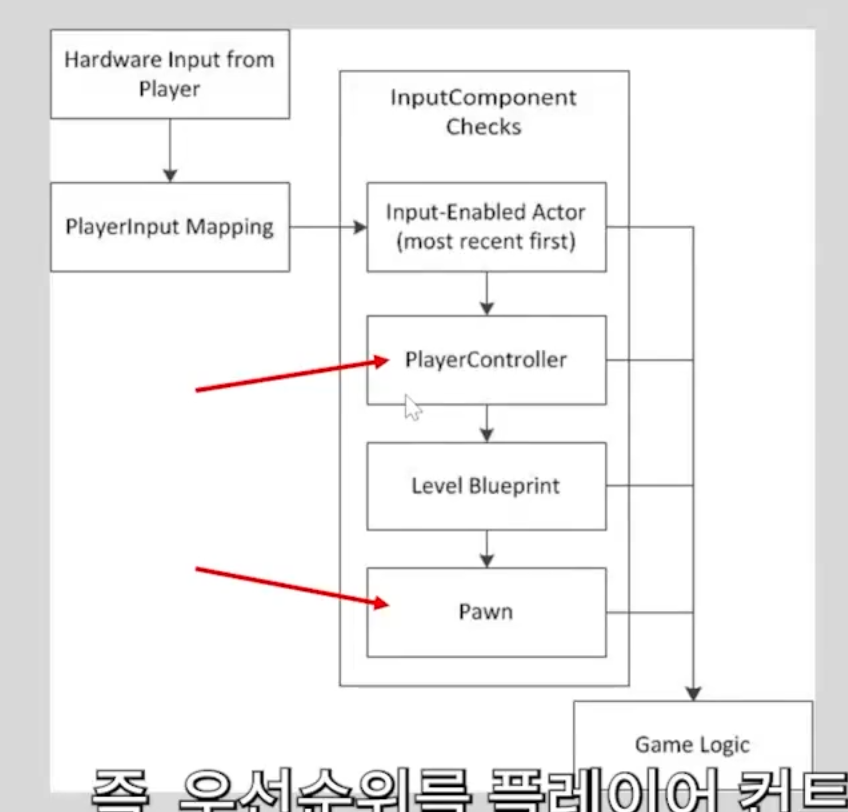

# 향상된 입력 시스템

언리얼4의 입력시스템 개선을 위해 도입

- 사용자의 입력 설정 변경에 유연하게 대처할 수 있는 구조
- 입력 처리를 4단계로 분류하고 각 입력 설정을 독립적인 에셋으로 대체
- 사용자의 입력 데이터를 최종 함수에 매핑하는 과정을 체계적으로 구성
- 플랫폼에 따른 다양한 입력 장치 설정
  입력 매핑 컨텍스트를 사용해 <b>런타임 중</b>에 입력 플랫폼 변경이 유연하게 처리가 가능하다.

- 입력 값 변경 (반전 같은거 말하는거임)
- 이벤트 발생 조건의 상세 설정

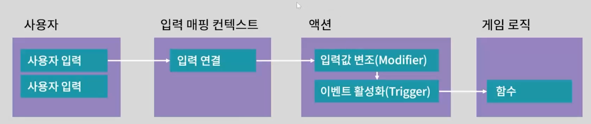

</details>

<details>
<summary>캐릭터 컨트롤</summary>

캐릭터 컨트롤은 일반적으로 폰, 카메라, 스프링 암, 캐릭터 무브먼트 다섯가지 요소를 사용해

설정한다.

컨트롤러 : 입력자의 의지(목표 지점)을 지정할 때 사용 (ControlRotation)

폰 : 폰의 트랜스폼 지정

카메라 : 화면 구도 설정(주로 1인칭)

스프링 암 : 화면 구도 설정 (주로 3인칭)

캐릭터 무브먼트 : 캐릭터의 이동과 회전 조

</details>

<details>
<summary>데이터 애셋</summary>

데이터 애셋을 사용하면 편하게 관리하고 싶은 항목들을 모아서 관리할 수 있다.

DataAsset/DataAssetPrimary를 상속받아 c++클래스에 리플렉션으로 에디터에 값을 올리면

원하는 값들을 세팅하고 그것들을 다시 c++에 objectfinder로 불러올 수 있다.

</details>

<details>
<summary>애니메이션</summary>

<b>캐릭터 애니메이션 시스템의 생성</b>

1. 캐릭터 초기화시에 애님인스턴스 클래스 생성
2. 캐릭터에서 GetAniminstance로 현재 애님인스턴스 획득 가능
3. 애님 인스턴스는 GetOwingActor사용하면 됨

애니메이션 블루프린트는 <b><span>이벤트 그래프 </span></b><b>- </b><b><span>애님 그래프로</span></b><span> </span>나뉜다.

<b><span>이벤트 그래프</span></b>

이벤트로부터 상태를 파악할 수 있는 주요 변수 저

NativeInitializeAnimation : 애니메이션 시스템이 생성될 때 발생

NativeUpdateAnimation : 프레임마다 발생

<b><span>애님 그래프</span></b>

이벤트 그래프에서 저장된 변수로부터 지정된 상태의 애니메이션 재생

애님그래프의 복잡한 상태는 State ailias로 분리해서 사용

</details>

<details>
<summary>애니메이션 몽타주</summary>

몽타주 : 이미지 일부를 잘라내 한 화면에서 합성하는 회화 기법

애니메이션 클립을 잘라내고 합성한 후 이를 재생하는 기능

애니메이션 클립을 모아둔 다수의 <b>섹션</b>으로 구성되어 있다.

섹션끼리 연동할 수 있으며, 스크립트를 통해 원하는 섹션으로 건너뛸 수 있음

</details>

<details>
<summary>충돌</summary>

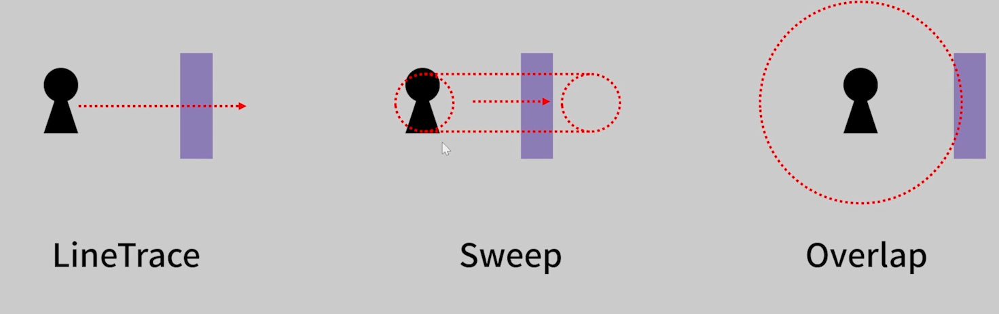

LineTrace : 레이트레이싱

Sweep : Line같이 지정한 방향으로 도형을 투사하여 충돌하는거 있는지 확인

Overlap : 지정한 영역과 물체가 충돌하는지 검사

<b>캐릭터의 경우에는 2가지 고려하여 충돌 프로필을 생성하여한다.</b>

- RootComponent(캡슐) 의 프로필
  - 폰 끼리의 충돌 수행
- 스켈레탈메시의 프로필
  - 렉돌 기능 사용할때 사용
    스태틱메시내에서 본끼리 충돌하는거(고이즈미 죽이기 같은거 ㅋㅋ)

    매우 상세한 충돌 구현할때 사용할듯?

<b>기믹 트리거용 프로필</b>

- 폰 캡슐에만 반응하도록 설정
- 움직이지 않는 기믹이면 WorldStatic

<b>월드 트레이싱 함수 선택</b>

- 세 가지 카테고리로 원하는 함수 이름 획득
  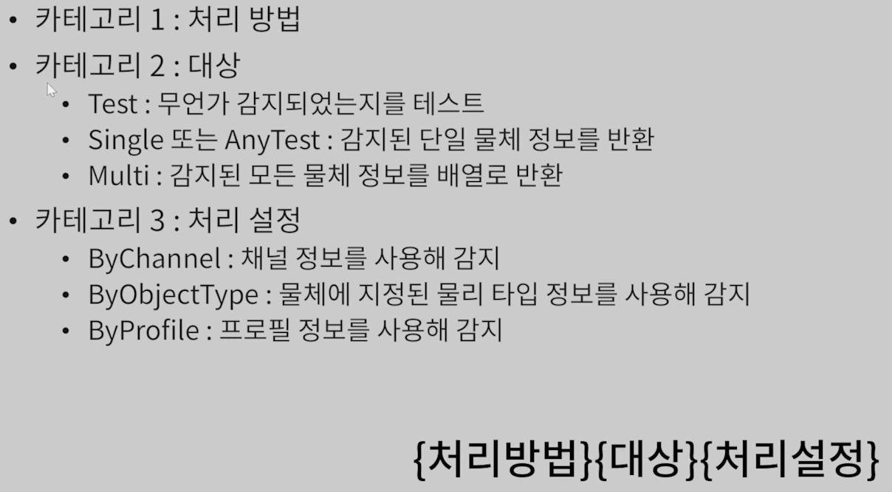

</details>

<details>
<summary>데미지 처리</summary>

<b>충돌 사용을 가정한다.</b>

```c++
FHitResult OutHitResult;

// Tag, TraceComplex, Actor
// Tag : 태그정보 분석시 식별자로 사용 (언리얼 분석툴에서 Attack이라는 이름으로 조사가 가능하도록 처리)
// Complex : 복잡한 형태(convex)의 충돌체도 감지할지의 옵션
// Actor : 무시할 액터(우리는 자기자신만)
FCollisionQueryParams Params(SCENE_QUERY_STAT(Attack), false, this);

const float AttackRange = 40.f;
const float AttackRadius = 50.f;
const float AttackDamage = 30.f;

const FVector Start = GetActorLocation() + GetActorForwardVector() * GetCapsuleComponent()->GetScaledCapsuleRadius();
const FVector End = Start + GetActorForwardVector() * AttackRange;

bool HitDetected = GetWorld()->SweepSingleByChannel(OutHitResult, Start, End, FQuat::Identity, CCHANNEL_ABACTION, FCollisionShape::MakeSphere(AttackRadius), Params);
if (HitDetected)
{
	FDamageEvent DamageEvent;
	OutHitResult.GetActor()->TakeDamage(AttackDamage, DamageEvent, GetController(), this);
}

float AABCharacterBase::TakeDamage(float DamageAmount, FDamageEvent const& DamageEvent, AController* EventInstigator, AActor* DamageCauser)
{
												// 가해자		// 가해자가 사용한 무기/빙의한 폰
	Super::TakeDamage(DamageAmount, DamageEvent, EventInstigator, DamageCauser);

	SetDead();
	return DamageAmount;
}
```

</details>

<details>
<summary>타이머</summary>

델리게이트 사용한 타이머를 가정

```c++
FTimerHandle TimerHandle;
	GetWorld()->GetTimerManager().SetTimer(TimerHandle,
		FTimerDelegate::CreateLambda(
		[&]()
		{
			Event();
		})
		, EventDelayTime, false); // 마지막 bool 값은 loop이다.
```

</details>

<details>
<summary>위젯</summary>

<b>위젯을 액터에 붙여줄때는</b>

<b>UserWidget</b>상태로는 붙여줄 수 없고, <b>WidgetComponent</b>사용해야한다.

위젯 컴포넌트는 위젯의 컨테이너 역할만 할 뿐이고, 서로 독립적으로 동작한다.

<b>위젯 에디터에서 가져오기</b>

```c++
void UABHpBarWidget::NativeConstruct()
{
	Super::NativeConstruct(); // 여기서 ui관련해 대부분의 초기화가 일어난다.

	HpProgressBar = Cast<UProgressBar>(GetWidgetFromName(TEXT("PbHpBar")));
	ensure(HpProgressBar);

}
```

<b>위젯 컴포넌트의 초기화 과정</b>

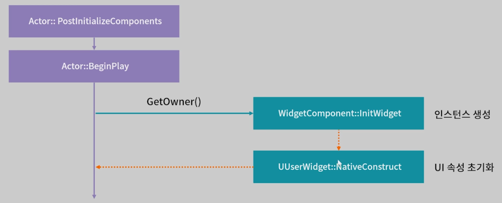

우리는 위젯을 보유하고 있는 위젯 컴포넌트의 Actor를 가져오고 싶을 때가 있다.

(하지만 이는 현재 언리얼 버전에서 지원하지 않는다)

우리가 클래스 확장해서 가져와야함

</details>

<details>
<summary>에셋 매니저</summary>

<ul>
<li>
언리얼엔진이 제공하는 애셋을 관리하는 싱글톤 클래스이다.
</li>
<li>
엔진이 초기화될 때 제공되며, 애셋 정보 요청해 받을 수 있음
</li>
<li>
PrimaryAssetId를 사용해 프로젝트 내 애셋의 주소 얻어올 수 있음

이거쓰면 레퍼런스 주소 얻어서 생성자에서 받는 수고 덜 수 있음
</li>
<li>
PrimaryAssetId는 우리가 지정한 태그와 이름의 두 가지 키 조합으로 구성
</li>
<li>
특정 태그를 가진 모든 애셋 목록을 가져올 수 있음 

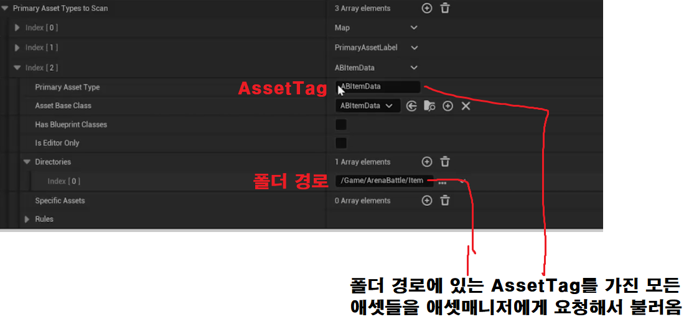
</li>
</ul>

</details>

<details>
<summary>데이터 처리</summary>

<b>언리얼에서 엑셀파일 Import하려면 csv로 변환 필요</b>

- 데이터 테이블로 받아서 쓴다
- c++로는 해당 Data들의 행 항목을 FTableRowBase로 받는다.
  <details>
  <summary>  <b>예시 코드</b></summary>

  ```c++
  #include "CoreMinimal.h"
  #include "Engine/DataTable.h"
  #include "ABCharacterStat.generated.h"

  USTRUCT(BlueprintType)
  struct FABCharacterStat : public FTableRowBase
  {
  	GENERATED_BODY()

  public:
  	FABCharacterStat() : MaxHp(0.0f), Attack(0.0f), AttackRange(0.0f), AttackSpeed(0.0f) {}

  	UPROPERTY(EditAnywhere, BlueprintReadWrite, Category = Stat)
  	float MaxHp;

  	UPROPERTY(EditAnywhere, BlueprintReadWrite, Category = Stat)
  	float Attack;

  	UPROPERTY(EditAnywhere, BlueprintReadWrite, Category = Stat)
  	float AttackRange;

  	UPROPERTY(EditAnywhere, BlueprintReadWrite, Category = Stat)
  	float AttackSpeed;

  	UPROPERTY(EditAnywhere, BlueprintReadWrite, Category = Stat)
  	float MovementSpeed;

  	FABCharacterStat operator+(const FABCharacterStat& Other) const
  	{
  		const float* const ThisPtr = reinterpret_cast<const float* const>(this);
  		const float* const OtherPtr = reinterpret_cast<const float* const>(&Other);

  		FABCharacterStat Result;
  		float* ResultPtr = reinterpret_cast<float*>(&Result);
  		int32 StatNum = sizeof(FABCharacterStat) / sizeof(float); // MaxHp부터 MovementSpeed까지의 변수 개수가 나오게 된다.
  		for (int32 i = 0; i < StatNum; i++)
  		{
  			ResultPtr[i] = ThisPtr[i] + OtherPtr[i]; // 전부다 float일거니까 이렇게 계산 가능
  		}

  		return Result;
  	}
  };
  ```

  </details>

- 에디터 내에서는 FTableRowBase을 상속받은 클래스를 상속받아
  Data Table을 만들 수 있고 해당 Data Table에서 csv파일을 Reimport하여 내용들을 불러올 수 있다.

  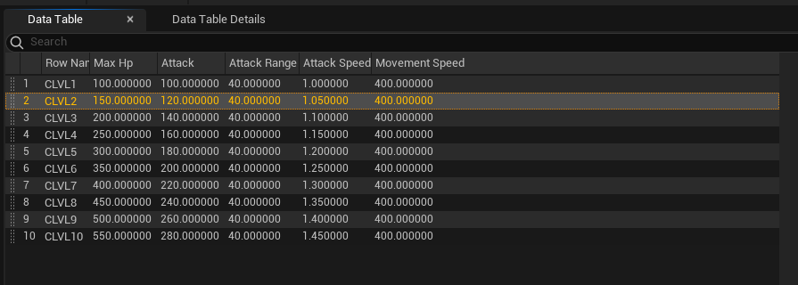

위에서 데이터 테이블을 관리하는 별도의 클래스를 하나 생성할 필요가 있다.

- 이러한 클래스들은 게임 내의 단 하나의 인스턴스에서 관리하도록 처리하는게 좋다

RowName으로 행마다 키 값이 정해진다.

Key값이 연속적이면 Array로 받는게 좋고 아니면 Map으로 하는게 좋다.

</details>

<details>
<summary>행동트리 (BT)</summary>

<a href="%ED%96%89%EB%8F%99-%ED%8A%B8%EB%A6%AC-35971329.md">행동트리</a> 

</details>

<details>
<summary>HUD</summary>

플레이어 컨트롤러에 의해 제작되고 관리되는 UI객체

HUD의 구현은 위젯을 생성하고 플레이어 뷰포트에 띄우는 과정으로 생성된다.

이 위젯은 자신을 소유한 플레이어 컨트롤러에 접근이 가능하다.

</details>

<details>
<summary>Tick</summary>

Tick이란 코드나 블루프린트 스크립트를 프레임과 같은 일정한 주기로 실행시키는 것을 의미한다. 게임의 Actor, Component들이 Tick을 수행하는 상대적인 순서를 이해하는 것은 게임 실행 방식의 일관성을 보장하고, 또 엔진에서 따로 수행되는 작업과의 Tick이 어긋나며 생기는 문제를 피할 수 있다.

Actor와 Component는 설정된 최소 시간 간격으로 프레임 Tick을 설정할 수도 있고, Tick을 전혀 하지 않도록 할 수도 있다. 또한 엔진의 프레임 별 업데이트 루프에서 서로 다른 단계에서 Grouping이 가능하며, 특정 Tick이 완료될 때까지 기다리도록 설정도 가능하다.

### <b>Tick Function</b>

언리얼 엔진에서 Tick을 어떻게 발생시키는지 알아보자. 가장 기본적으로는 FTickFunction 이라는 객체가 있다. 이 객체는 언리얼에서 생기는 모든 Tick에 대해 정의하고, Tick을 요구하는 객체에 Tick 이벤트를 발생시키도록 하며, 각 Tick이 어떤 순서 및 형태로 발생해야하는지에 대해 명세할 수 있다. 가장 많이 사용되는 Actor 객체와 ActorComponent는 Tick을 어떻게 등록하였을까?

Actor와 Component은 Tick을 수행하기 위해서 각자 FActorTickFunction, FActorComponentTickFunction이라는 객체를 PrimaryActorTick, PrimaryComponentTick이라는 이름으로 갖고 있다.

Actor의 경우 다음 Tick 함수와 TickFunction 객체를 갖고있다.

```c++
// Tick 함수
virtual void Tick( float DeltaSeconds );

// Tick Function 객체
FActorTickFunction PrimaryActorTick;

```

Component의 경우 다음 Tick 함수와 TickFunction 객체를 갖고있다.

```c++
// Tick 함수
virtual void TickComponent(float DeltaTime, enum ELevelTick TickType, FActorComponentTickFunction *ThisTickFunction);

// Tick Function 객체
FActorComponentTickFunction PrimaryComponentTick;
```

TickFunction은 Tick 처리를 위한 설정값과, TickGroup 지정, Tick Dependency와 같은 데이터를 갖고 있는 객체인데 BeginPlay 시점에 등록된다. (Actor.cpp의 RegisterAllActorTickFunctions 함수 참고) 등록된 TickFunction 객체들은 TickGroup과 Tick Dependency에 맞게 Target의 Tick 함수를 호출시킨다.

<b>엔진코드 분석</b>

등록된 Tick들은 어떤 원리로 동작할까? 먼저 TickFunction의 RegisterTickFunction 함수를 추적해보면 FTickTaskManager에 등록되는 것을 확인할 수 있다.

```cs
FTickTaskManager::Get().AddTickFunction(Level, this);
```

그리고 이 함수는 인자로 레벨을 받는데, 이를 통해 Tick이 레벨에 종속적이라는 것을 확인할 수 있다.

최종적으로 TickFunction이 자리잡는 위치는 FTickTaskLevel이라는 객체의 AddTickFunction이다.

호출 스택은 다음과 같다.

TGraphTask:: ExecuteTask

TickFunctionTask::DoTask (GameThread)

TickFunction::ExecuteTick

Actor::TickActor

<b>TickGroup</b>

TickGroup을 통해 Tick의 호출 순서에 대한 명세를 세팅할 수 있다. 이러한 TickGroup은 물리 시뮬레이션과 같은 엔진 내의 여러 작업들 사이 어느 프레임 위치에서 실행시킬지를 결정하기 위해 사용된다.

각 TickGroup은 그룹 내 모든 Actor와 Component들의 Tick이 끝나고 나서야 다음 TickGroup을 실행시킨다.

또한 하나의 TickGroup 내에서도 특정 Actor와 Component들 사이의 Tick Dependency를 결정할 수 있다.

TickGroup을 이용하는 것과 Tick Dependency를 이용하는 것은 게임 내의 물리 의존적인 작업이나 여러 Actor와 Component간 연계된 작업을 처리하기 위해 필수적이다.

(LevelTick.cpp 1544 line 참고)

(Link 참고)

[docs.unrealengine.com/en-US/ProgrammingAndScripting/ProgrammingWithCPP/UnrealArchitecture/Actors/Ticking/index.html](https://docs.unrealengine.com/en-US/ProgrammingAndScripting/ProgrammingWithCPP/UnrealArchitecture/Actors/Ticking/index.html)

<b>설정값 및 사용방법</b>

TickFunction에는 몇 가지 자주 이용하는 설정값들이 있다.

1\. bCanEverTick

TickFunction을 이용할 것인지에 대한 설정값이다.

이 값이 false이면 TickFunction의 등록 자체를 막아버리기 때문에,

절대로 Tick을 사용하지 않을 객체에 대해서만 false로 처리하도록 한다.

2\. bStartWithTickEnabled

선택적으로 Tick을 이용하는 상황에 대한 설정값이다.

이 값이 false로 설정되면 TickFunction은 등록이 되지만,

실질적인 Tick 함수는 호출이 되지 않는다.

상황에 맞게 Tick을 껐다 켰다 해야하는 객체에 대해서 사용하면 좋을 것이다.

3\. bTickEvenWhenPaused

게임이 paused 되었어도 Tick을 호출해야하는 객체에 대해 사용된다.

4\. TickGroup

TickGroup을 지정한다.

```arduino
/** Determines which ticking group a tick function belongs to. */
UENUM(BlueprintType)
enum ETickingGroup
{
	/** Any item that needs to be executed before physics simulation starts. */
	TG_PrePhysics UMETA(DisplayName="Pre Physics"),

	/** Special tick group that starts physics simulation. */
	TG_StartPhysics UMETA(Hidden, DisplayName="Start Physics"),

	/** Any item that can be run in parallel with our physics simulation work. */
	TG_DuringPhysics UMETA(DisplayName="During Physics"),

	/** Special tick group that ends physics simulation. */
	TG_EndPhysics UMETA(Hidden, DisplayName="End Physics"),

	/** Any item that needs rigid body and cloth simulation to be complete before being executed. */
	TG_PostPhysics UMETA(DisplayName="Post Physics"),

	/** Any item that needs the update work to be done before being ticked. */
	TG_PostUpdateWork UMETA(DisplayName="Post Update Work"),

	/** Catchall for anything demoted to the end. */
	TG_LastDemotable UMETA(Hidden, DisplayName = "Last Demotable"),

	/** Special tick group that is not actually a tick group. After every tick group this is repeatedly re-run until there are no more newly spawned items to run. */
	TG_NewlySpawned UMETA(Hidden, DisplayName="Newly Spawned"),

	TG_MAX,
};
```

5\. Tick Dependency 설정

Actor와 Component에는

```arduino
AddTickPrerequisiteComponent(SomeComponent);
AddTickPrerequisiteActor(SomeActor);
```

와 같은 함수들이 있는데, 이 함수는 내부적으로 TickFunction에 Tick Dependency를 추가하도록 구현되어 있다.

A라는 Actor와 C1, C2라는 Component가 있다고 가정해보자.

여기서 C2는 반드시 A와 C1이 끝난 후에 처리가 되어야 기능이 올바르게 동작한다면,

다음과 같이 추가해주면 된다.

```arduino
C2.AddTickPrerequisiteComponent(C1);
C2.AddTickPrerequisiteActor(A);
```

Actor Tick 설정 예제

```arduino
PrimaryActorTick.bCanEverTick = true;
PrimaryActorTick.bStartWithTickEnabled = true;
PrimaryActorTick.bTickEvenWhenPaused = true;

// TickGroup
PrimaryActorTick.TickGroup = TG_PrePhysics;

// Tick Dependency
AddTickPrerequisiteComponent(SomeComponent);
AddTickPrerequisiteActor(SomeActor);
```

Component Tick 설정 예제

```arduino
PrimaryComponentTick.bCanEverTick = true;
PrimaryComponentTick.bStartWithTickEnabled = true;
PrimaryComponentTick.bTickEvenWhenPaused = true;

// TickGroup
PrimaryComponentTick.TickGroup = TG_PrePhysics;

// Tick Dependency
AddTickPrerequisiteComponent(SomeComponent);
AddTickPrerequisiteActor(SomeActor);
```

<b>틱 추가 호출</b>

하나의 Component에서 물리 이전, 물리 이후 두 번에 걸쳐 처리해야할 작업이 있는 경우를 가정해보자.

기본적으로 제공되는 TickFunction으로는 PrimaryComponentTick이 있다.

이 객체를 물리 이전으로 TickGroup을 설정한다.

```arduino
PrimaryComponentTick.TickGroup = TG_PrePhysics;
```

물리 이후에 처리해야할 Tick을 위해 새로운 TickFunction을 멤버변수로 추가하고 물리 이후로 TickGroup을 설정한다.

```arduino
// header
FComponentTickFunction PostPhysicsComponentTick;
```

```arduino
// source
PostPhysicsComponentTick.TickGroup = TG_PostPhysics;
```

PostPhysicsComponentTick은 PrimaryComponentTick과 달리 따로 관리를 받는 객체가 아니므로 직접 등록을 해주어야 한다. TickFunction 등록을 위해 이미 Super 클래스에서 호출해 주는 RegisterComponentTickFunctions라는 가상함수가 있다. 이 함수를 override 해준다.

```arduino
// header
virtual void RegisterComponentTickFunctions(bool bRegister) override;
```

```arduino
// source
void UMyComponent::RegisterComponentTickFunctions(bool bRegister)
{
	Super::RegisterComponentTickFunctions(bRegister);
	if(bRegister)
	{
		if (SetupActorComponentTickFunction(&PostPhysicsComponentTick))
		{
			PostPhysicsComponentTick.Target = this;
		}
	}
	else
	{
		if(PostPhysicsComponentTick.IsTickFunctionRegistered())
		{
			PostPhysicsComponentTick.UnRegisterTickFunction();
		}
	}
}
```

이렇게 작업을 하면 TickComponent 함수가 한번은 PrimaryComponentTick을 통해서 호출되고,

한번은 PostPhysicsComponentTick을 통해서 호출될 것이다.

그러므로 함수 내부에서 이것을 ThisTickFunction을 통해 구분해주어야 한다.

```arduino
void UMyComponent::TickComponent(
	float DeltaTime,
	enum ELevelTick TickType,
	FActorComponentTickFunction *ThisTickFunction
{
	if(ThisTickFunction->TickGroup == ETickingGroup::TG_PrePhysics)
	{
		Super::TickComponent(DeltaTime, TickType, ThisTickFunction);
		// PrePhysics 처리
	}
	else if(ThisTickFunction->TickGroup == ETickingGroup::TG_PostPhysics)
	{
		// PostPhysics 처리
	}
}
```

</details>
