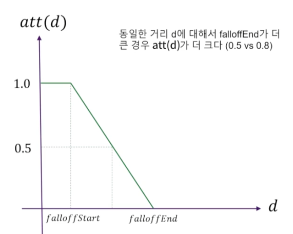
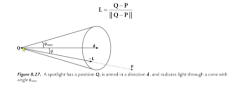
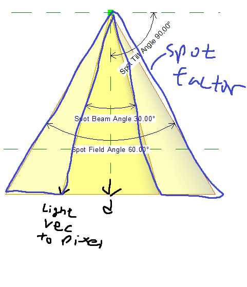

---

### Directional Light

- 현실 세계의 태양광을 3차원 가상 공간으로 가져온 것이다.
  저 멀리 태양에서 온다고 생각하기 때문에 빛 입자의 모든 벡터는 평행한다고 가정한다.

  (극한을 생각하면 쉽다)

### <b>Point Light</b>

- 3차원 공간의 한 점에서 나오는 빛을 말한다.
  direction을 가지고 있지 않고 위치와 falloff 정보를 갖는다.

  <b>falloffstart는 </b>빛의 세기가 1인 범위의 끝

  <b>falloffend는 </b>빛의 최대 범위를 의미한다.

  falloffstart를 지나치면 빛의 감쇄가 시작되고 end 에서 0이된다.

  아래 그래프를 보면 이해가 빠르다.

  

  즉 falloffend는 pointlight의 반지름을 의미한다.

### Spot Light

- 우리가 잘 아는 스포트 라이트(무대조명)를 의미한다.
  방향을 가지고있고

  빛 입자가 닿는 면에서 falloff가 계산이 된다.

  약간 direction light랑 point light 합친 느낌이라고 생각하면 쉽다.

  spot power를 올리면 우리가 잘 아는 phong의 specular lobe와 같은 현상이 일어난다.

  

  spot power을 올리면 spot factor가 작아진다

  
