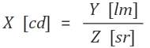
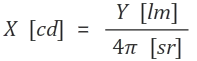

---

### <b>광선속 </b>(광속, Luminous Flux, Luminous Power)

여기서 의미하는 광속은 속도의 속자가 아니고 묶을 속자를 사용한다.

<b>( 光速 ) - X</b>

<b>( 光束 ) - O</b>

말 그대로 빛의 다발을 의미한다.

영어 뜻도 그대로 풀면 <b>빛의 흐름</b>이라는 소리다

---

<b>광속이란</b>

- 단위시간에 광원에서 나오는 빛(가시광선)의 총량이다.

(Radiometry 관점에서 보면 Radiant Flux( 방사속 )라는 용어가 이에 대응된다.)

우리가 조명을 보고 저 조명의 밝기는 XX이다\~ 라고 말 할 때 사용하는 것이 바로 광속이다.

단위는 <b>루멘(lm)</b>!

(몇 W(와트) 전구냐는 말을 많이 들어봤는데 이는 전구의 밝기가 얼마냐는게 아니라 에너지를 얼마나 소비하느냐를 의미한다.)

<b>광도란</b>

- 점 광원에서 특정 방향으로 1 스테라디안(단위 입체각)당 방출되는 광속이다
  단위는 <b>칸델라(cd)</b>!

  

  Z는 전체 입체각

point light는 전 방향으로 빛을 방출하기 때문에 1스테라디안은 1/4PI다

이때 칸델라는 아래처럼 구해진다.

