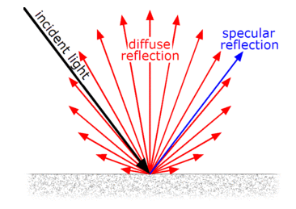
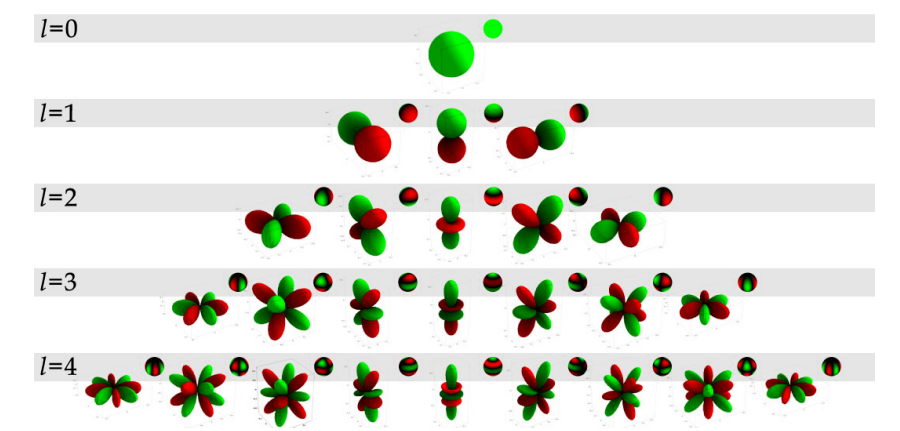

Irradiance map을 생성하는데 사용되는 대표적인 함수인 구면 조화함수

---

표면으로 들어오는 빛은 정반사와 난반사 성분으로 나눌 수 있다.

매끈표면이라고 가정할때 정반사 성분은 큐브맵을 그대로 사용해도 되지만

fabric같은 재질을 표현하려면 난반사를 표현해야 할 것이다.

그래서 우리는 <b>surface에 들어온 빛을 담는 정보를 가지는 텍스처</b>를 만들어준다.

이를 <b>Irradiance map</b>이라고 부른다.

Cubemap이 global light라고 할 때

이 Irradiance map을 만드려면 한 픽셀당 약 50000개의 텍셀을 가져와야한다.

(한 픽셀이 normal과 매칭되는 한 텍셀의 성분만을 가지지는 않기 때문)

똑똑이들은 이를 최적화 하는 방법을 찾았다.

이 방법이 바로 <b>구면 조화 (SH)</b>이다.

구면 조화는 뭔가 튀어나오거나 들어간 물체의 형태를 아래 그림처럼 수학적으로 표현한 것이다.

이를 이용해

Irradiance map을 구에대가 매핑 한 후 밝기에 따라 튀어나오게 하면

Image의 밝기에 맞추어 빛이 나가는 세기가 결정되게 된다.
