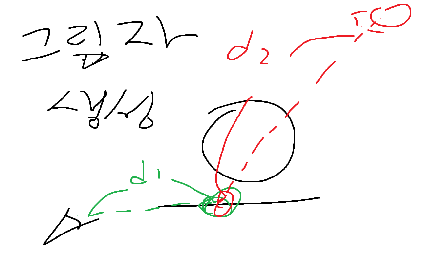
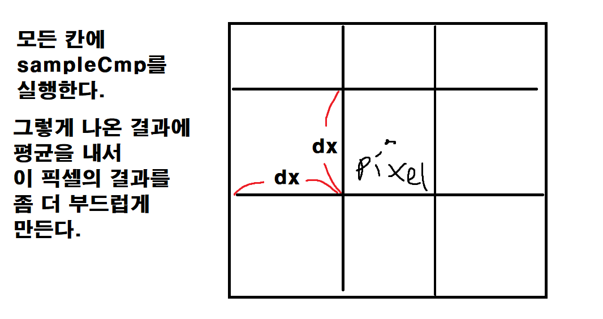
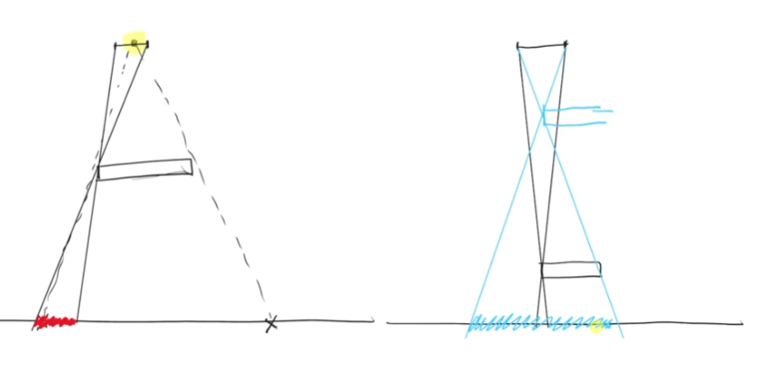

---

기본적인 그림자 알고리즘이다.

이것보다 이전에는 바닥 평면에서의 투영 행렬을 월드 행렬로 사용해 그림자를 그렸다

(즉 메시가 5개면 5번 더 그리는 것)

### PCF 기법

(percentage closer filtering)

해당 픽셀에서 원하는 dx를 두고 평균을 구한다.

### PCSS 기법

그림자는 당연히 빛의 세기에 따른 감쇄가 있다. (Penumbra)

(반대로 물체가 광원을 완전히 가린 부분을 umbra라고 부른다)

우리는 항상 광원을 점이라고 생각하고 계산했지만 현실은 그렇지 않기 때문에

penumbra가 생긴다.

광원이 면적을 가지고 있으면 저렇게 물체 위치에 따라서 생기는 그림자의 범위가 커질 것이다.

물체가 광원과 가까울수록 PCF 샘플링의 범위가 커지는 것이다.
