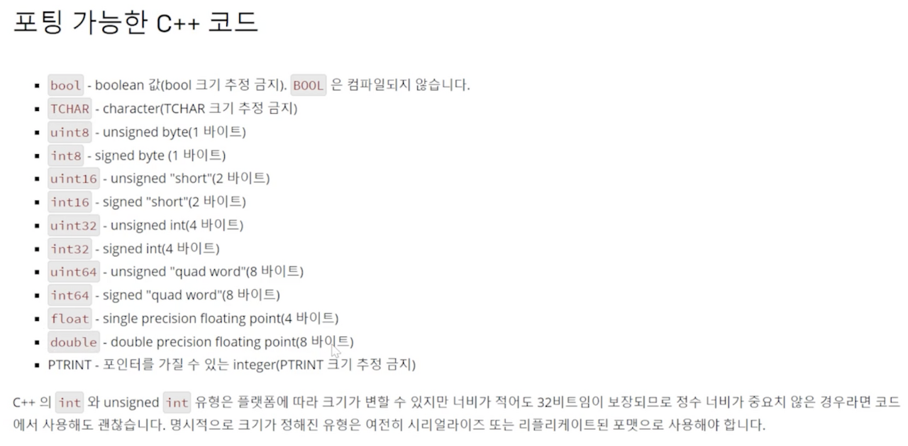

언리얼 내에서는 기본 타입을 따로 지정하고 있다.

<b>그럼 왜?</b>

현대 c++에서는 int가 최소 32bit를 보장하도록 규정되어있다.

하지만 특정 플랫폼에서는 64bit로 해석될 여지가 있다.

⇒따라서 데이터를 저장할 때 int 타입의 크기를 확신할 수 없다.

<b>게임 제작의 경우에는 단일 컴퓨터에서 퍼포먼스를 뽑아내야한다.</b>

그런 목표를 가지고 고려해야 할 것중 하나가 캐시 적중률인데.

데이터 정보가 캐시 크기에 맞춰 정렬되어있지 않으면 성능에 영향이 간다.

<b>언리얼 엔진내 기본 타입</b>



언리얼에서는 bool 타입 표준 자체가 없다.

(참 거짓을 표현하는 타입을 네트워크로 통신하거나 파일로 저장할 때 어떻게 할지 정확히 명시 X)

그래서 bool보다는

```c++
uint8 bFlag:1;
```

위처럼 bitfield operator를 사용한다.

헤더가 아니라 cpp의 지역에서 bool 선언할땐 저렇게 안해도 된다.

<b>언리얼은 문자열도 따로 지정한다.</b>

ANSI, ASCII, multibyte, uni-code(utf)는 아직까지사용중이다.

(c++ STL은 ascii, utf8/16 만 지원)

언리얼의 모든 문자열은 <b>FString/TCHAR배열 상태로 UTF-16 포멧 메모리에 저장</b>된다.

문자열은 항상 TEXT매크로로 감싸서 지정해야한다.

FString은 TCHAR을 포함하는 string 헬퍼 클래스이다.

- <b>TEXT매크로</b>
  ```c++
  FString str = TEXT("Hello World!!");
  ```

  이 매크로로 감싸면 THCAR 배열에 저장된다.

FString 내부에는 TCHAR 동적 배열인 TArray를 갖는다.


문자열 가공하고싶으면 FCString 내의 함수들을 사용하면 된다.

<b>FName</b>

에셋 관리를 위해 사용되는 문자열 체계이다.

<b>대소문자 구분X, 한번 선언되면 변경 불가</b>

문자를 표현하는 용도는 아니고 에셋 키를 지정하는 용도로 사용한다.

⇒ 빌드하면 해시값으로 변환됨.


