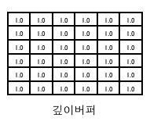
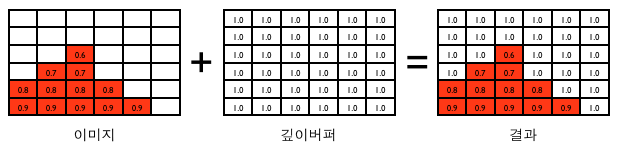
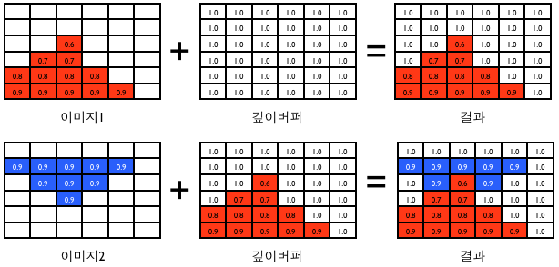

여기서 말하는 깊이버퍼는 레스터라이저에서 실제 동작을 완벽히 설명한 것은 아니고 간략하게 설명한다.

---

클라이언트 해상도의 모든 픽셀은 깊이 라는 값을 가진다.

깊이 버퍼보다 깊이값이 작은 물체들을 화면에 렌더링한다.

여러 정점들이 한 픽셀에 있으면 그중 깊이값이 작은 정점만을 렌더링한다.

깊이는 투영된 정점들의 z값을  무게중심좌표로 계산하여 정해진다.
