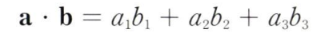
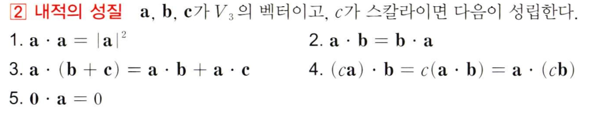
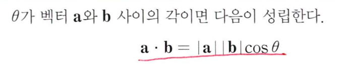
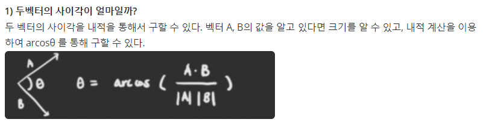
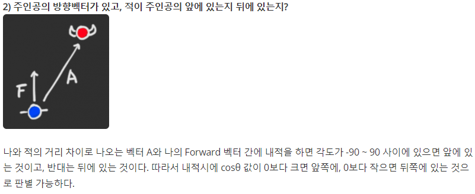
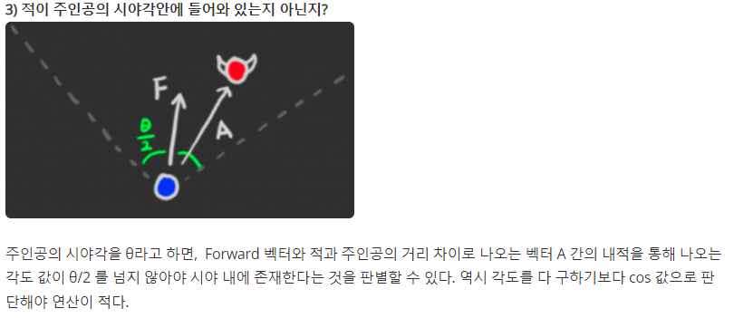
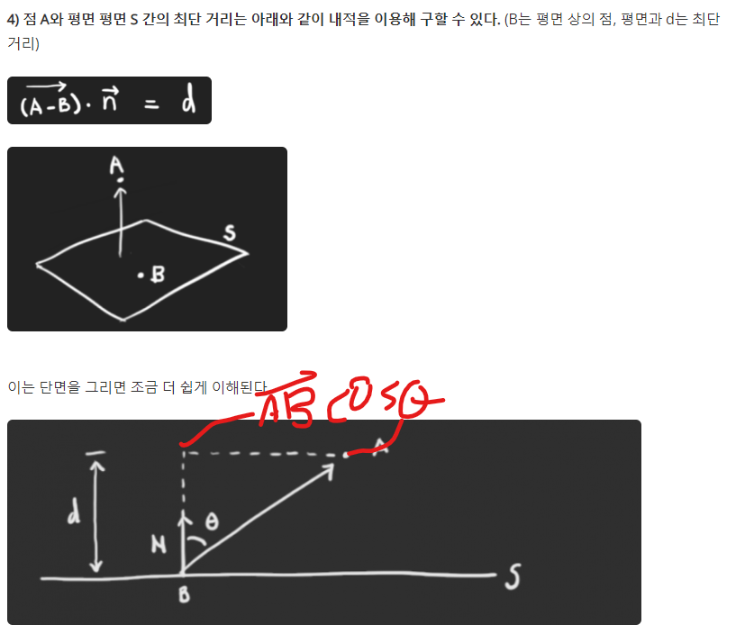
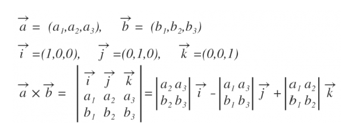
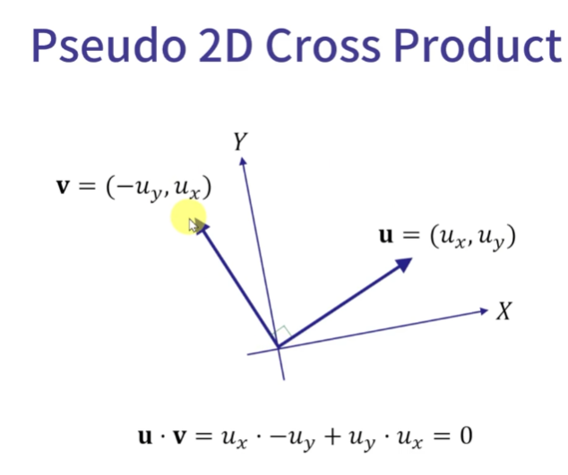

---

<a href="http://rapapa.net/?p=2974">rapapa.net</a>

---

## 내적

3차원 상의 두 벡터가 있을 때 두 벡터를 내적하는 계산은 아래 그림처럼 된다.

여기서 a.b는 내적을 한다는 의미이다

a, b가 해당 결과로 나오는 값은  벡터 a와 b가 이루는 스칼라 값이다.

<b>내적의 성질</b>

여러 정의들을 사용해서 아래의 식이 성립을한다.

\*<b>해당 식을 통해서 세타값을 구할 수 있다. 매우 중요하니 기억하자\*</b>

아래의 예시를 통해 내적을 쉽게 이해해보자

(위의 세타/2는 절대값을 의미한다)

<b>d\^2 = (A-B)\^2 + ABcos세타\^2</b>

두 벡터의 결과

- 양수 : 180도 내에서 같은 방향을 향하고 있다
- 음수 : 180도 내에서 다른 방향을 향하고 있다
- 0 : 직교한다.

## 외적

3차원 상의 두 벡터가 있을 때 두 벡터를 내적하는 계산은 아래 그림처럼 된다.

여기서 a.b는 내적을 한다는 의미이다

해당 결과로 나오는 값은 벡터 a, b에 수직엔 벡터가 나온다

이는 aXb와 bXa는 반대의 결과를 도출한다.

aXb로 나오는 결과는 벡터 a와 b 모두에게 수직하는 벡터가 나온다.

<table header-row="true" header-column="true">
<colgroup>
<col width="105.66958618164062" />
<col width="232.6695760091146" />
<col width="232.6695760091146" />
</colgroup>
<tr>
<td></td>
<td>
내적
</td>
<td>
외적
</td>
</tr>
<tr>
<td>
 계산결과
</td>
<td>
 스칼라
</td>
<td>
 벡터
</td>
</tr>
<tr>
<td>
 교환법칙
</td>
<td>
O
</td>
<td>
X
</td>
</tr>
<tr>
<td>
 결합법칙
</td>
<td>
X
</td>
<td>
X
</td>
</tr>
<tr>
<td>
 분배법칙
</td>
<td>
O
</td>
<td>
O
</td>
</tr>
</table>

2차원에서의 외적이라고 하지만 사실 u를 90도 회전시킨것이다.

