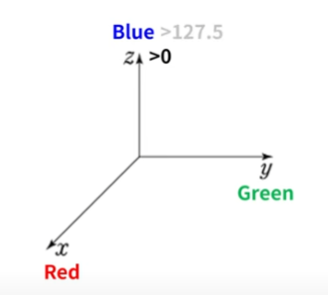

---

노말은 픽셀의 Normal Vector의 방향을 RGB로 표현한 것이다.

- 방향은 Vector값이기 때문에 -1 \~ 1의 값을 갖는다
- 컬러값은 0\~255까지로 표현이 된다.

<b>방향을 컬러로 표현하려면 0을 -1 1을 255로 치환하면 된다.</b>

여기서 높이인 Blue는 높이이기 때문에 0보다 낮은값은 아무런 의미를 가지지 않는다

다시 설명하면 0보다 작은값은 0으로 생각한다는 것이다.

높이가 0이라는 것은 컬러값으로 127.5를 의미하기 때문에

노말맵이 파란색을 띄는 것이다.

노말맵을 매핑했을때 빛 반사를 원하지 않는 부분은  0보다 같거나 작아야한다.
