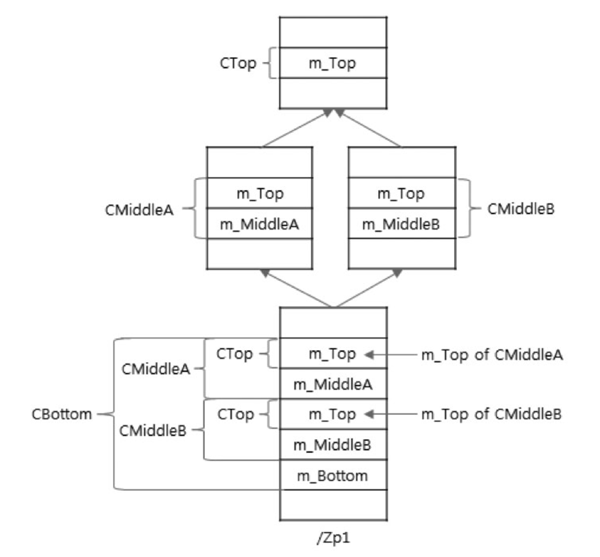
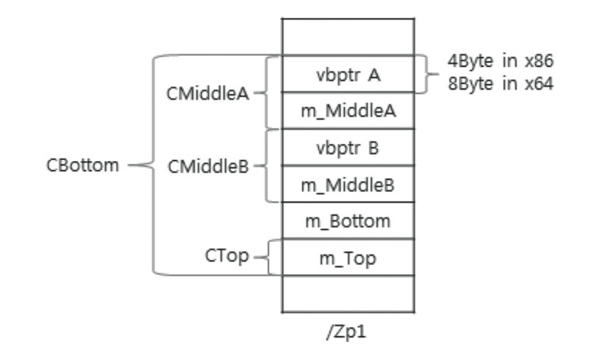
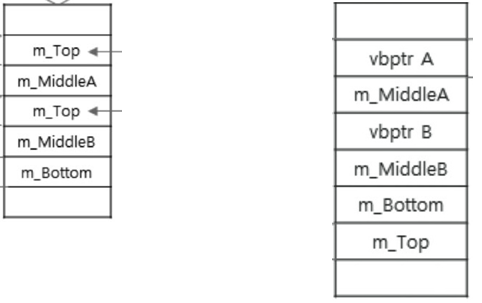
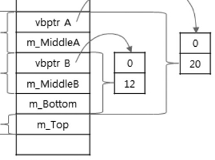
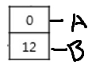

사용하면 객체에 여러 특성을 간편하게 줄 수 있는 다중 상속 근데 문제점이 있다고한다

---

그림만 봐도 문제가 보인다.

(가장 대표적인 다중 상속의 문제인 다이아몬드 구조)



```c++
class CTop
{
public:
	int m_Top;
};
 class CMiddleA : public CTop
{
public:
	int m_MiddleA;
};
 class CMiddleB : public CTop
{
public:
	int m_MiddleB;
}; 
class CBottom : public CMiddleA, public CMiddleB
{
public:
	CBottom()
	{
		m_Top = 10; // ① Error m_Top이 모호합니다!
		m_MiddleA = 21;
		m_MiddleB = 22;
		m_Bottom = 30;
	}
	int m_Bottom;
};
```

- <b>CBottom이 CTop으로 up캐스팅을 할 때 문제가 생긴다.</b>
  캐스팅을 할 때 두 개의 CTop중 어떤 CTop으로 캐스팅 하는지 모호하기 때문

  <i>이 아래부터는 다중 상속의 공통된 문제점이다</i>

- <b>최상위 부모  CTop에 대한 메모리가 2번 잡힌다.</b>
- <b>CTop의 생성자도 두 번씩 호출된다</b>

## 개선 방법

<b>Virtual Base Class로 만든다.</b>

가상 상속을 한다는 소리다.

<b>중복을 제거하고 싶은 클래스에 대해 virtual 키워드를 붙인다.</b>

이렇게되면 생성자 호출도 한 번씩되고 메모리 구조에도 하나만 존재하게 된다.

(메모리 구조에 1개만 있으니 모호한 문제도 사라진다)

```c++

class CTop
{
public:
	CTop()
	{

	}
	int m_Top;
}; 
class CMiddleA : public virtual CTop // CTop중복 없애고싶으니 virtual 붙임
{
public:
	CMiddleA()
	{

	}
	int m_MiddleA;
}; 
class CMiddleB : public virtual CTop// CTop중복 없애고싶으니 virtual 붙임
{
public:
	CMiddleB()
	{

	}
	int m_MiddleB;
}; 
class CBottom : public CMiddleA, public CMiddleB
{
public:
	CBottom()
	{
		m_MiddleA = 21;
		m_MiddleB = 22;
		m_Bottom = 30;
	}
	int m_Bottom;
};

// 기존의 실행 순서
// btm이 mdlA생성자 호출 -> mdlA가 CTop의 생성자 호출
// CTop생성자p실행 -> mdlA실행-> btm 진입 
// -> btm이 mdlB생성자 호출 -> mdlB가 CTop의 생성자 호출
// CTop생성자p실행 -> mdlB실행-> btm 진입-> btm 실행

// virtual 붙인 이후의 실행 순서
// btm이 CTop생성자 호출 -> CTop실행
// btm이 mdlA생성자 호출 -> mdlA실행
// btm이 mdlB생성자 호출 -> mdlB실행
// btm 실행
```

가상 상속을 사용하면 메모리는 아래와 같이 잡힌다 (visual c++기준)



(vbptr은 필자가 붙여놓은 이름이다 대충 virtual based ptr table로 알자)

다중상속을 받은 클래스의 시작주소에 CTop으로 가는 포인터를 두어 참조해서 찾아가게 한다.

따라서 btm 시작 → Top → middleA → middleB가 되게된다.

근데 이게 무조건 좋냐! 하면 또 아닌게 <b>포인터 크기만큼 클래스의 크기가 커진다.</b>

따라서 매우 심플한 클래스를 VBC로 만들면 메모리 절약효과가 크지는 않다.



vbptr에는 아래 그림처럼 오프셋 정보들이 저장된다.





A에는 vbptr이 클래스의 시작으로부터 몇바이트나 떨어져 있는지

B에는 VBC까지 몇바이트나 떨어져 있는지 저장된다.

<b>A에 대해 설명이 더 필요한데 가상함수가 있을때 생기는 vfptr(가상함수테이블)은</b>

<b>vbptr 위에 메모리가 잡히기 때문에 A의 오프셋이생기는 것이다.</b>

예를들어 가상함수가 하나 있으면 a에는 -4가 저장된다 (x86기준)
