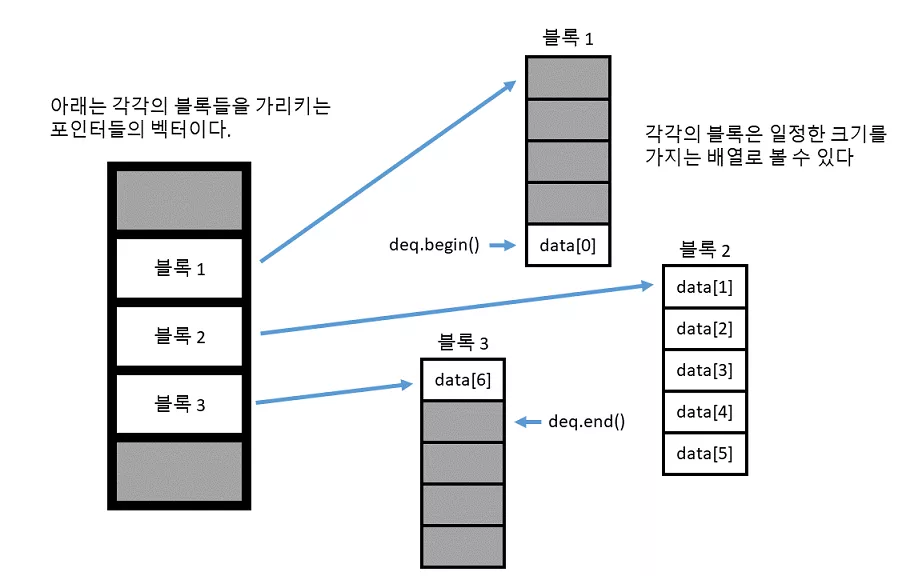
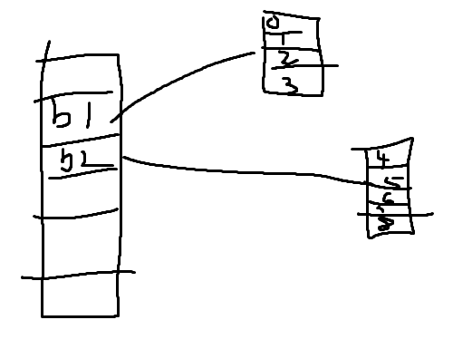
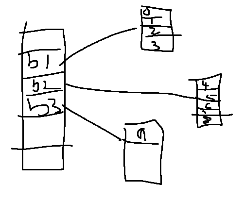

양방향 큐 덱에 대해서 알아보자\~

---

<h3>
<b>Deque (Double Ended Queue) </b>(<s>디큐가 아니다 덱이다</s>)

- 덱은 O(1)로 임의의 원소에 접근할 수 있다
- 맨 앞/뒤에 원소를 추가/제거 하는 작업도 O(1)로 수행이 가능하다
- <b>뭐야 그러면 덱이 짱이잖아요 벡터 왜씀?</b>
  <b>덱 내의 데이터들은 메모리 상에서 완전히 연속적으로 존재하는건 아니다!!</b>

  우선 메모리 내에서의 덱을 보자

  - 메모리 내에서의 덱

이처럼 블록 내의 데이터들은 연속성을 가지고 저장이 되지만

각각의 블록들은 linkedList처럼 작동하고 있다.

</h3>

- 덱은 O(1)로 임의의 원소에 접근할 수 있다
- 맨 앞/뒤에 원소를 추가/제거 하는 작업도 O(1)로 수행이 가능하다
- <b>뭐야 그러면 덱이 짱이잖아요 벡터 왜씀?</b>
  <b>덱 내의 데이터들은 메모리 상에서 완전히 연속적으로 존재하는건 아니다!!</b>

  우선 메모리 내에서의 덱을 보자

  - <b>메모리 내에서의 덱</b>

이처럼<b> 블록 내의 데이터들은 연속성</b>을 가지고 저장이 되지만

<b>각각의 블록들은 linkedList처럼</b> 작동하고 있다.

- 덱의 push back/front 동작
  

  데이터가 위처럼 저장되어 있을때 push back을 하면

  

  <b>새로운 block이 만들어지고 그 블록에 데이터가 들어간다</b>

  (벡터처럼 capacity를 늘려서만든 newVector에 <b>모든 원소 복사해서 옮기는 작업 없다</b>)

  <b>PushFront도 동일하게 동작한다.</b>

  - b0을 만들어서 그 벡터의 맨 마지막 인덱스에 넣는다.

  <b>그림에서 알 수 있듯이 메모리공간이 많이 소모된다.</b>
