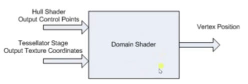
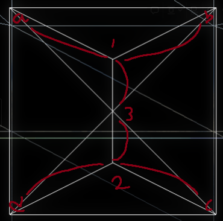

---

도메인 쉐이더는 다른 input으로 들어온 텍스처좌표와 Control point들 (Topology에 맞는 개수만큼)을 이용해 쪼개진 정점들의 위치를 계산하는데 사용한다.

도메인 쉐이더도 어느 쉐이더와 마찬가지로

이전 단계의 쉐이더의 output을 input으로 받는다.

도메인 쉐이더는 추가적으로 쪼개진 vertex들의 <b>텍스처 좌표</b>를 받아온다.

Output으로는 분할된 Control Point들의 모든 좌표를 출력한다.



```c++
struct PatchConstOutput
{
    float edges[4] : SV_TessFactor;
    float inside[2] : SV_InsideTessFactor;
};

struct HullOut
{
    float3 pos : POSITION;
};

struct DomainOut
{
    float4 pos : SV_POSITION;
};

[domain("quad")]
DomainOut main(PatchConstOutput patchConst,
             float2 uv : SV_DomainLocation,
             const OutputPatch<HullOut, 4> quad)
{
    DomainOut dout;

	// Bilinear interpolation.
    float3 v1 = lerp(quad[0].pos, quad[1].pos, uv.x);
    float3 v2 = lerp(quad[2].pos, quad[3].pos, uv.x);
    float3 p = lerp(v1, v2, uv.y);
    
    dout.pos = float4(p, 1.0);
    dout.pos = mul(dout.pos, view);
    dout.pos = mul(dout.pos, proj);
	
    return dout;
}
```

위 코드에서 사용한 2중 선형보간 

그림처럼 3번 보간한다.



<b>도메인쉐이더는 교점 개수만큼 호출된다.</b>
