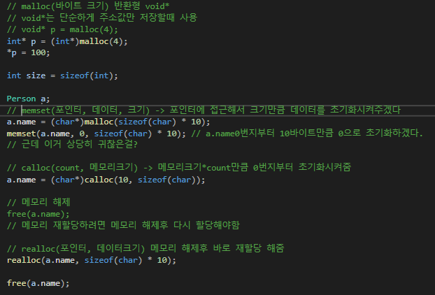

### <b>동적할당</b>

사용자가 어떤 크기만큼의 메모리가 필요한 데이터를 사용할지 알 수가 없음

메모리 Stack영역의 크기는 정해져있음 → visualstuido 옵션창에서 큰기 변경 가능 default 10mb

스택                지역변수

데이터영역     전역변수

↑↑↑얘네들은↑↑↑

프로그램이 실행중일때 메모리가 할당되는게 아니라

<b>프로그램을 실행할때 최초로 한 번만 크기를 정해두고 </b>프로그램 종료시까지 변경 불가

<b>동적할당 </b>- 프로그램 동작중에 메모리의 크기를 지정해주고 사용 할 수 있게 하는것

동적할당한 데이터는 메모리의 Heap영역에 저장된다.

<b>이 데이터들은 메모리에서 해제해주기 전까지 Heap에 남아있다</b>.

<b>동적할당시 사용하는 함수</b>

<ol>
<li>
<b>malloc</b> - malloc(바이트크기), <b>반환형 void\*</b>

malloc(4) ⇒ heap 영역에 4byte 할당하겠다.

int\* p = (int\*)malloc(8) ⇒ heap 영역에 8byte할당할건데 그걸 int포인터로 사용하겠다.

- 메모리 해제 ⇒ <b>heap에 할당한 메모리를 해제한다</b>
  <b>free</b>(동적할당한 변수);

  해제를 꼭 꼭 꼭 꼭 꼭 하자 댕글링포인터 안생기게

  
</li>
<li>
<b>new</b>

int\* ptr = new int; 이럼 끝ㅋ

- 메모리 해제
  delete ptr; 끗

</li>
<li></li>
</ol>
