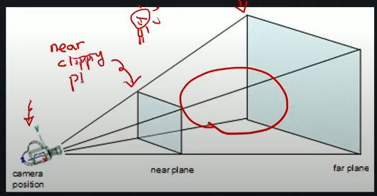
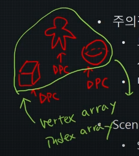

### DrawCall 줄이기

- <b>단순히 Scene(Camera)내 rendering 되는 Obj수를 줄이기 (Reduce Realtime Rendering)</b>

- <b>카메라의 Near, Far Clipping Plane의 거리 줄이기</b>
  

  빨간색 원으로 표시한 부분만 렌더링 된다.

  - <b>Near Clipping Plane</b>
    - Near Clipping Plane 안쪽(너무 가까이 있는)의 mesh들은 렌더링하지 않는다
  - <b>Far Clipping Plane</b>
    - Far Clipping Plane 바깥쪽(너무 멀리 있는)의 mesh들은 렌더링하지 않는다
  - 먼 곳에 위치한 Obj가 안 보이게 Fog 적용
    - Far clipping plane이 가까이 있을때
      갑자기 Obj들이 사라지거나 나오면 부자연스러움을 느낄 수 있기 때문에

      해당 기법을 사용하여 사물이 안개에 가려져있다 나오는 느낌을 줄 수 있음

- <b>View frustum culling</b>
  - 카메라 시야 밖 메시들의 렌더링 막기
- <b>Backface culling</b>
  - 시야 내 메시들의 뒷면 렌더링 막기
- <b>오클루전 컬링 (Occlusion Culling)</b>
  - <b>오클루더(Occluder)</b>
    - 다른 오브젝트를 가리는 역할. 사전 연산을 걸쳐서 데이터를 미리 Bake 해놓는다. 따라서 Static 오브젝트이다.
  - <b>오클루디(Occludee)</b>
    - 오클루더에 의해 가려지는 오브젝트.
    - 오클루전 컬링을 할 때는 공간을 일정 간격의 <b>셀</b>로 나눠놓는다. 이는 오클루더가 가리는 영역의 해상도와 관련이 있다. 당연히 셀의 크기가 작을수록 정확도(해상도)가 높고 오버헤드가 크다.
  - 다른 메시에 의해 가려진 물체들 렌더링 막기
  - 실내에서는 오브젝트들끼리 가려지는 경우가 많아서 큰 이득을 보지만
    야외 Scene처럼 가려지는 경우가 적을 때에는 오클루전 컬링 연산에서 드는 비용이 더 들 수 있다.

- <b>LOD (Level of Detail)</b>
  - 카메라 위치를 기준으로 깊이 값에 따라서 구간을 정한다.
    가까이 있으면 high polygon 멀면 low polygon으로 표현한다.

    (거리에 따라 정점 개수를 줄이고 늘린다는 뜻)

- <b>Obj 렌더링 횟수 줄이기 (보통 lighting issue)</b>
  - realtime light 대신 baked light 사용
    - 라이트 개수 만큼의 drawcall이 필요하다 (포워드 렌더링 기준)
      - 라이트가 2개면 2배 3개면 3배 ㄷㄷㄷㄷㄷㄷ
    - <b>baked light</b>
      - 미리 계산된 라이트
      - 미리 계산된 라이트를 담는 map을 만들어서 사용
      - 보통 static obj에 사용 (위치가 고정된 물체)
      - 이게 디퍼드 렌더링이였네!!
  - 실시간 그림자를 사용하는 경우 (Quality Setting 조정)
  - Reflection Probes의 사용 최소화
    - 반들거리는 물체에 화면 비쳐보이는 것
      - 비용이 매우 크기 때문에 사용을 절제해야함

---

- <b>아틀라스 이미지 사용</b>
  - <b>아틀라스 이미지</b>
    - 하나의 메시에 사용되는 여러 개의 텍스쳐 맵(머티리얼 일수도)을 하나로 합치기
  - Mesh #1 + Material #N Draw call #N을
    Mesh #1 + Material #1 Draw call #1으로 바꿀 수 있다.

- <b>배치 렌더링(batch rendering : batching) 사용 (이게 인스턴싱?)</b>
  - 1 batch = 1 drawcall
  - Mesh #N + Material #1 Draw call #N을
    Mesh #1 + Material #1 Draw call #1으로 바꿀 수 있다.

  - 여러 드로우 콜이 필요한 상황을 하나의 드로우 콜로 묶는 과정이다.
    - Material 기준 : 다른 Obj, 다른 Mesh를 사용하더라도 같은 Material을 사용하면 하나의
      batch 구성이 가능

      (메시들을 더 큰 메시로 합치나봄)

    - 텍스처만 다른 동일한 머티리얼 2개가 있는 경우 : 아틀라스 이미지를 통해 하나의
      Material로 통합 후 batching 사용

  - <b>Batching 기법</b>
    - <b>정적 배칭(static)</b>
      - 움직이지 않는 게임 오브젝트를 큰 메시로 합치고 더 빠른 방법으로 렌더링
      - 주로 배경 obj대상
      - 동적 배칭보다 효율적 : 동적배칭은 매번 vertex 연산이 필요하다.
      - 주의점 : 메모리가 추가로 요구
        <ul>
        <li>
        vertex / index array를 합치기 때문
        </li>
        <li>
        drawcall을 줄이기 위해 obj들을 합쳐서 내부적으로 하나의 메시로 만듦

        이렇게 통합된 메시를 gpu로 가져가서 그대로 렌더링
        </li>
        <li>
        메모리 문제시에 스태틱 배칭의 대상을 줄여야함
        </li>
        <li>

        
        </li>
        <li>
        <b>Scene을 모듈화</b>하여 제작하는 방식 사용 가능

        - Scene을 하나의 단일 메시로 만드는(merging)기법이 있으나
          이는 문제점이 많아서 모듈화 하는 방식을 사용한다

          Scene 전체가 하나의 메시가 되면 Scene의 일부만 보여도 전부 다 렌더링 해야 할 수 있음

          카메라 시야에 걸쳐있는 메시는 화면 밖에있는 부분도 렌더링이 된다.

        - 그래서 같은 메시들을 조합하여 배치해 새로운 오브젝트를 만든다던지 함
          이를 <b>모듈화방식 </b>이라고부름 

        </li>
        </ul>

    - <b>동적 배칭(dynamic)</b>
      - 메시가 충분히 작은 경우 이 기법을 사용하면 메시의 정점이 cpu에서 transform되고
        여러 유사한 메시가 그룹화되고, 모든 것이 한꺼번에 드로우됨

      - 다이나믹 배칭에 쓰이는 정보를 모아 정점 버퍼와 인덱스 버퍼에 담아 한번에 처리
      - 매 프레임마다 오버헤드가 발생한다
        - 그럼에도 불구하고 드로우 콜을 줄임
      - 정점이 너무 많은 메시는 대상에서 제외한다
        - (드로우콜의 이점보다 오버헤드가 더 큼)
