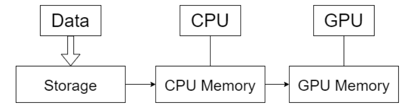

<a href="https://tsyang.tistory.com/79">tsyang.tistory.com</a>

---

<b>Drawcall : cpu가 gpu에게 무엇인가 그려달라고 요청하는 것</b>

- CPU는 현재 프레임에서 무엇을 어떻게 그려야하는가를 결정한다
  그 후에 GPU에게 Obj를 그려달라고 요청한다.

- 요청하기전 레스터라이저(gpu)에서 해당 mesh를 Culling 하고 Culling을 거친 mesh가 렌더링 되기 위해서는
  - cpu가 gpu에게 해당 mesh의 render state를 줘야함
    메시 텍스쳐 쉐이더등의 정보는 스토리지에 보관되어 있다가 CPU가 이를 읽어들여 CPU 메모리에 데이터를 올린다. 그 후 CPU메모리에 있는 정보들을 GPU 메모리로 복사한다. 정보들은 GPU 메모리에 있어야 GPU가 사용할 수 있다.

    

  - DrawCall은 Gpu의 RenderState Table을 변경시키는 과정
  - <b>Renderstate</b>
    - vertex/idxbuffer, VS/PS, Color, texture, material……
    - gpu는 renderstate를 담는 테이블을 가지고 있고
    - 매 프레임마다 renderstate를 cpu에게 받아서 교체한다.
  - 이 과정은 <b>매우 시간이 많이 걸리는 작업이다.</b>

- <b>Draw Primitive Call(DP Call)</b>
  - cpu가 gpu에게 Mesh를 그리라고 명령하는것

<b>결론</b> : <i><b><u>RenderState Change + DP Call = DrawCall</u></b></i>

cpu → gpu로 갈때 서로 다른 기계이기 때문에 번역 작업이 필요하다.

(그래픽 드라이버 프로그램이 이 일을 해줌)

- DrawCall의 숫자가 많으면 병목현상이 일어날 수 있음
  - 숫자가 적어서 1프레임안에 모든 DrawCall을 처리하면 다음 프레임의 Drawcall을 미리 처리할 수 있음
  - 하지만 반대로 너무 많으면 다음 프레임에 Drawcall이 처리되야하는 시점보다 늦게 처리될 수 있음

- DrawCall 문제는 cpubound이다

---

- [DrawCall 줄이기](%EB%93%9C%EB%A1%9C%EC%9A%B0-%EC%BD%9C-%EC%B5%9C%EC%A0%81%ED%99%94-e62dc2b0.md)

---

### DrawCall의 발생

- Mesh #1 + Material #1 = Drawcall #1  (# 개수) ⇒ 이는 쉐이더 처리에 따라 달라질 수 있음
                                                                                 (특정 쉐이더는 여러번 렌더링 하는 경우 있음)

                                                   (toon shader은 내부를 먼저 그리고 외곽선을 한 번 더 그린다)

                                              (이를 멀티패스에 의한 드로우콜이라고 한다)

  - Mesh #N + Material #N = Drawcall #N
  - Mesh #N + Material #1 = Draw call #N (아무런 최적화 없을시)
    - (Mesh #N + Material #N보다 훨씬 좋음 (render state 변경이 적기 때문)
    - dpcall 횟수는 똑같지만 render state change가 적음
      - mesh 개수 = dpcall 횟수
      - material 개수 = renderstate change 횟수
      - <b>비용 </b>
        - dpcall \< render state
  - Mesh개수 / Material 개수 중 많은 쪽이 drawcall 횟수가 된다.
