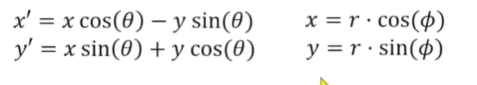
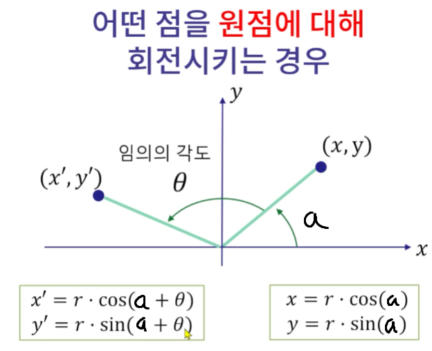
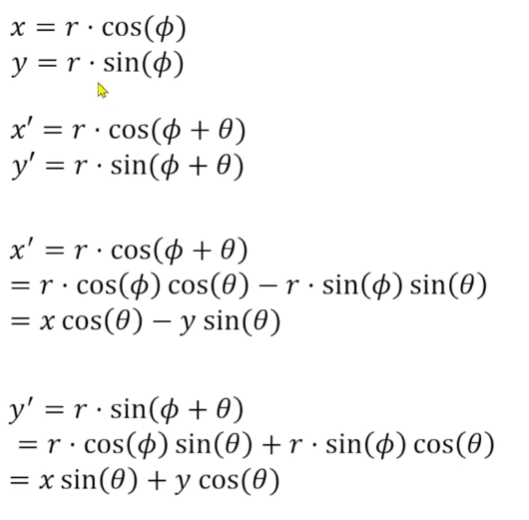

---

# 2D

- <b>Transition(이동)</b>
  단순하게 정점들의 위치를 이동해주면

  메시의 위치가 이동된다.

- <b>Rotation(회전)</b>
  2D에서의 회전은 원점을 중심으로 생각한다.

  

  

  
  <b>식 유도과정</b>

  

  이렇게 x’ y’를 구할 수 있지만

  cos(a) sin(a)를 구하기 위한 계산은 arcos도 써야하고 머리아프다.

  그래서 우리는 식을 전개를 해서

  

  이렇게 해결 할 수 있다.

  

- <b>Scale(크기)</b>
  정점의 벡터 방향으로 scale만큼 곱한 값을 세팅해주면된다.

<b>tip - 공전의 공전 (ex 태양 지구 달)</b>

달은 지구를 공전하고 지구는 태양을 공전할때

달을 공전시키기 위해서는

태양에 먼저 공전(transition → rotation) 후

지구가 태양을 공전하는걸 따라서 하면된다.

<video controls preload="metadata" src="../media/97e4747c255dc06e5340.mp4"></video> <a href="../media/97e4747c255dc06e5340.mp4">2023-08-27_19-38-46.mkv</a>

# 3D
