---

View 벡터와 Game의 Object와의 벡터를 계산해서 물체 표면의 색상값을 스크린에 표현하는 것

물체 표면의 색상은 광원의 색, 세기와 물체의 표면의 색상에 따라서 정해진다.

모든 모니터 픽셀에서 ray를 만들어서 object에 쏜다.

그 ray가 충돌하는 object에 따라 나오는 색상의 결과를 모니터의 픽셀로 지정해준다.

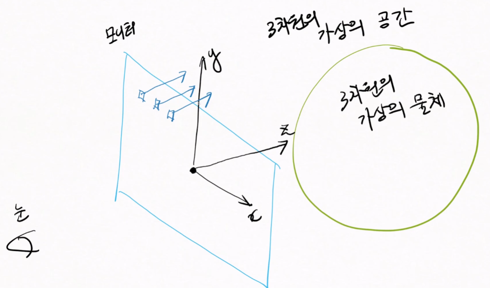

<b>직선(ray)과 구의 충돌</b>

<ul>
<li>
<b>충돌 지점 찾기</b>
</li>
<li>

직선의 방정식과 구의 방정식을 동시에 만족하는 x를 찾으면 됨

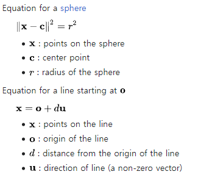

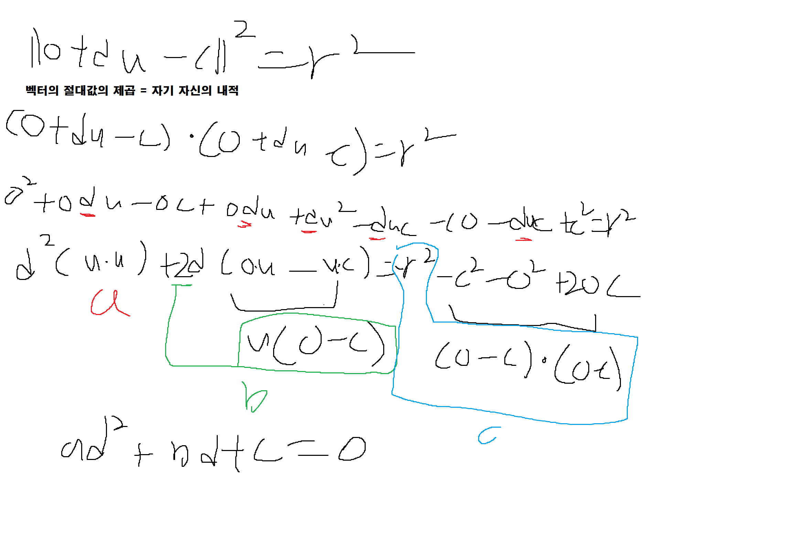

<b>결국 이렇게 유도된다.</b>

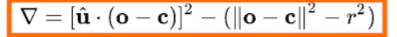

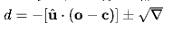

여기서 d는 ray의 start로부터 sphere와 충돌지점까지의 거리이다

따라서

ray.start + ray.dir \* d = 충돌 지점이다.

그리고 hit.point의 normaldir은

sphere의 중심으로부터 hit point로 향하는 벡터이다.

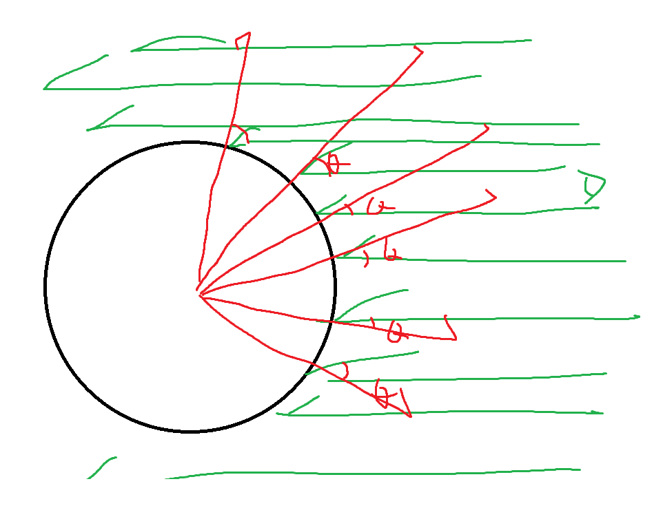

hit.normal과 -ray.dir을 내적하면 두 벡터가 이루는 코사인세타가 나오고

그 각도는 빛의 세기를 담당한다.

현실에서도 빛과 지면이 정확히 마주보고 있어서 코사인세타가 1일때 가장 강한 빛을 발산한다.

현재까지는 light를 계산하지 않았다.

</li>
</ul>

퐁 쉐이딩

<b>Diffuse</b>

위에서 설명한 빛과 물체의 normal을 내적해서 나온 코사인세타를 diffuse의 강도로 처리한다.

이 diffuse는 물체의 색상과 곱해서 오브젝트의 재질을 표현한다.

<b>Specular</b>

Specular는 우리의 눈으로 반사되는 정반사광이기 때문에 우리의 눈으로 향하는 벡터를 구해야한다.

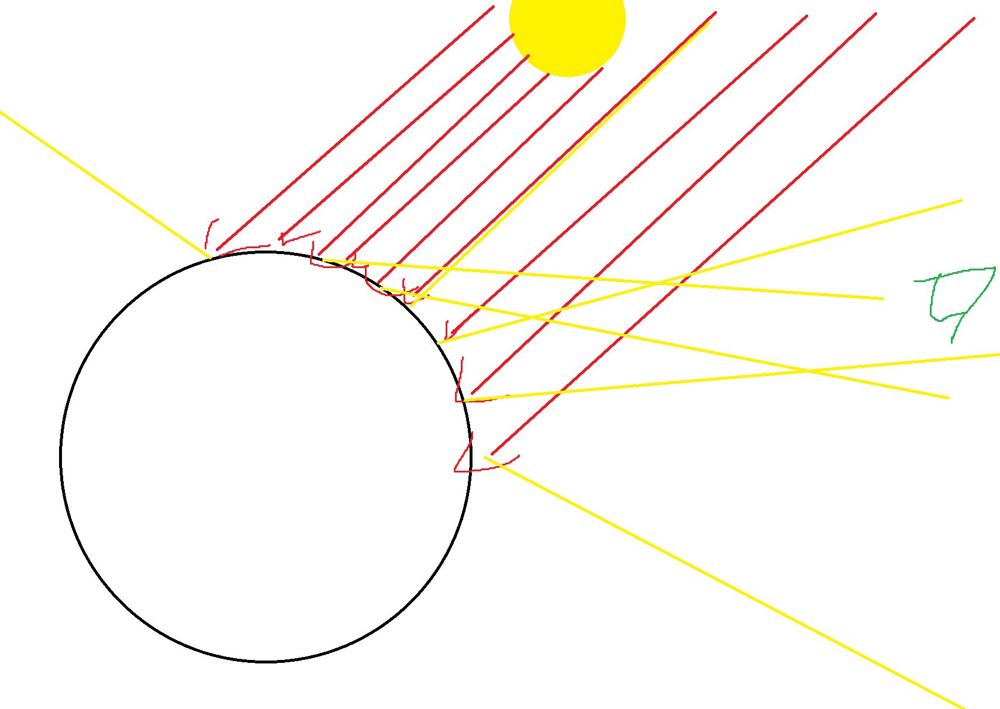

내적과 코사인세타를 이용해 빛이 표면에 닿은 후 정반사 되는 방향을 구한다.

그리고 눈과의 각도를 구해 0이상인 값들을 실질적인 반사광으로 처리한다.

이때 phong모델에서의 specular는 specular 값을 제곱해 그래프를 기하급수로 만들어

빛이 한곳에 모이게 하는 효과를 줄 수 있다.

<b>ambient</b>

빛이 주변은로 산란되는 효과를 주기 위해 결정된 색상에 ambient를 더한다.

<b>ambient없음</b>

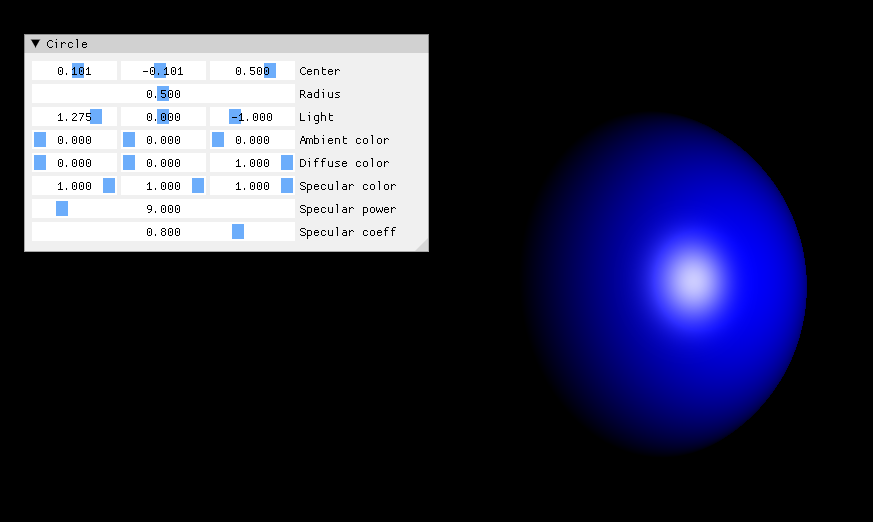

<b>ambient 있음</b>

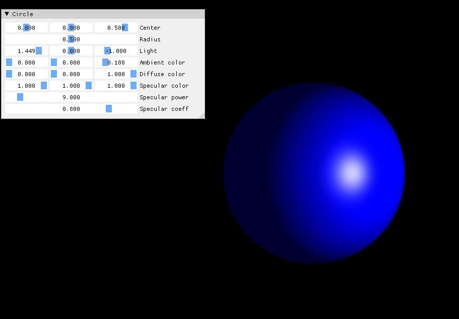

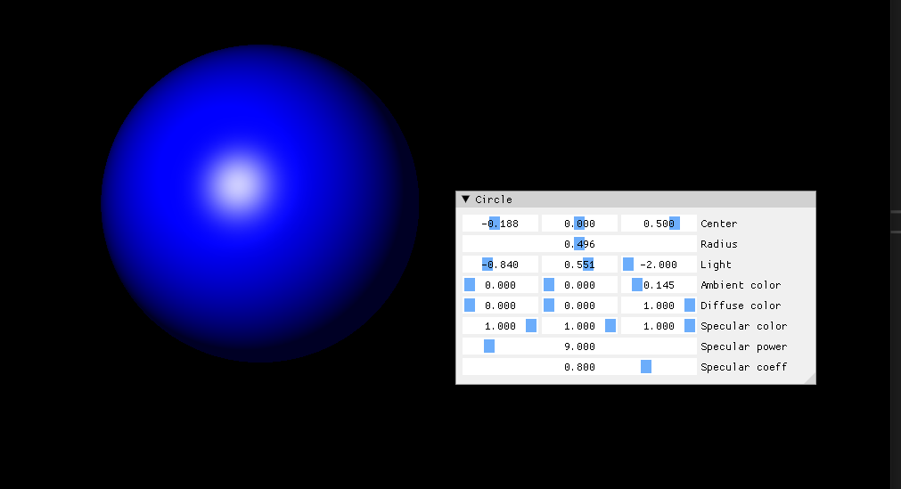

원근투영

위까지의 raytracing은 모든 스크린픽셀에서 ray의 방향이 0,0,1인 z축으로 직선이라고 가정하고 진행했다.

이는 씬의 어떤 오브젝트가 어디에 있던 ray의 충돌이 scale에 따라서 충돌하기 때문에

z축(원근) 전혀 고려되지 않는다

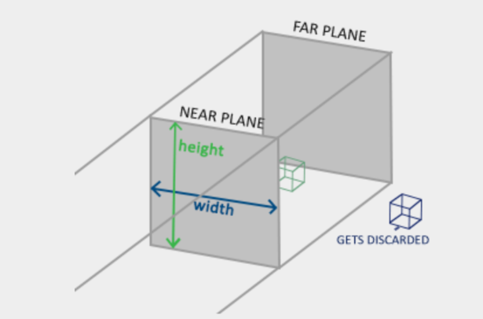

-직교투영의 이해를 돕는 그림-

하지만 원근투영은

눈(point)으로부터 스크린 픽셀에 향하는 vector가 곧 ray의 방향이 되는 것이기 때문에

픽셀마다 특정한 각도가 만들어진다.

이를 <b>시야 각</b>이라고 부른다.

z값이 가까운 오브젝트일수록 먼 오브젝트보다 먼저 감지가 되기 때문에 먼저 그려지게 된다. 

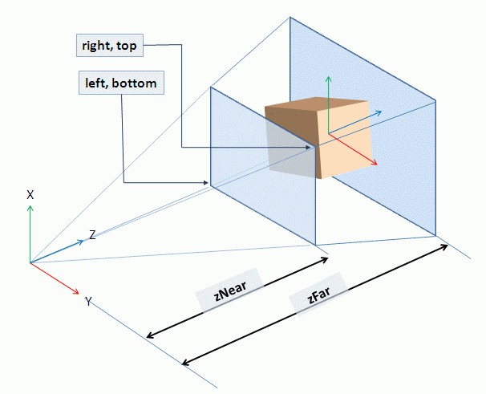

거리에 따른 물체의 크기는 해당 픽셀에서 쏜 ray가 충돌한 물체들중

가장 거리가 가까운 물체만을 처리하면 된다.

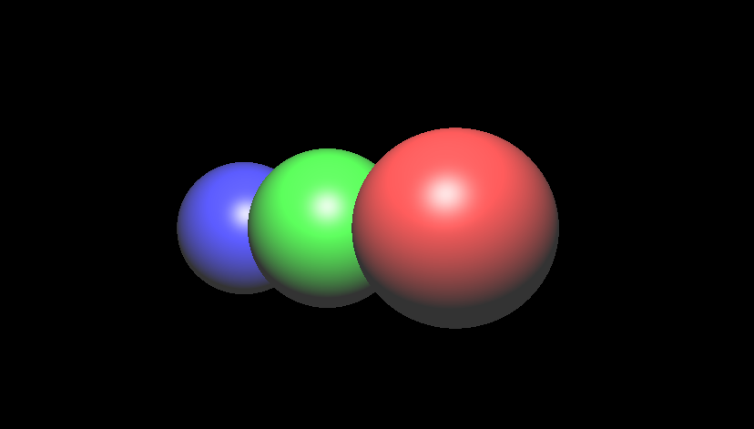

직선과 삼각형의 충돌

기본적인 컨셉은 원의 충돌과 같다.

그냥 레이 쏘고 그 부분에 삼각형 있으면 렌더링 한다.

직선으로부터 삼각형 까지의 거리를 구하고

그 거리를 사용해 충돌 지점을 구한다.

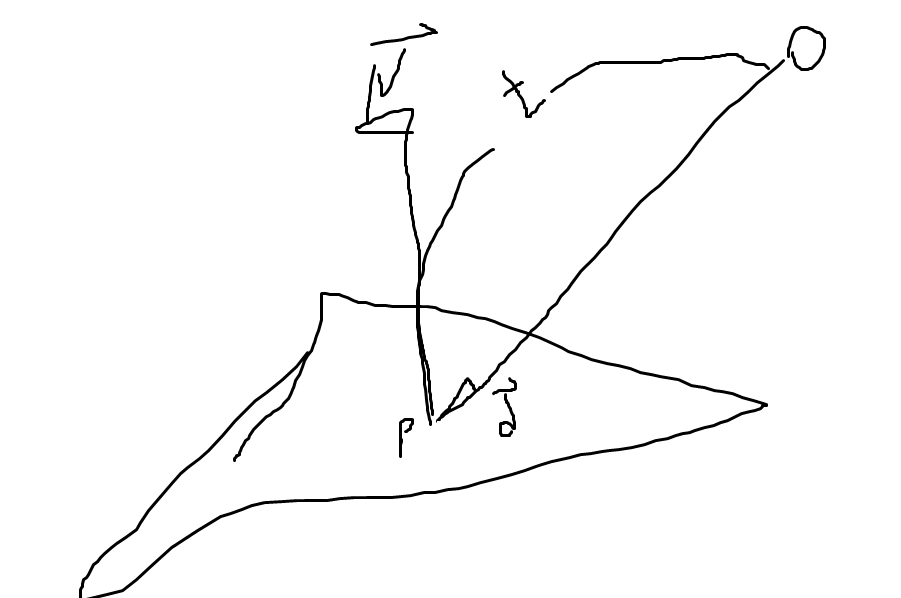

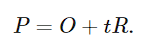

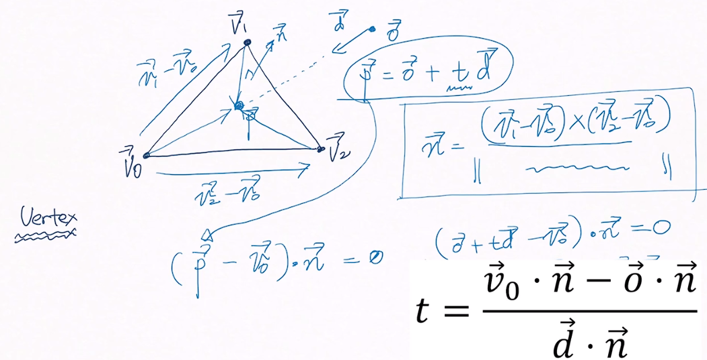

평면위의 임의의 점 p와

p \~ v0 벡터와  삼각형 normal이 수직한다는 성질을 이용해 p를 dot(o + to - v0, n)으로 치환이 가능하다.

무한평면상의 어떤 점과 충돌했을때 렌더링 하겠다\~ 라는 처리를 하고 나면

이제 무한 평면위의 삼각형과의 충돌을 한다는 것을 검사해야한다.

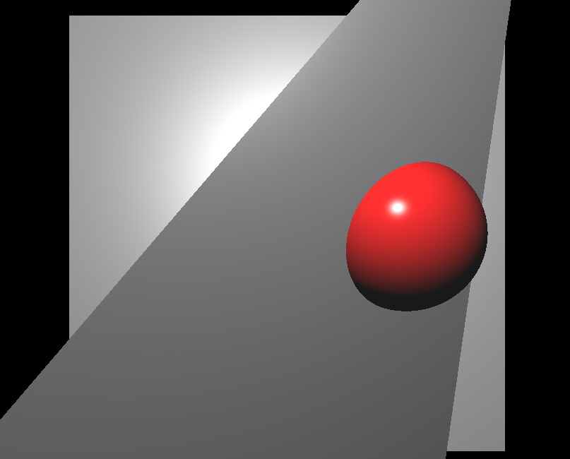

그림자

레이트레이싱에서의 그림자는 간단하다.

ray로부터 빛을 역추적하면된다.

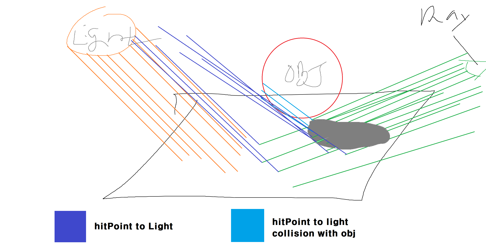

오브젝트와 Ray의 충돌 지점에서 Light 로 향하는 Ray가

다른 Obj와 충돌했을때 이는 빛이 도달하지 못하는것을 의미함으로

해당 픽셀에 그림자를 처리하면 된다. 

보통 ambient만 남긴다고 한다.

<video controls preload="metadata" src="../media/fc80a990f6a03508ba02.mp4"></video> <a href="../media/fc80a990f6a03508ba02.mp4">2023-08-23_21-56-40.mkv</a>

반사

레이트레이싱에서의 반사는 간단하다.

그림자 처리와 비슷하게 screen에서 쏜 ray가 obj에 부딪혔을때

reflect 정도가 0 이상이면 그 hit point의 반사벡터로 ray를 쏜다.

이는 거울이 마주보고있을때 무한히 반사하는 것 처럼

계속 반사 할 가능성이 있기 때문에 컴퓨터를 지키기 위해 재귀 중단 조건을 만들어놓는다.

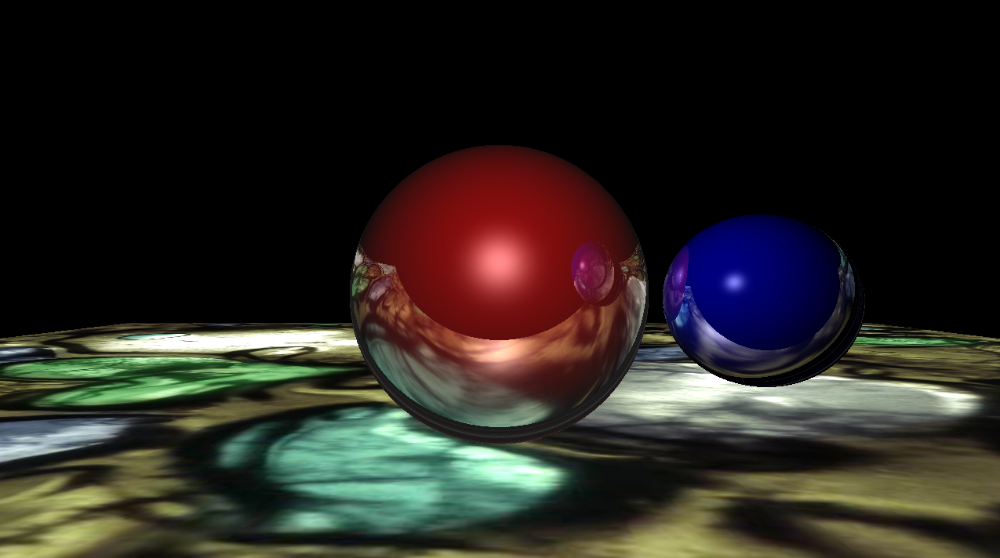

굴절

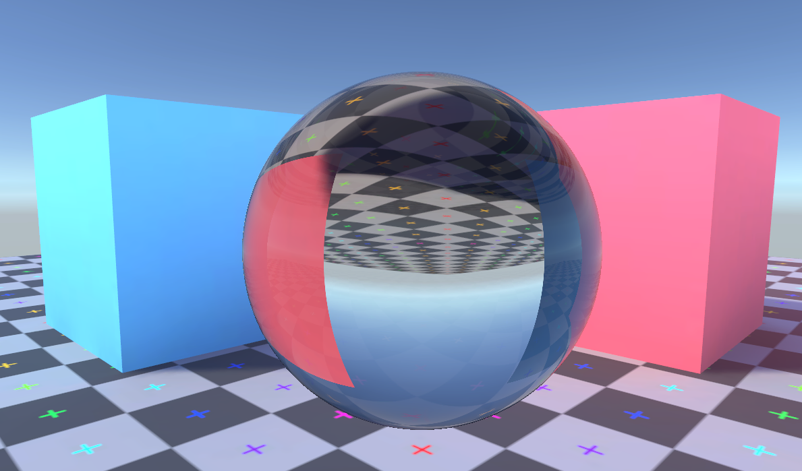

굴절을 표현하면 이렇게 투과되어 보이는 뷰가 뒤집혀져있다.

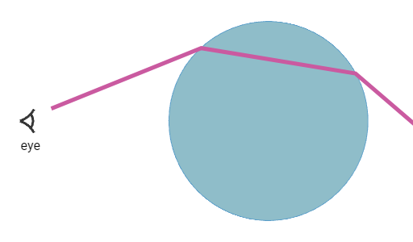

빛의 굴절은 그림처럼 일어난다.

따라서 밑에 있는 뷰가 위에서 나오기때문에 첫번째 그림처럼 렌더링 되는 것이다.

굴절률은 매질마다 다르다.

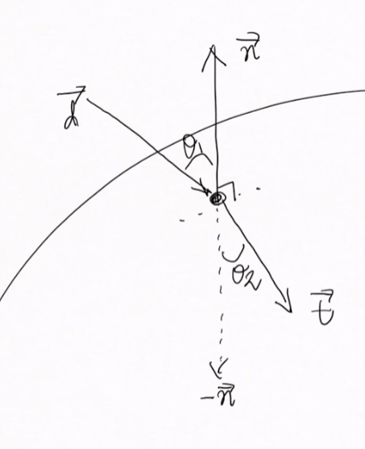

빛이 굴절이 되면 저렇게 입사각과 굴절 각이 생기는데

<b>입사각/굴절각 (세타1/세타2)</b> 은 투과하는 매질에 따라 항상 일정하다.

- 예를들어 공기 to 유리는 1.5이고
  공기 to 물은 1.3 정도가 나온다.

- 반대로 유리 to 공기는 1/1.5이고
  물 to 공기는 1/1.3이다.

  우리는 벡터 t를 구해서 투과 광선 t가 충돌하는 픽셀의 값을 얻을 것이다.

  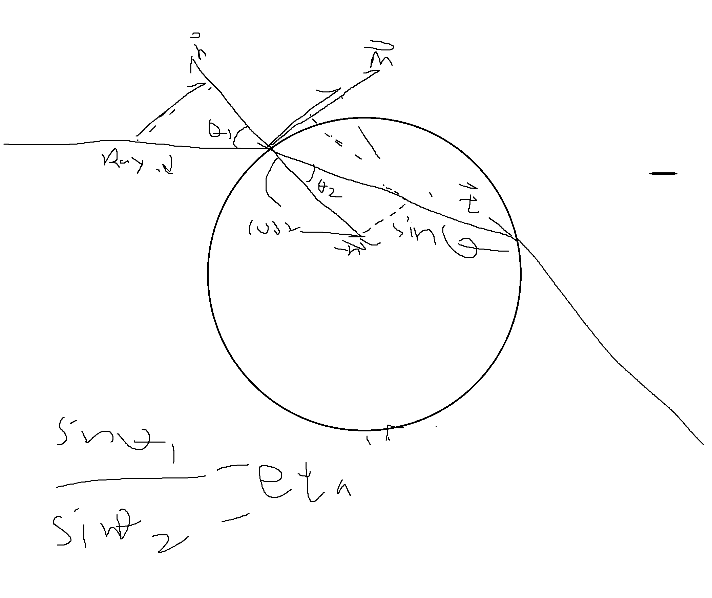

  t 는 요래요래 구해지는데

  좀 더 깔끔하게 정리를 하면

  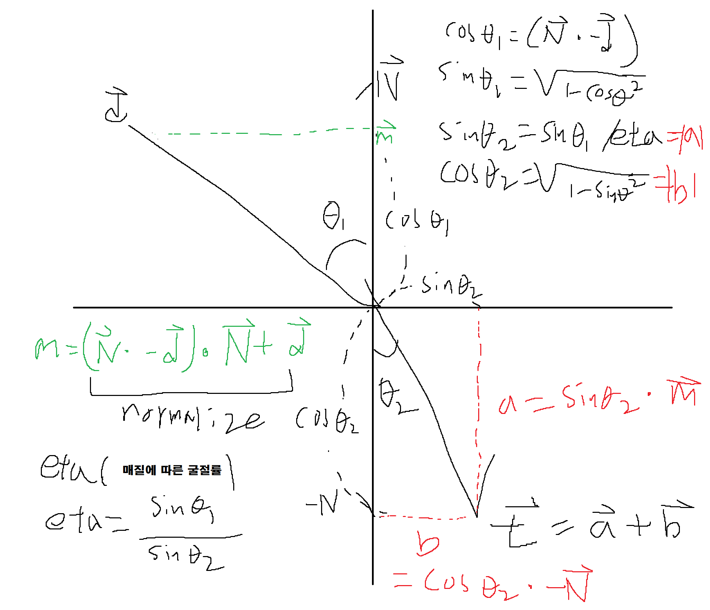

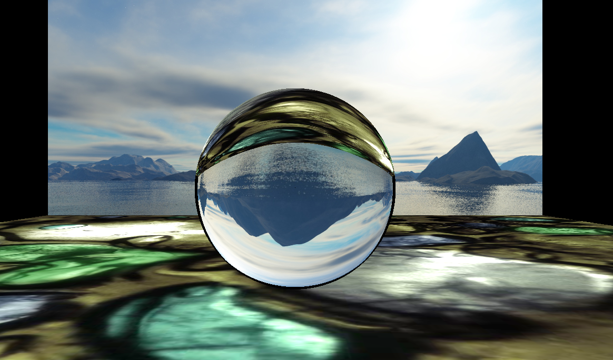

