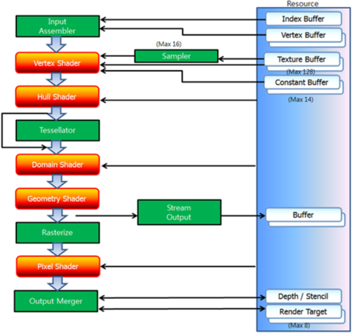
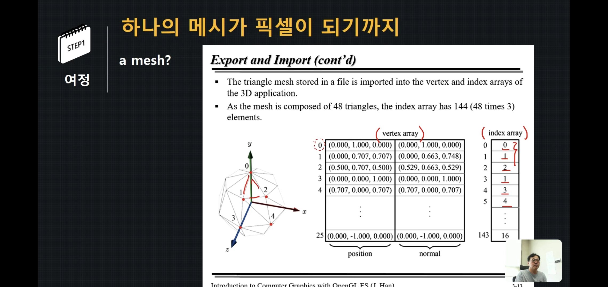
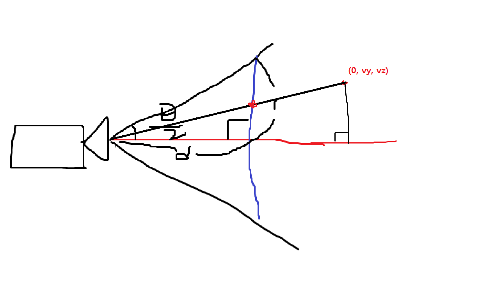
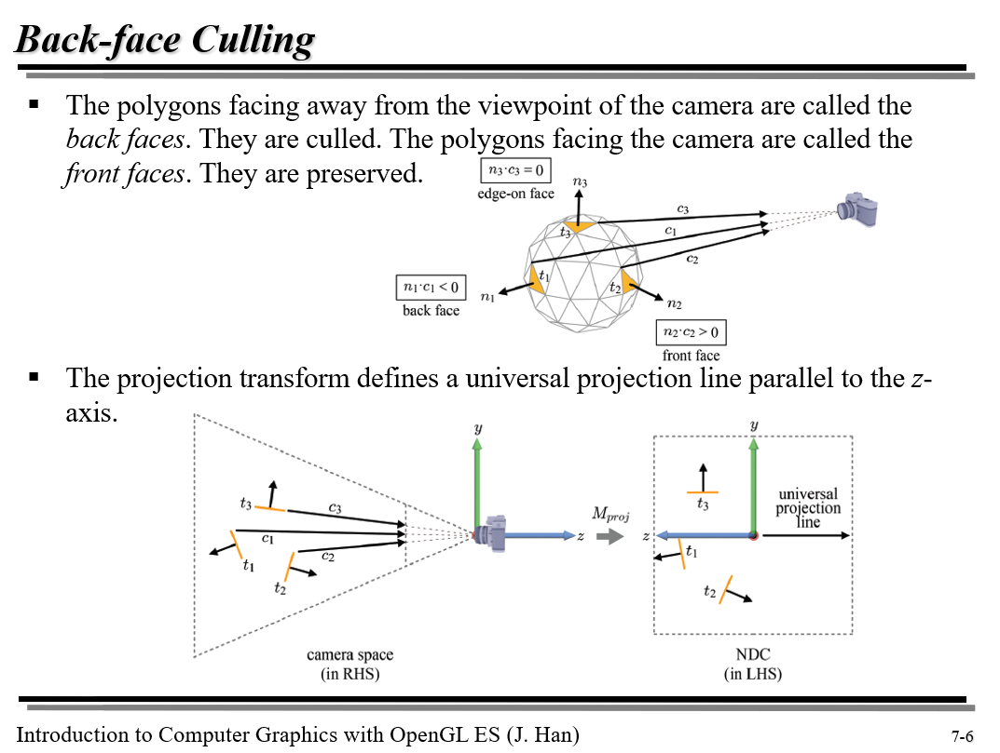
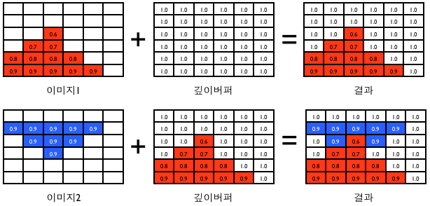

---

<i><b>참고자료</b></i>

<a href="https://koreanfoodie.me/713">koreanfoodie.me</a>

<a href="https://m.blog.naver.com/sorkelf/40160740465">m.blog.naver.com</a>

<a href="https://copynull.tistory.com/242">copynull.tistory.com</a>

<a href="https://sos0911.github.io/cg/CG7/">sos0911.github.io</a>

---

이전에는 pixel 단위로 pos를 결정했었음

<b>direct에서는 2d게임이든 3d게임이든 3d로 데이터 처리함</b>

우리가 2d게임 만들때는 3d데이터를 픽셀단위로 출력이 되게끔 할 것

이걸 우리가 수동으로 해줘야댐

이걸 수동으로 해주는 과정을 <b>렌더링 파이프라인</b>이라고 부른다

좌표계에 있는 도형의 점을 정점데이터라고 부름

이 정점데이터를 gpu가 레스터라이저해주면 픽셀데이터로 변한다

<b>3차원 모델을 window에 나타내려면?</b>

<ul>
<li>
모델의 정보를 GPU로 전송한다
</li>
<li>
모델 : 

- 삼각형의 집합(정점 3개의 집합) : 예시가 아니라 메시 삼각형으로 된거 말하는거
  - 사각형으로하면 찌그러질수 있음(데이터가 같은 평면에 없을 수 있음)
</li>
<li>
이 <b>정점의 집합(정점버퍼)</b>들을 GPU에 전송한다
</li>
</ul>

### 주요 렌더링 파이프라인 과정

- <b>Input Assembler</b>
  - 오브젝트 데이터를 받아오는 과정
  - 정점 쉐이더에 정점 버퍼 전달
  - 정점들을 어떤 방식으로 처리할까 결정함
  - Topology 결정함

  - <b>정점버퍼(array)와 인덱스버퍼</b>

  

  - <b>Index Buffer</b>
    <ul>
    <li>
    정점의 연결정보를 저장하게 위해 정점들의 인덱스를 저장해둔 버퍼이다
    </li>
    <li>
    정점들의 연결 정보를 저장할때 정점들의 쌍을 저장하면 

    데이터가 큰 정점들을 많이 저장하게 됨으로

    <b>vertex buffer</b>에 있는 <b>정점들의 인덱스</b>만 저장한다
    </li>
    <li>
    중복된 정점들을 적게 만들어서 최적화해준다 (한붓그리기 기억해)

    - (렌더링을 할 때 정점들을 이어서 선을 그리고 그 안을 채우는듯?)
    </li>
    </ul>
  - <b>Vertex Buffer (로컬좌표)</b>
    - 정점들을 저장해둔 버퍼
      - 정점에는 xyz 좌표뿐만아니라 다양한 렌더링 효과가 추가되면
        데이터들을 추가시킬수 있음

  - <b>상수버퍼</b>
    - 숫자정보를 들고있는 버퍼
      - 예를들어 플레이어가 이동할 때 정점의 위치를 직접 바꾸는게 아니라
        상수버퍼에서 빼와서 변경해줌

      - <b><u>다양한 값들을 변화시킬때 사용 가능하다</u></b>

- <b>Vertex Shader (정점 쉐이더)</b>
  - 정점 버퍼의 정점들을 3D공간으로 변환시켜준다.
  - 얘를 잘 만들어야지 최적화가 잘됨
  - Input Assembler 에서 받은 정점 정보로 도형 생성됨
  - 게임에서는 캐릭터가 움직이기 때문에 공간, 좌표계를
    실시간으로 변환시켜야 한다.

  - <b>로컬</b> <b>좌표계</b>
    - 모델의 중심이 정점이 되는 좌표계
  - <b>월드 좌표계</b>
    - 모델들이 월드에 나왔을때 모델들의 좌표
  - <b>월드변환 (월드좌표)</b>
    - 로컬 좌표계상의 모델들을 월드좌표계로 변환한다.
    - <b>변환 순서</b>
      <ul>
      <li>
      (크기 → 회전) → 위치
      </li>
      <li>
      정점 변환
      </li>
      <li>
      위치먼저 이동시키고 회전시키면 앵커가 이동한만큼 

      변하기 때문에 회전이 이상하게됨
      </li>
      </ul>
  - <b>카메라변환 (카메라 좌표, 뷰 좌표)</b>
    - 월드변환이 완료 되어있는 모든 물체들은
      우리가 원하는 시점에서 볼 수 있게끔 관찰하는 카메라가 필요함

    - 카메라가 이동/확대축소/회전함에 따라서 모든 물체들이 반대로 움직여주면서
      카메라 공간이라는 개념으로 변환해줘야함

    - 카메라는 Scale변환이 없음
  - <b>투영변환 (원근감) (클리핑 스페이스)</b>
    - 3차원 공간 내의 Obj들을 2차원 평면화면으로 이동시킨다
    - viewing frustum(사다리꼴 3d) 안에 있는 놈들만 렌더링 해줄것
      

      비례식을 이용하여 그림에 보이는 동일한 삼각형 두개를 이용해 파란선위의 점의 좌표를 구할 수 있다.

    - <b>원근투영</b>
      - 멀리있는 물체는 작게
        - 가까이 있는 물체는 크게 변환해주어야 한다.
      - \*<b>물체마다 거리(w값)가 다 다른데 일일히 다 계산해주지 않고 레스터라이저로 넘김</b>\*
        <ul>
        <li>
        투영행렬은 고정적임 

        (유도된 행렬에 vz를 곱해줘서 다 같은 행렬로 만들어주기 때문)

        ex) obj 100개가 이동하면 shader에서는 100개의 행렬로 연산을 100번 해줘야 하기 때문에 모든 정점에 같은 투영행렬을 곱해주고

        레스터라이저로 넘겨서 병렬로 처리해준다.
        </li>
        </ul>

    - <b>직교투영</b>
      - 물체가 멀리있던 가까이있던 상관없이 똑같은 크기로 렌더링한다.
      - 렌더링 우선순위는 변하지만 크기는 변하지 않음
    - <b>투영이 끝나면 비율좌표로 변환한다. → 클리핑 스페이스(클리핑 공간)이라고 부름</b>
      (다른 해상도에서도 똑같은 위치로 사용하기 위해 비율좌표 사용)

    - <b>정점 사이에 잡다한것들이 많겠지만 그건 레스터라이저한테 넘겨서 한번에 함</b>

- <b>Rasterizer (GPU가 알아서 해줌)</b>
  - <b>Clipping (클리핑 - 가위치기)</b>
    - 실제 화면에 보이는 데이터들만 보여주고 화면 밖의 데이터들은 렌더링 안하게 해줌
  - <b>원근 나눗셈 </b>
    - 원근 투영에서 vz를 곱해서 원근을 제외했던 정점들의 vz를 나누어주어서 gpu에서 한꺼번에 처리해준다.
  - <b>픽셀보간</b>을해줌 (정점 사이의 픽셀들의 데이터를 정해줌)
    - <b>UV좌표</b> : 텍스처의 픽셀을 가져오는 위치
      <ul>
      <li>
      어느 좌표에서 픽셀을 가져올지 일일히 다 정해주는게 아니라 

      픽셀보간하면서 정해줌
      </li>
      </ul>
  - 이렇게 만들어진 픽셀 데이터들을 <b>Pixel Shader</b>로 보냄
  - <b>Backface culling</b>
    - 3D모델의 보이는 부분만 데이터로 처리하는것
      <ul>
      <li>
      정점의 <b>노말벡터</b>는 정점들을 순서대로 외적해서 얻게된다.
      </li>
      <li>
      <b><u>모델의 모든 정점의 노말벡터와 그 삼각형의 정점과 카메라와 연결한 선</u></b>을 내적했을때 음수가나오면 보이지 않는 면이기 때문에 렌더링 되지 않는다
      </li>
      <li>
      <b><u>모델의 모든 정점의 노말벡터와 그 삼각형의 정점과 카메라와 연결한 선</u></b>이 이루는 각이 둔각이면 렌더링 안되고 예각이면 됨
      </li>
      <li></li>
      </ul>

    
  - <b>ViewPort (윈도우 화면) (뷰포트 변환)</b>
    - 클리핑 스페이스에서 윈도우 화면(2d ndc 좌표)으로 옮겨줌

- <b>Pixel Shader(Fragment Shader) (ndc 좌표 (최종))</b>
  - 그리고자 하는 도형에 채색효과를 주는 쉐이더(프로그램)
  - 화면에 보여지는 모든 픽셀들에 대해 GPU에서 연산됨
  - 얘도 GPU가 수없이 불러대기 때문에 효율적으로 작성해야함

### <b>잔잔바리 과정</b>

- <b>Tessellator</b>
  - 입력된 정점 정보를 연결하여 삼각형 메시로 변환하는 과정에서 추가 정점을 생성한다.
  - 정점을 늘려 모델의 세부 정보가 더욱 높아지게 되어 3D모델의 곡면을 자연스럽게 처리하고
    곡면 뿐만 아니라 추가적인 빛, 그림자, 거리감등의 효과를 자연스럽게 표현할 수 있게한다.

- <b>Geometry Shader</b>
  <ul>
  <li>
  입력된 정점을데이터를 처리하여 새로운 [<b>Primitive</b>](%EB%A0%8C%EB%8D%94%EB%A7%81-%EC%9A%A9%EC%96%B4%EC%A7%91-63d4e2f7.md)를 생성하거나 

  기존의 프리미티브를 수정한다.

  ex) 입력된 프리미티브(삼각형)를 분할하여 여러개의 삼각형을 생성하거나 변을 굽혀서 곡면을 표현
  </li>
  <li>
  기존의 정점데이터를 변형시킨다.
  </li>
  </ul>

  <a href="%EC%A7%80%EC%98%A4%EB%A9%94%ED%8A%B8%EB%A6%AC-%EC%85%B0%EC%9D%B4%EB%8D%94%EC%99%80-%ED%85%8C%EC%85%80%EB%A0%88%EC%9D%B4%EC%85%98-%EB%B9%84%EA%B5%90-a4118ed9.md">Geometry Shader vs Tesselator</a> 

- <b>Output Merger</b>
  - <b>Render Target</b>
    - 우리가 api에서 사용하던 dc랑 같은개념
      (렌더링 하는 위치)

  - <b>Depth / Stencil Buffer</b>
    - <b>Depth</b>
      <ul>
      <li>
      <b>렌더링우선순위 정해주는곳</b>
      </li>
      <li>
      물체가 겹치는 구간이 확인되면 겹치는 곳만 직교투영 이후 4x4 행렬에 들어있던 

      Z값을 비교해서 우선순위를 정해줌 

      
      </li>
      </ul>
    - <b>Stencil</b>
      - 그 마리오 깨면 별모양으로 화면 쭐어드는거 생각하셈
      - 쿠키 모양틀 생각하면 편함

<b>GPU쓰는이유</b>

- CPU는 한틱에 한개밖에 처리를 못하지만
- GPU는 그래픽 관련 연산을 더 빠르게함

<b>Sampler</b>

- 텍스처를 확대하면 비워져 보이는 픽셀을 채워야하고
  텍스처를 축소하면 최적화를 위해 픽셀을 버려야함

  이를 해주는게 샘플러

- [정점 변환](%EC%A0%95%EC%A0%90-%EB%B3%80%ED%99%98-05bbfc1b.md)

---

### 초등학생도 이해 가능한 <b>요약</b>

<b>Vertex Buffer, Index Buffer 생성</b>

<b>Input Assembler</b>

- 입력으로 들어온 vertex, index 정보를  결합(assemble) 해준다

<b>Vertex Shader</b>

- 정점들을 이동, 회전, 스케일링 해줌

<b>Tessellation / Geometry Shader</b>

- 입력으로 들어온 Geometry를 더 상세화 하는 것

<b>Rasterization</b>

- 기하 (vertex)정보를 pixel 정보로 만든다.

Pixel Shader

- 픽셀 단위로 컬러값을 결정한다.

Output merger

- 화면에 출력될 컬러값을 결정한다. (depth 등등)

---

---

Forward Rending은 빛이 많아질수록 일일히 빛을 추가적으로 연산해주어야 한다.

Deferred Rending은 렌더링객체 생성 이후 렌더 타겟에 한번에 빛 연산을 해준다.
